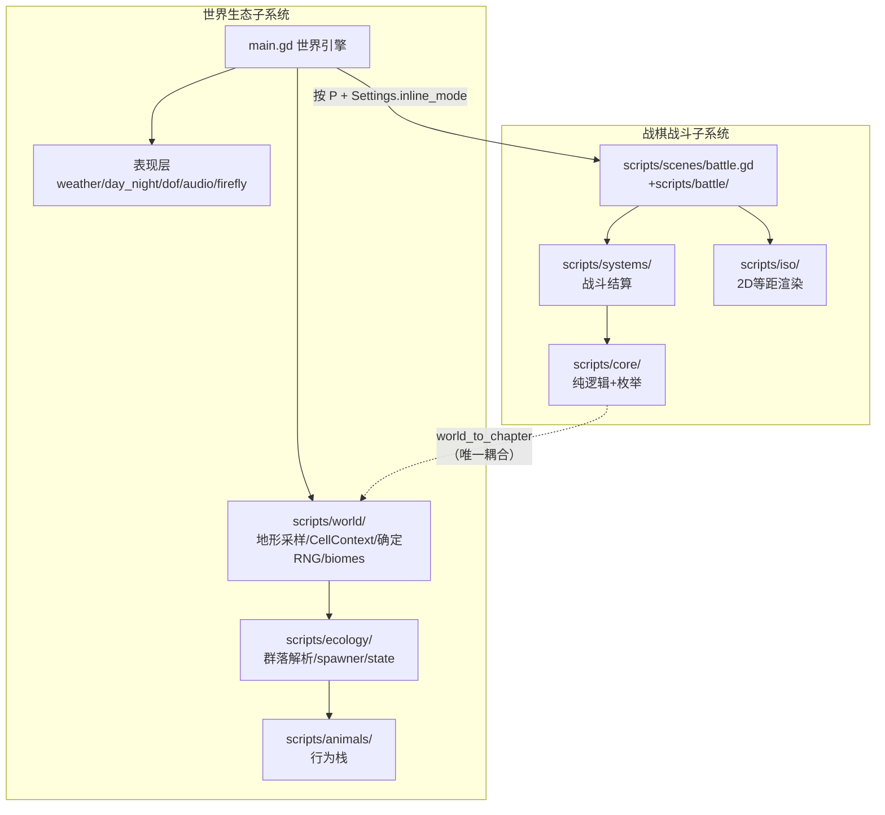

# Pixel World — AI 上下文索引

## 项目简单介绍

Pixel World 是一个 **Godot 4.7（GL Compatibility）/ Node2D** 单体 2D 游戏：在等距(isometric)视口下，按固定种子实时、确定性、流式生成一个"无限"像素生态世界 —— 地形、生物群系(温带/沙漠/雪地/水域/岸)、植物群落、动物(狼群/猪家/蛙群/金鱼/鸟等)、天气(雨/雪)、昼夜与月光、萤火虫、音乐与空间音效。

世界中嵌入了从另一个项目(phaserjs)迁移来的**回合制战棋战斗**系统，按 `P` 即可在玩家所在的真实地形上"就地战斗"(B1)，或切换为独立战斗场景(B2)。两个子系统的唯一耦合点是 `scripts/core/world_to_chapter.gd`。

关键技术栈：Godot 4.7 / GDScript / JSON 数据驱动 / 程序化批量绘制 + 自写 `.gdshader` / 无第三方运行时依赖（唯一 vendored 组件是调试插件 `addons/breakpoint_mcp`）。世界引擎逻辑高度集中在单文件 `main.gd`（3886 行）。

## 约定的规则（高优先级）

- **运行**：`godot --path .`（主场景 `res://main.tscn`）。要求 Godot 4.6+。
- **测试**：无框架。`godot --headless --path . --script res://tests/<name>_contract.gd`；战棋自测跑 `scenes/SkillTest.tscn`。**地形测试用固化 SHA-256 快照检测回归** —— 改确定性会挂。
- **编辑器缓存坑**：改代码后必须删 `.godot/editor` 目录并重启编辑器，否则跑旧脚本。
- **不要往 `main.gd` 加分支**：新 biome / noise / surface / minimap 色 / weather tag 一律走 biome 模块 + 配置 + community。新内容用 `config/ecology/`（manifest + species + communities + biomes），**禁用 `legacy_bundles.json` 与 `metadata.legacy_placement_seed`**。
- **确定性契约**：ID / `stream_key` / legacy `placement_seed` 是存档/世界契约；文件路径与显示名绝不能当随机种子；重排 manifest / 改稳定 ID 需 world version 迁移。
- **战棋双模式**：`Settings.battle_inline_mode`（autoload `Settings`，持久化 `user://settings.cfg`）切换 B1(就地,默认 true)/B2(切场景)。改 `main.gd` 遵守"新增不修改，分支注入"：B1 逻辑一律 `if _battle_active:` 前置短路，不动 B2 路径。
- **代码风格**：tab 缩进；文件名 `snake_case.gd`；顶部带 `## file.gd — 职责` 注释；战棋部分标注对应 TS 源。

> 详细命令、规范与禁忌见 [conventions.md](claude/conventions.md)。

## 文件索引

| 文件 | 用途 | 何时阅读 |
| --- | --- | --- |
| [claude/overview.md](claude/overview.md) | 架构总览、运行时形态、关键设计取舍、仓库边界 | **先读** —— 建立全局认知 |
| [claude/conventions.md](claude/conventions.md) | 命令、代码风格、配置/内容规范、调试方法、安全边界 | 动手改代码 / 加内容前 |
| [claude/module-responsibilities.md](claude/module-responsibilities.md) | 子域职责划分、两条数据流、main.gd 函数簇分区、依赖方向 | 定位"某逻辑在哪/该改哪" |
| [claude/entrypoints.md](claude/entrypoints.md) | 引擎入口、autoload、场景、main.gd 启动流程、战斗入口 | 理解启动 / 入口 |
| [claude/public-interfaces.md](claude/public-interfaces.md) | 玩家输入映射、SceneArgs/Settings 契约、world_to_chapter、信号、MCP 桥 | 理解跨场景/跨模块接口 |
| [claude/dependencies-and-config.md](claude/dependencies-and-config.md) | 依赖、全部配置文件、环境变量、命令行参数、资源目录约定 | 改配置 / 加物种 / 排查版本 |
| [claude/data-model.md](claude/data-model.md) | CellContext/CellState/确定性RNG、群落模型、战棋 UnitData/Weapon/Skill、持久化 | 理解运行时数据结构 |
| [claude/testing-and-quality.md](claude/testing-and-quality.md) | 测试机制、已知验证状态、Lint、质量风险、运行命令 | 跑测试 / 评估改动风险 |
| [claude/file-map.md](claude/file-map.md) | 完整目录树、scripts/ 文件级地图、快速定位表、文件类型统计 | 找具体文件 |
| [claude/faq.md](claude/faq.md) | 14 条常见问题与定位路径 | 卡住时先查 |
| [claude/changelog.md](claude/changelog.md) | 本索引自身的生成/更新记录（最近 5 条） | 查索引何时/how 更新 |

## 模块索引

本仓库是**单体 Godot 游戏**，无多个 `package.json`/`plugin.cfg` 级子工作区。源码子域（`scripts/core`、`systems`、`iso`、`battle`、`scenes`、`world`、`ecology`、`animals` 等）属同一应用，统一在 [claude/module-responsibilities.md](claude/module-responsibilities.md) 描述，不单独建 CLAUDE.md。

唯一独立成册的模块：

| 模块 | 职责 | 索引 |
| --- | --- | --- |
| `addons/breakpoint_mcp/` | vendored 调试插件（loopback JSON 桥接编辑器/运行时给 MCP host，v1.9.1） | [addons/breakpoint_mcp/CLAUDE.md](addons/breakpoint_mcp/CLAUDE.md) |

### 子系统关系

## 扫描状态

- **更新时间**：2026-07-28
- **已扫描**：根目录全部源码结构（`main.gd` 函数级 3886 行、`scripts/` 文件级 104 `.gd`、`tests/` 27 契约脚本归类、`config/`+`data/` 22 JSON 顶层结构、4 `.tscn`、7 `.md`、4 `.gdshader`、`addons/breakpoint_mcp` 全量）。
- **跳过**：`.godot/`（引擎生成，gitignore）；二进制素材 `.png`(197)/`.mp3`(8)；引擎生成物 `.import`(180)/`.uid`(108)；`.obj`/`.mtl`(2+2) 网格。
- **覆盖率**：源码与配置结构 ~100%；二进制素材内容 0%（仅统计）。
- **未执行**：27 个契约测试的运行态验证（需 Godot 环境）；HANDOFF 引用的外部 `phaserjs/` 源项目不在本仓库。
- **下一步建议**：① 跑一轮 `tests/*_contract.gd` headless 确认基线；② 补扫 `scripts/core/`+`systems/` 函数级签名（若重构）；③ 补 `shaders/*.gdshader` 参数（若调视觉）。详见 [claude/changelog.md](claude/changelog.md)。
