# Pixel World

**English** | [简体中文](README.zh-CN.md)

An isometric world experiment inspired by a pixel-art Minecraft: the map is generated infinitely, in real time, and deterministically as you explore, while ecosystems, communities, animals, and weather shape the world.

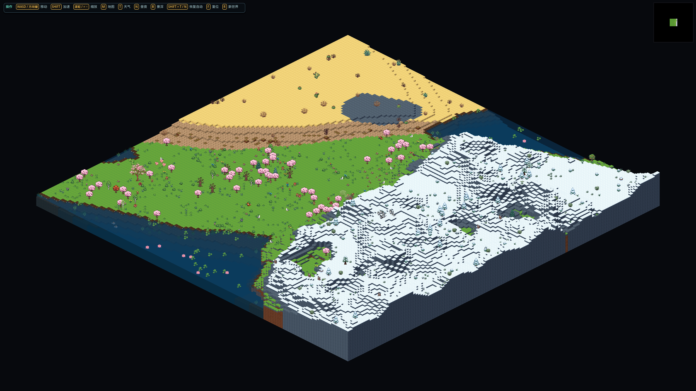

## Highlights

- **Infinite real-time generation**: A fixed seed and streaming window generate only the world near the player while preserving explored map data.
- **Modular ecosystems**: Temperate, desert, snow, water, and shoreline ecosystems are independently configurable and ready for future biomes such as volcanoes and ice fields.
- **Biological communities**: Wolf packs, pig families, frog clusters, lily ponds, and plant patches have their own composition and spatial distribution.
- **Animal behavior**: Land and aquatic animals have individual animations, habitats, and social habits. Birds walk on the ground, take flight when startled, and cross the sky in flocks.
- **Dynamic atmosphere**: Rain, snow, precipitation feedback on water, a day-night cycle, moonlight, fireflies, music, and ambient audio.
- **Isometric rendering enhancements**: Transparent water, correct depth ordering, smart terrain cutaways, pixel-safe camera smoothing, and tilt-shift-style depth of field.

## World Generation: Independent Modules, Infinite Continuity

A biome is more than a different surface texture. Temperate, desert, and snow environments each have an independent `BiomeModule` responsible for height adjustments, climate classification, surface materials, and ecology tags. Plains, hills, swamps, mountains, and oceans are configurable base landforms. Named noise fields and jittered Voronoi regions define the large-scale structure, while height, ridges, slopes, and terraces are continuously blended across neighboring regions to avoid hard seams.

```text
World Seed
  └─ Named Noise + Jittered Voronoi Regions
      └─ Biome Modules (height / climate / surface / tags)
          └─ CellContext (landform / elevation / water depth / shoreline)
              └─ Community Resolver (flora / fauna / ambient communities)
                  └─ CellState → isometric rendering and streaming
```

- **On-demand generation**: Cells are instantiated only when they enter the streaming window around the player. The entire world is never created in advance.
- **Coordinate-level determinism**: The same seed and coordinate always produce the same result, so exploration in any direction remains stable and unique.
- **Pluggable biomes**: Every ecosystem has its own script and configuration. Deserts can shape low rolling dunes, while the snow line is controlled by both elevation and temperature.
- **Natural transitions**: Low-frequency macro noise creates large continuous deserts. Detail noise then blends their edges through rock, sand, parched soil, sparse grass, and plains.

<table>
  <tr>
    <td width="33%">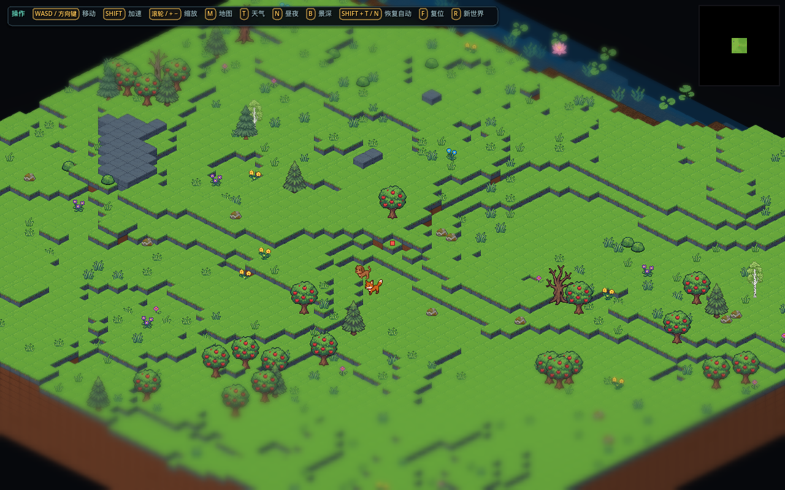</td>
    <td width="33%">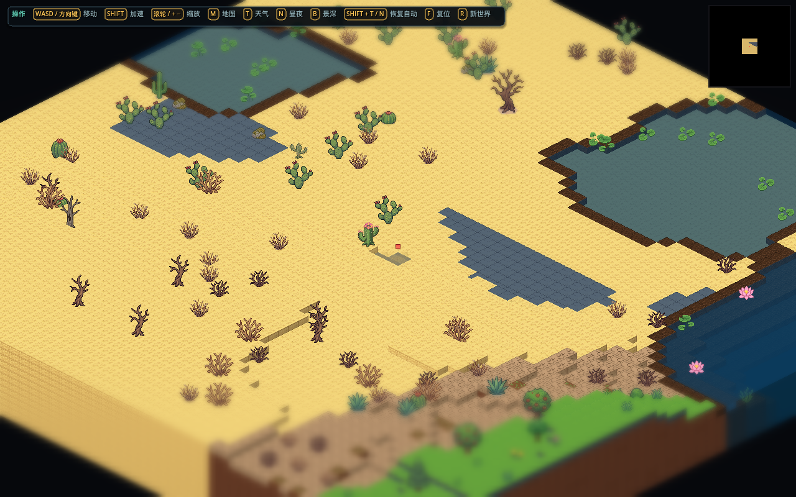</td>
    <td width="33%"></td>
  </tr>
  <tr>
    <td align="center">Temperate grasslands and woodlands</td>
    <td align="center">Deserts, oases, and arid transition zones</td>
    <td align="center">Snowfields and high-elevation mountains</td>
  </tr>
</table>

## Flora and Fauna Follow Environmental Rules

Every cell first receives a data-only `CellContext` describing its biome, landform, elevation, water depth, shoreline state, and surface type. The ecology resolver then applies every community whose habitat rules match. Plants and animals are therefore not scattered independently across the map: they live in suitable environments.

- An irregular parched-soil belt separates desert from plains, while the first land layer beside water automatically becomes moist soil.
- Underwater, water-surface, and shoreline placement are distinct habitats. Aquatic grass grows on shallow lakebeds, lilies and lotus flowers occupy the surface, and willows, reeds, flowers, and mossy rocks favor the shore.
- Snowy tree pools primarily contain several conifer variants and use independent density controls.
- Four mushroom types are retained only when a tree exists within four cells; mushrooms selected in open ground are replaced by ordinary grass.

<table>
  <tr>
    <td width="50%">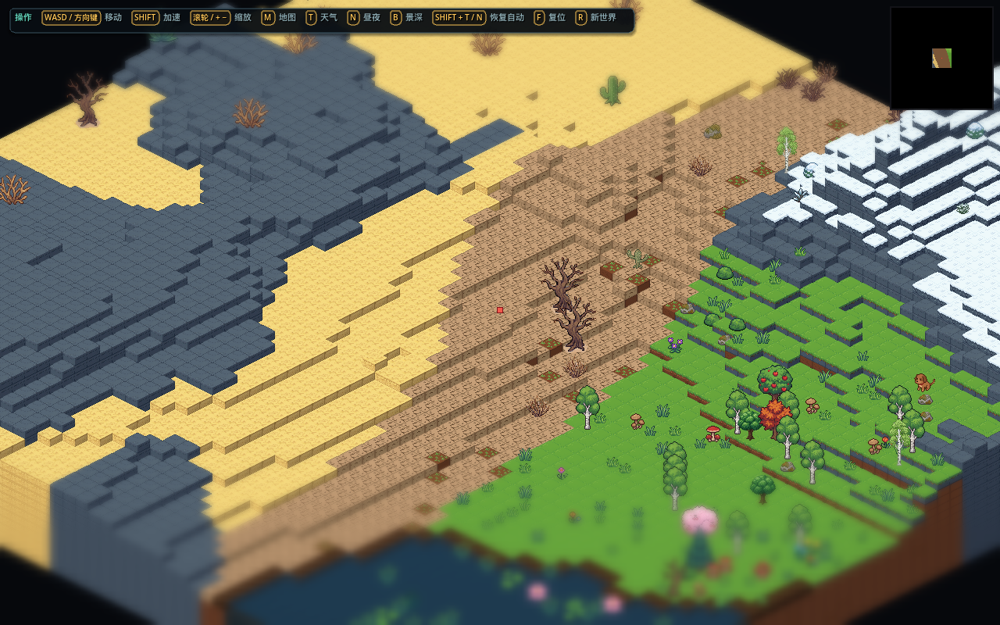</td>
    <td width="50%">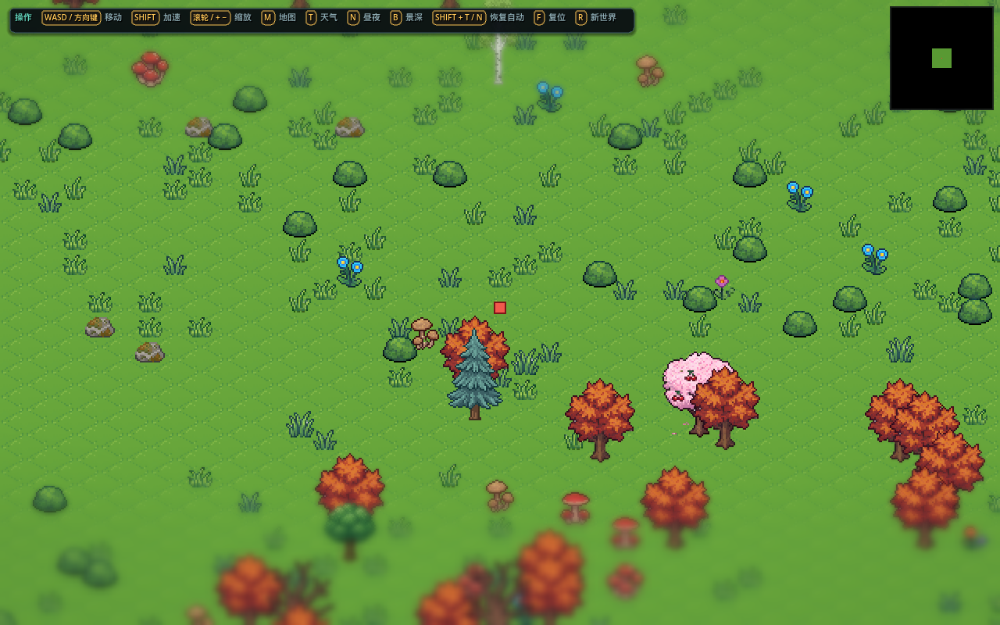</td>
  </tr>
  <tr>
    <td align="center">Rock and sand → parched soil → plains and shore</td>
    <td align="center">Four mushroom types distributed along woods and forest edges</td>
  </tr>
</table>

## Different Plant Communities Within the Same Biome

A temperate region does not receive a uniform mixture of plants. Trees, groundcover, and decorations use independent noise layers. Each macro-region then selects a dominant species from the world seed. The dominant species owns most placements while a small number of companion species remain, allowing neighboring regions to form cherry, apple, broadleaf, or conifer groves.

When multiple ecological objects compete for one cell, stable conflict weights select exactly one. Configuration order and the direction from which the player enters an area do not change the result.

<table>
  <tr>
    <td width="33%">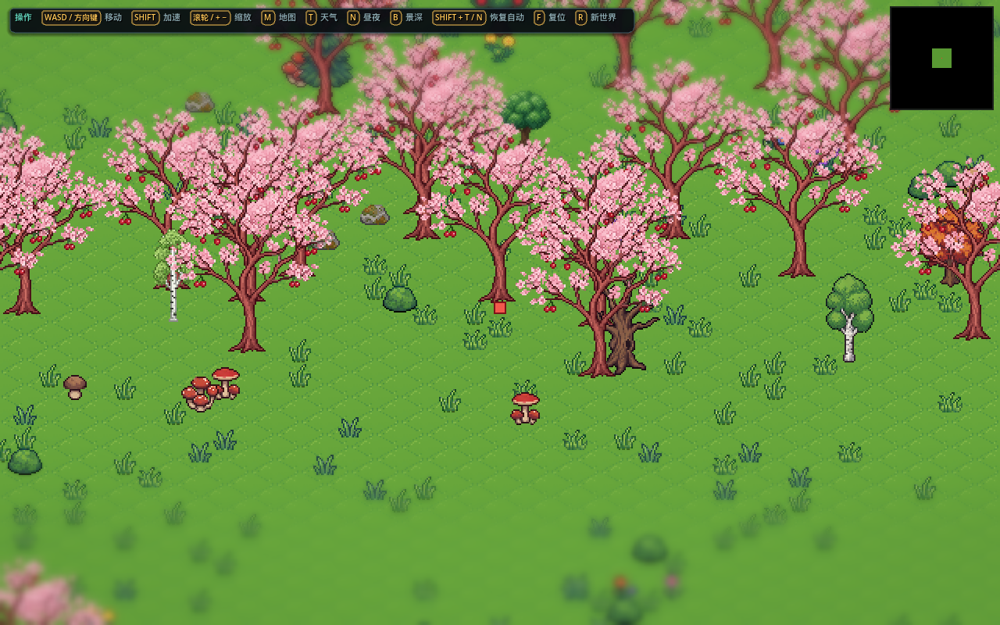</td>
    <td width="33%">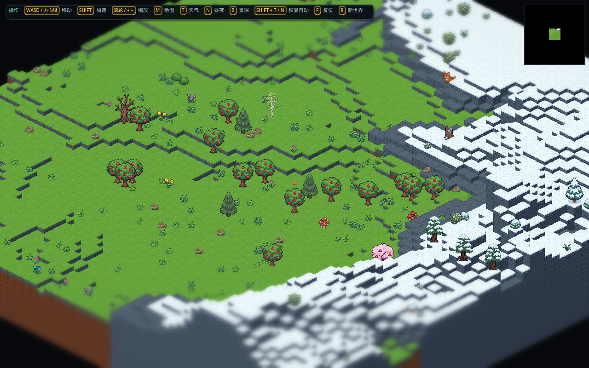</td>
    <td width="33%">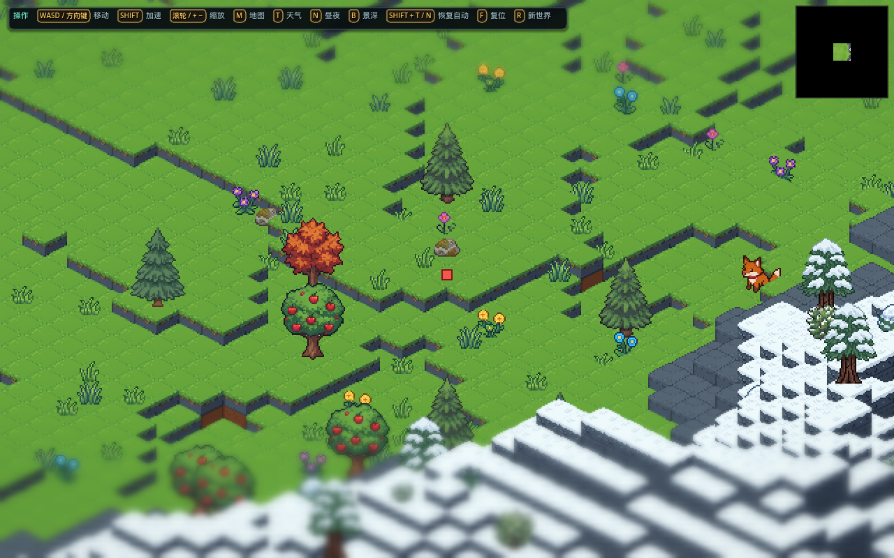</td>
  </tr>
  <tr>
    <td align="center">Cherry grove</td>
    <td align="center">Apple grove</td>
    <td align="center">Temperate conifers and companion trees</td>
  </tr>
</table>

## Animals Have Habitats, Instincts, and Social Habits

Animal communities are generated from deterministic anchors, member composition, population size, activity radius, and habitat constraints. Returning to the same area produces a consistent population. Each species has its own range and movement preferences:

| Animal | Habitat and behavior |
| --- | --- |
| Wolf / Husky | Snow only; packs contain 7–8 wolves, with a 35% chance of including one husky |
| Frog | Groups of 2–4; spawn within 10 cells of water and continue to favor the shore while roaming |
| Goldfish | Same-species groups of 2–3 in temperate shallow water; each territory chooses common, blue, or patterned goldfish |
| Crucian carp | Rare groups of 2–3 in temperate rivers and lakes; tolerate deeper water than goldfish |
| Salmon | Cold, relatively deep water only; fast-moving schools of 2–4 |
| Bird | Sparse birds walk on temperate ground and leave immediately when approached; most flyovers are staggered V-shaped flocks of 3–6 |
| Pig | Temperate families of 2–4 that actively avoid snow |
| Dog / Fox | Solitary temperate animals that actively avoid snow |

All animals instinctively avoid humans. When the player enters their six-cell alert radius, animals favor directions away from the player and flee at roughly twice their normal speed. Social animals also remain influenced by their group center, so a roaming group does not immediately scatter.

Aquatic animals reuse the same community and behavior systems but can spawn and move only on water cells, subject to species-specific depth and climate ranges. Fish remain at least one cell from shore. Large bodies of water naturally contain more fish because they cover more deterministic territories, while small ponds contain fewer. A foreground water-layer shader hides most of each fish according to water depth, leaving its back and fins clearest.

Birds are managed by a dedicated ambient presentation module. At most one ground bird occupies each logical cell, while nearby cells can still form a loose group. Startled birds and flyovers integrate motion in world space, so camera smoothing only reprojects them and cannot make them accelerate or freeze. About 72% of flyovers create staggered V-shaped flocks of 3–6 birds.

<table>
  <tr>
    <td width="50%">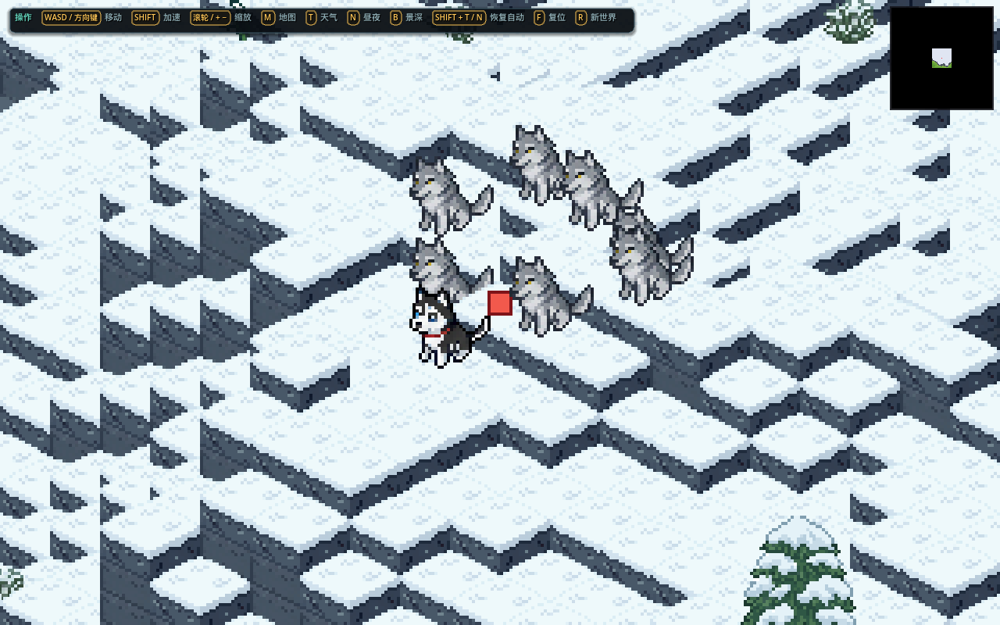</td>
    <td width="50%">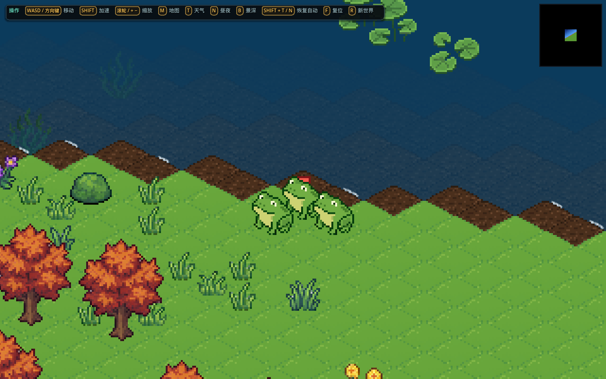</td>
  </tr>
  <tr>
    <td align="center">A snowfield wolf pack, occasionally joined by a husky</td>
    <td align="center">A shoreline frog group and lily-pond community</td>
  </tr>
  <tr>
    <td>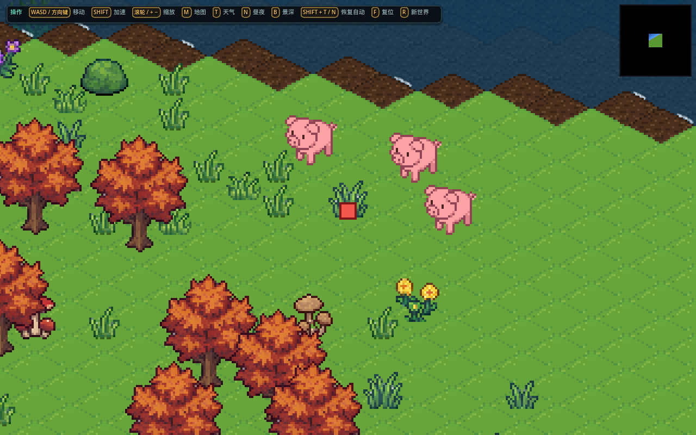</td>
    <td>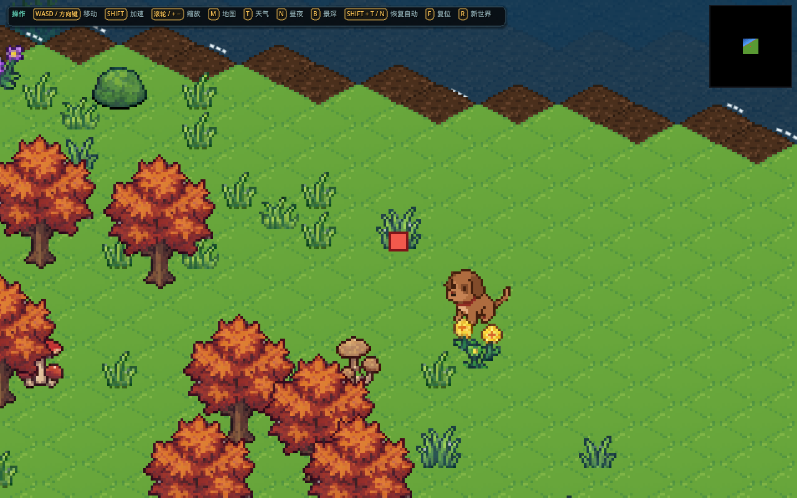</td>
  </tr>
  <tr>
    <td align="center">A small pig family</td>
    <td align="center">A solitary dog roaming the temperate biome</td>
  </tr>
</table>

<table>
  <tr>
    <td width="33%">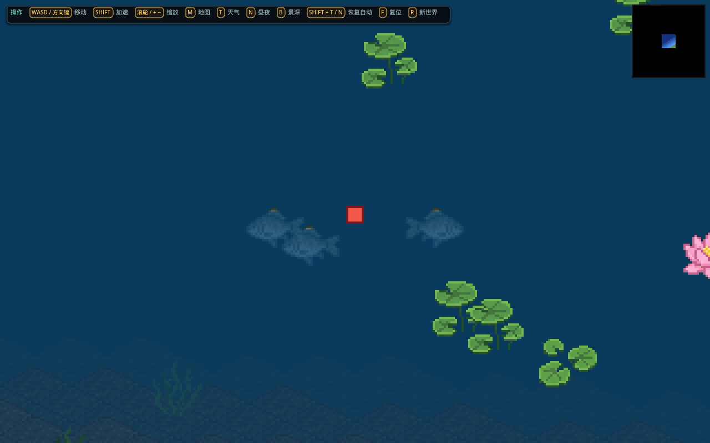</td>
    <td width="33%">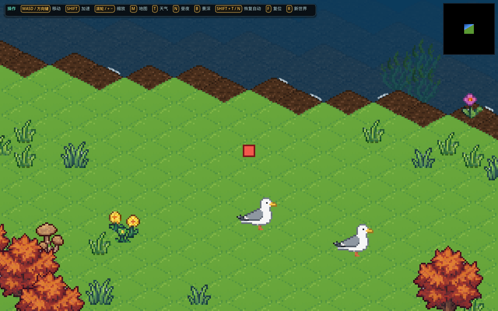</td>
    <td width="33%">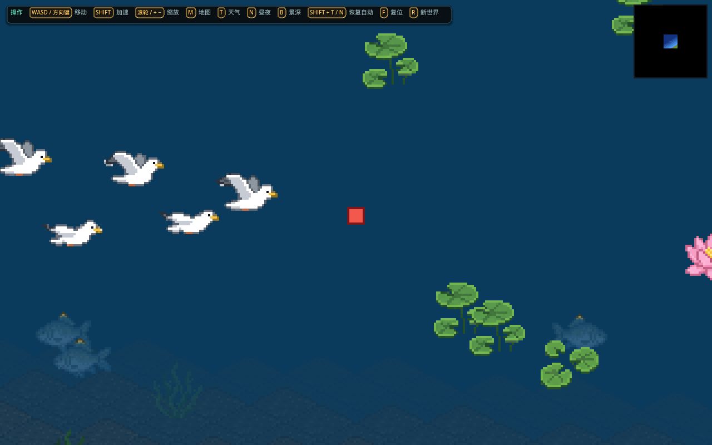</td>
  </tr>
  <tr>
    <td align="center">Depth-aware fish schools obscured by the water layer</td>
    <td align="center">Ground birds occupying separate cells without overlap</td>
    <td align="center">A staggered flock flying in world coordinates</td>
  </tr>
</table>

## Weather, Day and Night, and Water

Rain and snow are simulated in world space and do not drift backward with the camera. Raindrops produce feedback when they strike water. Thin, broken shore waves mark the land-water boundary: each wave is split into five or six segments, alternating groups crossfade and move slightly toward the shore, and one of three stable curve profiles provides shape variation. The result suggests a slow tide instead of a rigid white outline. Night retains cool moonlight, with small firefly lights appearing in suitable temperate habitats.

<table>
  <tr>
    <td width="33%">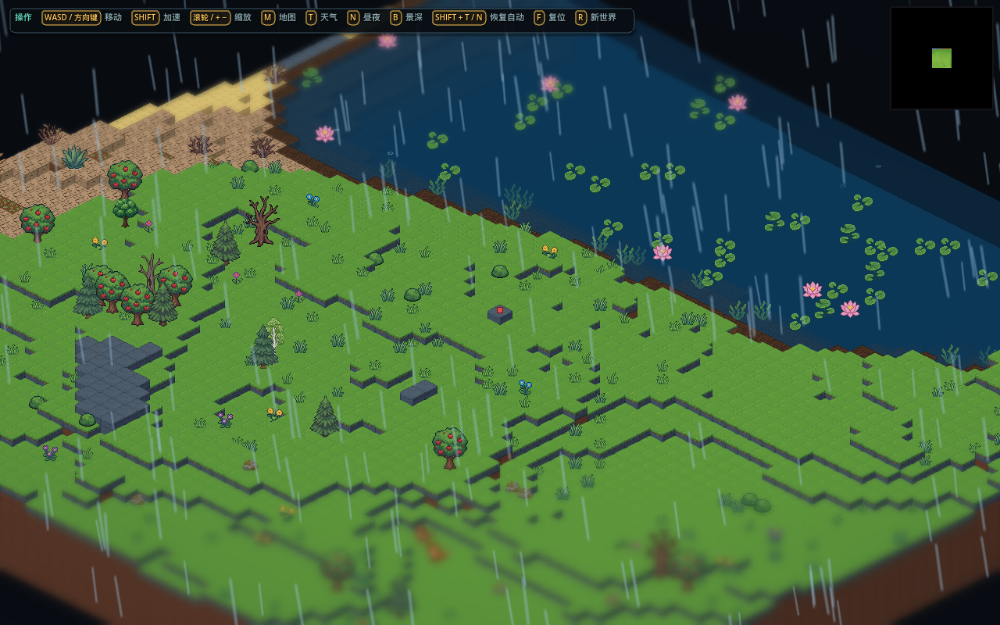</td>
    <td width="33%">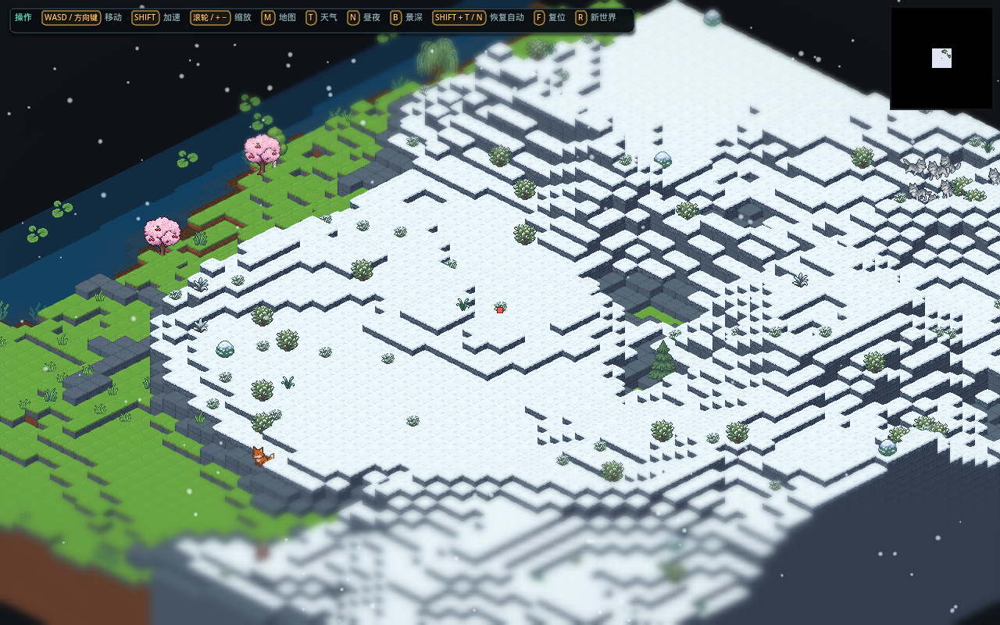</td>
    <td width="33%">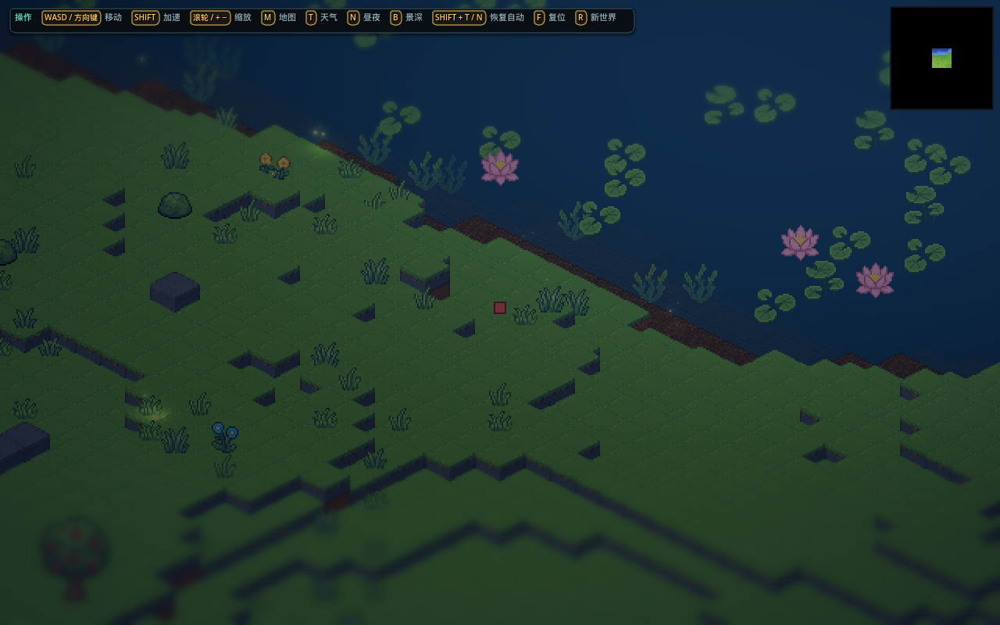</td>
  </tr>
  <tr>
    <td align="center">Rain interacting with water</td>
    <td align="center">High-elevation snowfall</td>
    <td align="center">Moonlight and fireflies at night</td>
  </tr>
</table>

## Music and Spatial Audio

- **Day and night music**: Separate looping tracks use an approximately four-second equal-power crossfade driven by daylight, avoiding abrupt cuts at sunset.
- **Rain ambience**: Looping rain fades smoothly with the weather state and remains quieter than the background music.
- **Species voices**: Foxes, frogs, pigs, and wolves have individual sound configurations; dogs and huskies share barking sounds. Audio positions follow moving animals, and separate wolves can howl at the same time.
- **Distance and cadence**: Animal sounds activate only near the player. The first approach guarantees a call, normal calls remain occasional, and a fleeing animal calls again about once per second while continuously pursued.

## Rendering Details for an Isometric World

Water, shore waves, weather, and flying animals favor batched drawing or limited presentation slots. Shore waves prebuild four animation slices and require only two batched polyline draws per frame. Flying birds retain only world position and velocity and are reprojected when the camera changes. These choices preserve dynamic detail without creating an independent `_process` node for every water cell or distant bird.

<table>
  <tr>
    <td width="33%">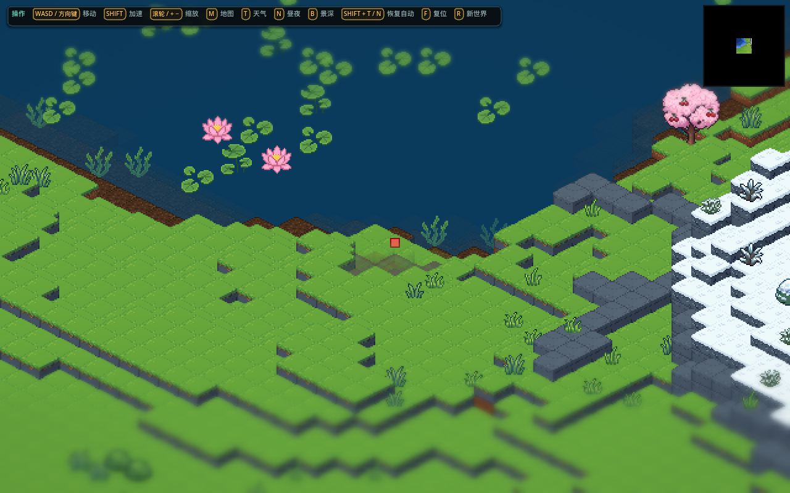</td>
    <td width="33%">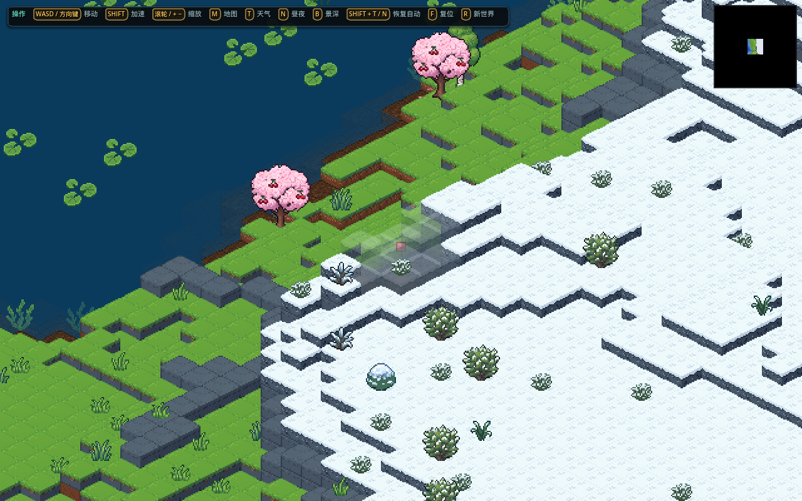</td>
    <td width="33%">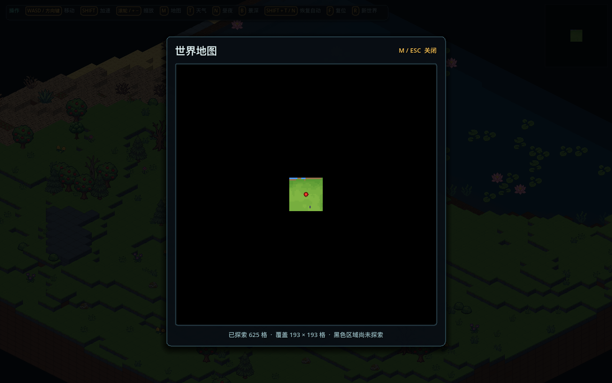</td>
  </tr>
  <tr>
    <td align="center">Transparent water attenuated by depth</td>
    <td align="center">Terrain fades automatically when it obscures the player</td>
    <td align="center">The world map reveals explored areas only</td>
  </tr>
</table>

## Running the Project

Pixel World requires **Godot 4.6+**. Open `project.godot` in Godot and run the main scene, or execute this command in the project directory:

```bash
godot --path .
```

## Controls

| Input | Action |
| --- | --- |
| `WASD` / Arrow keys | Move along the isometric grid |
| `Shift` | Move faster |
| Mouse wheel / `+` / `-` | Zoom |
| `M` | Open or close the world map |
| `T` / `N` / `B` | Cycle weather / day-night / depth of field |
| `Shift+T` / `Shift+N` | Restore automatic weather / day-night changes |
| `F` | Reset the camera |
| `R` | Generate a new world |

## Extending the Ecosystem

Ecology configuration begins at [`config/ecology/manifest.json`](config/ecology/manifest.json). Species, communities, and biomes are independent. A new ecosystem usually requires only a biome module, its materials and noise configuration, and references to reusable communities; the main scene does not need to change. See [`config/ecology/README.md`](config/ecology/README.md) for the detailed conventions.

| Layer | Main entry points | Responsibility |
| --- | --- | --- |
| World and landforms | [`config/ecology/world/base.json`](config/ecology/world/base.json), [`scripts/world/terrain_sampler.gd`](scripts/world/terrain_sampler.gd) | Named noise, Voronoi regions, height fields, surfaces, and streaming samples |
| Biome modules | [`scripts/world/biomes/`](scripts/world/biomes/) | Independent height adjustment, classification, surfaces, tags, minimap colors, and weather tendencies |
| Species and communities | [`config/ecology/communities/`](config/ecology/communities/), [`scripts/ecology/`](scripts/ecology/) | Habitat matching, community composition, spatial distribution, and deterministic state |
| Animal behavior | [`scripts/animals/animal_behavior_registry.gd`](scripts/animals/animal_behavior_registry.gd) | Composable water preference, snow avoidance, snow affinity, group cohesion, and player avoidance |
| World presentation | [`scripts/weather_system.gd`](scripts/weather_system.gd), [`scripts/day_night_system.gd`](scripts/day_night_system.gd), [`scripts/world_audio_system.gd`](scripts/world_audio_system.gd) | Weather, day and night, moonlight, music, and spatial audio |

## License

Pixel World's code, pixel art, music, sound effects, and documentation screenshots are licensed under the [MIT License](LICENSE) unless a file explicitly states otherwise. You may use, modify, distribute, and sell them. Retaining the copyright and license notice provides the required source attribution. See [ASSET_LICENSE.md](ASSET_LICENSE.md) for asset coverage and a ready-to-use attribution line.
