# Pixel World

[English](README.md) | **简体中文**

一个“像素版 Minecraft”式的等距世界实验：地图会在探索过程中无限、实时、确定性地生成，并由生态、群落、动物与天气共同塑造。

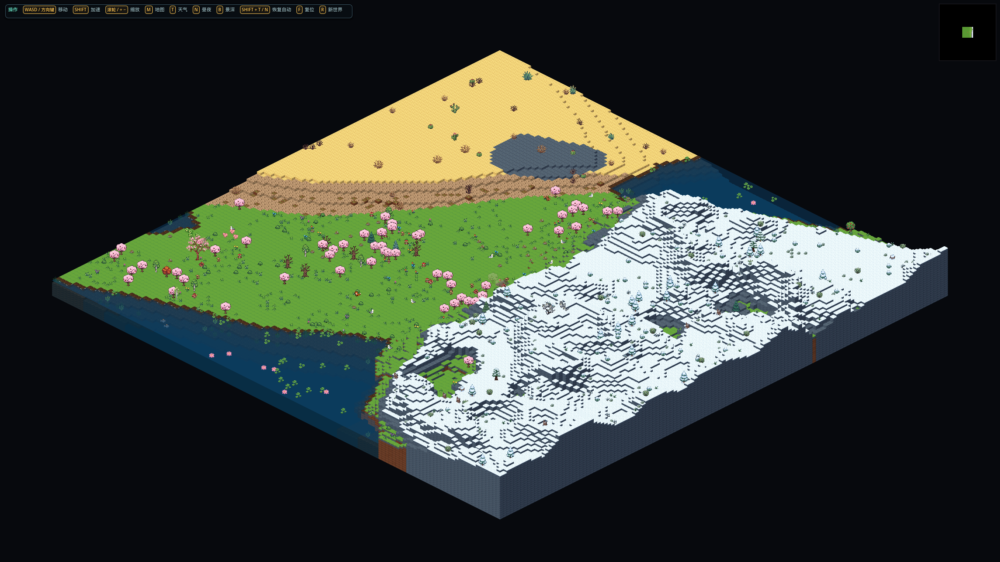

## 核心亮点

- **无限地图实时生成**：固定种子、流式加载，只生成玩家附近与已经探索过的地图信息。
- **模块化生态系统**：温带、沙漠、雪原、水域与岸线可以独立配置，并可继续扩展火山、冰原等生态。
- **生物群落系统**：狼群、猪群、青蛙群、荷塘和植物斑块拥有自己的组成与空间分布。
- **动物行为系统**：陆地与水域动物拥有独立动画、栖息地与种群习性；鸟类还会在地面踱步、受惊起飞并成群掠过天空。
- **动态世界氛围**：雨、雪、水面降水反馈、昼夜变化、月光、萤火虫与环境音频。
- **等距渲染增强**：透明水体、正确遮挡顺序、智能透视、像素安全平滑镜头与移轴式景深。

## 世界生成：独立模块，无限连续

生态并不是换一张地表贴图。温带、沙漠与雪原分别由独立的 `BiomeModule` 负责高度修正、气候判定、地表材质和生态标签；平原、丘陵、沼泽、高山、海洋则是可配置的基础地貌。世界先以命名噪声和带抖动的 Voronoi 大区确定宏观结构，再连续混合相邻区域的高度、山脊、坡度与梯田参数，所以地形切换不会出现生硬断层。

```text
World Seed
  └─ Named Noise + Jittered Voronoi Regions
      └─ Biome Modules（高度 / 气候 / 地表 / 标签）
          └─ CellContext（地貌 / 海拔 / 水深 / 岸线）
              └─ Community Resolver（植物 / 动物 / 环境群落）
                  └─ CellState → 等距渲染与流式加载
```

- **按需生成**：只有玩家附近的格子进入流式窗口时才会被实例化，不需要提前创建整个世界。
- **坐标级确定性**：同一个种子与坐标永远得到相同结果，因此向任意方向探索都能持续生成稳定、独特的景观。
- **Biome 可插拔**：每个生态拥有独立脚本与配置；沙漠可塑造低起伏沙丘，雪线则由海拔与温度共同决定。
- **自然过渡**：沙漠由低频宏观噪声形成大块连续区域，边缘再叠加细节噪声，逐渐过渡为岩石、沙地、干枯土壤、少量稀疏草与平原。

<table>
  <tr>
    <td width="33%">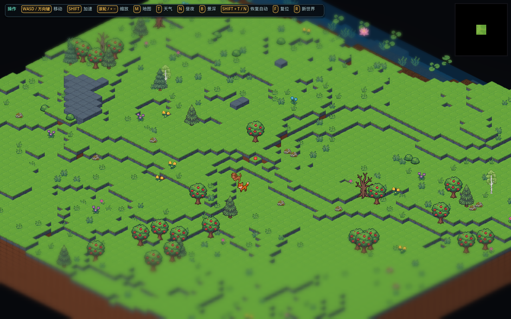</td>
    <td width="33%">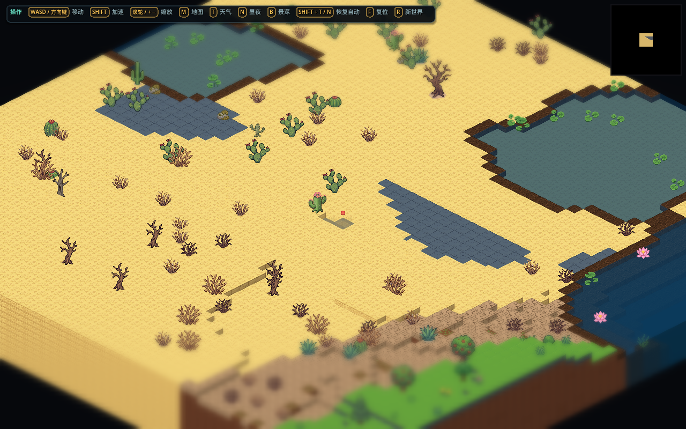</td>
    <td width="33%"></td>
  </tr>
  <tr>
    <td align="center">温带草原与林地</td>
    <td align="center">沙漠、绿洲与干旱过渡带</td>
    <td align="center">雪原与高海拔山地</td>
  </tr>
</table>

## 动植物分布遵循环境规则

每个格子会先得到一个纯数据 `CellContext`，记录 Biome、地貌、海拔、水深、岸线和地表类型；生态解析器随后叠加所有符合 habitat 条件的群落。植物与动物因此不是在全图独立随机撒点，而是生活在适合自己的环境中。

- 沙漠与平原之间使用不规则的干枯土过渡带；紧邻水面的首层陆地则自动变为湿润泥土。
- 水底、水面与岸边是三种不同的放置环境：浅水湖底生长水草，浅水水面生成荷叶与莲花，岸边拥有柳树、岸草、岸花和苔石。
- 雪地树池以多种雪松为主，并使用独立密度控制。
- 四类蘑菇只有在半径 4 格内存在树木时才会保留；空旷处会被普通草丛替代。

<table>
  <tr>
    <td width="50%">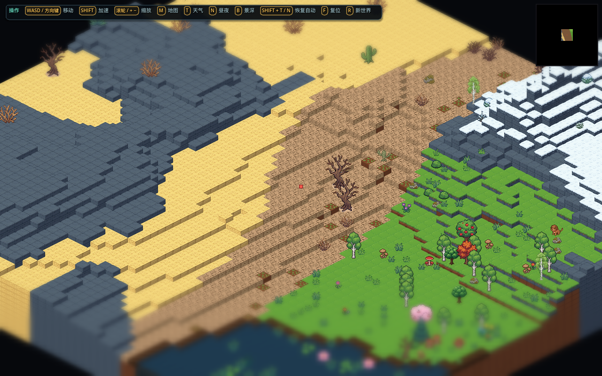</td>
    <td width="50%">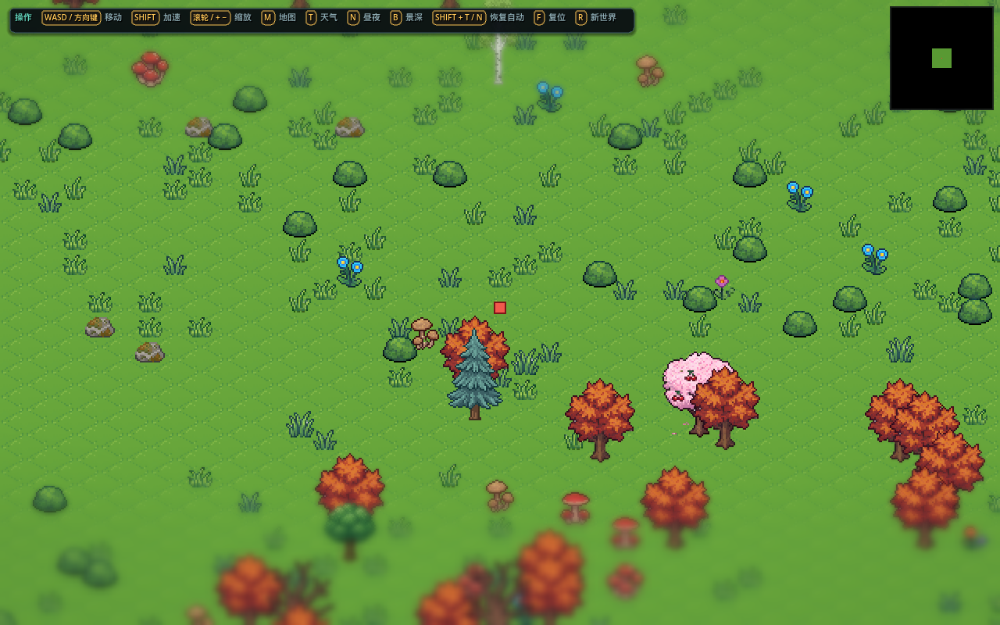</td>
  </tr>
  <tr>
    <td align="center">岩石与沙地 → 干枯土 → 平原与水岸</td>
    <td align="center">四类蘑菇沿树林和林缘分布</td>
  </tr>
</table>

## 同一地貌，也会形成不同植物群落

同一片温带地貌不会得到均匀混合的植物。树木、地被与装饰物分别使用独立噪声；每个宏观区域再根据世界种子选择优势种，优势种占据大部分生成结果，同时保留少量伴生种。因此相邻区域可能分别形成樱花林、苹果林、阔叶林或松树林。

当多个生态对象竞争同一格时，系统会按稳定的冲突权重只保留一个对象；配置顺序和玩家进入区域的方向都不会改变最终结果。

<table>
  <tr>
    <td width="33%">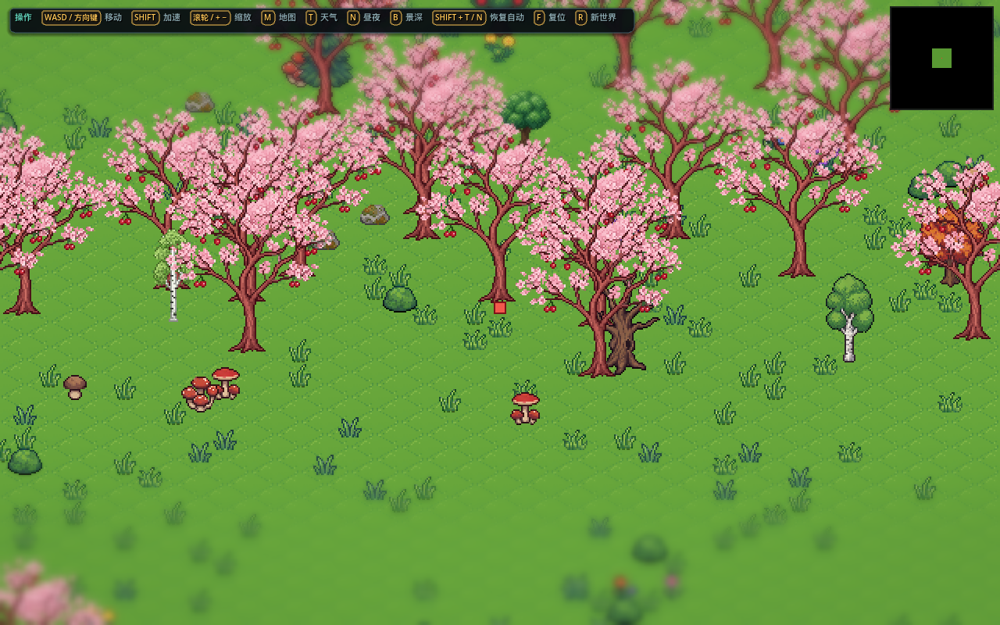</td>
    <td width="33%">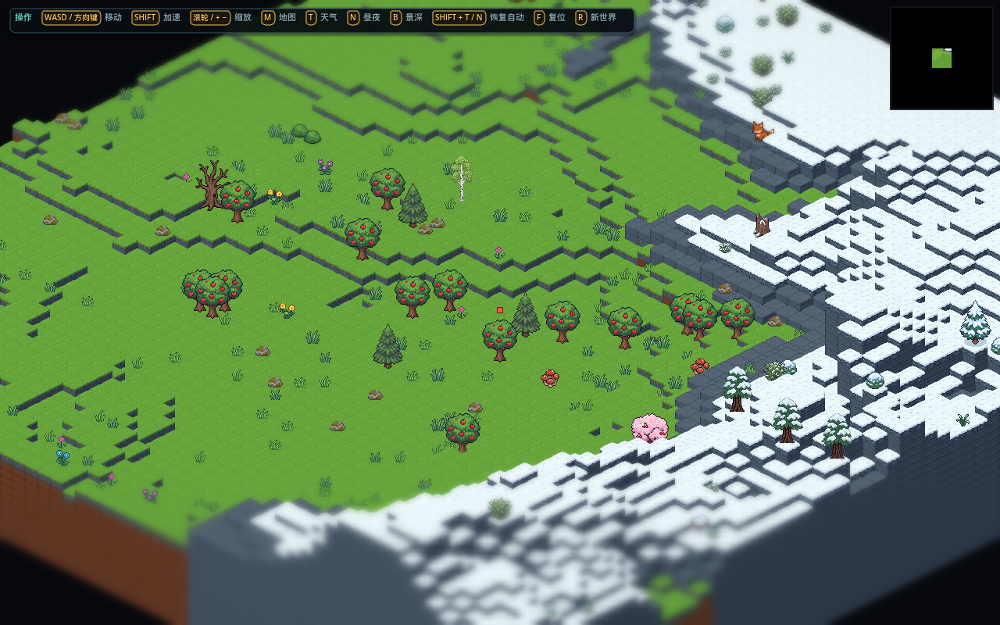</td>
    <td width="33%">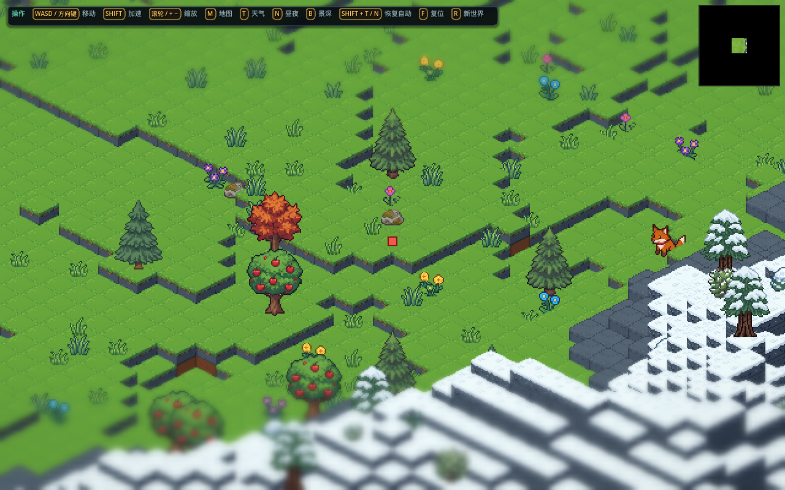</td>
  </tr>
  <tr>
    <td align="center">樱花树林</td>
    <td align="center">苹果树林</td>
    <td align="center">温带松树林与伴生树种</td>
  </tr>
</table>

## 动物拥有生境、本能与种群习性

动物群落由确定性的锚点、成员组成、数量、活动半径和栖息地条件生成；重新进入同一区域时仍能得到一致的种群。不同动物也有不同的生存区域与移动偏好：

| 动物 | 生境与习性 |
| --- | --- |
| 狼 / 哈士奇 | 只出生于雪地；狼群为 7–8 只，并有 35% 概率混入一只哈士奇 |
| 青蛙 | 2–4 只结伴，出生点需位于水体 10 格内，漫游时持续偏向水边 |
| 金鱼 | 温带浅水中以 2–3 条同品种小群活动；不同领地会选择普通、蓝色或花色金鱼 |
| 鲫鱼 | 温带河湖中很低频出现，2–3 条一群，可活动于比金鱼更深的水域 |
| 鲑鱼 | 只生成在寒冷的较深水域，以 2–4 条鱼群快速游动 |
| 鸟 | 少量鸟在温带地面踱步；玩家靠近后立即起飞离场，天空飞越事件多数为 3–6 只的错位 V 形鸟群 |
| 猪 | 生活在温带，以 2–4 只的小家庭活动，并主动远离雪地 |
| 狗 / 狐狸 | 生活在温带，偏好单独出没，并主动远离雪地 |

所有动物都会本能地逃避人类：玩家进入 6 格警戒范围后，它们会优先选择远离玩家的方向，并以约 2 倍速度逃跑。群体动物同时受群体中心约束，不会在漫游中立刻完全散开。

水域动物复用相同的行为与群落系统，但只能出生和移动于水格，并继续遵守各自的水深与气候范围。鱼至少与岸线间隔一格，大水域因覆盖更多确定性鱼群领地而自然拥有更多鱼，小水域更少；随水深变化的前景水层 shader 会遮住鱼的大部分身体，只让背部与鱼鳍更清晰。

鸟类由独立环境表现模块管理：同一逻辑格最多保留一只地面鸟，附近地块仍可形成松散小群；受惊和飞越状态使用世界坐标积分，镜头平滑移动只负责重新投影，不会让鸟突然加速或静止。天空飞越约有 72% 的概率生成为 3–6 只鸟群，并以错位 V 形间距共同移动。

<table>
  <tr>
    <td width="50%">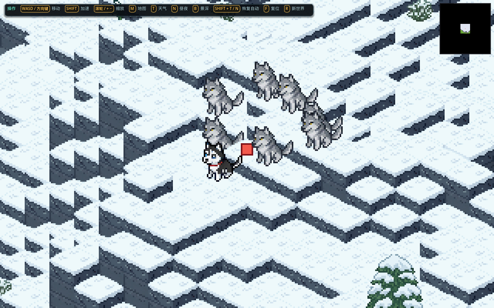</td>
    <td width="50%">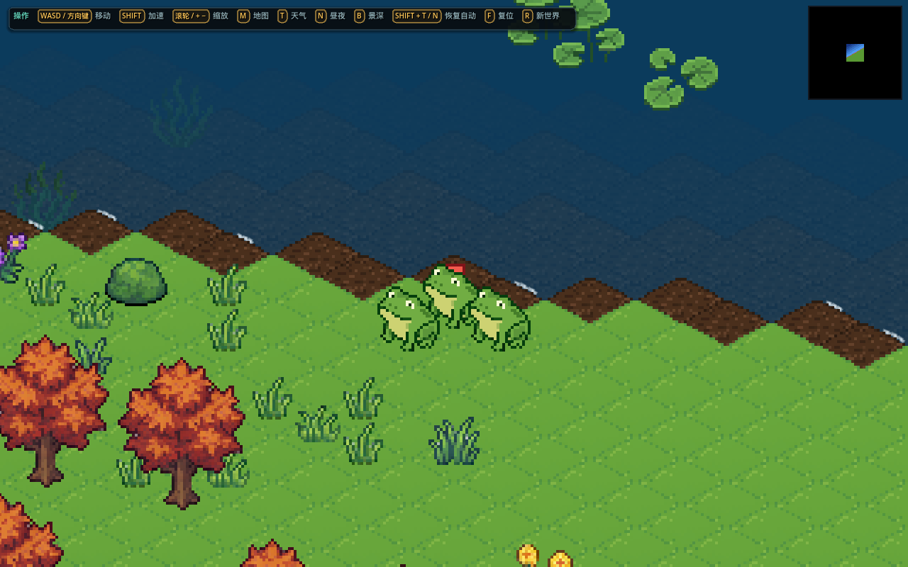</td>
  </tr>
  <tr>
    <td align="center">雪原狼群，偶尔会混入一只哈士奇</td>
    <td align="center">水岸青蛙群与荷塘群落</td>
  </tr>
  <tr>
    <td>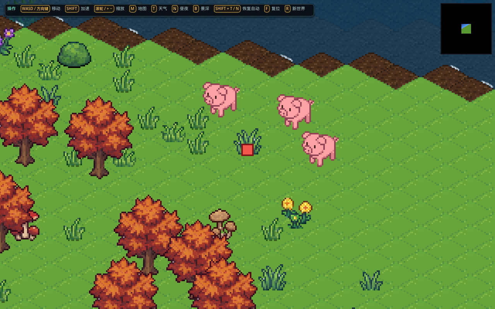</td>
    <td>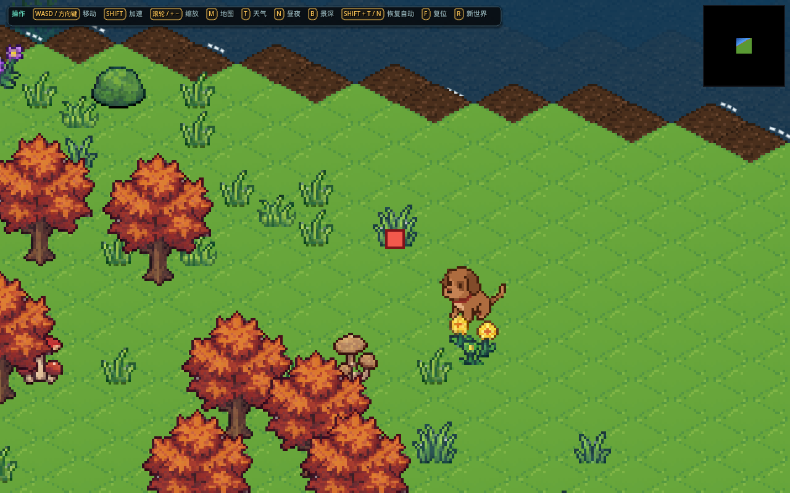</td>
  </tr>
  <tr>
    <td align="center">小规模猪群</td>
    <td align="center">独自在温带活动的狗</td>
  </tr>
</table>

<table>
  <tr>
    <td width="33%">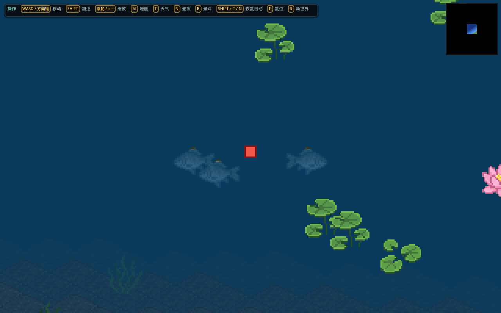</td>
    <td width="33%">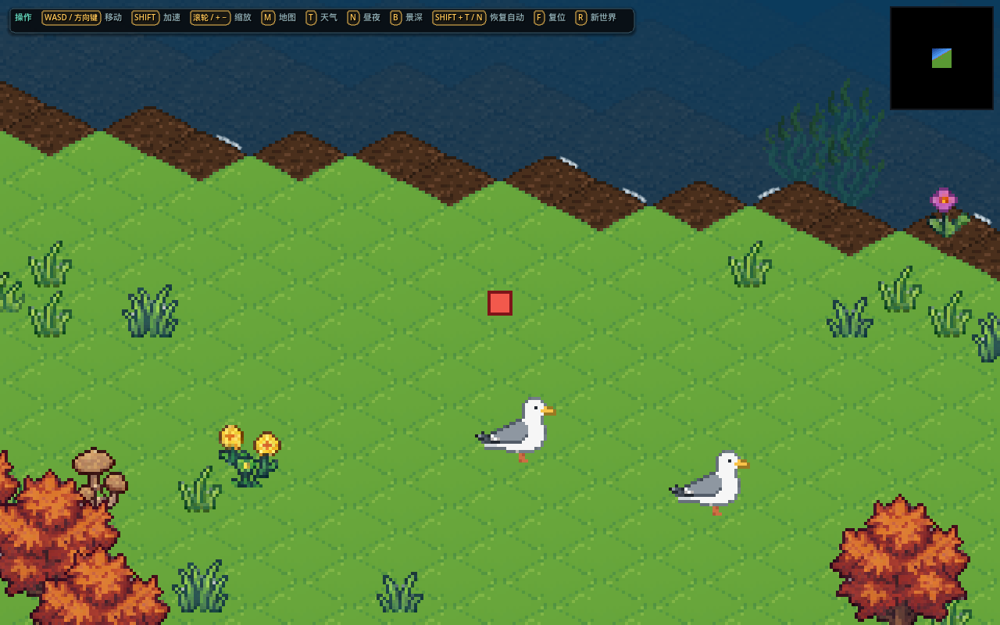</td>
    <td width="33%">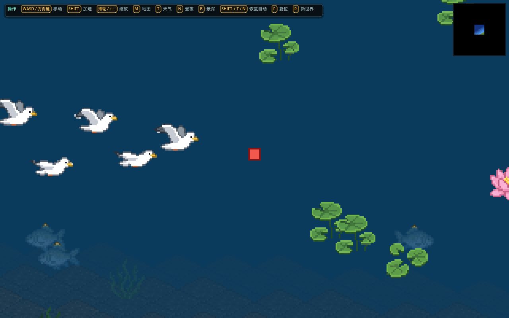</td>
  </tr>
  <tr>
    <td align="center">按水深分布并受水层遮挡的鱼群</td>
    <td align="center">分散占格、不会重叠的地面鸟</td>
    <td align="center">使用世界坐标飞行的错位鸟群</td>
  </tr>
</table>

## 天气、昼夜与水面

雨雪使用世界空间表现，不会随着镜头反向漂移；雨滴落到水面时会产生反馈。水陆边界由细而长的断续岸浪组成：每段岸浪会拆成 5–6 个小段，奇偶组交替明暗并轻微向岸内位移，再从三种曲线轮廓中稳定选形，形成低频潮汐感而不是整齐白线。夜晚保留冷色月光，并在合适的温带环境出现萤火虫微光。

<table>
  <tr>
    <td width="33%">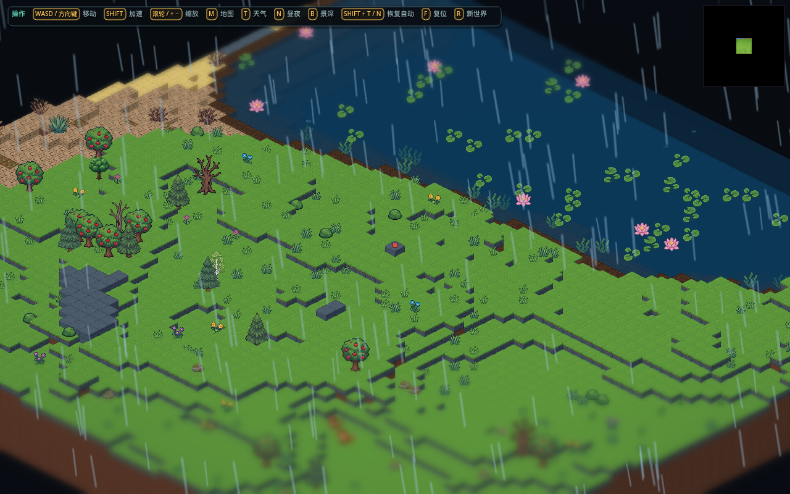</td>
    <td width="33%">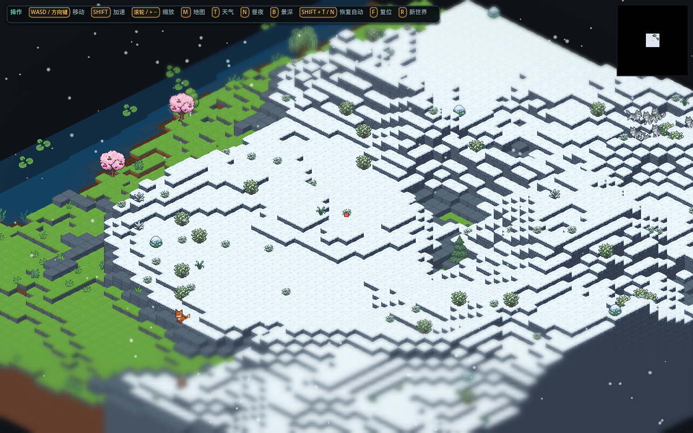</td>
    <td width="33%">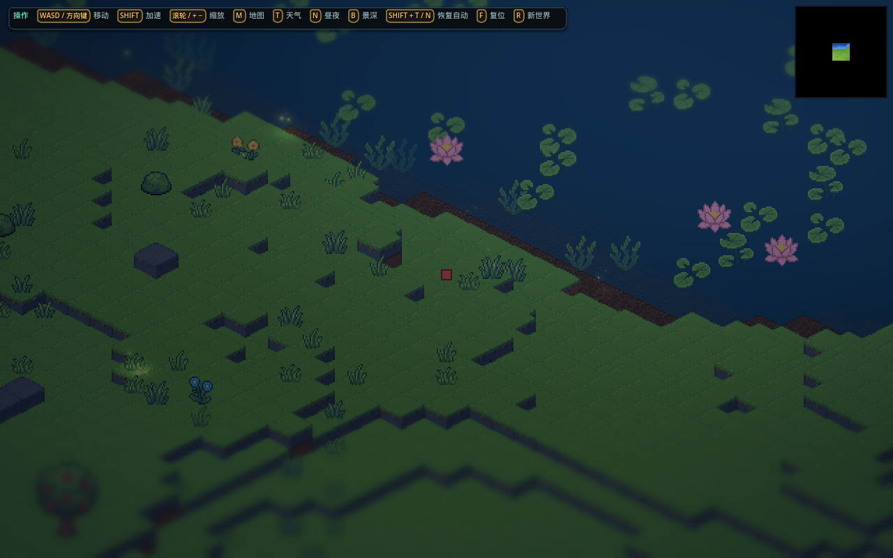</td>
  </tr>
  <tr>
    <td align="center">雨与水面交互</td>
    <td align="center">高海拔降雪</td>
    <td align="center">月光夜色与萤火虫</td>
  </tr>
</table>

## 音乐与空间音效

- **昼夜音乐**：白天与夜晚各自使用独立循环音乐，并随昼夜光照值进行约 4 秒的等功率交叉淡化，不会在日落时突然切断。
- **雨天环境音**：雨声随天气状态循环播放，并在晴雨切换时平滑淡入淡出；音量保持在 BGM 之下，不会盖过音乐。
- **物种声音**：狐狸、青蛙、猪、狼拥有各自的叫声配置，狗与哈士奇共用犬吠；声音位置会跟随正在移动的动物，狼群中不同个体的嚎叫可以自然叠加。
- **距离与节奏**：动物声音只在玩家进入附近时激活。首次靠近会保证叫一声，平时只偶尔发声；如果玩家持续追赶，逃跑中的动物会大约每秒再次鸣叫。

## 为等距世界服务的渲染细节

水体、岸浪、天气与飞行动物都尽量使用批绘制或有限表现槽位：岸浪预生成 4 个动画切片，每帧只需两次批量折线绘制；飞鸟只保存世界位置与速度，镜头变化时重新投影。这样可以保留动态细节，同时避免为每个水格或每只远景鸟创建独立 `_process` 节点。

<table>
  <tr>
    <td width="33%">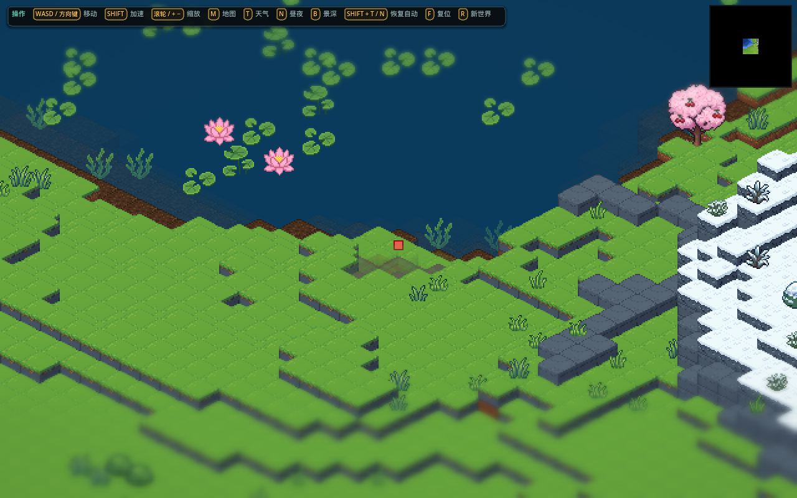</td>
    <td width="33%">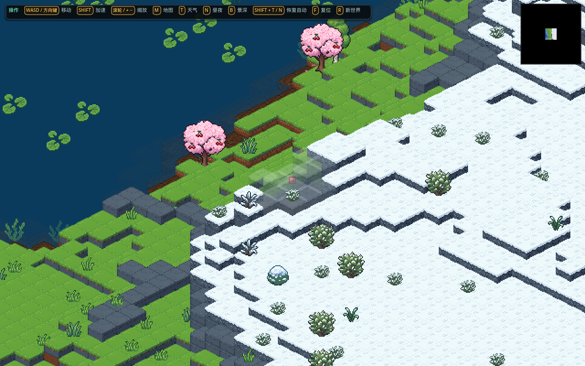</td>
    <td width="33%">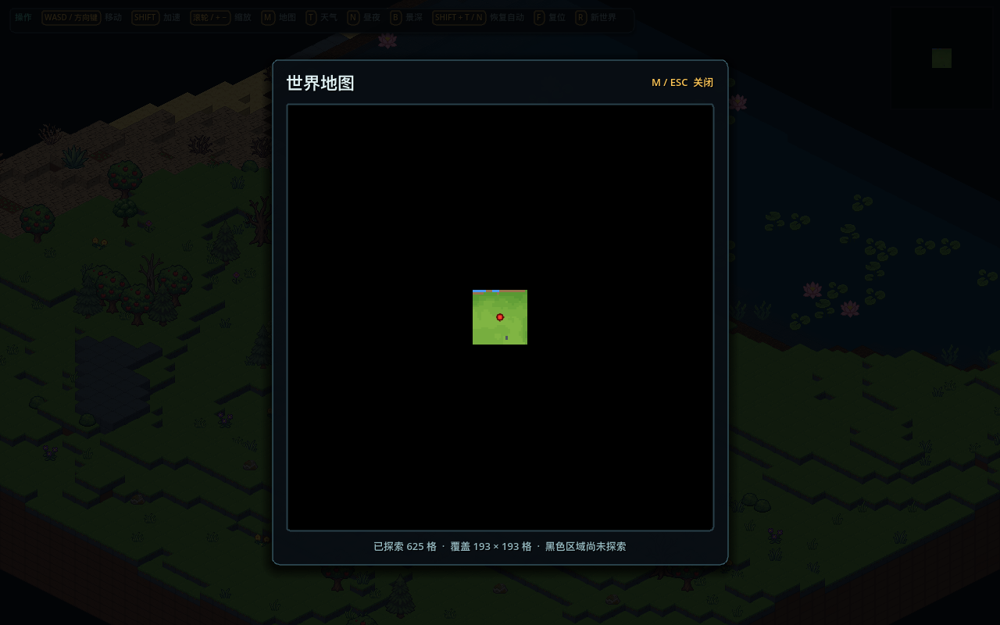</td>
  </tr>
  <tr>
    <td align="center">按深度衰减的透明水体</td>
    <td align="center">遮挡玩家时自动淡化地形</td>
    <td align="center">只显示已探索区域的世界地图</td>
  </tr>
</table>

## 运行

需要 **Godot 4.6+**。用 Godot 打开 `project.godot` 并运行主场景，或在项目目录执行：

```bash
godot --path .
```

## 操作

| 按键 | 功能 |
| --- | --- |
| `WASD` / 方向键 | 沿等距网格移动 |
| `Shift` | 加速移动 |
| 滚轮 / `+` / `-` | 缩放 |
| `M` | 打开或关闭世界地图 |
| `T` / `N` / `B` | 切换天气 / 昼夜 / 景深 |
| `Shift+T` / `Shift+N` | 恢复天气 / 昼夜自动变化 |
| `F` | 复位视角 |
| `R` | 生成新世界 |

## 扩展生态

生态配置以 [`config/ecology/manifest.json`](config/ecology/manifest.json) 为入口。物种、群落和 Biome 各自独立；新增生态通常只需增加一个 Biome 模块、配置其材质与噪声，再挂载可复用群落，而无需修改主场景。详细约定见 [`config/ecology/README.md`](config/ecology/README.md)。

| 层级 | 主要入口 | 职责 |
| --- | --- | --- |
| 世界与地貌 | [`config/ecology/world/base.json`](config/ecology/world/base.json)、[`scripts/world/terrain_sampler.gd`](scripts/world/terrain_sampler.gd) | 命名噪声、Voronoi 大区、高度场、地表与流式采样 |
| Biome 模块 | [`scripts/world/biomes/`](scripts/world/biomes/) | 独立的高度修正、分类、地表、标签、小地图与天气倾向 |
| 物种与群落 | [`config/ecology/communities/`](config/ecology/communities/)、[`scripts/ecology/`](scripts/ecology/) | habitat 匹配、群落组成、空间分布与确定性状态 |
| 动物行为 | [`scripts/animals/animal_behavior_registry.gd`](scripts/animals/animal_behavior_registry.gd) | 水域偏好、避雪、亲雪、群体约束与逃离玩家等可组合行为 |
| 世界表现 | [`scripts/weather_system.gd`](scripts/weather_system.gd)、[`scripts/day_night_system.gd`](scripts/day_night_system.gd)、[`scripts/world_audio_system.gd`](scripts/world_audio_system.gd) | 天气、昼夜、月光、音乐与空间音效 |

## 许可证

Pixel World 的代码、像素素材、音乐、音效与文档截图默认统一使用 [MIT License](LICENSE)。你可以自由使用、修改、商用与再分发；保留版权和许可声明即构成所需的来源署名。推荐署名格式及素材目录说明见 [ASSET_LICENSE.md](ASSET_LICENSE.md)。若某个未来加入的第三方素材带有单独声明，则以该声明为准。
