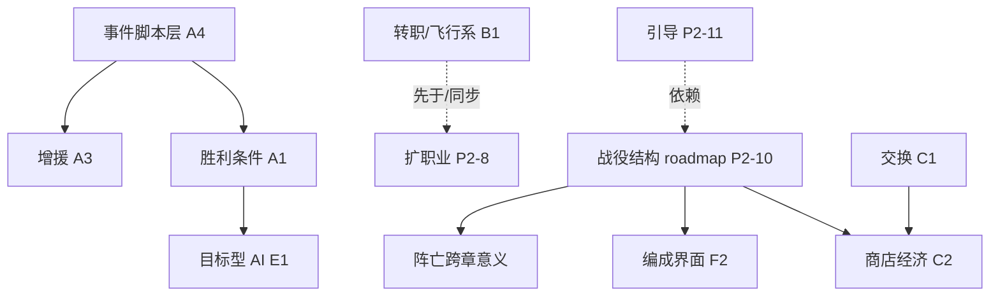

# 战棋玩法完成度差距清单

> 生成：2026-11-15。对比基准：**高完成度 SRPG/战棋**（火焰纹章、皇家骑士团、三角战略式的要素全集）。
> 只列**玩法元素**差距；工程性完善项（测试基线/重构/CI 等）见 [roadmap.md](roadmap.md)，两者互补。
> 每项标注：状态（❌ 缺失 / 🟡 部分 / ✅ 已有）、证据（源码位置）、建议规模（S/M/L）、是否已在 roadmap。

## 0. 先说底座：已达到的部分（好于直觉）

这些是高完成度战棋的**核心规则层**，本项目已具备，扩差距时不必重做：

- ✅ **完整交战规则**：武器三角、命中/必杀/追击(×2)、反击，`scripts/core/weapons.gd` + `CombatSystem`
- ✅ **战斗预报面板**（FE 标配，很多半成品战棋没有）：`battle_ui.gd:970 _preview_and_attack` → 命中%/必杀%/伤害(×2)/反击预报，**含地形回避与防御加成**；技能也有预览（`_preview_and_use_skill`）
- ✅ **技能系统**：8 技能，MP 消耗+冷却+五类效果（damage/heal/aoe/buff/debuff）
- ✅ **四档 AI 难度**：novice/normal/hard/nightmare，评分参数化（`systems/ai_difficulty.gd` + `ai_difficulty_scoring.gd`）——参数化基础好，扩 AI 行为型不用推倒
- ✅ **托管自动战斗**（TurnDirector 玩家托管偏好）——高完成度商业作品都少见的配置
- ✅ **移动撤销**（`_pending_move_undo`）与行动边界自动存档（GameSession 逐战场档案，tmp+bak 原子写）
- ✅ **演出可开关可快进**（battle_presentation/result_presentation/immersive_camera，`*_finished(skipped)`）
- ✅ **战场编辑器 + 预制 JSON 战场 + 无头自动化回归**（`tools/battle_cli.gd` 共享结算内核）
- ✅ 单位详情面板（全属性/技能/背包/buff/武器/攻击射程，`battle_ui.gd:560`）；物品有使用次数（uses）

---

## A. 目标与关卡设计 —— 差距最大的维度

| # | 元素 | 状态 | 证据与说明 | 规模 | roadmap |
| --- | --- | --- | --- | --- | --- |
| A1 | **多样化胜利条件** | ❌ | `turn_manager.gd:84 check_victory()` **仅歼灭制**（敌全灭=win/我全灭=lose）。缺：防守 N 回合、据点夺取(seize)、护送/撤离(escape)、指定单位击破、回合限制失败。自动化 CLI 有步数僵持保护但那是防挂死，不是玩法 | M（框架）/S（每种条件） | 未列，建议补 |
| A2 | **战役/章节结构** | 🟡 | 4 战场平铺（O 键选单），无章节链/解锁/胜负流转；story 目标态 15 章。演出层已有 `play_chapter_result` 接口等着接 | L | ✅ P2-10 |
| A3 | **增援系统** | ❌ | `reinforce` 零命中。无按回合/事件刷援军——战旗关卡节奏的灵魂机制 | M | 未列，建议补 |
| A4 | **地图事件脚本** | ❌ | 无"第 N 回合发生 X"的脚本层（增援/对话插播/地形变化/失败条件追加）。chapter JSON 只有静态单位表 | M–L | 未列（A1/A3 的载体） |
| A5 | **Boss/指挥官单位** | 🟡 | 演出层有 Boss 横幅接口（`play_opening(units, boss={})`）；单位数据层无 boss 标志/专属技能/击破即胜语义 | S–M | 未列 |
| A6 | 地形交互语义 | 🟡 | 11 种地形有数值（回避/防御/移动成本），但 village/fort/wall 无占领、治疗、开门等交互 | M | 部分（roadmap P1-4 只管地形覆盖） |

## B. 成长与角色系统

| # | 元素 | 状态 | 证据与说明 | 规模 | roadmap |
| --- | --- | --- | --- | --- | --- |
| B1 | **转职/晋升** | ❌ | `promote/转职` 零命中。8 职业封闭终阶；`professions.json` 已有 moveType 字段（armor/cavalry 各一，**flying 键存在但无飞行职业使用**）——扩职业时顺手补飞行系 | M | 部分（P2-8 扩职业未提转职） |
| B2 | 支援/羁绊 | ❌ | `support/羁绊` 零命中。FE 标配的邻接支援加成+对话解锁 | M | 未列（story 未见设计，先补设计） |
| B3 | 升级成长透明化 | 🟡 | UnitData 有 growths，但无升级面板逐属性 roll 展示（FE 式 STR+1 弹窗），玩家感知不到成长差异 | S | 未列 |
| B4 | 阵亡的跨章意义 | 🟡 | 结算有 survivors/defeated 名单，但无 roster 续承载体——阵亡只在单场内有效果，取决于 A2 战役结构先行 | —（A2 下游） | — |

## C. 经济与物品

| # | 元素 | 状态 | 证据与说明 | 规模 | roadmap |
| --- | --- | --- | --- | --- | --- |
| C1 | **单位间交换/传递** | ✅ | FE 式相邻友军 trade：行动菜单「交换」项（相邻 1 格带物品友军时可用）→ 选友军 → 单向转移（来回两次=交换），自由动作不置 hasActed；核心逻辑 `scripts/systems/trade_system.gd`（can_trade/adjacent_trade_targets/execute_trade），UI 在 `battle_ui.gd _open_trade_picker/_open_trade_item_picker`；契约 `tests/battle_trade_contract.gd`（commit 2a501c7） | S | 已补 |
| C2 | **商店/金币经济** | ❌ | `gold/金币` 零命中。战间无资源循环，物品获得只有关卡配置 | M | 未列（依赖 A2 战役结构） |
| C3 | 装备深度 | 🟡 | 有 equip 类物品与武器三角，无多槽位/耐久修理/锻造分化 | M | 部分（P2-9 扩道具数量，未提槽位） |

## D. 战场信息与交互

| # | 元素 | 状态 | 证据与说明 | 规模 | roadmap |
| --- | --- | --- | --- | --- | --- |
| D1 | **战争迷雾** | ❌ | `fog` 零命中。视野/侦察维度缺失（皇家骑士团系核心；火纹外传系可选） | M | 未列（可做可选开关，非必做） |
| D2 | 可破坏物/机关 | ❌ | 无门/桥/宝箱/木桶等格子物件概念（编辑器也画不了） | M | 未列 |
| D3 | 高低差/朝向 | ❌ | 等距柱地形有视觉高度但**高度不入结算**；无背面攻击加成 | M | 未列（可明确不做，记录在案） |

## E. AI 与敌手设计

| # | 元素 | 状态 | 证据与说明 | 规模 | roadmap |
| --- | --- | --- | --- | --- | --- |
| E1 | **目标型 AI** | 🟡 | 评分制 AI 只会"歼灭最优"；无防守据点/拖延/护送目标型行为（A1 落地后 AI 必须跟进，否则防守关敌人照样全军突击） | M（在评分框架内加目标项） | 未列，依赖 A1 |
| E2 | 增援调度 | ❌ | 同 A3，AI 侧无第二波概念 | — | — |
| E3 | 个性化 AI | 🟡 | 托管偏好有 priorityTargetId/strategy 字段（玩家侧）；敌方单位级个性（鲁莽/谨慎/守巢）未见 | S–M | 未列 |

## F. 进程、引导与外围

| # | 元素 | 状态 | 证据与说明 | 规模 | roadmap |
| --- | --- | --- | --- | --- | --- |
| F1 | **新手引导/教程** | ❌ | DialogueDemo + demo_intro.json 孤立演示未接流程；story/15_onboarding.md 有目标态设计 | M | ✅ P2-11 |
| F2 | 队伍编成/整备界面 | ❌ | 无战间 Roster/编成 UI（依赖 A2） | M | 未列 |
| F3 | 成就/图鉴 | ❌ | story 目标态有成就设计 | S–M | 未列 |
| F4 | 帮助/数据透明页 | 🟡 | 报警面板已含地形加成，但无武器三角/成长率/公式说明页 | S | 未列 |
| F5 | 音乐阶段反馈 | 🟡 | Sfx 音效 cue 齐（胜利 880ms 等）；music/ 仅 night+normal 两曲，无敌方回合/危机变奏 | M（素材为主） | ✅ P3-19 |
| F6 | 难度选择入口 | 🟡 | 四档难度系统在，但玩家从哪里选（战场配置?设置页?）未验证有 UI 入口 | S | 未列 |

## G. 定位边界（不算差距，明示不做）

- **对战/联机**：纯单机定位，不建议立项。
- **三角战略式多结局/投票**：story 未设计，超出目标态。
- 高度/朝向（D3）可明确"不做"以控制范围，本清单记录在案。

---

## 优先级建议（影响 × 依赖排序）

**第一批（性价比最高， gameplay 骨架立刻立体）**：
1. **A1 胜利条件框架 + 2–3 种条件**（S–M）——现有 `check_victory` 单点改造，CLI 回归立刻可测；
2. **A3+A4 增援与事件脚本**（M–L）——关卡设计的杠杆，做 1 个事件即可做"第 3 回合敌援军"；
3. **C1 单位间交换**（S）——半天级，物品系统立刻活起来；
4. **E1 目标型 AI**（M）——A1 的配套，评分框架内加项，不用重写。

**第二批**：B1 转职+飞行系（与扩职业合并做）、A5 Boss 语义、B3 升级弹窗、F6 难度入口。
**第三批（依赖战役结构）**：C2 经济、F2 编成、B4 阵亡续承、F1 引导。
**可选开关型**：D1 战争迷雾、D2 机关、F4 帮助页。

> 维护约定：完成一项标 ✅ 并同步 [roadmap.md](roadmap.md)；本文档与 story 目标态变化保持年检。
