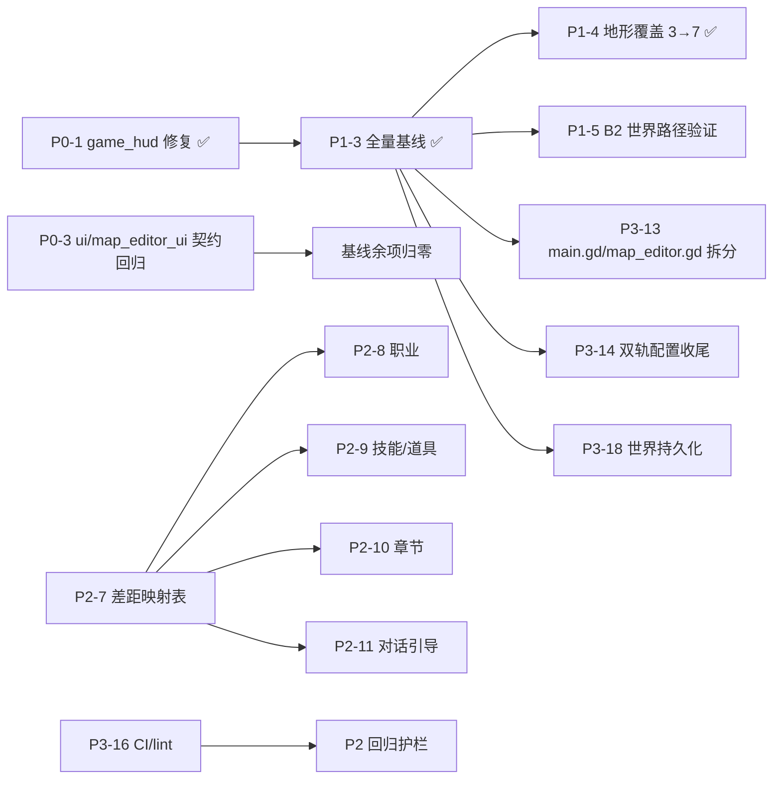

# Roadmap — 后续可逐步完善清单

> 生成：2026-11-15（/init-project 扫描产出）；状态更新：2026-11-15 二轮增量扫描。按**优先级分层（P0–P3）+ 前置依赖**组织。
> 用法：从 P0 开始自上而下做；同一层内按前置依赖排序。每项给「做什么 / 为什么 / 前置 / 验收 / 规模」。
> 完成一项就把它标 ✅ 并在 `claude/changelog.md` 记一笔；本文档随进度滚动维护。
> **玩法元素差距**（对照高完成度战旗的胜负条件/增援/转职/经济等）另见 [gameplay_gap.md](gameplay_gap.md)，两份互补：本文管工程与内容管线，那份管玩法机制。

## 总览

| 层 | 主题 | 条目 |
| --- | --- | --- |
| **P0** | 修坏 & 堵漏（小时级） | 1 修 game_hud 契约 ✅ · 2 清理失效引用/调试遗留（半 ✅）· 3 修 ui/map_editor_ui 契约回归 ✅（ui 2026-11-16 复绿；map_editor_ui 2026-11-17 断言按实现重锚转 pass，known-fail 全清零） |
| **P1** | 补基线 & 保正确（天级） | 3 macOS 全量测试基线 ✅（余项跟进）· 4 世界战场地形覆盖 ✅ · 5 B2 世界路径验证 · 6 素材源解绑（大半 ✅） |
| **P2** | 内容扩张（story 目标态） | 7 差距映射表（**关键路径根**）· 8 职业扩 13 · 9 技能/道具扩容 · 10 章节/战场扩 15 · 11 对话接入引导 · 12 素材四向展开 |
| **P3** | 重构 & 打磨（有余力再做） | 13 main.gd 拆分 · 14 双轨配置收尾 · 15 UI 组件库推广 · 16 CI/lint · 17 导出配置 · 18 世界状态持久化 · 19 音乐扩容 |

### 依赖关系（箭头 = 前置）

---

## P0 — 修坏 & 堵漏（小时级，无前置，可立即做）

### 1. 修复 `game_hud_contract.gd` ⚡ ✅ 2026-11-15（e8fda38）

- **已完成**：契约在 2026-11-15 全量基线中通过（`docs/testing_baseline_2026-11-15.md`，72 契约 62 过之一）。
- ~~旧记录死因：`--script` 模式不加载 autoload，而 `game_hud.gd` 引用 `Settings` 编译报错。~~

### 2. 清理失效引用与调试遗留 ⚡（半 ✅ 2026-11-15）

- **已清**：根目录 `b1_*.png` 调试截图已删光；孤儿 `tests/zz_align_probe.gd.uid` 已清。
- **仍剩**：
  - `AGENTS.md:47` 仍引用已删除的 `rules/image-viewing.md`（用户文件，建议本人改，agent 勿动）；
  - `data/battlefields/contract_asset_map.json.bak`（契约产物脏文件，6943B，gitignore 或删除）。
- **验收**：`git grep image-viewing` 仅剩历史文档；根目录无 b1_*.png；无 .bak 脏文件。**规模**：极小。

### 3. 修复 `ui` / `map_editor_ui` 契约回归 ⚡（新，2026-11-15 扫描发现；✅ 已完成）

- **✅ 结果（2026-11-16/17）**：`ui` 契约 2026-11-16 复绿（map_editor 三处直建控件改走 `UIFactory`，契约 needle 反转为禁直预加载 PixelButton）；`map_editor_ui` 2026-11-17 转 pass——定性 6 项失败全部为**断言过时**（侧栏实为 320px 下限+内容最小宽 344/353px；单块陆柱 0..z 每层一块共 7 块；选择菜单断隐藏前需先关程序化打开的弹窗；历史惰性封存需先 `_seal_pending()`），按实现重锚并逐处注释依据。五项 known-fail 同轮清零（含 isometric_view 根因=HUD 预留列、user_asset_editor=925fe0c 真回归），基线 **pass 75 / fail 0 / env-skip 5**。
- **做什么**（历史记录）：两契约当前红（实测 exit=1）：
  - `tests/ui_contract.gd`：静态扫描抓到 `scripts/editor/map_editor.gd` 三处直建控件 —— `Button.new()`@943、`CheckButton.new()`@1410（`_place_preview_toggle`）、`OptionButton.new()`@2124（`_mode_option`）；且该文件头注释自称"不再自带样式 helper 与裸 Button.new"，名实不符。
  - `tests/map_editor_ui_contract.gd`：三断言失败 —— (1024,640) 与 (1280,800) 下"侧栏保持 320px"；改 z 后实际重建的单块 `level=6`（应为增量更新而非全量重建）。
- **修法方向**：三处直建换 `ui/` 组件（`PixelButton`/`PixelCheckButton`/`PixelOptionButton`）；侧栏宽度与单块重建逻辑按契约语义修（侧栏宽度用 DESIGN token；z 变更走单块更新路径）。
- **为什么**：`ui_contract` 是组件库推广（P3-15）的护栏，map_editor 是第一个被抓红的业务脚本；红着就无法判断后续 UI 改动是否合规。
- **前置**：无。**验收**：两契约 headless 退出码 0，且 map_editor 视觉无回归（编辑器契约 12 项全绿）。**规模**：小–中。

---

## P1 — 补基线 & 保正确（天级）

### 3. macOS 全量契约测试基线 ⭐（P1 的根）✅ 2026-11-15（首份已产出，余项跟进）

- **已完成**：`tools/run_contract_baseline.sh` + `docs/testing_baseline_2026-11-15.md`（72 契约：**62 过 / 6 败 / 4 超时**）；`claude/testing-and-quality.md` 已有结果表。game_hud 在基线中通过。
- **余项**（转入 P0-3 与后续跟进）：
  - 2 红（`ui` / `map_editor_ui`）→ **P0-3**；
  - 4 败未复跑：`battle_action_chain` / `battle_presentation_hooks` / `isometric_view`（真红待修）；`sunlight_3d_gl` 属 headless 环境限制，非回归（需带渲染环境跑）；
  - 4 超时：`action_anim` / `immersive_battle_camera` / `world_map_overlay`（`--script` 模式 autoload 依赖编译失败挂起 900s，需测试内替身或改 preload 方案）；`user_asset_source_live`（8076 源未启 + 失败路径索引越界）。
- **验收**（收口时）：全量基线 78 契约 0 红 0 超时（环境受限项显式 SKIP）。**规模**：余项小–中。

### 4. 世界就地战场地形覆盖 3→11 ⭐⭐（玩法收益最大）✅ 2026-11-15（`feat(world-battle): expand cell_context_to_terrain mapping beyond 3 terrains`，见 git log hash）

- **已完成**：`cell_context_to_terrain()` 从 3 种扩到 **7 种**，映射（确定性纯函数，无 RNG，优先级自上而下）：
  1. `water` ← `is_water` 或 `height <= water_max(5)`
  2. `mountain` ← `landform == mountain` 或 `height >= rock_level(12)`
  3. `snow` ← `biome == snow` 或 `surface == snow`
  4. `sand` ← `biome == desert/desert_transition` 或 `surface == sand`
  5. `rocky` ← `surface == rock/mossy_rock/rock_grass`（顺带修掉旧代码引用不存在的 `rock_with_moss` 死分支）
  6. `grass` ← `surface == grass/sparse_grass`
  7. `plain` ← 兜底（soil/moist_soil/parched_soil 等）
- **不映射**（CellContext 无对应世界数据源）：`forest`（群落/flora 不在 CellContext 里）、`village/fort/wall`（世界层无建筑概念）。
- **验证**：新契约 `tests/world_terrain_mapping_contract.gd`（22 断言全过，seed=42 大范围采样出现 6 种地形）；防回归跑过 `terrain_generation`（SHA-256 快照）/ `terrain_sampler` / `terrain_material_registry` / `streaming_input_latency` / `biome_modules` / `cell_state_integration` / `dynamic_landform` 及消费方 `world_camera_navigation` / `battlefields` / `battle_3d`，全部通过——世界生成本身零漂移。
- 存档影响：该函数只影响战斗转换（chapter 合成），不触碰内容 ID/`stream_key`/`placement_seed`，无需 world version 迁移。

### 5. B2 世界地形路径深度验证

- **做什么**：`Settings.battle_inline_mode=false` 时按 P 进 B2（世界地形快照战）的整链路（world_to_chapter → Battle.tscn → 渲染 → 结算 → 存档 resume → 返回）历史交接从未深度验证过。用 godot MCP（`dbg_launch` + `runtime_assert_*`）跑一轮全链路断言。
- **前置**：P1-3。**验收**：L2 断言脚本或 MCP 断言记录；发现的问题单独开条目。**规模**：小–中。

### 6. 用户素材源解绑 `127.0.0.1:8076`（大半 ✅ 2026-11-15，3a08327）

- **已完成**：源地址三档优先级可配 —— `user://asset_source.cfg` `[asset_source] source_url` 覆盖 > 库内 `settings.source_url` > `DEFAULT_SOURCE_URL`（`user_asset_service.gd:30/:33/:96`）；无源时优雅降级（占位不崩）。
- **仍剩**：① `docs/user_assets.md` 补"换机器重建源"最小步骤（含 `tools/build_blocks_manifest.mjs` 离线生成清单的用法）；② 评估 `file://`/本地目录直读作为无 HTTP fallback；③ `user_asset_source_live` 契约当前超时红（源未启 + 失败路径索引越界），修完才算验收闭环。
- **验收**：断网/无源时编辑器素材面板优雅降级；改源后重导幂等；live 契约绿。**规模**：余项小。

---

## P2 — 内容扩张（向 `story/` 目标态推进）

> **先做 7（差距映射表），再并行推进 8–11。** 运行时事实永远是 `data/`；`story/` 只准绳。

### 7. story ↔ data 差距映射表 ⭐（P2 的根）

- **做什么**：建 `docs/story_gap.md`（或并入本文）：13 职业 vs 8（哪些先做、素材是否在 `meowa_tiles/heroes/` 24 png 里）、27 技能 vs 8、25 道具 vs 8、15 章 vs 4 战场（每章对应战场规格/敌方配置/触发条件）、8 角色 vs 现有单位命名。
- **为什么**：没有映射表，每次扩张都要重读 19 篇 story 文档；有了它，8–11 可并行派发。
- **前置**：无。**验收**：表覆盖 4 类内容全量 ID 对照 + 建议实现顺序。**规模**：中（纯文档）。

### 8. 职业扩 8→13（含 heroes 素材映射）

- **做什么**：按映射表分批加职业进 `data/professions.json` + 对应武器/成长；`meowa_tiles/heroes/` 24 png 先做与职业的映射约定（一个职业可能多姿态图）。
- **前置**：7。**验收**：每批新职业过 `scenes/SkillTest.tscn` + 新增契约；JSON 战场可引用新职业。**规模**：大（分批）。

### 9. 技能/道具扩 8→27/25

- **做什么**：按映射表分批扩 `data/skills.json` / `data/items.json`；新效果类型若超出现有 type 枚举（damage/heal/aoe/buff/debuff），先扩 `systems/` 结算与 `battle_action_resolver`，**同步扩 automation 场景库**（新效果必须有 CLI 无头断言）。
- **前置**：7；新类型依赖 16（回归护栏）更稳。**验收**：SkillTest + battle_cli 场景断言全绿。**规模**：大（分批）。

### 10. 章节/战场扩 4→15（战役结构）

- **做什么**：story 15 章落成 `data/battlefields/` + 可能需要**战役容器**新概念（章节顺序/解锁/胜负流转，现只有战场平铺列表）。先出设计（是否加 `data/campaign.json`），再实现 GameSession 扩展。
- **前置**：7（章节↔战场映射）；8/9 部分到位（章节引用的职业/技能存在）。**验收**：一条可从头打到尾的短战役链 + 存档/续玩正确。**规模**：大。

### 11. 对话系统接入正式流程（新手引导）

- **做什么**：`DialogueDemo`（`scenes/DialogueDemo.tscn` + `data/dialogue/demo_intro.json`）目前是孤立演示。按 `story/15_onboarding.md` 把首章开场对话接到 Game/主世界入口，补对话→战斗的跳转钩子。
- **前置**：7（引导文案依 story）；建议 10（章节容器）先行否则先接世界入口。**验收**：新开档可见引导对话且可跳过；无对话死路。**规模**：中–大。

### 12. 用户素材 render.mode 四向展开

- **做什么**：单图素材目前只有 `full`（整图贴面）等有限模式；做四向展开/切块模式（一张方块图 → 顶面+四侧面），扩展 descriptor `render` 协议 + `UserAssetVisualAdapter.bake_image()`。
- **前置**：6（源可移植）更稳，非硬依赖。**验收**：新契约（bake 结果像素断言）+ 编辑器预览正确。**规模**：中–大。

---

## P3 — 重构 & 打磨（有余力再做，勿阻塞 P2）

### 13. `main.gd`（4319 行/176 函数）拆分 —— 与 `map_editor.gd`（3285 行/150 函数）双单体治理

- **做什么**：main.gd 按函数簇（配置编译 / 流式生成 / 生态 / 表现 / HUD / 战斗入口）渐进抽出到 `scripts/world/` 既有子域，`main.gd` 收敛为装配层。**红线**：流式生成与确定性调用顺序不得变（SHA-256 快照测试是护栏）。
- **2026-11-15 扫描注**：`scripts/scenes/map_editor.gd` 本轮 +~900 行涨到 3285 行/150 函数（区域操作/取色器/弹窗全塞主文件），膨胀速度超 main.gd；区域操作已有 `region_clipboard`/`region_preset_store` 模块可挂，下一步编辑器功能应先进模块再挂主文件，或同法拆分。
- **✅ 2026-11-15 第一增量完成**（pixel-split 团队，方案先行+分批抽取）：main.gd 4319→2283 行（−47.1%，12 个新模块入 `scripts/world/`，RefCounted+Callable 注入无反向依赖）；map_editor.gd 3285→2295 行（−30.1%，6 个新模块入 `scripts/editor/`）。行为护栏：terrain_generation SHA-256 每批零漂移、map_editor_region_ops L1 埋点序列与改前逐行一致；终验 67/74 契约无新增红（user_asset_editor 红系当日午后 16 个功能提交造成的过期断言，非拆分引入，归 P0-3 批次整改）。详见 `docs/plans/main_split_plan.md`、`docs/plans/map_editor_split_plan.md`、`docs/plans/split_report_2026-11-15.md`。**剩余**：两文件仍是 2.2K 行级装配层，可按同法继续抽；改动现留工作区未提交（"每次抽取独立 commit"未执行，待 review 后分批提交）。
- **前置**：P1-3 基线 + 每抽一簇跑地形快照契约。**验收**：每次抽取独立 commit、全量契约绿、无行为 diff。**规模**：大（分多次）。

### 14. 双轨配置迁移收尾

- **做什么**：`config/ecosystems.json`（旧，运行时真入口）→ `config/ecology/manifest.json`（新）全量切换：逐 biome/species/community 核对两轨一致后切换读取入口，最终删旧轨与 `legacy_bundles.json`。**注意确定性契约**：`stream_key`/salt 保持不变，需 world version 评估。
- **前置**：P1-3。**验收**：切换前后地形快照哈希一致。**规模**：中–大。

### 15. UI 组件库推广到业务 UI

- **做什么**：`ui/` 22 组件（1062 headless checks）+ 根 `DESIGN.md` token 规范迁移 `battle_ui` / `map_editor` / `game_hud` 旧手搓 UI；按"改哪个界面迁哪个"渐进，不专门停功能做大迁移。**第一个被抓红的就是 map_editor**（P0-3：三处直建控件），修它即是本项第一步。
- **前置**：无（随时可做）。**验收**：被迁移界面过既有契约（`ui_contract` 静态扫描 + 画廊视觉对齐）。**规模**：大（按界面摊平）。

### 16. CI / lint 引入

- **做什么**：最小可行：脚本化跑 `node --test`（素材工具 7 项）+ 冒烟契约子集（battlefields/battle_save/game_session/terrain_generation）+ GDScript 语法级检查（godot --check-only 或 headless parse）；本地一键脚本即可起步，GitHub Actions 视仓库托管情况。
- **前置**：P1-3（知道哪些本来就红）。**验收**：一条命令出汇总。**规模**：小–中。

### 17. 导出配置（export_presets.cfg）

- **做什么**：建导出预设；排除 `addons/at-icons/` 未用色系、`docs/`、`story/`、`tests/`、`plans/`、`.codegraph/`；验证导出包内 `user://startup.cfg` 回退、素材 HTTP 源提示、Panku/Breakpoint 桥在发布版的处置（建议禁用或仅 debug 构建）。
- **前置**：无。**验收**：导出包在干净机器可跑主流程。**规模**：中。

### 18. 世界状态持久化（大工程，谨慎立项）

- **做什么**：世界探索状态（已生成地形印象、动物/群落状态、玩家位置）目前退出即丢。若要做：设计 world save schema（分层：玩家位置小档 vs 世界快照大档）、版本迁移、与战旗存档的关系。**先出设计文档再动手**。
- **前置**：P1-3；14（配置收尾）建议先行。**验收**：往返读档世界一致（快照测试）。**规模**：大。

### 19. 音乐扩容

- **做什么**：`music/` 现仅 night/normal 两曲；按 `story/12_audio_design.md` 目标态补战斗曲/胜负面/环境变奏，接 `Sfx`/BGM 调度（战斗进出切曲已有钩子可复用）。
- **前置**：无。**验收**：进出战斗音乐切换正确，无爆音。**规模**：中（素材为主）。

---

## 已知但暂不立项（记录在案）

- `plans/` 目录定位（开发计划存档 vs 本 roadmap 的关系，可日后合并）。
- `scenes/HomeEntry.tscn` / `Isometric3DTest.tscn` 等占位/探针场景的去留。
- 沉浸演出在 B1 模式下的完整验证（当前主要在 B2 验证）。
- `ai_difficulty` 评分系统与托管（autoplay）策略的进一步调参。
