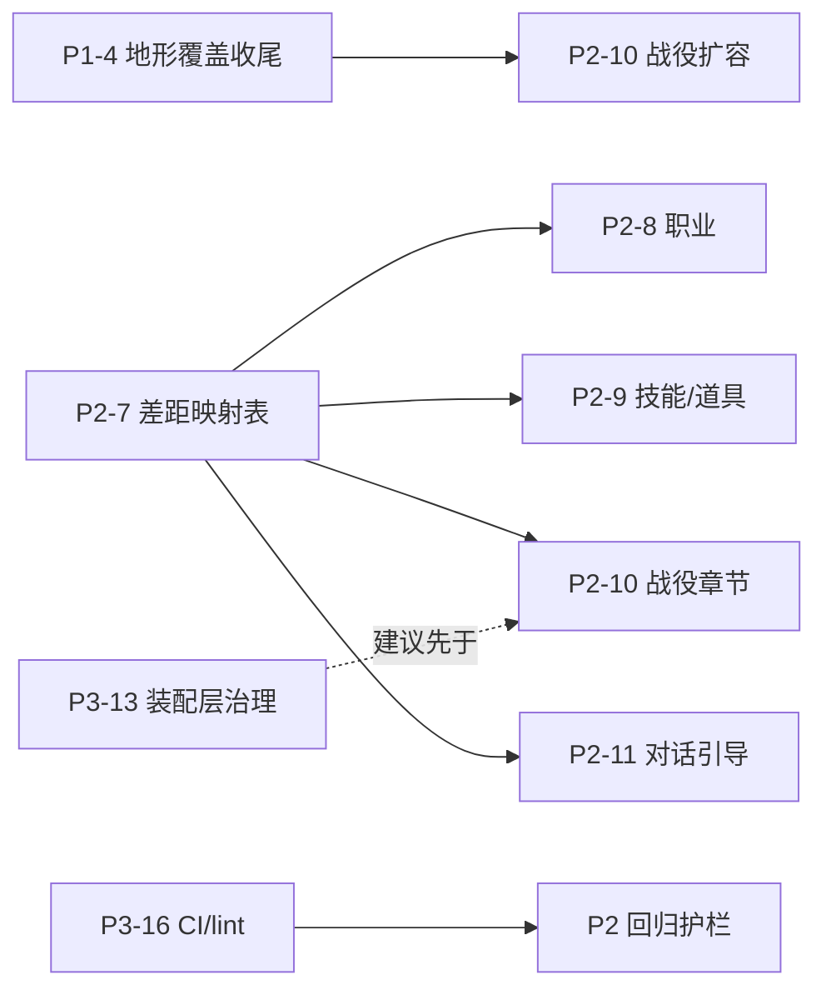

# Roadmap — 后续可逐步完善清单

> 生成：2026-11-15（/init-project 扫描产出）；状态更新：**2026-11-19 第四轮增量清理**（HEAD `b349c7f`）——冒险模式与建筑子系统落地、103 契约基线全绿（pass 98 / fail 0 / env-skip 5）后，已完成项归档、过期项移除。
> 用法：从 P0 开始自上而下做；同一层内按前置依赖排序。每项给「做什么 / 为什么 / 前置 / 验收 / 规模」。
> 完成一项就把它标 ✅ 并在 `claude/changelog.md` 记一笔；本文档随进度滚动维护。
> **玩法元素差距**（对照高完成度战旗的胜负条件/增援/转职/经济等）另见 [gameplay_gap.md](gameplay_gap.md)，两份互补：本文管工程与内容管线，那份管玩法机制（其中 A2 战役结构已由冒险模式解决大半，该文档待下轮刷新）。

## 总览

| 层 | 主题 | 条目 |
| --- | --- | --- |
| **P0** | 堵漏（小时级） | 2 清理脏文件（.bak ×2 + assets/ui/tmp/） |
| **P1** | 补基线 & 保正确（天级） | 4 地形覆盖 7→11 收尾 · 5 B2 世界路径验证 · 6 素材源解绑余项 |
| **P2** | 内容扩张（story 目标态） | 7 差距映射表（**关键路径根**）· 8 职业扩 13 · 9 技能/道具扩容 · 10 战役扩容 6→15 章 · 11 对话接入引导 · 12 用户素材四向展开 |
| **P3** | 重构 & 打磨（有余力再做） | 13 装配层持续治理（battle.gd / campaign_session.gd）· 14 双轨配置收尾 · 15 UI 组件库推广（剩 battle_ui/HUD）· 16 CI/lint · 17 导出配置 · 18 世界状态持久化 · 19 音乐扩容 |

### 依赖关系（箭头 = 前置）

---

## 已完成归档（2026-11-15 → 11-18 期间收口，细节见 `claude/changelog.md`）

- **P0-1 game_hud 契约修复** ✅ 2026-11-15（e8fda38）。
- **P0-3 ui / map_editor_ui 契约回归** ✅ 2026-11-16/17：`ui` 复绿（map_editor 三处直建控件改走 UIFactory）；`map_editor_ui` 六项断言按实现重锚；五项 known-fail 同轮清零（含 isometric_view 根因=HUD 预留列、user_asset_editor=925fe0c 真回归修复）。
- **P1-3 macOS 全量测试基线** ✅ 收口 2026-11-18：契约 80→**103 项**（campaign 4 + 建筑 3 + 战斗规则/演出/图标 ~15），全量 **pass 98 / fail 0 / env-skip 5 / 0 超时**（`.tmp/init_baseline_2026-11-18/`，Godot 4.7.1，HEAD e7ed380）；旧超时项（action_anim / immersive_battle_camera / world_map_overlay / user_asset_source_live）均已转 pass 或 manifest env-skip 声明。
- **P1-4（前半）世界就地战场地形覆盖 3→7** ✅ 2026-11-15：`cell_context_to_terrain()` 3→7 种（water/mountain/snow/sand/rocky/grass/plain，确定性纯函数）；契约 `world_terrain_mapping` 22 断言；世界生成零漂移。剩余 4 种见下面开放条目。
- **P1-6（大半）素材源解绑** ✅ 2026-11-15（3a08327）：源三档可配（`user://asset_source.cfg` > 库内 settings > 默认值）+ 断源优雅降级；live 契约已转 env-skip。余项见开放条目。
- **P2-10（战役结构部分）** ✅ 2026-11-17/18：**战役容器已落地**——`scripts/campaign/`（CampaignSession autoload + 档案 codec/store）+ `data/campaign.json`（6 关线性解锁 + first_clear/repeat 奖励 + loot_table）+ `data/shop.json`（金币 + 按通关数限购）+ 营地七屏（首个全 Pixel* 组件业务 UI）+ 出征/结算桥（先落盘快照、settle 幂等、独立 RNG 掉落、升级差分演出）。权威文档 `docs/campaign_loop.md`；契约 4 项（campaign / campaign_ui / campaign_battle_integration / battle_drop）。剩余=向 story 15 章扩容，见开放条目。
- **P3-13（第一波）main.gd / map_editor.gd / battle.gd 三单体拆分** ✅ 2026-11-15/16：main 4319→2280、map_editor 3285→1088、battle 1934→1557（拆分报告 `docs/plans/split_report_2026-11-15.md`；护栏=terrain SHA-256 零漂移 + region_ops 埋点一致）。后续治理（battle.gd 回涨）见开放条目。
- **P3-15（部分）UI 组件库推广**：组件 22→**27**；**campaign 七屏已全量消费**（首个正经业务消费者），map_editor 直建控件已清（P0-3）；剩余迁移面见开放条目。
- **背击/夹击规则、行动历史【记录】Tab、战斗内升级演出、九键成长表、技能/状态图标、技能图鉴（SkillList.tscn）、建筑摆放与室内战场**：2026-11-17/18 新落地，均带契约（backstab×2 / pincer×2 / profession_growths / level_up_presentation / battle_levelup_flow / skill_icons / status_icons / skill_list / building×3 等），对应 gameplay_gap 的 A1（胜利条件，此前已有）与 A3（增援）之后的战术层差距进一步收窄。

---

## P0 — 堵漏（小时级，无前置，可立即做）

### 2. 清理脏文件与调试遗留 ⚡（剩余收尾）

- **仍剩**（2026-11-18 实测）：
  - `data/battlefields/contract_asset_map.json.bak` + `data/battlefields/building_demo.json.bak`（契约/生成产物脏文件；loader 只扫 `*.json` 不受影响，删除或 gitignore）；
  - `assets/ui/tmp/`（中文名切片中转目录：dialog_frame / element_icons / status_icons / ui 四个子目录——确认切片产物已转正后删除）。
- **已清**（历史）：根目录 `b1_*.png` 调试截图、孤儿 `tests/zz_align_probe.gd.uid`、`AGENTS.md` 的 image-viewing.md 失效引用（2026-11-18 复查已无此引用）。
- **验收**：`git ls-files | grep -E '\.bak$'` 为空；`assets/ui/tmp/` 删除或转正。**规模**：极小。

---

## P1 — 补基线 & 保正确（天级）

### 4. 世界就地战场地形覆盖 7→11 收尾 ⭐⭐

- **做什么**：`cell_context_to_terrain()` 已覆盖 7 种（见归档），补齐剩余 4 种：
  - `forest`：需要把 flora/群落信息引入 CellContext（或采样时查询群落层）——**设计先行**，注意不破坏确定性（CellContext 是流式契约）；
  - `village` / `fort` / `wall`：世界层现无建筑概念；建筑子系统（`BuildingLayout` + recipe 素材）已就绪，可评估"世界生成稀疏建筑点位 → chapter buildings 层"的映射，与 `world_to_chapter` 唯一耦合点原则一致。
- **为什么**：B1 就地战斗的地形多样性直接受此限制；7/11 时 plain 兜底占比高。
- **前置**：无（forest 需先出 CellContext 扩展设计）。**验收**：`world_terrain_mapping` 契约扩展断言新映射 + `terrain_generation` SHA-256 零漂移。**规模**：中。

### 5. B2 世界地形路径深度验证

- **做什么**：`Settings.battle_inline_mode=false` 时按 P 进 B2（世界地形快照战）的整链路（world_to_chapter → Battle.tscn → 渲染 → 结算 → 存档 resume → 返回）历史交接从未深度验证过。用 godot MCP（`dbg_launch` + `runtime_assert_*`）跑一轮全链路断言。
- **2026-11-18 注**：campaign 出征固定走 B2（JSON 战场），B2 链路本身已被 campaign 契约大量覆盖；**本项专指"世界地形"来源的 B2**（P 键 + inline_mode=false），使用频率低但仍是公开路径。
- **前置**：无。**验收**：L2 断言脚本或 MCP 断言记录；发现的问题单独开条目。**规模**：小–中。

### 6. 素材源解绑余项（小）

- **仍剩**：① `docs/user_assets.md` 补"换机器重建源"最小步骤（含 `tools/build_blocks_manifest.mjs` 离线生成清单的用法）；② 评估 `file://`/本地目录直读作为无 HTTP fallback。
- **验收**：断网/无源时编辑器素材面板优雅降级；换机文档可照做。**规模**：小。

---

## P2 — 内容扩张（向 `story/` 目标态推进）

> **先做 7（差距映射表），再并行推进 8–11。** 运行时事实永远是 `data/`；`story/` 只准绳。

### 7. story ↔ data 差距映射表 ⭐（P2 的根）

- **做什么**：建 `docs/story_gap.md`（或并入本文）：13 职业 vs 8（哪些先做、素材是否在 `meowa_tiles/heroes/` 24 png 里）、27 技能 vs 8、25 道具 vs 8、15 章 vs campaign 6 关（每章对应战场规格/敌方配置/触发条件）、8 角色 vs 现有单位命名。
- **为什么**：没有映射表，每次扩张都要重读 19 篇 story 文档；有了它，8–11 可并行派发。
- **前置**：无。**验收**：表覆盖 4 类内容全量 ID 对照 + 建议实现顺序。**规模**：中（纯文档）。

### 8. 职业扩 8→13（含 heroes 素材映射）

- **做什么**：按映射表分批加职业进 `data/professions.json` + 对应武器/成长（**九键 growths 契约已就绪**：缺键逐键回退 `_GROWTH_FALLBACK`，见 `profession_growths` 契约）；`meowa_tiles/heroes/` 24 png 先做与职业的映射约定（一个职业可能多姿态图）。
- **前置**：7。**验收**：每批新职业过 `scenes/SkillTest.tscn` + 新增契约；JSON 战场/campaign 关卡可引用新职业。**规模**：大（分批）。

### 9. 技能/道具扩 8→27/25

- **做什么**：按映射表分批扩 `data/skills.json` / `data/items.json`；**图标槽位已预留**（iconId `'01'..'53'` 稳定契约，未知 ID 回退默认图标——扩容时给新技能分配既有 iconId 即可，勿重排）。新效果类型若超出现有 type 枚举（damage/heal/aoe/buff/debuff），先扩 `systems/` 结算与 `battle_action_resolver`，**同步扩 automation 场景库**（新效果必须有 CLI 无头断言）；掉落进 campaign 商店的记得同步 `data/shop.json`。
- **前置**：7；新类型依赖 16（回归护栏）更稳。**验收**：SkillTest + battle_cli 场景断言全绿。**规模**：大（分批）。

### 10. 战役扩容 6→15 章（story 章节落 campaign）

- **做什么**：战役容器已落地（见归档：campaign.json/CampaignSession/商店/掉落/成长/存档隔离）。剩余：按 story 15 章把 `data/campaign.json` 从 6 关扩到 15 章（每章战场规格、敌方配置、first_clear/repeat 奖励、loot_table、解锁顺序），需要的战场落 `data/battlefields/`（现 8 个）或复用编辑器产出；评估章节间对话钩子（依赖 11）。
- **前置**：7（章节↔战场映射）；8/9 部分到位（章节引用的职业/技能存在）。**验收**：一条可从头打到尾的 15 章链 + campaign 存档/续玩正确（`campaign` / `campaign_battle_integration` 契约扩展覆盖）。**规模**：大（分批）。

### 11. 对话系统接入正式流程（新手引导）

- **做什么**：`DialogueDemo`（`scenes/DialogueDemo.tscn` + `data/dialogue/demo_intro.json`）目前是孤立演示。按 `story/15_onboarding.md` 把首章开场对话接到**Campaign 营地/首关入口**（现主入口；世界入口为次），补对话→战斗的跳转钩子。
- **前置**：7（引导文案依 story）；建议 10 先行（章节容器已在，接首章即可）。**验收**：新开档可见引导对话且可跳过；无对话死路。**规模**：中–大。

### 12. 用户素材 render.mode 四向展开

- **做什么**：单图素材目前只有 `full`（整图贴面）等有限模式；做四向展开/切块模式（一张方块图 → 顶面+四侧面），扩展 descriptor `render` 协议 + `UserAssetVisualAdapter.bake_image()`。**注意**：建筑素材的四方向（`direction_mode=four_directions` + 4:1 sheet + `BuildingLayout`）走的是 `assets/buildings/*/recipe.json` 独立契约（`docs/building_assets.md`），与本项的用户素材通道互不影响，可参考其帧选择公式。
- **前置**：6（源可移植）更稳，非硬依赖。**验收**：新契约（bake 结果像素断言）+ 编辑器预览正确。**规模**：中–大。

---

## P3 — 重构 & 打磨（有余力再做，勿阻塞 P2）

### 13. 装配层持续治理（battle.gd / campaign_session.gd）

- **背景**：三单体拆分已完成（见归档），main.gd 2280 / map_editor.gd 1088 稳定；但 **battle.gd 2026-11-18 回涨到 2186 行 / 116 函数**（+行动历史【记录】Tab + campaign 结算接线），**campaign_session.gd 973 行 / 38 函数**（业务全在 autoload）——证据与建议见 `claude/report.md` §1。
- **做什么**（增量拆分，沿用"模块 RefCounted + Callable 注入 + 同名薄委托"既有模式）：
  - battle.gd：拆出行动记录 Tab（`battle_action_history` 已是独立类，把 UI 接线与回退编排拆出）与 campaign 结算接线（bridge 回调侧）；
  - campaign_session.gd：拆 `campaign_settlement`（`_settle_win` / `_settle_restore` / `_diff_level_ups` / `_victory_loot` / `_merge_loot_entry` 结算簇）为独立模块，autoload 收敛为档案路由 + 存储。
- **红线**：结算逻辑行为不得变（`campaign` / `battle_drop` / `battle_levelup_flow` 契约是护栏）；每抽一簇跑相关契约 + terrain 快照。
- **前置**：无（基线全绿）。**验收**：每次抽取独立 commit、相关契约绿、无行为 diff。**规模**：中（分两次）。

### 14. 双轨配置迁移收尾

- **做什么**：`config/ecosystems.json`（旧，运行时真入口）→ `config/ecology/manifest.json`（新）全量切换：逐 biome/species/community 核对两轨一致后切换读取入口，最终删旧轨与 `legacy_bundles.json`。**注意确定性契约**：`stream_key`/salt 保持不变，需 world version 评估。
- **前置**：无。**验收**：切换前后地形快照哈希一致。**规模**：中–大。

### 15. UI 组件库推广到剩余业务 UI

- **现状**：`ui/` **27 组件**（含 2026-11-18 新增 avatar_frame / frame / nameplate / ninepatch_frame / tabs_vertical）+ 根 `DESIGN.md` token 规范；**campaign 七屏全量消费 ✅**、map_editor 直建控件已清（部分迁移）、`scripts/ui_gallery/` 已模块化拆分。
- **做什么**：迁移剩余老手搓 UI —— **`battle_ui` 四件 + 战斗设置页**（最大头）、`game_hud`（战场面板/设置面板）、世界侧栏/提示条/大地图叠加。按"改哪个界面迁哪个"渐进，不专门停功能做大迁移。
- **前置**：无（随时可做）。**验收**：被迁移界面过既有契约（`ui_contract` 静态扫描 + 画廊视觉对齐）。**规模**：大（按界面摊平）。

### 16. CI / lint 引入

- **做什么**：最小可行：脚本化跑 `node --test`（素材工具 7 项）+ 冒烟契约子集（battlefields/battle_save/game_session/terrain_generation/campaign）+ GDScript 语法级检查（godot --check-only 或 headless parse）；本地一键脚本即可起步，GitHub Actions 视仓库托管情况。**基线已全绿 + runner 自带 JUnit 输出**（`--junit`），接入只差 runner 前置。
- **前置**：无（基线已绿，P1-3 已收口）。**验收**：一条命令出汇总。**规模**：小–中。

### 17. 导出配置（export_presets.cfg）

- **做什么**：建导出预设；排除 `addons/at-icons/` 未用色系、`docs/`、`story/`、`tests/`、`plans/`、`.codegraph/`、`.tmp/`；验证导出包内 `user://startup.cfg` 回退、素材 HTTP 源提示、Panku/Breakpoint 桥在发布版的处置（建议禁用或仅 debug 构建）；**新增**：campaign 存档目录 `user://campaign_saves/` 随包说明。
- **前置**：无。**验收**：导出包在干净机器可跑主流程（Campaign 入口 → 打完一关 → 重启续玩）。**规模**：中。

### 18. 世界状态持久化（大工程，谨慎立项）

- **做什么**：世界探索状态（已生成地形印象、动物/群落状态、玩家位置）目前退出即丢。若要做：设计 world save schema（分层：玩家位置小档 vs 世界快照大档）、版本迁移、与战旗/冒险存档的关系（campaign_saves 已自成体系，勿混）。**先出设计文档再动手**。
- **前置**：14（配置收尾）建议先行。**验收**：往返读档世界一致（快照测试）。**规模**：大。

### 19. 音乐扩容

- **做什么**：`music/` 现仅 night/normal 两曲；按 `story/12_audio_design.md` 目标态补战斗曲/胜负面/环境变奏，接 `Sfx`/BGM 调度（战斗进出切曲已有钩子可复用；campaign 营地/结算场景音乐同此批评估）。
- **前置**：无。**验收**：进出战斗音乐切换正确，无爆音。**规模**：中（素材为主）。

---

## 已知但暂不立项（记录在案）

- `plans/` 目录定位（开发计划存档 vs 本 roadmap 的关系，可日后合并）。
- `scenes/HomeEntry.tscn` / `Isometric3DTest.tscn` 等占位/探针场景的去留。
- 沉浸演出在 B1 模式下的完整验证（当前主要在 B2 验证）。
- `ai_difficulty` 评分系统与托管（autoplay）策略的进一步调参。
- campaign 出征固定走 B2（JSON 战场）；是否给 campaign 关卡加"B1 世界就地变体"或纯剧情关——等 story 章节扩容（P2-10）时一并设计。
