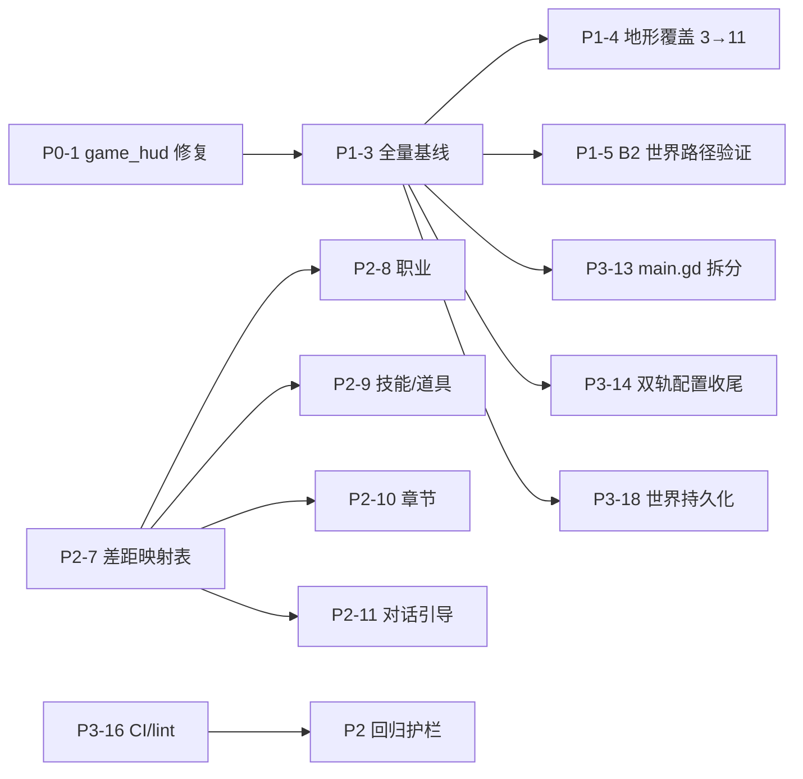

# Roadmap — 后续可逐步完善清单

> 生成：2026-11-15（/init-project 扫描产出）。按**优先级分层（P0–P3）+ 前置依赖**组织。
> 用法：从 P0 开始自上而下做；同一层内按前置依赖排序。每项给「做什么 / 为什么 / 前置 / 验收 / 规模」。
> 完成一项就把它标 ✅ 并在 `claude/changelog.md` 记一笔；本文档随进度滚动维护。
> **玩法元素差距**（对照高完成度战旗的胜负条件/增援/转职/经济等）另见 [gameplay_gap.md](gameplay_gap.md)，两份互补：本文管工程与内容管线，那份管玩法机制。

## 总览

| 层 | 主题 | 条目 |
| --- | --- | --- |
| **P0** | 修坏 & 堵漏（小时级） | 1 修 game_hud 契约 · 2 清理失效引用/调试遗留 |
| **P1** | 补基线 & 保正确（天级） | 3 macOS 全量测试基线 · 4 世界战场地形覆盖 · 5 B2 世界路径验证 · 6 素材源解绑 |
| **P2** | 内容扩张（story 目标态） | 7 差距映射表（**关键路径根**）· 8 职业扩 13 · 9 技能/道具扩容 · 10 章节/战场扩 15 · 11 对话接入引导 · 12 素材四向展开 |
| **P3** | 重构 & 打磨（有余力再做） | 13 main.gd 拆分 · 14 双轨配置收尾 · 15 UI 组件库推广 · 16 CI/lint · 17 导出配置 · 18 世界状态持久化 · 19 音乐扩容 |

### 依赖关系（箭头 = 前置）

---

## P0 — 修坏 & 堵漏（小时级，无前置，可立即做）

### 1. 修复 `game_hud_contract.gd` ⚡

- **做什么**：让该契约能在 `--headless --script` 模式下运行。旧记录的死因：`--script` 模式**不加载 autoload**，而 `scripts/ui/game_hud.gd` 引用 `Settings` 编译报错。修法二选一：① 测试内显式 `Settings` 替身/预载；② HUD 依赖改注入式（构造时传入）。
- **为什么**：69 个契约里它是唯一已知红的；红了就永远干扰"全绿"判断。
- **前置**：无。**验收**：`godot --headless --path . --script res://tests/game_hud_contract.gd` 退出码 0。**规模**：小（半天内）。

### 2. 清理失效引用与调试遗留 ⚡

- **清单**（已逐一核实存在）：
  - `AGENTS.md:47` 仍引用已删除的 `rules/image-viewing.md`（用户文件，建议本人改，agent 勿动）；
  - 孤儿 uid：`tests/zz_align_probe.gd.uid`（对应 .gd 已删）；
  - 根目录调试截图 `b1_debug.png`、`b1_depth_probe.png`、`b1_fixed.png`、`b1_negative_depth_probe.png`、`b1_offset_probe.png`（历史 B1 排查产物，gitignore 或删除）。
- **前置**：无。**验收**：`git grep image-viewing` 仅剩历史文档；`tests/` 无孤儿 .uid；根目录无 b1_*.png。**规模**：极小。

---

## P1 — 补基线 & 保正确（天级）

### 3. macOS 全量契约测试基线 ⭐（P1 的根）

- **做什么**：在 macOS 本机 headless 跑完 69 契约 + SkillTest，产出「通过/失败/跳过」清单，写进 `claude/testing-and-quality.md` 并更新 changelog。首跑含资源导入会慢（已实测 >90s 转后台），建议批量脚本 + 逐份收退出码。
- **为什么**：项目从 Windows 迁到 macOS 后**没有任何一份完整通过记录**；后面所有 P1–P3 改动都需要"改之前是绿的"这一前提。
- **前置**：P0-1（否则永远 1 红）。**验收**：testing-and-quality.md 有 2026-11-xx 的全量结果表。**规模**：中（一次跑批 + 修环境问题）。

### 4. 世界就地战场地形覆盖 3→11 ⭐⭐（玩法收益最大）

- **做什么**：`scripts/core/world_to_chapter.gd` 的 `cell_context_to_terrain()` 目前**只产出 3 种地形**：`water / mountain / plain`（已核实源码：is_water→water，landform mountain/裸岩/雪面→mountain，其余全 plain）。其余 8 种（`grass, sand, snow, rocky, forest, village, fort, wall`）只存在于 JSON 战场。应按 biome/surface/landform 建映射：snow biome→snow、desert→sand、grass surface→grass、树木密格→forest 等。
- **为什么**：世界就地战斗（B1/B2-P）地形单调，防御/回避/移动成本维度全浪费；这是战棋与世界融合度的最大短板。
- **注意**：映射必须是**确定性纯函数**（CellContext→terrain），不得引入 RNG；改动会影响 `world:` 存档恢复的地图一致性——需要评估是否触发 world version 迁移或存档内容签名已兜底（`GameSession` 有 initial 内容签名，大概率自动识别"内容变更"提示）。
- **前置**：P1-3（基线绿了才敢动）+ 设计映射表。**验收**：新契约测试覆盖每种新映射 + 手动进 B1 看地形多样性 + 存档恢复路径不崩。**规模**：中（映射设计 + 契约 + 验证，1–2 天）。

### 5. B2 世界地形路径深度验证

- **做什么**：`Settings.battle_inline_mode=false` 时按 P 进 B2（世界地形快照战）的整链路（world_to_chapter → Battle.tscn → 渲染 → 结算 → 存档 resume → 返回）历史交接从未深度验证过。用 godot MCP（`dbg_launch` + `runtime_assert_*`）跑一轮全链路断言。
- **前置**：P1-3。**验收**：L2 断言脚本或 MCP 断言记录；发现的问题单独开条目。**规模**：小–中。

### 6. 用户素材源解绑 `127.0.0.1:8076`

- **做什么**：素材清单源默认硬编码本机回环地址（历史机器 F:/blocks + http-server）。① 源地址进 `user://settings.cfg` 或独立配置并提供 UI 入口；② `docs/user_assets.md` 补"换机器重建源"最小步骤（含 `tools/build_blocks_manifest.mjs` 离线生成清单文件的用法）；③ 评估支持 `file://`/本地目录直读作为无 HTTP fallback。
- **为什么**：当前换机器素材库即不可用；阻塞 P2-12 的可移植性。
- **前置**：无。**验收**：断网/无源时编辑器素材面板优雅降级（占位图不崩）；改源后重导幂等。**规模**：中。

---

## P2 — 内容扩张（向 `story/` 目标态推进）

> **先做 7（差距映射表），再并行推进 8–11。** 运行时事实永远是 `data/`；`story/` 只准绳。

### 7. story ↔ data 差距映射表 ⭐（P2 的根）

- **做什么**：建 `docs/story_gap.md`（或并入本文）：13 职业 vs 8（哪些先做、素材是否在 `meowa_tiles/heroes/` 24 png 里）、27 技能 vs 8、25 道具 vs 8、15 章 vs 4 战场（每章对应战场规格/敌方配置/触发条件）、8 角色 vs 现有单位命名。
- **为什么**：没有映射表，每次扩张都要重读 19 篇 story 文档；有了它，8–11 可并行派发。
- **前置**：无。**验收**：表覆盖 4 类内容全量 ID 对照 + 建议实现顺序。**规模**：中（纯文档）。

### 8. 职业扩 8→13（含 heroes 素材映射）

- **做什么**：按映射表分批加职业进 `data/professions.json` + 对应武器/成长；`meowa_tiles/heroes/` 24 png 先做与职业的映射约定（一个职业可能多姿态图）。
- **前置**：7。**验收**：每批新职业过 `scenes/SkillTest.tscn` + 新增契约；JSON 战场可引用新职业。**规模**：大（分批）。

### 9. 技能/道具扩 8→27/25

- **做什么**：按映射表分批扩 `data/skills.json` / `data/items.json`；新效果类型若超出现有 type 枚举（damage/heal/aoe/buff/debuff），先扩 `systems/` 结算与 `battle_action_resolver`，**同步扩 automation 场景库**（新效果必须有 CLI 无头断言）。
- **前置**：7；新类型依赖 16（回归护栏）更稳。**验收**：SkillTest + battle_cli 场景断言全绿。**规模**：大（分批）。

### 10. 章节/战场扩 4→15（战役结构）

- **做什么**：story 15 章落成 `data/battlefields/` + 可能需要**战役容器**新概念（章节顺序/解锁/胜负流转，现只有战场平铺列表）。先出设计（是否加 `data/campaign.json`），再实现 GameSession 扩展。
- **前置**：7（章节↔战场映射）；8/9 部分到位（章节引用的职业/技能存在）。**验收**：一条可从头打到尾的短战役链 + 存档/续玩正确。**规模**：大。

### 11. 对话系统接入正式流程（新手引导）

- **做什么**：`DialogueDemo`（`scenes/DialogueDemo.tscn` + `data/dialogue/demo_intro.json`）目前是孤立演示。按 `story/15_onboarding.md` 把首章开场对话接到 Game/主世界入口，补对话→战斗的跳转钩子。
- **前置**：7（引导文案依 story）；建议 10（章节容器）先行否则先接世界入口。**验收**：新开档可见引导对话且可跳过；无对话死路。**规模**：中–大。

### 12. 用户素材 render.mode 四向展开

- **做什么**：单图素材目前只有 `full`（整图贴面）等有限模式；做四向展开/切块模式（一张方块图 → 顶面+四侧面），扩展 descriptor `render` 协议 + `UserAssetVisualAdapter.bake_image()`。
- **前置**：6（源可移植）更稳，非硬依赖。**验收**：新契约（bake 结果像素断言）+ 编辑器预览正确。**规模**：中–大。

---

## P3 — 重构 & 打磨（有余力再做，勿阻塞 P2）

### 13. `main.gd`（4319 行/176 函数）拆分

- **做什么**：按函数簇（配置编译 / 流式生成 / 生态 / 表现 / HUD / 战斗入口）渐进抽出到 `scripts/world/` 既有子域，`main.gd` 收敛为装配层。**红线**：流式生成与确定性调用顺序不得变（SHA-256 快照测试是护栏）。
- **前置**：P1-3 基线 + 每抽一簇跑地形快照契约。**验收**：每次抽取独立 commit、全量契约绿、无行为 diff。**规模**：大（分多次）。

### 14. 双轨配置迁移收尾

- **做什么**：`config/ecosystems.json`（旧，运行时真入口）→ `config/ecology/manifest.json`（新）全量切换：逐 biome/species/community 核对两轨一致后切换读取入口，最终删旧轨与 `legacy_bundles.json`。**注意确定性契约**：`stream_key`/salt 保持不变，需 world version 评估。
- **前置**：P1-3。**验收**：切换前后地形快照哈希一致。**规模**：中–大。

### 15. UI 组件库推广到业务 UI

- **做什么**：`ui/` 16 组件（735 headless checks）迁移 `battle_ui` / `map_editor` / `game_hud` 旧手搓 UI；按"改哪个界面迁哪个"渐进，不专门停功能做大迁移。
- **前置**：无（随时可做）。**验收**：被迁移界面过既有契约 + 画廊视觉对齐。**规模**：大（按界面摊平）。

### 16. CI / lint 引入

- **做什么**：最小可行：脚本化跑 `node --test`（素材工具 7 项）+ 冒烟契约子集（battlefields/battle_save/game_session/terrain_generation）+ GDScript 语法级检查（godot --check-only 或 headless parse）；本地一键脚本即可起步，GitHub Actions 视仓库托管情况。
- **前置**：P1-3（知道哪些本来就红）。**验收**：一条命令出汇总。**规模**：小–中。

### 17. 导出配置（export_presets.cfg）

- **做什么**：建导出预设；排除 `addons/at-icons/` 未用色系、`docs/`、`story/`、`tests/`、`plans/`、`.codegraph/`；验证导出包内 `user://startup.cfg` 回退、素材 HTTP 源提示、Panku/Breakpoint 桥在发布版的处置（建议禁用或仅 debug 构建）。
- **前置**：无。**验收**：导出包在干净机器可跑主流程。**规模**：中。

### 18. 世界状态持久化（大工程，谨慎立项）

- **做什么**：世界探索状态（已生成地形印象、动物/群落状态、玩家位置）目前退出即丢。若要做：设计 world save schema（分层：玩家位置小档 vs 世界快照大档）、版本迁移、与战旗存档的关系。**先出设计文档再动手**。
- **前置**：P1-3；14（配置收尾）建议先行。**验收**：往返读档世界一致（快照测试）。**规模**：大。

### 19. 音乐扩容

- **做什么**：`music/` 现仅 night/normal 两曲；按 `story/12_audio_design.md` 目标态补战斗曲/胜负面/环境变奏，接 `Sfx`/BGM 调度（战斗进出切曲已有钩子可复用）。
- **前置**：无。**验收**：进出战斗音乐切换正确，无爆音。**规模**：中（素材为主）。

---

## 已知但暂不立项（记录在案）

- `plans/` 目录定位（开发计划存档 vs 本 roadmap 的关系，可日后合并）。
- `scenes/HomeEntry.tscn` / `Isometric3DTest.tscn` 等占位/探针场景的去留。
- 沉浸演出在 B1 模式下的完整验证（当前主要在 B2 验证）。
- `ai_difficulty` 评分系统与托管（autoplay）策略的进一步调参。
