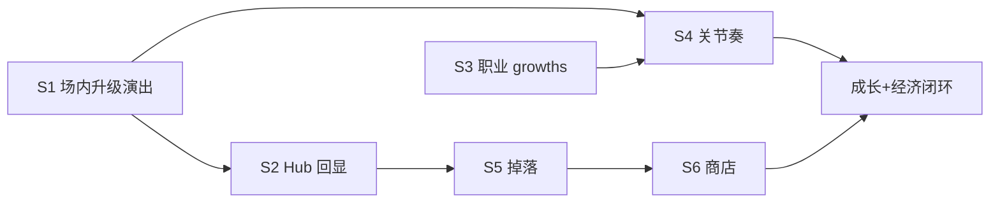

# 计划：战斗 → 升级 → 掉落 → 商店闭环（对话后置）

> 日期：2026-11-18（增补掉落/商店）  
> 目标产品感：打完一场后**明显变强**，并带着成长/战利品回营地，能用金币**买到续航道具再出征**。  
> 明确不做（本期）：对话/引导文案、剧情分支、转职树、商店深度（锻造/贩卖/限时特卖）、战争迷雾、高度结算、神级卷轴事件、场内宝箱格子交互。  
> 入口场景：`res://scenes/Campaign.tscn`（不绕开放世界）。  
> 对照文档：`docs/campaign_loop.md`、`docs/gameplay_gap.md`（B3 / C2）、`story/08` §9、`story/11` §五、`story/06` 道具定价。

---

## 0. 结论速览

**经验成长数据闭环已存在；金币通关奖已有；缺的是「可感知反馈」+「掉落多样性」+「金币消费口（商店）」+「职业成长分化」。**

| 层 | 状态 | 证据 |
| --- | --- | --- |
| 场内经验/升级公式 | ✅ | `WeaponData.exp_for_*` / `exp_to_next`；`BattleActionResolver.gain_exp` |
| 跨关成长落盘 | ✅ | `CampaignRoster.import_victory` 吸收 level/exp/stats；`CampaignSession._settle_win` |
| 战役 Hub / 多关链 | ✅ | `Campaign.tscn` + `data/campaign.json`（6 关） |
| 通关金币/固定物品奖 | 🟡 | `campaign.json` `rewards.first_clear/repeat`；Hub 只展示，**无消费口**（`docs/campaign_loop.md` 明示「不含商店」） |
| 战场/击杀掉落表 | ❌ | 战场 JSON 无 loot；击杀不掉物；`chapter.loot` 基本空 |
| 商店买物 | ❌ | `items.json` 无 `price`；Hub 无购买 UI；金币只进不出 |
| 场内升级演出 | ❌ | 无属性 +1 弹窗；升级音效读错返回结构（见 §1.2） |
| 战后成长回显 | ❌ | Hub 结算只报金币/物品，不报谁升了级 |
| 职业差异成长率 | ❌ | 全员 `UnitFactory.DEFAULT_GROWTHS` |
| 对话 | ⏭ 后置 | 本期零依赖 |

**建议执行顺序（6 个切片，可各独立 commit）：**

```text
S1 修音效 + 场内升级弹窗     （当场感到成长）
S2 Hub 战后成长回显 + 经验条 （回营地确认成长）
S3 职业 growths 分表         （成长有职业味）
S4 前 2–3 关节奏微调         （第一小时必升 1–2 级）
S5 掉落表 + 结算展示         （打完有战利品，不只固定通关奖）
S6 营地商店（金币消费）      （金币有去处 → 经济闭环）
```

验收总题：新档进 Campaign，不看对话，2–3 关内平均等级 +1～2；通关有可见掉落；回营地能花金币买到药剂并在下一关用上。
---

## 1. 现状锚点（改前必读）

### 1.1 经验公式（勿改语义，除非 S4 调参）

| 公式 | 位置 | 现行 |
| --- | --- | --- |
| 击杀 | `scripts/core/weapons.gd` `exp_for_kill` | `30 + enemy_level * 3` |
| 命中未杀 | `exp_for_hit` | `max(1, 10 + (enemy_lv - atk_lv))` |
| 升级阈值 | `exp_to_next` | `50 + level * 30` |
| 成长掷骰 | `battle_action_resolver.gd` `gain_exp` | 每属性 `randf()*100 < growths[k]` → +1；升 hp 上限后回满 |

### 1.2 战斗结算主路径

- 普攻/技能：`battle.gd` → `BattleActionResolver.resolve_*` → 内部 `gain_exp`，返回 `outcome.exp = { amount, gained, levels:[{level, gains}] }`
- 薄包装 `_gain_exp`（`battle.gd` ~1390）目前几乎不被主路径使用，且 **音效条件写错**：

```gdscript
# 错误：gain_exp 返回顶层 levels，没有嵌套在 exp 下
if not (info.get(&"exp", {}).get(&"levels", []) as Array).is_empty():
	Sfx.play(&"ui_levelup")
```

正确应为读 `info.get(&"levels", [])`（或与 `outcome.exp.levels` 对齐的统一结构）。

### 1.3 战役落盘

- 出征：`CampaignBattleBridge.enter_battle` → `CampaignSession.prepare_battle`
- 胜利：`settle_battle` → `_settle_win` → `import_victory`（按单位 id 吸收成长）→ 发金币/物品 → 落盘
- `_last_result` 现字段：`result/level_*/gold/items/first_clear/...`，**无 level_ups 摘要**
- Hub：`campaign_hub._present_last_result` 只展示金币/物品；`campaign_format.unit_label` 有 Lv，**无 EXP 进度**

### 1.4 成长率

- `unit.gd` `DEFAULT_GROWTHS`：全职共用
- `professions.json`：**无 growths 字段**
- `apply_profession`：不写职业成长表

### 1.5 奖励 / 掉落 / 商店现状

| 能力 | 现状 | 缺口 |
| --- | --- | --- |
| 通关奖 | `CampaignConfig.rewards_for` → 首胜 200 金 + `hpPotion`×1；重复 50 金 | 仅全局默认；关卡级 `rewards` 覆写已支持但未配内容差异 |
| 结算展示 | `battle.gd` 把 receipt `items/gold` 塞进 result；Hub 弹窗列金币/物品 | 无「本场掉落」与「通关奖」区分；无击杀过程掉落 |
| 库存 | 公共 `inventory` + 出征 `carry_templates` 自动发放 | 买到的物应进同一库存，走现有出征发放 |
| 商店 | 无 | 需价目表 + Hub UI + `spend_gold`/`buy_item` 会话 API |
| 道具价 | `items.json` 无 `price` / `sellPrice` | S6 补 `price`（买价）；卖出本期不做 |

设计锚（简化落地，勿一次抄满 story）：

- `story/11` §5.1–5.3：首几章偏消耗品；mpPotion 宜限购；胜利金 100–250 量级。  
- 本期商店：**只买不卖**；货架 3–5 个现有道具即可。  
- 本期掉落：**通关掉落表（确定性或加权一次掷骰）优先**；击杀即时掉落为增强项（S5b，可同切片或紧随）。

### 1.6 UI 可复用资产

- Gallery 已有胜利结算 EXP 行 / 「掉落：铁枪 ×1 · …」mock：`ui_component_gallery.gd`——**视觉参考，勿直接耦合 gallery**
- SFX：`&"ui_levelup"` 已登记；购入可复用既有 `ui_click` / 若有 `ui_buy` 则用，否则先 click
- 组件库：升级弹窗 / Hub / 商店一律 `UIFactory` + Pixel* + `ComponentTheme`（`DESIGN.md`）；禁裸 `Button.new()`

---

## 2. 切片详解

### S1 — 场内升级可见（优先，规模 S）

**目的**：击杀升级当下就能看到「谁升了、涨了哪些属性」。

#### 做什么

1. **统一升级结果读取**  
   - 约定：`gain_exp` / `outcome.exp` 的 `levels` 为唯一真相。  
   - 修 `battle.gd._gain_exp` 音效条件；主路径（`resolve_attack` / `resolve_skill` 返回后）在 `levels` 非空时播 `&"ui_levelup"`。

2. **升级弹窗（表现层）**  
   - 新建薄模块建议：`scripts/battle/level_up_presentation.gd`（或并入既有 presentation，避免再膨胀 `battle.gd`）。  
   - 输入：`unit` + `levels: [{ level, gains: { stat: {from,to} } }]`  
   - 展示：单位名、新等级、非空 gains 的中文属性行（力/魔/技/速/运/防/魔防/HP/MP）。  
   - 行为：可快进/点击关闭；与沉浸演出开关解耦（升级反馈默认开；若需设置项后补）。  
   - 插入点：普攻/技能结算演出结束后、回到行动菜单前；`levels` 为空则跳过。

3. **单位详情 EXP 进度**  
   - `battle_ui_unit_detail.gd`：由 `EXP %d` 改为 `EXP %d / %d`（分母 = `WeaponData.exp_to_next(level)`）。

#### 不做什么

- 不改经验公式数值（留给 S4）。  
- 不做章前对话、不改战役 schema。

#### 文件触点（预期）

| 文件 | 变更 |
| --- | --- |
| `scripts/scenes/battle.gd` | 修音效；在 resolve 后调用升级演出 |
| `scripts/battle/level_up_presentation.gd` | **新建** 弹窗 |
| `scripts/battle/battle_ui_unit_detail.gd` | EXP 进度文案 |
| `tests/…` | 新增或扩展契约（见 §3） |

#### 验收

- [ ] 击杀导致升级时播放 `ui_levelup`（可在合约里 spy / 读调用计数 meta）。  
- [ ] 弹窗列出至少一项实际 gains（与 `levels[].gains` 一致）。  
- [ ] 可快进关闭且不卡死回合状态机。  
- [ ] 单位详情显示 `EXP a / b`。  
- [ ] 既有 `battle_automation_contract` 击杀→level_up 仍绿。

---

### S2 — Hub 战后成长回显（规模 S）

**目的**：回营地一眼确认「打完更强了」。

#### 做什么

1. **结算收据增加成长摘要**（纯数据，演出无关）  
   - 在 `_settle_win` / `import_victory` 路径比较「出征前 snapshot roster」与「imported roster_new」：  
     - 对每个 matched id：若 `level` 升高或 `exp`/`stats` 变化，记入 `level_ups` 数组。  
   - 建议字段：

```json
"level_ups": [
  {
    "id": "r_0",
    "name": "罗兰",
    "from_level": 3,
    "to_level": 4,
    "stat_deltas": { "str": 1, "spd": 1 }
  }
]
```

   - `stat_deltas` 可用前后 stats 差分（不必重放 RNG）；无升级但经验增加也可另列 `exp_gains`（可选，本期可只报升过级的单位）。

2. **Hub 弹窗文案**  
   - `campaign_hub._present_last_result`：胜利分支追加「升级：罗兰 3→4（力+1 速+1）」类行。

3. **队伍行 EXP**  
   - `campaign_format.unit_label`：在有 `exp` 时追加 `EXP a/b`（b=`exp_to_next(level)`）。  
   - Hub 列表已用该 helper 则自动受益。

#### 不做什么

- 不做编成勾选 UI 大改（商店见 S6）。  
- 不改 `import_victory` 的吸收字段集合（只多产出摘要）。

#### 文件触点（预期）

| 文件 | 变更 |
| --- | --- |
| `scripts/campaign/campaign_session.gd` 或 `campaign_roster.gd` | 产出 `level_ups` |
| `scripts/scenes/campaign_hub.gd` | 展示成长行 |
| `scripts/scenes/campaign_format.gd` | `unit_label` 加 EXP |
| `tests/campaign_contract.gd` / `campaign_battle_integration_contract.gd` | 断言收据含 level_ups |

#### 验收

- [ ] 人为构造「战前 Lv1、战后 Lv2」的 settle，收据含对应 `level_ups`。  
- [ ] Hub 弹窗可见升级文案；关闭后队伍行 Lv/EXP 与存档一致。  
- [ ] 失败/撤退仍不发奖、无虚假 level_ups。

---

### S3 — 职业 growths 分表（规模 S–M）

**目的**：不同职业升级手感可辨，避免「全员同一骰表」。

#### 做什么

1. **`data/professions.json`**  
   - 每个职业增加 `growths` 对象，键与运行时一致：`hp, mp, str, mag, skl, spd, luk, def, res`。  
   - 初版可从 `story/11_balance_and_progression.md` §2.2 简化抄 8 个现职；总和量级保持 ~250–300。  
   - 缺字段时回退 `DEFAULT_GROWTHS`（兼容旧档/测试夹具）。

2. **写入时机**  
   - `UnitFactory` / `ProfessionData.apply_profession`：建单位或套职业时写入 `unit.growths`。  
   - 战役初始队伍 `CampaignRoster.build_initial` 走同一路径，保证新档即分化。

3. **契约**  
   - 扩展 `builtin`/`professions` 相关契约：每职 growths 键齐全、值为 0–100 int。  
   - 可选：同种子下剑士 vs 法师多次升级，期望 str/mag 增量方向不同（统计断言宜松，或纯数据断言即可）。

#### 不做什么

- 不做转职、不扩 8→13 职业（那是后续内容批）。  
- 不改战斗伤害公式。

#### 验收

- [ ] 新单位 `growths` 与职业表一致（非全局默认，除非职业未配置）。  
- [ ] 旧存档缺 growths 时加载不崩（codec 已有 default 填充则保持）。  
- [ ] SkillTest / 相关契约绿。

---

### S4 — 前几关节奏（规模 S，偏内容）

**目的**：第一小时内「必升感」，闭环可被玩家自然触发。

#### 做什么

1. 审 `data/campaign.json` 前 3 关对应战场：  
   - `plains_skirmish`：确保主力打完至少 1 人升级（必要时降敌级或减敌数）。  
   - `river_crossing` / `mountain_pass`：级差验证「升级后更好打」，勿劝退。  
   - `ambush_reinforce`：勿放太前，或标为进阶关。

2. **优先改战场 JSON，慎改全局经验公式**；若必须动公式，同步改 `tests/battle_automation_contract.gd` 中 `exp_for_kill(1)==33` 等硬编码。

3. 手测路径（无对话；S5/S6 落地后延伸）：

```text
Campaign → 新建档 → 平原前哨战通关
  → Hub 见升级文案、Lv、掉落/通关奖
  → 商店花金币买药剂
  → 下一关出征，数值与库存接续
```

#### 验收

- [ ] 新档首胜至少 1 人升级（稳定可复现；允许写合约用固定 RNG 种子）。  
- [ ] 第二关读档/续玩等级不回滚。

---

### S5 — 掉落物（通关奖扩展 + 可选击杀掉落）（规模 M）

**目的**：胜利不只「固定 200 金 + 1 瓶药」；玩家感到**战场有收获**。

#### 做什么（分层，先做 5a，5b 同切片或紧随）

**S5a — 关卡掉落表（推荐先做，确定性好测）**

1. **配置**  
   - 在 `data/campaign.json` 为前几关写 `rewards` 覆写（已有 schema）：差异化 `gold` + `items[]`。  
   - 可选扩展字段（若现校验不够再扩 `campaign_config._validate_rewards`）：

```json
"rewards": {
  "first_clear": {
    "gold": 150,
    "items": [{ "id": "hpPotion", "count": 1 }],
    "loot_table": [
      { "id": "shuriken", "count": 1, "weight": 60 },
      { "id": "antidote", "count": 1, "weight": 30 },
      { "id": "mpPotion", "count": 1, "weight": 10 }
    ],
    "loot_rolls": 1
  },
  "repeat": { "gold": 50, "items": [], "loot_rolls": 0 }
}
```

   - `loot_table` + `loot_rolls`：胜利时按权重抽 N 次，结果并入发放物品（与固定 `items` 合并进库存）。  
   - **无 `loot_table` 时行为与现网完全一致**（只发固定 items）。

2. **结算**  
   - `_settle_win`：解析 loot → 写入 inventory；收据增加：
     - `items` / `items_awarded`：固定奖（保持兼容）  
     - `loot`：本次掷骰掉落（可空）  
     - 或统一 `items` 但加 `source: "clear"|"loot"`（二选一，推荐分字段免破旧 UI）

3. **展示**  
   - 战场胜利演出 + Hub 弹窗：分行列「通关奖励」与「战场掉落」；空则省略行。  
   - 对齐 gallery 文案风格，但走真实收据数据。

**S5b — 击杀掉落（增强，可选同批）**

1. 敌人单位或职业可挂 `drop_table`（战场 JSON 单位字段或 `professions`/`data/drops.json`）。  
2. 击杀时 `BattleActionResolver` / battle 死亡路径掷一次；掉落进「本场待结算包」`chapter.pending_loot`，**胜利才入账**（失败/撤退丢弃，与现「失败不发奖」一致）。  
3. 收据 `loot` 合并通关掷骰 + 击杀掉落。  
4. **首版可只做 1–2 个演示敌**（如 plains 某斧兵掉手里剑），勿全表铺满。

#### 不做什么

- 不做地图宝箱格子、开门搜刮、偷取指令。  
- 不做传说/史诗掉落池（story 全表后置）。  
- 不在失败时保留击杀拾取（避免刷子；与战役失败回滚一致）。

#### 文件触点（预期）

| 文件 | 变更 |
| --- | --- |
| `data/campaign.json` | 前几关 rewards / loot_table |
| `scripts/campaign/campaign_config.gd` | 校验 loot_table；`rewards_for` 或新 `roll_loot` |
| `scripts/campaign/campaign_session.gd` | `_settle_win` 合并发放 + 收据 |
| `scripts/scenes/campaign_hub.gd` / result presentation | 展示掉落行 |
| `scripts/battle/…`（仅 S5b） | 击杀写入 pending_loot |
| `tests/campaign_contract.gd` 等 | 固定 RNG 断言掉落入账 |

#### 验收

- [ ] 无 loot_table 的关卡：行为与改前逐字一致（金币/物品数）。  
- [ ] 有 loot_table 的关：胜利库存增加掷出物品；收据可见；失败不入账。  
- [ ]（S5b）击杀掉落仅胜利入账；撤退后库存与出征前一致。  
- [ ] 相关 campaign / result 契约绿。

---

### S6 — 营地商店（金币消费闭环）（规模 M）

**目的**：金币有去处；买到的药能进公共库存并在出征时发到身上。

#### 做什么

1. **价目与货架数据**  
   - 方案 A（推荐）：`data/shop.json`（或 `campaign.json` 顶层 `shop`）：

```json
{
  "version": 1,
  "stock": [
    { "id": "hpPotion", "price": 80, "limit_per_clear": 0 },
    { "id": "antidote", "price": 60, "limit_per_clear": 0 },
    { "id": "mpPotion", "price": 120, "limit_per_clear": 2 },
    { "id": "shuriken", "price": 100, "limit_per_clear": 0 }
  ]
}
```

   - `limit_per_clear=0` 表示不限购（仍受金币约束）；`>0` 表示**每个已通关关卡刷新额度**或「当前进度章限购」（实现时锁定一种语义并写进注释：推荐 **按 `completed_levels.size()` 为章索引刷新库存**）。  
   - `items.json` 可同步加可选 `price` 作默认；货架价优先。

2. **会话 API（纯逻辑，先于 UI）**  
   - `CampaignSession.list_shop()` → 货架 + 当前可买数 + 玩家金币  
   - `CampaignSession.buy_item(item_id, count=1)` → 扣金、加 inventory 实例（uses=物品 max）、落盘；失败返回明确 error（金币不足 / 售罄 / 未知物）  
   - 购买必须走与 `_persist` 相同安全落盘；**禁止只改内存不落盘**。

3. **Hub UI**  
   - 营地增加「商店」入口按钮（PixelButton）。  
   - 屏或 Modal：列表（名 / 价 / 库存）+ 购买确认；买后刷新金币与随身物品列表。  
   - 遵守 DESIGN：六薄容器、无绝对定位、无横向滚动。

4. **与出征衔接**  
   - 买到的消耗品进公共库存后，现有 `deploy` + `carry_templates` 应能自动发到单位（缺货跳过逻辑已有）。  
   - 若 templates 不含新物 id：S6 最小修复 = 购买后也可「未分配留在公共库、出征 FIFO 仍按 templates」——**至少保证下一关能从库存发到已配置该 id 的模板槽**；若首发 templates 只有 hpPotion，货架先卖 templates 已覆盖的 id，或买后把该 id 追加进默认 template（选更简单的一条并写清）。

#### 不做什么

- 不卖装备锻造、不回收（卖出）、不讨价还价。  
- 不做多商店/流浪商人地图点。  
- 不重做整备「手动拖物品到单位」（仍靠自动携带方案）。

#### 文件触点（预期）

| 文件 | 变更 |
| --- | --- |
| `data/shop.json`（或 campaign 内嵌） | **新建** 货架 |
| `data/items.json` | 可选 `price` |
| `scripts/campaign/campaign_session.gd` | `list_shop` / `buy_item` |
| `scripts/campaign/campaign_config.gd` 或新 `shop_catalog.gd` | 装载校验 |
| `scripts/scenes/campaign_hub.gd` / 新 `campaign_shop.gd` | UI |
| `tests/campaign_contract.gd`、`campaign_ui_contract.gd` | 购买/穷举/落盘 |
| `docs/campaign_loop.md` | 删除「不含商店」；补购买规则 |

#### 验收

- [ ] 金币足够：购买成功，金币减少，inventory +1，刷新后仍在（重进 Hub / 重载档）。  
- [ ] 金币不足 / 售罄：失败且状态不变。  
- [ ] mpPotion 限购生效（若配置了 limit）。  
- [ ] 买药后出征，战场上单位能用到该药（或文档声明的发放规则成立）。  
- [ ] `campaign` / `campaign_ui` 契约绿；`ui_contract` 不因新脚本直建 Button 而红。

---

## 3. 测试与验证策略

| 层级 | 命令 / 方式 | 覆盖切片 |
| --- | --- | --- |
| L1 单测 | `godot --headless --path . --script res://tests/battle_automation_contract.gd` | S1 公式/level_up 事件 |
| L1 | `…/campaign_contract.gd`、`campaign_battle_integration_contract.gd` | S2/S5 收据/落盘 |
| L1 | professions / unit 相关契约（扩展） | S3 |
| L1 | `campaign_ui_contract.gd` + shop 断言 | S6 |
| L2 | Campaign 手测或 MCP `dbg_launch` `res://scenes/Campaign.tscn` | S1–S6 体感 |
| 回归子集 | 改动触及的合约 + `python3 tools/run_contracts.py --test campaign` | 防回归 |

新增/扩展合约建议：

- 优先扩展既有 `campaign_contract` / `campaign_ui_contract`（掉落入账、购买扣金、限购）。  
- S1 演出类断言可并入 battle 合约或薄 `level_up_presentation_contract`（避免膨胀则并入）。  
- 掉落 RNG：测试内 `seed()` 固定或注入可测的 `roll_loot(table, rng)` 纯函数。

---

## 4. 依赖与风险



| 风险 | 缓解 |
| --- | --- |
| 升级弹窗卡住回合机 | 强制 timeout / 跳过键；合约断言 phase 能继续 |
| RNG 导致「本场没人升级/没掉落」 | S4 调敌级；loot 合约固定种子；首胜固定 items 保底 |
| 改经验公式拖红 automation | S4 优先改战场；改公式必同步断言 |
| 掉落与通关奖重复发两遍 | 收据字段分离；单测断言 count |
| 商店买了发不到战场 | 货架 id ⊆ carry_templates 或买后写入 template；集成测一票否决 |
| 刷关囤金破经济 | 重复通关金保持低；限购 mpPotion；不做卖出 |
| UI 违反 DESIGN | 只用 Pixel*/UIFactory；跑 `ui_contract` |
| 与进行中的建筑/室内 diff 混提交 | **本计划与 S1–S6 实现分 commit；勿捆绑 `.tmp/` 与无关建筑改动** |

---

## 5. 明确后置（不要偷偷做）

- 对话系统接入、`story/15_onboarding`  
- 转职 / 飞行系扩职业 / 技能道具大扩容  
- 商店深度：卖出、锻造、多商人、史诗货架  
- 地图宝箱 / 可破坏物搜刮  
- 支援、永久死亡叙事  
- 战争迷雾、高度入结算、AP 制  
- 开放世界持久化  

以上不影响本闭环验收。

---

## 6. 执行检查清单（打勾用）

### S1
- [ ] 修复 `_gain_exp` / 主路径升级音效读取 `levels`
- [ ] 升级弹窗模块 + 接入 resolve 后
- [ ] 单位详情 EXP a/b
- [ ] 契约 / 手测通过

### S2
- [ ] settle 收据 `level_ups`
- [ ] Hub 胜利文案
- [ ] `unit_label` EXP
- [ ] campaign 契约通过

### S3
- [ ] 8 职业 growths 入 JSON
- [ ] apply_profession / UnitFactory 写入
- [ ] 缺省回退 + 契约

### S4
- [ ] 前 2–3 关可稳定触发升级
- [ ] Campaign 竖切手测记录（可写在本文件「执行记录」）

### S5
- [ ] campaign rewards / loot_table 配置与校验
- [ ] `_settle_win` 发放 + 收据 `loot`
- [ ] Hub / 胜利演出展示掉落
- [ ]（可选）S5b 击杀 pending_loot 仅胜利入账
- [ ] campaign 契约：有表/无表/失败不入账

### S6
- [ ] shop 数据 + `list_shop` / `buy_item`
- [ ] Hub 商店 UI（DESIGN 合规）
- [ ] 限购与穷举失败路径
- [ ] 购买 → 出征可用
- [ ] 更新 `docs/campaign_loop.md`
- [ ] campaign / campaign_ui 契约通过

### 收尾
- [ ] 本计划勾选更新
- [ ] 若合入主线：`docs/gameplay_gap.md` B3→✅、C2→🟡/✅ 并链到本计划
- [ ] 不提交 `.tmp/`、无关建筑室内大 diff（除非另开建筑 PR）

---

## 7. 执行记录（开工后追加）

| 日期 | 切片 | 结果 | 备注 |
| --- | --- | --- | --- |
| （待填） | | | |

---

## 8. 与「皇家骑士团」大图的关系

本计划 = 大图 **Phase 1「成长可感知」+ 经济最小闭环（掉落/商店）**，刻意砍掉对话与战役叙事。  
完成 S1–S6 后，玩家闭环为：

```text
出征 → 战斗升级 → 胜利掉落/奖金 → 营地花金币补给 → 再出征
```

下一优先：整备（手动配装）→ 事件脚本/目标 AI → 转职；而不是先铺 15 章文案。
