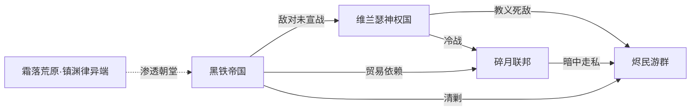

# 国家设定（Nations）

> 本文档对应设计支柱 **「交锋」** 与 **「抉择」**——每个国家的作战风格直接映射战旗的兵种克制与布阵策略（交锋），国与国的关系网为剧情分支提供道德困境（抉择）。一切设定严格服从 [00_design_pillars.md](00_design_pillars.md) 的「魔法稀缺」与「战争没有赢家」基调，并建立在 [01_worldview.md](01_worldview.md) 的地理、源脉、信仰体系之上。

---

## 0. 国家设计总纲

为给每个国家足够的剧情刻画深度，且服务主题（参考：synergy-thematic-design 主题协同——每个国家都是「战争没有赢家」的一个切面），**只设 3 国 + 1 蛮族势力**，共 4 方：

| 势力 | 在主题中的切面 | 玩法风格一句话 |
|------|----------------|----------------|
| **黑铁帝国** Atraferro | 「以力量求自保者，终被力量反噬」 | 重甲坦克流：高 HP 低机动，正面碾压 |
| **维兰瑟神权国** Velantheocracy | 「以信仰之名行掠夺之实」 | 稀有法师流：单位少但强力，治疗+魔法双修 |
| **碎月联邦** Broken Moon League | 「以贸易求生存者，被迫卷入厮杀」 | 弓弩工事流：远程+地形工事，防御反击 |
| **烬民游群** Ashen Remnant（蛮族） | 「被所有人抛弃者的复仇与真相」 | 狂化消耗流：高 HP 低魔防，自伤换伤害 |

> 范围控制说明（参考：game-development-planning 约束三角）：4 方是 SRPG 剧情刻画的舒适上限。更多国家会让每个国家扁平化，破坏主题所需的灰色深度。

---

## 1. 黑铁帝国 Atraferro（铁与血的旧霸主）

### 1.1 一句话定位
苍脊西麓的钢铁巨兽，大陆军事最强、却因长年穷兵黩武而内部腐朽的老牌帝国——它以为自己在保卫边疆，实则在用战争延缓自身的崩塌。

### 1.2 国旗 / 国色 / 国徽
- **国旗**：黑底中央一只咬合的灰色铁砧，铁砧上插着一柄断剑，背景为暗红色斜十字
- **国色**：**黑 / 暗红 / 铁灰**（战场敌我识别色）
- **国徽**：断剑铁砧（寓意「以断剑铸更强之剑」）

### 1.3 政体
**中央集权的军事帝国**。皇帝拥有绝对权力，下设「铁血六部」分掌军政。贵族以军功封地，无军功者世代贬黜——这迫使贵族不断主战。

### 1.4 地理位置
- 位于**苍脊山脉以西**、银泪河中上游，占据大陆中部最肥沃的温带平原与黑铁要塞隘口。
- 邻国：东接维兰瑟神权国（隔苍脊），南邻碎月联邦（隔银泪河下游），北依霜落荒原（《镇渊律》异端渗透来源）。

### 1.5 国力定位

| 维度 | 评分（1-5） | 说明 |
|------|-------------|------|
| 军事 | **5** | 大陆最强陆军，重装骑士团「黑铁卫」威震四方 |
| 经济 | 3 | 农业强，但连年战争透支国库 |
| 魔法 | 2 | 源裔稀少且被强制征召，法师数量勉强够用 |
| 人口 | 4 | 人口最多，兵源充足，但厌战情绪高涨 |

### 1.6 国家性格与作战风格
- **重骑士帝国 = 高 HP 低机动坦克流**。帝国军以重装步兵与重装骑兵为核心，单位 HP 与防御冠绝大陆，但移动力（mov）普遍偏低，惧怕高机动骚扰与远程消耗。
- **玩法风格**：慢推阵地战，抢占隘口后以「不可撼动」的正面推进碾碎敌阵；弱点是侧翼空虚、追不上撤退之敌，面对碎月联邦的弓弩工事与烬民的狂化突进时会非常吃力。
- **主题映射**：帝国的「不可撼动」是它的骄傲，也是它的坟墓——它永远在赢正面战，却永远追不上真正的敌人（参考：synergy-thematic-design 主题协同）。

### 1.7 核心资源 / 特产
- **黑铁矿石**（苍脊西麓特产，大陆最优质的兵器用钢）
- **银泪河中游粮仓**（养活全大陆三分之一的麦田）
- 触发战争的利益点：帝国亟需东进夺取圣城艾尔萨下的**最后富源井**，以维持其法师部队不致断炊。

### 1.8 代表色与美术关键词
- **黑金、铁灰、暗红血锈、哥特尖顶、厚重板甲、城垛、军旗、硝烟（非火药，为篝火/烽烟）**
- 美术参考词汇：*grimdark gothic, ironclad, basalt walls, blood-red banners*

### 1.9 关键政治人物

| 姓名 | 职位 | 一句话动机（留给剧情文档展开） |
|------|------|--------------------------------|
| **铁帝·盖里克四世（Garrick IV）** | 在位皇帝，七旬老帝 | 「朕要在咽气前为帝国锁住最后一口源井，哪怕用所有人的血。」 |
| **黑铁相·赫尔曼（Herrmann）** | 铁血六部之首，实际摄政 | 暗中与《镇渊律》勾结，欲借「净魔」之名清洗朝中源裔派，真实目的是篡位。 |

---

## 2. 维兰瑟神权国 Velantheocracy（源脉圣座的仆从）

### 2.1 一句话定位
以《源典》正教立国的神权国，自命为源脉的守护者，实则把对源井的垄断包装成神圣使命——它的每一句祷词都滴着异端的血。

### 2.2 国旗 / 国色 / 国徽
- **国旗**：纯白底中央一只金色的「源眼」（一只流泪的眼睛，瞳孔为源脉符文）
- **国色**：**白 / 金 / 淡蓝**（战场敌我识别色）
- **国徽**：流泪源眼

### 2.3 政体
**神权国**。最高统治者「圣座」由源典教廷大祭司团选出，兼任宗教与世俗领袖。下设「圣裁庭」审判异端（《镇渊律》信徒）。

### 2.4 地理位置
- 位于**苍脊山脉以东**、烬海以北的高原，国土多荒原与高原台地，地形崎岖易守难攻。
- **圣城艾尔萨**位于其与帝国交界的苍脊中段，**主权存在争议**——这是主冲突的导火索。
- 邻国：西隔苍脊接黑铁帝国，南接烬海（烬民游群出没），北接霜落荒原。

### 2.5 国力定位

| 维度 | 评分（1-5） | 说明 |
|------|-------------|------|
| 军事 | 3 | 常规部队平庸，但法师团「圣裁者」极强 |
| 经济 | 2 | 高原贫瘠，依赖朝圣经济与源晶贸易 |
| 魔法 | **5** | 大陆法师最密集之国，掌控圣城源井 |
| 人口 | 2 | 人口少，但全民狂信徒，士气极高 |

### 2.6 国家性格与作战风格
- **源脉神权国 = 稀有但强力的魔法部队流**。神权国常规步兵孱弱，但其「圣裁者」法师团与「源典祭司」治疗者是大陆最恐怖的王牌——单位数量稀少（个位数到低两位数），但单个法术可扭转战局，治疗者能让残兵持续作战。
- **玩法风格**：以少数精英法师为核心构建阵型，物理部队只负责护卫与拖延，靠魔法爆发和治疗续航在关键回合一举翻盘；弱点是法师阵亡不可补充（源裔稀缺），每一次法师的阵亡都是战略级损失，玩家必须像保护王牌棋子一样保护他们——这正是「抉择」支柱的极致体现。
- **主题映射**：神权国看似「正义」，实则是用信仰包装的资源掠夺者。当玩家指挥它的法师团焚毁一座村庄时，主题「战争没有赢家」会不证自明（参考：synergy-thematic-design 主题协同）。

### 2.7 核心资源 / 特产
- **圣城艾尔萨下的最后富源井**（全大陆魔法命脉，主权争议核心）
- **源晶**（神权国垄断高品质源晶的出口，以此拿捏他国法师补给）
- **朝圣经济**（每年无数信徒带财货来朝，是其外汇支柱）

### 2.8 代表色与美术关键词
- **纯白、金箔、淡蓝光晕、教堂穹顶、彩色玻璃花窗、祭袍、符文、浮空源晶**
- 美术参考词汇：*sacred theocracy, gilded cathedrals, ley-glow runes, stained glass, solemn priests*

### 2.9 关键政治人物

| 姓名 | 职位 | 一句话动机 |
|------|------|-----------|
| **圣座·艾莉莎三世（Elysa III）** | 源典教廷最高领袖 | 表面慈悲，内心坚信「灰潮是源脉的净化」，暗中阻挠治愈研究以维持神权合法性。 |
| **圣裁长·瓦伦（Valen）** | 圣裁庭之长，法师团统帅 | 一位真正虔诚的源裔，开始怀疑圣座的灰潮阴谋，是剧情中可能的倒戈关键。 |

---

## 3. 碎月联邦 Broken Moon League（逐利而生的城邦联盟）

### 3.1 一句话定位
碎月湾沿岸的商贸城邦联盟，没有国王、只有账本，本想永远在战争中两头赚钱，却终因源晶贸易被两边同时当作敌人——中立的代价是同时失去两个朋友。

### 3.2 国旗 / 国色 / 国徽
- **国旗**：深蓝底上一轮破碎的银月，月缺处悬着一枚金色天平
- **国色**：**深蓝 / 银 / 金**（战场敌我识别色）
- **国徽**：碎月天平

### 3.3 政体
**城邦联邦（商共）**。由七大自由市的商会推举的「执政官」轮流主政，决议需商会投票。决策慢但内耗高，是典型的「民主的低效」。

### 3.4 地理位置
- 位于**大陆西海岸碎月湾**沿岸及银泪河下游三角洲，港口密布，水网纵横。
- 邻国：北隔银泪河接黑铁帝国，东隔苍脊余脉接维兰瑟神权国，海路连通烬海。

### 3.5 国力定位

| 维度 | 评分（1-5） | 说明 |
|------|-------------|------|
| 军事 | 3 | 陆军弱但海军强，善用雇佣兵 |
| 经济 | **5** | 大陆最富，垄断海贸与源晶中转 |
| 魔法 | 2 | 不信教廷，法师靠高薪雇佣，忠诚度低 |
| 人口 | 3 | 都市人口密集，但农民稀少，粮荒隐患 |

### 3.6 国家性格与作战风格
- **城邦联邦 = 弓弩与工事防御流**。联邦陆军缺少重甲骑士，但拥有大陆最精良的弓弩手与攻城工程师，擅长依托城墙、拒马、壕沟、箭塔等工事进行防御反击，以及远程消耗。
- **玩法风格**：以远程单位（弓/弩/投石）+ 工事地形为核心，诱敌深入后以火力网歼灭；机动战与正面冲锋是短板，一旦工事被破、被拉入近战便极易崩溃。飞行单位（moveType: fly）是联邦的天敌，可越过工事直取后排弓手。
- **主题映射**：联邦自诩中立商人，却把源晶同时卖给交战双方发战争财——它以为自己在赢，实则是把整个世界推向枯竭。当灰潮因源晶加速开采而蔓延到碎月湾时，「没有赢家」的主题会狠狠砸在它头上（参考：synergy-thematic-design 主题协同）。

### 3.7 核心资源 / 特产
- **碎月湾海贸网络**（大陆唯一远洋商队）
- **源晶中转垄断**（神权国产源晶、帝国需源晶，联邦是中间商）
- **三角洲渔盐之利**
- 触发战争的利益点：帝国与神权国都想独占源晶贸易，摆脱联邦的中间商盘剥。

### 3.8 代表色与美术关键词
- **深蓝海、银月、金币、帆船、拱廊商街、弩机、壕沟、雇佣兵各色甲胄**
- 美术参考词汇：*mercantile republic, naval harbor, crossbowmen, moonlit canals, mercenary banners*

### 3.9 关键政治人物

| 姓名 | 职位 | 一句话动机 |
|------|------|-----------|
| **执政官·莉薇娅（Livia）** | 七大商会本届轮值主席 | 一位精明的女商人，试图以「武装中立」保全联邦，却渐渐发现中立已成不可能。 |
| **金舌·萨尔托（Sarto）** | 最大的源晶走私寡头 | 暗中向烬民游群出售武器以换取灰潮石化的「标本」，真实目的成谜——是剧情伏笔。 |

---

## 4. 烬民游群 Ashen Remnant（被放逐者的复仇）

### 4.1 一句话定位
游荡于烬海与灰潮前线的半石化弃民部族，被所有国家视为瘟疫与威胁，却握有灰潮真相的钥匙——他们不是入侵者，而是诸国罪行的活证据。

### 4.2 国旗 / 国色 / 国徽
- **旗帜**：无统一国旗，各氏族以灰色兽骨为号
- **国色**：**灰 / 暗褐 / 暗紫（凝固血色）**（战场敌我识别色）
- **族徽**：断裂的灰骨

### 4.3 政体
**部落联盟**。由各大氏族长老组成的「灰烬议会」协商共治，无最高领袖，氏族可自由加入或退出。

### 4.4 地理位置
- 以**烬海**为核心活动区，随灰潮蔓延向北扩散至神权国南部与帝国东南。
- 无固定国界，是三方势力夹缝中的流亡者。

### 4.5 国力定位

| 维度 | 评分（1-5） | 说明 |
|------|-------------|------|
| 军事 | 2 | 单兵强悍但无组织，无重装无骑兵 |
| 经济 | 1 | 几乎无产，靠掠夺与拾荒 |
| 魔法 | 1 | 无源裔，但少数「灰脉者」能反引导凝固的源脉 |
| 人口 | 2 | 数量稀少，但因灰潮感染人数在增长 |

### 4.6 国家性格与作战风格
- **蛮族 = 狂化消耗流**。烬民单位 HP 极高（半石化之躯），魔防极低，攻击方式粗暴——以自伤（如「沸血」「碎骨击」）换取高额伤害，是典型的「伤敌一千自损八百」消耗战单位。
- **玩法风格**：以人海与自伤技能快速冲阵，靠高 HP 吃下第一波反击后撕开防线；弱点是魔防为零，遇到神权国法师团会被瞬间清场。烬民在战场上既是敌人，也可能是真相的揭露者——剧情中玩家可能会被要求保护某个烬民证人，从而出现「护卫异族对抗本国」的道德抉择。
- **主题映射**：烬民是「战争没有赢家」最直接的化身——他们就是上一场战争（第一纪元大碎裂）的输家后裔，如今又将成为这场新战争的第一个牺牲品。善待他们还是顺应诸国屠杀他们，是玩家最沉重的「抉择」之一。

### 4.7 核心资源 / 特产
- **灰潮石化的源脉碎片**（凝固魔力，可被「灰脉者」反引导，是异端力量来源）
- **源城废墟的远古遗物**（烬海中的拾荒所得）

### 4.8 代表色与美术关键词
- **灰烬、暗褐、暗紫凝血、石化皮肤、兽骨、破布、废墟、灰雾、扭曲的源脉结晶**
- 美术参考词汇：*ash-walkers, petrified skin, bone totems, wasteland nomads, ley-crystal growths*

### 4.9 关键政治人物

| 姓名 | 职位 | 一句话动机 |
|------|------|-----------|
| **灰母·莫拉（Mora）** | 灰烬议会最年长氏族长 | 知道灰潮的真正成因（源脉枯竭的反噬），想把真相带给诸国，却无人相信一个「瘟兽」。 |

---

## 5. 国家关系矩阵表

> 图例：**同盟** / **世仇** / **冷战** / **贸易依赖** / **敌对未宣战** / **教义死敌**

|  | 黑铁帝国 | 维兰瑟神权国 | 碎月联邦 | 烬民游群 |
|--|----------|--------------|----------|----------|
| **黑铁帝国** | — | **敌对未宣战**（争夺圣城源井） | **贸易依赖**（需联邦中转源晶） | **敌对**（视烬民为瘟疫清剿） |
| **维兰瑟神权国** | **敌对未宣战** | — | **冷战**（嫌联邦贪婪渎神） | **教义死敌**（视烬民为源脉污染） |
| **碎月联邦** | **贸易依赖** | **冷战** | — | **暗中走私**（寡头私利，非国策） |
| **烬民游群** | **敌对** | **教义死敌** | **中立偏警惕** | — |

### 关系网（ASCII）

```
        【霜落荒原·镇渊律异端】
                 │ 渗透
                 ▼
    ┌───── 黑铁帝国 ←──敌对未宣战──→ 维兰瑟神权国 ─┐
    │           │                          │         │
    │      贸易依赖                       教义死敌   │
    │           │                          │         │
    │           ▼                          ▼         │
    │       碎月联邦 ──────暗中走私──────→ 烬民游群  │
    │                                              │
    └────────────── 清剿 ────────────────→ ←──敌对─┘
```

### mermaid 版本（可选渲染）



---

## 6. 主冲突导火索

> **一句话：**

**圣城艾尔萨归属谈判破裂的当夜，神权国圣座以「护圣」为名派圣裁者入驻圣城，黑铁帝国以「护侨」为名令黑铁卫强渡银泪河，而碎月联邦运往神权国的一批源晶在途中被不明势力（实为帝国鹰犬）截获——三方在同一个黎明同时踩下了战争的油门，而烬民游群的灰母莫拉带着灰潮真相奔向圣城的求见，被所有人当成了开战的借口。**

> 这场战争的每一个参与者都认为自己是「被迫还击」的受害者，没有一方是纯粹的侵略者——这正是「战争没有赢家」主题的开局落地（参考：synergy-thematic-design 主题协同——没有绝对正义的一方，玩家无论效忠谁都会面临道德代价）。

---

## 7. 设计自检（对齐支柱）

| 设计支柱 | 本文档如何服务 |
|----------|----------------|
| **布阵（Position）** | 各国地形偏好（帝国山地隘口 / 神权国高原 / 联邦水网工事）直接决定关卡地形与布阵策略 |
| **交锋（Clash）** | 四国作战风格形成克制环：帝国坦克 > 神权法师？不——法师克坦克；烬民狂化克法师（魔防低反而敢冲）；联邦远程克烬民；帝国重甲克联邦近战 |
| **抉择（Choose）** | 国家关系网全是灰色（贸易依赖同时敌对、教义死敌却握真相），玩家效忠任一国都要付出道德代价 |
| **魔法稀缺** | 神权国魔法 5 分但人口 2 分、烬民魔法 1 分——魔法强国必是人口小国，法师永远稀缺 |
| **战争没有赢家** | 导火索设计确保无一方是纯正义，每国动机都是「自保」却都在加速世界覆灭 |

> 克制环（参考：synergy-thematic-design 协同 1+1>2）：
> `重甲坦克(帝国) →(碾压)→ 工事远程(联邦) →(风筝)→ 狂化冲锋(烬民) →(贴脸)→ 稀有法师(神权) →(爆发)→ 重甲坦克(帝国)`
> 这个环确保没有任何一个国家是「最强」，玩家必须理解对手风格才能取胜——这正是战旗「交锋」支柱的乐趣来源。

---

## 8. 文档关联

- 上游：[01_worldview.md](01_worldview.md)（地理、源脉、信仰体系——本文件的基底）
- 约束：[00_design_pillars.md](00_design_pillars.md)（主题基调、魔法硬约束、输出规范）
- 下游待补：03 职业（基于四国作战风格细化兵种）、04 角色（基于各国关键人物）、05 剧情（基于导火索与关系矩阵展开分支）
