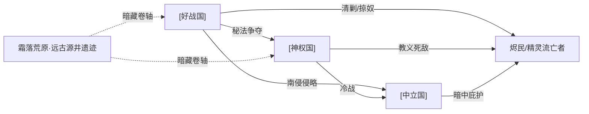

# 国家设定（Nations）

> 本文档对应设计支柱 **「交锋」** 与 **「抉择」**——每个国家的作战风格直接映射战旗的兵种克制与布阵策略（交锋），国与国的关系网为剧情分支提供道德困境（抉择）。一切设定严格服从 [00_design_pillars.md](00_design_pillars.md) 的「二元魔法（普通魔法普及 / 神级魔法稀缺）」与「战争没有赢家」基调，并建立在 [01_worldview.md](01_worldview.md) 的地理、二元魔法、神权国《新世典》信仰之上。
>
> 国家格局为 **3 种国家态度 + 被压迫势力**——好战国（终局 boss 国）/ 神权国（中期反派国）/ 保守中立国（玩家母国）+ 烬民游群与精灵流亡者。本文档以 `[好战国]` / `[神权国]` / `[中立国]` 占位符标记正式国名，待定名（见末尾「待定」）。

---

## 0. 国家设计总纲

参考：synergy-thematic-design（每个国家都是「战争没有赢家」的一个切面）+ game-development-planning（约束三角——克制范围，宁少勿滥）。

新设定下，大陆的国家按**对战争的态度**分为三派，加上一支被压迫势力，共 4 方。**核心冲突动因统一为「神级秘法卷轴的争夺」**——谁拥有卷轴，谁就能单方面碾压他国、打破平衡。

| 势力（占位符） | 态度 | 在主题中的切面 | 神级秘法持有数 | 玩法风格一句话 |
|------|------|----------------|----------------|----------------|
| **[好战国]** | 好战扩张 | 「为求力量与恶魔交易者，终被力量反噬」 | 较多（主动搜刮，2-3 卷） | 重甲坦克流：高 HP 低机动，正面碾压 |
| **[神权国]** | 教条扩张（中期反派） | 「以信仰之名行收割之实」 | 中等（暗搜，1-2 卷 + 精灵水晶） | 祭司法师流：治疗 + 魔法双修，审判官克精灵 |
| **[中立国]** | 保守自保（玩家母国候选） | 「被迫卷入厮杀的守卫者」 | 较少（防御，0-1 卷） | 弓弩工事流：远程 + 地形工事，防御反击 |
| **烬民游群 / 精灵流亡者** | 被压迫反抗 | 「被所有人抛弃者的复仇与真相」 | 0 | 狂化消耗流（烬民）/ 高魔法天赋玻璃刀（精灵流亡者） |

> 玩家阵营 = **[中立国]**（受侵略国 / 被迫参战的守卫者）。剧情主线：「前期保卫国家 → 中期团队壮大 → 后期攻打好战国大本营」（见 [05 剧情](05_story_branches.md)）。

> 地缘与美术色板：[好战国]≈苍脊西麓平原（黑红铁灰色板）；[神权国]≈苍脊以东高原（白金淡蓝色板）；[中立国]≈碎月湾沿岸（深蓝银金色板）；烬民游群≈烬海（灰褐凝血色板）。精灵流亡者散布各国暗处。

---

## 1. [好战国] ——「为力量与恶魔交易者」（终局 boss 国）

### 1.1 一句话定位
苍脊西麓的军事巨兽，大陆最强陆军之国。其君主为求速胜终结乱世，**与恶魔交易**换取力量，本性残忍冷酷、愈发无情——他主动搜刮神级秘法卷轴，企图以集齐秘法碾压全大陆，却不知自己正沦为恶魔的傀儡。

### 1.2 国旗 / 国色 / 国徽
- **国旗**：黑底中央一只咬合的灰色铁砧，铁砧上插着一柄断剑，背景为暗红色斜十字。近年君主崇魔，暗中在国旗背缝入隐秘的恶魔符文。
- **国色**：**黑 / 暗红 / 铁灰**（战场敌我识别色）
- **国徽**：断剑铁砧（寓意「以断剑铸更强之剑」）

### 1.3 政体
**中央集权的军事帝国**。皇帝（好战君主）拥有绝对权力，下设军政六部分掌。贵族以军功封地，无军功者世代贬黜——这迫使贵族不断主战。**君主近年引入「恶魔辅祭」机制**，一群与恶魔立约的暗影祭司渗透朝堂，影响决策。

### 1.4 地理位置
- 位于**苍脊山脉以西**、银泪河中上游，占据大陆中部最肥沃的温带平原与黑铁要塞隘口。
- 邻国：东接 [神权国]（隔苍脊），南邻 [中立国]（隔银泪河下游），北依霜落荒原。

### 1.5 国力定位

| 维度 | 评分（1-5） | 说明 |
|------|-------------|------|
| 军事 | **5** | 大陆最强陆军，重装骑士团威震四方 |
| 经济 | 3 | 农业强，但连年穷兵黩武透支国库 |
| 普通魔法 | 3 | 法师团成建制，与剑士弓手同级常规兵种 |
| **神级秘法** | **3**（约 2-3 卷） | 主动搜刮，已夺得数卷；君主靠恶魔之力强化承载 |
| 人口 | 4 | 人口最多，兵源充足，但厌战情绪高涨 |

### 1.6 国家性格与作战风格
- **重骑士帝国 = 高 HP 低机动坦克流**。以重装步兵与重装骑兵为核心，单位 HP 与防御冠绝大陆，但移动力（mov）普遍偏低，惧怕高机动骚扰与远程消耗。
- **玩法风格**：慢推阵地战，抢占隘口后以「不可撼动」的正面推进碾碎敌阵；弱点是侧翼空虚、追不上撤退之敌。
- **恶魔加持线**（终局 boss 战专属）：君主与精锐「恶魔契者」单位持有神级秘法，可施放天灾级法术——这是终局 boss 战的核心机制。
- **主题映射**：好战国的「不可撼动」是它的骄傲，也是它的坟墓——它永远在赢正面战，却永远在输掉灵魂（参考：synergy-thematic-design）。

### 1.7 核心资源 / 特产
- **黑铁矿石**（苍脊西麓特产，大陆最优质的兵器用钢）
- **银泪河中游粮仓**
- **神级秘法卷轴**（主动搜刮所得，2-3 卷，是其实力的真正天花板）
- 触发战争的利益点：君主亟需集齐所有神级秘法卷轴，以「终结乱世」之名行称霸之实。

### 1.8 代表色与美术关键词
- **黑金、铁灰、暗红血锈、哥特尖顶、厚重板甲、城垛、军旗、硝烟（篝火/烽烟）、隐藏的恶魔符文**
- 美术参考词汇：*grimdark gothic, ironclad, basalt walls, blood-red banners, hidden demonic sigils*

### 1.9 关键政治人物

| 姓名（占位） | 职位 | 一句话动机 |
|------|------|-----------|
| **[好战君主]**（终局 boss / 恶魔附体） | 在位皇帝 | 「朕要集齐所有秘法，终结这该死的乱世——哪怕用所有人的血，哪怕……哪怕朕已不再完全是朕。」本性残忍冷酷，为力量与恶魔交易，恶魔本体潜藏其身，是主角最终要面对的终极敌人。 |
| **[恶魔辅祭首领]**（占位） | 朝中暗影祭司之首 | 恶魔在人间的代理人，蛊惑君主搜刮卷轴——真实目的是借卷轴之力完成恶魔降临仪式。 |

---

## 2. [神权国] ——「以信仰之名行收割之实」（中期反派国）

### 2.1 一句话定位
以《新世典》立国的神权国，**表面提倡自由平等**，宣称「新世界即将降临」；**实则社会结构固化、民众被洗脑**，教廷高层垄断权力。它定期举办扭曲的「净世祭」——以「净化魔法偷窃者」为名当众活取精灵额头魔法水晶，真实目的是为高层搜集水晶以承载 / 强化神级秘法。它视精灵为异端，是必须消灭的对象。

### 2.2 国旗 / 国色 / 国徽
- **国旗**：纯白底中央一只金色的「圣日」（一只流泪的眼睛，瞳孔为新世典符文）
- **国色**：**白 / 金 / 淡蓝**（战场敌我识别色）
- **国徽**：流泪圣日

### 2.3 政体
**神权国**。最高统治者「圣座」由《新世典》教廷大祭司团选出，兼任宗教与世俗领袖。下设「圣裁庭」审判异端（精灵庇护者、卷轴私藏者）。**国教即国法，民众从出生即被规训。**

### 2.4 地理位置
- 位于**苍脊山脉以东**、烬海以北的高原，国土多荒原与高原台地，地形崎岖易守难攻。
- 邻国：西隔苍脊接 [好战国]，南接烬海（烬民游群出没），北接霜落荒原。

### 2.5 国力定位

| 维度 | 评分（1-5） | 说明 |
|------|-------------|------|
| 军事 | 3 | 常规部队平庸，但祭司法师团 + 审判官极强 |
| 经济 | 2 | 高原贫瘠，依赖朝圣经济与精灵水晶黑市 |
| 普通魔法 | 4 | 祭司 - 法师复合单位，治疗 + 魔法双修 |
| **神级秘法** | **2**（约 1-2 卷 + 大量精灵水晶） | 暗搜卷轴、屠戮精灵取水晶，用以强化源裔承载 |
| 人口 | 2 | 人口少，但全民狂信徒，士气极高 |

### 2.6 国家性格与作战风格
- **教条神权国 = 祭司法师 + 审判官流**。常规步兵孱弱，但「祭司法师团」（普通魔法治疗 + 伤害双修）与「审判官」（专门克制精灵系敌人，对精灵特攻）是其王牌。
- **玩法风格**：以祭司法师团为核心构建阵型，物理部队护卫与拖延，靠治疗续航与魔法爆发；审判官是精灵系单位的天敌。
- **主题映射**：神权国是「自以为正义的恶」——它真诚相信自己代表光明，实则在固化压迫与收割精灵。当玩家指挥部队解放一座精灵奴隶营时，主题「战争没有赢家」会以另一种方式呈现（参考：synergy-thematic-design）。

### 2.7 核心资源 / 特产
- **精灵魔法水晶**（「净世祭」活取所得，用于承载 / 强化神级秘法，是教廷最黑暗的资源链）
- **神级秘法卷轴**（暗搜，1-2 卷）
- **朝圣经济**（每年无数信徒带财货来朝，是其外汇支柱）

### 2.8 代表色与美术关键词
- **纯白、金箔、淡蓝光晕、教堂穹顶、彩色玻璃花窗、祭袍、新世典符文、被「净世祭」血染的白色祭台、囚禁精灵的铁笼**
- 美术参考词汇：*sacred theocracy, gilded cathedrals, stained glass, solemn priests, elven slave pens, blood-stained altars*

### 2.9 关键政治人物

| 姓名（占位） | 职位 | 一句话动机 |
|------|------|-----------|
| **[神权国圣座]**（中期主线反派） | 新世典教廷最高领袖 | 表面慈悲，坚信「新世界降临需以异端之血净化」；暗中主导「净世祭」搜集精灵水晶与卷轴，是中期主线核心反派。 |
| **[圣裁长]**（占位） | 圣裁庭之长，审判官统帅 | 一位开始怀疑「净世祭」真相的虔诚者，是剧情中可能的倒戈关键（留给剧情分支）。 |

---

## 3. [中立国] ——「被迫卷入厮杀的守卫者」（玩家母国候选）

### 3.1 一句话定位
碎月湾沿岸的商贸城邦联盟，本欲永远在战争中两头赚钱、保持武装中立，却因好战国南侵与神级秘法卷轴贸易被卷入战火——中立的代价是同时失去两个朋友，最终不得不扛起保卫家园之责。**这是玩家的母国**，主角于此成长、组队、抵抗侵略。

### 3.2 国旗 / 国色 / 国徽
- **国旗**：深蓝底上一轮破碎的银月，月缺处悬着一枚金色天平
- **国色**：**深蓝 / 银 / 金**（战场敌我识别色）
- **国徽**：碎月天平

### 3.3 政体
**城邦联邦（商共）**。由七大自由市的商会推举的「执政官」轮流主政，决议需商会投票。决策慢但内耗高，是典型的「民主的低效」——这正是它初期面对好战国闪击时溃败的原因，也是主角被推上前台的契机。

### 3.4 地理位置
- 位于**大陆西海岸碎月湾**沿岸及银泪河下游三角洲，港口密布，水网纵横。
- 邻国：北隔银泪河接 [好战国]，东隔苍脊余脉接 [神权国]，海路连通烬海。

### 3.5 国力定位

| 维度 | 评分（1-5） | 说明 |
|------|-------------|------|
| 军事 | 3 | 陆军弱但海军强，善用雇佣兵 |
| 经济 | **5** | 大陆最富，垄断海贸 |
| 普通魔法 | 3 | 不信教廷，法师靠学院与高薪雇佣，成建制 |
| **神级秘法** | **1**（0-1 卷） | 防御为主，卷轴多被两国抢走；主角团队可能在剧情中夺得一卷 |
| 人口 | 3 | 都市人口密集，但农民稀少，粮荒隐患 |

### 3.6 国家性格与作战风格
- **城邦联邦 = 弓弩与工事防御流**。缺少重甲骑士，但拥有最精良的弓弩手与攻城工程师，擅长依托城墙、拒马、壕沟、箭塔等工事进行防御反击，以及远程消耗。
- **玩法风格**：以远程单位 + 工事地形为核心，诱敌深入后以火力网歼灭；机动战与正面冲锋是短板。飞行单位（moveType: fly）是天敌。
- **主题映射**：[中立国] 自诩中立商人，却把卷轴与军火同时卖给交战双方发战争财——它以为自己在赢，实则在把整个世界推向毁灭。当主角（其国民）亲眼见到本国寡头走私的卷轴引来好战国屠杀时，「没有赢家」的主题会狠狠砸在它头上（参考：synergy-thematic-design）。

### 3.7 核心资源 / 特产
- **碎月湾海贸网络**（大陆唯一远洋商队）
- **神级秘法卷轴中转**（曾垄断卷轴黑市贸易，如今反成祸根）
- **三角洲渔盐之利**

### 3.8 代表色与美术关键词
- **深蓝海、银月、金币、帆船、拱廊商街、弩机、壕沟、雇佣兵各色甲胄、被战火波及的港口浓烟**
- 美术参考词汇：*mercantile republic, naval harbor, crossbowmen, moonlit canals, mercenary banners, war-torn port*

### 3.9 关键政治人物

| 姓名（占位） | 职位 | 一句话动机 |
|------|------|-----------|
| **[中立国执政官]**（占位） | 七大商会本届轮值主席 | 一位精明的统治者，试图以「武装中立」保全母国，却渐渐发现中立已成不可能——是主角的上级 / 监护人。 |
| **[走私寡头]**（占位） | 最大的卷轴走私寡头 | 暗中向各国出售卷轴情报以换取私利，真实目的成谜——是剧情伏笔。 |

---

## 4. 烬民游群 / 精灵流亡者（被放逐者的复仇）

### 4.1 一句话定位
被所有国家压迫的两支弃民——**烬民游群**（烬海半石化弃民，握有灰潮真相）与**精灵流亡者**（ escaped 精灵奴隶，躲避神权国追杀与人族奴役）。他们不是入侵者，而是诸国罪行的活证据，也是玩家队伍中精灵同伴的来源。

### 4.2 旗帜 / 色系
- **烬民**：无统一旗帜，各氏族以灰色兽骨为号；**灰 / 暗褐 / 暗紫（凝固血色）**
- **精灵流亡者**：以额头水晶的微光与破碎的绿色布条为记；**翠绿 / 月白 / 银光（额水晶辉光）**

### 4.3 政体
- **烬民**：部落联盟，由「灰烬议会」协商共治，无最高领袖。
- **精灵流亡者**：无组织，散布各国暗处的隐匿村落与地下逃亡网络，由「引路人」接应。

### 4.4 国力定位

| 维度 | 评分（1-5） | 说明 |
|------|-------------|------|
| 军事 | 2 | 烬民单兵强悍但无组织；精灵流亡者多为平民，少数有魔法天赋 |
| 经济 | 1 | 烬民靠掠夺拾荒；精灵流亡者几无产 |
| 普通魔法 | 烬民 1 / **精灵流亡者 5** | 精灵天生元素亲和极强，是普通魔法天花板 |
| **神级秘法** | **0** | 无卷轴；但精灵源裔比例高，是各国觊觎的「人形矿藏」 |
| 人口 | 2 | 数量稀少 |

### 4.5 国家性格与作战风格
- **烬民 = 狂化消耗流**：HP 极高（半石化之躯），魔防极低，以自伤换高额伤害。
- **精灵流亡者 = 高魔法天赋玻璃刀**：普通魔法威力冠绝大陆，但 HP / def 极低，且**额水晶一旦被夺即衰竭而亡**——是高风险高回报的单位。
- **玩法风格**：烬民靠人海与自伤冲阵；精灵流亡者靠后排魔法爆发，必须被严密保护（呼应主角队伍中的精灵同伴）。
- **主题映射**：烬民与精灵流亡者是「战争没有赢家」最直接的化身——他们是上一场秘法战争的输家后裔与这场新战争的第一个牺牲品。善待他们还是顺应诸国奴役他们，是玩家最沉重的「抉择」之一。

### 4.6 核心资源 / 特产
- **灰潮石化的源脉碎片**（烬民，凝固魔力，可被「灰脉者」反引导）
- **精灵魔法水晶**（精灵流亡者——但这既是他们的生命，也是各国猎杀他们的原因）

### 4.7 代表色与美术关键词
- **烬民**：灰烬、暗褐、石化皮肤、兽骨、废墟、灰雾
- **精灵流亡者**：翠绿斗篷兜帽、月白长袍、额头银光水晶、镣铐烙印（奴隶印记）、隐匿林间村落
- 美术参考词汇：*ash-walkers, petrified skin, bone totems / hooded elves, forehead glowing crystal, slave brands, hidden forest sanctuary*

### 4.8 关键政治人物

| 姓名（占位） | 职位 | 一句话动机 |
|------|------|-----------|
| **[灰母]**（占位） | 烬民灰烬议会最年长氏族长 | 知道灰潮真正成因（神级魔法滥用的反噬），想把真相带给诸国，却无人相信一个「瘟兽」。 |
| **[精灵引路人]**（占位） | 精灵流亡者逃亡网络的首领 | 一位额水晶已被夺去一半（将死未死）的老精灵，护送同胞流亡，是主角精灵同伴的恩人。 |

---

## 5. 国家关系矩阵表

> 图例：**同盟** / **世仇** / **冷战** / **贸易依赖** / **敌对未宣战** / **秘法争夺**

|  | [好战国] | [神权国] | [中立国] | 烬民 / 精灵流亡者 |
|--|----------|----------|----------|----------|
| **[好战国]** | — | **秘法争夺**（争卷轴） | **侵略**（南侵吞并） | **清剿**（视烬民为瘟疫、掠精灵为奴） |
| **[神权国]** | **秘法争夺** | — | **冷战**（嫌其贪婪渎神） | **教义死敌**（精灵为异端，活取水晶） |
| **[中立国]** | **被侵略 / 抵抗** | **冷战** | — | **暗中庇护**（部分城邦收容精灵流亡者） |
| **烬民 / 精灵流亡者** | **敌对** | **教义死敌** | **警惕偏依附** | — |

### 关系网（ASCII）

```
        【霜落荒原·远古源井遗迹】
                 │ 暗藏卷轴
                 ▼
    ┌───── [好战国] ←──秘法争夺──→ [神权国] ──┐
    │           │                          │         │
    │        南侵侵略                    教义死敌   │
    │           │                          │         │
    │           ▼                          ▼         │
    │       [中立国] ────暗中庇护────→ 烬民/精灵流亡者│
    │    (玩家母国)                                │
    └────────────── 清剿 / 奴役 ────────→ ←──敌对─┘
```

### mermaid 版本（可选渲染）



---

## 6. 主冲突导火索

> **一句话：**

**一卷被认为已佚失千年的神级秘法卷轴——「断脉卷轴」（可永久切断一地与源脉的联系，灭一国之魔法根基）——在霜落荒原的远古源井遗迹中被发现的消息走漏。当夜，[好战国] 君主以「护侨」为名令重骑士团强渡银泪河直扑遗迹；[神权国] 圣座以「净化异端」为名派圣裁者抢占遗迹、沿途屠戮一支逃亡的精灵氏族以取水晶；而 [中立国] 一支运送卷轴情报的商队被好战国鹰犬截获——三方在同一个黎明同时踩下了战争的油门。烬民游群的灰母带着「灰潮即神级魔法滥用反噬」的真相奔走求见，却被所有人当成了开战的借口。**

> 这场战争的每一个参与者都认为自己是「被迫还击」或「救世」，没有一方是纯粹的正义——这正是「战争没有赢家」主题的开局落地（参考：synergy-thematic-design）。玩家作为 [中立国] 的保卫者，故事由「**前期保卫国家**」正式开始。

---

## 7. 设计自检（对齐支柱）

| 设计支柱 | 本文档如何服务 |
|----------|----------------|
| **布阵（Position）** | 各国地形偏好（[好战国] 山地隘口 / [神权国] 高原 / [中立国] 水网工事）直接决定关卡地形与布阵策略 |
| **交锋（Clash）** | 四方作战风格形成克制环（数值与法师占比随 [03 职业](03_professions.md) / [08 玩法](08_gameplay_mechanics.md) 的二元魔法调整而定） |
| **抉择（Choose）** | 国家关系网全是灰色（贸易依赖同时敌对、教义死敌却握真相、中立国寡头发战争财），玩家效忠任一方都要付出道德代价 |
| **二元魔法** | [神权国] 祭司法师团（普通魔法强）+ 神级秘法 2 分；精灵流亡者普通魔法 5 分但神级秘法 0——普通魔法撑战力，神级秘法决定上限 |
| **战争没有赢家** | 导火索设计确保无一方是纯正义，每国动机都是「自保 / 救世」却都在加速世界覆灭；好战国君主与恶魔交易，是最悲剧性的反派 |

> 克制环方向（具体数值随 [03 职业](03_professions.md) / [08 玩法](08_gameplay_mechanics.md) 的二元魔法调整）：
> `重甲坦克 → 工事远程 → 狂化冲锋 → 普通法师团 → 重甲坦克`。因普通魔法已普及，法师不再作为「稀缺王牌」一环，而作为常规兵种参与克制；神级魔法（卷轴持有者）则是凌驾于该环之上的战略变量。

---

## 8. 待定（占位符）

- [ ] **正式国名**：`[好战国]` / `[神权国]` / `[中立国]` 占位符替换为正式命名。
- [ ] **关键人物实名**：好战君主 / 恶魔辅祭首领 / 神权国圣座 / 圣裁长 / 中立国执政官 / 走私寡头 / 灰母 / 精灵引路人，与 [04 角色](04_characters.md) 对齐。
- [ ] **神级秘法卷轴具体配置**：各国持有哪几卷、卷轴效果，对齐 [01 世界观 4.2.5](01_worldview.md) / [06 道具](06_items.md) / [07 技能](07_skills.md)。

---

## 9. 文档关联

- 上游：[01_worldview.md](01_worldview.md)（地理、二元魔法、神权国《新世典》信仰——本文件的基底）
- 约束：[00_design_pillars.md](00_design_pillars.md)（主题基调、二元魔法硬约束、输出规范）
- 下游：[04 角色](04_characters.md)（基于各国关键人物）、[05 剧情](05_story_branches.md)（基于导火索与关系矩阵展开分支）
