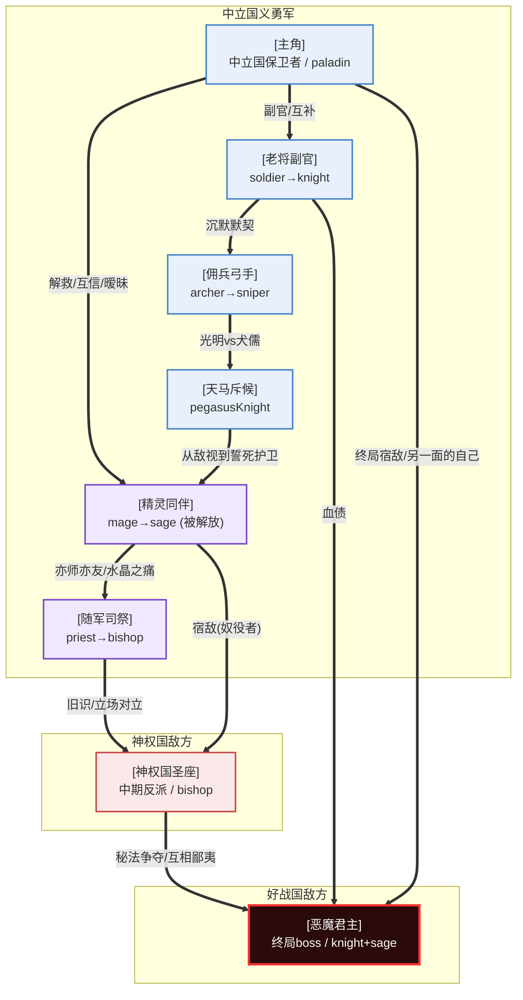

# 角色设定（Characters）

> 本文档支撑设计支柱 **「抉择（Choose）」**——角色的立场冲突、永久死亡条件、人物弧光，是让"战争没有赢家"主题在玩家心里落地的核心载体。
>
> 依赖：[设计支柱](00_design_pillars.md) · [职业系统](03_professions.md) · 联动：`05_story_branches.md`
>
> 主线叙事为「**前期保卫国家 → 中期团队壮大 → 后期攻打好战国大本营**」；主角定位为「[中立国] 的保卫者」；同伴含一名**精灵同伴**；反派为「**[恶魔君主]（好战国恶魔附体君王，终局 boss）**」+「**[神权国圣座]（中期反派，教条首领）**」。
>
> 国家 / 角色实名以占位符 `[中立国]` / `[好战国]` / `[神权国]` / `[主角]` / `[恶魔君主]` / `[神权国圣座]` / `[精灵同伴]` 标记，待定名（见末尾「待定」）。

---

## 〇、设计哲学

本角色群服务的命题是：**「没有人是反派，每个人都在为某种正确而战。」**

为忠实于 [设计支柱](00_design_pillars.md) 的灰色道德基调与「战争没有赢家」主题，本设定遵循三条铁律：

1. **没有脸谱化反派**——即使是好战国恶魔君主，也曾是一个想终结乱世的君王，是恶魔的交易与秘法的贪欲把他吞噬。玩家打败他时不该感到爽快，而该感到沉重。
2. **同伴之间有立场冲突**——玩家队伍内部不是铁板一块。不同国家出身的同伴（中立国本土 / 神权国叛逃者 / 精灵流亡者 / 佣兵）对"如何结束战争"有根本分歧，这会在剧情分支里爆发。
3. **永久死亡有叙事重量**——战旗的经典 permadeath 机制，在这里不是"单位损失"，而是"一段故事永远闭合"。每个角色都设计了死亡条件与死亡对剧情的连锁影响。**精灵同伴的「额水晶被夺」是本作独有的种族性死亡条件**。

### 引用的设计原理

| 原理 | 出处 | 体现 |
|------|------|------|
| **Thematic Emphasis（主题优先于数值）** | `character-optimization-design` | 角色的属性成长倾向服务其叙事定位（如"保卫者"防御成长高、"被解放的精灵"魔法成长极高但 HP 极低），而非单纯追求强度。 |
| **Flow State（难度梯度）** | `flow-state-design-framework` | 队伍构成天然形成难度梯度：简单单位（剑士 / 重骑士系）让新手立足，复杂单位（精灵魔法系 / 刺客系）留给熟练玩家。 |
| **Interconnected Attributes** | `character-optimization-design` | 每个角色的"优点"必伴"缺点"——杜绝完美主角；精灵同伴的「全大陆最强普通魔法」必伴「全队最低 HP + 水晶被夺即死」。 |

### 国家速查（详见 [02_nations.md](02_nations.md)）

| 简称（占位） | 全名（待定） | 一句话定位 |
|------|------|-----------|
| **[中立国]** | （占位，旧碎月联邦地缘） | 玩家母国。被迫卷入厮杀的商贸城邦联盟，主角的故乡。 |
| **[好战国]** | （占位，旧黑铁帝国地缘） | 终局 boss 国。君主与恶魔交易，主动搜刮神级秘法卷轴。 |
| **[神权国]** | （占位，旧维兰瑟地缘） | 中期反派国。《新世典》教条国，屠戮精灵取水晶。 |
| **烬民 / 精灵流亡者** | — | 被压迫势力。灰潮真相证人 / 精灵奴隶逃亡者。 |

---

## 一、角色总表

共 **8 个主要角色**：玩家队伍 6 人（含 1 名精灵同伴 + 1 名后期加入），反派 2 名（中期 + 终局）。

| # | 姓名（占位） | 国家 | 职业 id | 战斗定位 | 上手难度 | 阵营 |
|---|--------------|------|---------|----------|----------|------|
| 1 | [主角] | [中立国] | `recruitKnight`→`paladin` | 坦克/副输出 | 2 | 主角（玩家） |
| 2 | [精灵同伴] | 精灵流亡者 | `mage`→`sage` | 普通魔法输出（王牌） | 4 | 同伴 |
| 3 | [老将副官] | [中立国] | `soldier`→`knight` | 主坦克 | 1 | 同伴 |
| 4 | [佣兵弓手] | 无国籍（佣兵） | `archer`→`sniper` | 远程输出 | 2 | 同伴 |
| 5 | [天马斥候] | [中立国] | `pegasusKnight` | 飞行侦察/刺杀 | 3 | 同伴 |
| 6 | [随军司祭] | [中立国] | `priest`→`bishop` | 治疗/辅助 | 2 | 同伴 |
| 7 | [神权国圣座] | [神权国] | `bishop`（敌方统帅，不可转职） | 教条首领 | — | **中期反派** |
| 8 | [恶魔君主] | [好战国] | `knight`/`sage`（恶魔附体，boss 版） | 终局 boss（恶魔本体） | — | **终局反派** |

> 职业 id 全部链回 [03_professions.md 职业总表](03_professions.md)（该文档魔法相关章节按二元魔法解读：普通法师为常规兵种，神级魔法 / 卷轴持有者才稀缺）。

---

## 二、角色详细设定

### 角色 1：[主角]（重做 · 中立国保卫者）

| 项 | 内容 |
|----|------|
| **姓名（占位）** | [主角] |
| **国家** | [中立国] |
| **职业 id** | `recruitKnight` →（转职）→ `paladin` |
| **身份/职位** | [中立国] 七大商会之一家族的次子，平民出身的见习骑士。[好战国] 南侵时，其家族封地首当其冲被焚毁，亲族死伤惨重。在 [中立国] 正规军节节败退、城邦联邦决策低效之际，他被战火推上前台，逐渐成为一支义勇军的核心。 |
| **外貌** | 20 余岁，深栗色短发，灰蓝色眼睛。左眉骨有一道陈年刀疤（南侵战火留下）。穿 [中立国] 制式的银白轻甲，胸前佩一枚家族纹章——那是被焚毁家园的唯一遗物。体格偏瘦，不像传统重甲骑士那样魁梧。 |
| **性格** | 沉稳、负责、近乎固执地守诺。最大的缺点是**责任感过剩**——他把所有人的命都扛在自己肩上，导致决策迟缓、无法割舍任何一个同伴（在 permadeath 机制下这是致命的）。他害怕成为"为了胜利不顾一切的人"。 |
| **背景** | 商人家族次子，本应从商，却自幼迷恋骑士道。[好战国] 突袭焚毁其家乡，他在废墟中救出几名幸存者，被溃退的 [中立国] 守军推举为临时指挥。他不是天生的领袖，是被战火逼成的领袖。 |
| **核心动机** | **"我不要复仇，我要守住还活着的人——和不让任何人的家乡再被烧掉。"** |
| **人物弧光** | **开局信念**："只要我足够负责、足够公正，就能守住国家，结束这场侵略。" → **中段冲突**：发现 [好战国] 君主之所以势大，是因与恶魔交易、夺得多卷神级秘法；而 [中立国] 寡头竟有人暗中向 [好战国] 出售卷轴情报。[主角] 必须在"夺秘法反攻（可能像好战国一样被力量腐蚀）"与"以血肉之躯硬抗（胜算渺茫）"之间抉择。 → **结局转变**：接受"有些战争不是你能阻止的，你能选的只是以什么姿态走进去"——从一个想救所有人的青年，变成一个知道会有人死、但仍选择扛起责任的统帅，最终率军攻入 [好战国] 大本营直面恶魔君主。 |
| **战斗定位** | 中前期是 `recruitKnight`，平衡型骑兵，mov 7 用于机动补位。转职 `paladin` 后成为队伍主心骨——hp/def 中上，可抗可打，mov 8 全队最快，是"救火队长"。 |
| **成长倾向** | def 与 hp 成长高（守护型），agility 中等，power 中等偏低——他不是输出机器，是"永远站在最前面的人"。 |
| **与他人关系** | ① **[精灵同伴]**：从 [神权国] 奴隶营救出的精灵，是主角"守住他人"信念的最直接对象，也是 (隐含的) 情感对象；但精灵的种族处境让这段关系始终悬而未决。② **[老将副官]**：[中立国] 老兵，主角的副手与军中导师，互补。③ **[神权国圣座]**（中期反派）：曾以"结盟抗好战国"为名诱骗 [中立国]，实为窃取卷轴——是主角信任崩塌的源头。 |
| **死亡条件** | 若在终局 [恶魔君主] 单挑中未满足"说服 / 净化条件"（[精灵同伴] 在场 + 持有特定信物 / 净化卷轴），[主角] 会被恶魔君主击杀。**死亡影响**：主角死亡触发隐藏结局"群龙无首"——战争陷入更长久的拉锯，所有同伴的结局线恶化。 |

---

### 角色 2：[精灵同伴]（重做 · 被解放的精灵奴隶）

| 项 | 内容 |
|----|------|
| **姓名（占位）** | [精灵同伴] |
| **国家** | 精灵流亡者（被 [神权国] 奴役，被 [主角] 救出） |
| **职业 id** | `mage` →（转职，需源脉晶石 / 卷轴）→ `sage` |
| **身份/职位** | 原是 [神权国] 一座精灵奴隶营中的"法师奴隶兵"，额头魔法水晶被铁罩锁住以控制其魔力。[主角] 在捣毁该奴隶营时将其解救。她是全队普通魔法天赋最高的存在。 |
| **外貌** | 外表年龄约 20（精灵实际寿命远长于人类），银白色长发（精灵源裔特征），翠绿色眼睛，**额头正中一枚散发银光的魔法水晶**（被解放后去掉铁罩，水晶辉光重见天日）。身形单薄，颈腕有镣铐磨出的陈年疤痕。穿一件洗得发白的灰绿斗篷，随身一本焦边的法术书（奴隶营中偷学的禁书）。 |
| **性格** | 聪明、警觉、言辞犀利，习惯用理性与疏离保护自己。缺点是**信任机能近乎为零**——多年为奴让她对任何温暖的第一反应是"这是不是又一次利用"。她对 [主角] 的好感让她害怕，因为她的过往里"被善待"总预示"更狠的榨取"。 |
| **背景** | 出身一个隐匿的精灵流亡者村落，幼年时村落被 [神权国] 圣裁庭突袭，族人被屠或被掳为奴。她因额水晶魔力强被编入"法师奴隶兵"，铁罩锁水晶、以痛楚驱动她施法屠戮 [神权国] 的敌人。她在奴隶营中偷学普通魔法的精义，等待逃亡机会——直到 [主角] 捣毁奴隶营，她第一次见到"不求回报地解开她镣铐"的人类。 |
| **核心动机** | **"我想知道，不再为任何人燃烧是什么感觉——可我怕我已经习惯了。"** |
| **人物弧光** | **开局信念**："所有人都要我的水晶或我的命，包括救我的人。" → **中段冲突**：[主角] 多次拒绝利用她的水晶（哪怕那能扭转战局），她开始动摇；但 [神权国] 的追杀与 [好战国] 对水晶的觊觎让她始终无法安心。 → **结局转变**：在终局，她选择**主动献出一半水晶之力**（濒死代价）助 [主角] 净化 [恶魔君主]——这是她第一次作为"自己"做选择，不是为了被驱使，而是为了"我想守住他"。若获救，她活下来（水晶残缺但未死）；若不救，她以自由之身死去。 |
| **战斗定位** | 全队普通魔法输出天花板。参考 [二元魔法](00_design_pillars.md#51-普通魔法普及资源)，普通魔法 MP 可常规回复——她是"可反复输出的法系王牌"。转职 `sage` 后成为破甲钥匙与 boss 战核心。**致命弱点**：hp 全队最低，且额水晶被夺即死（见死亡条件）。 |
| **成长倾向** | power 与 res 成长极高（魔法威力与魔防），hp 成长全队最低——她是被保护的对象，也是最强的矛。 |
| **与他人关系** | ① **[主角]**：解救她的人，互相信任又互相试探，立场暧昧的盟友 / 恋人。② **[随军司祭]**：唯一理解她"水晶灼痛"的人（司祭精通魔法医理），亦师亦友。③ **[神权国圣座]**（中期反派）：曾直接下令奴役她，是她最深的梦魇与最想讨伐的对象。 |
| **死亡条件（种族性，独有）** | **额水晶被夺即衰竭而亡**——这是精灵族的种族性死亡条件（呼应 [01 世界观](01_worldview.md#五种族--民族) 精灵条目）。两种触发：① 战场上被 [神权国] 审判官特攻命中并"取晶"（机制：审判官对精灵的处决技）；② 终局主动献出半水晶之力净化恶魔君主（剧情性濒死，可被救治）。**死亡影响**：全队永久失去魔法输出王牌；[主角] 的结局线强制走向"复仇与孤独"。 |

---

### 角色 3：[老将副官]（保留框架 · 中立国老兵）

| 项 | 内容 |
|----|------|
| **姓名（占位）** | [老将副官] |
| **国家** | [中立国] |
| **职业 id** | `soldier` →（转职）→ `knight` |
| **身份/职位** | [中立国] 正规军老兵，二十年军旅的百夫长。[好战国] 南侵时其长官弃阵逃跑，他临阵接指挥、率残部死守隘口掩护平民撤离，事后编入 [主角] 的义勇军任副官。 |
| **外貌** | 30 余岁，金色短发剃成军旅式样，墨绿色眼睛。身材高大魁梧，右脸颊一道贯穿至颈的旧伤疤。永远穿着一套保养到发亮的旧 [中立国] 制式重甲。 |
| **性格** | 直率、忠诚、死板地恪守军纪。缺点是**倔强与自我惩罚**——他无法原谅自己长官的逃跑与战友的战死，把这股罪疚变成对 [主角] "绝对辅佐"的补偿。 |
| **背景** | [中立国] 农家出身，为养活家人参军。他相信"军人的职责是守护"，直到亲眼见到本国长官在好战国铁骑前弃阵——他第一次明白"服从"不能盲从。他追随 [主角]，不是因为后者是贵族，而是因为 [主角] 是"唯一回头救平民的人"。 |
| **核心动机** | **"我不想再看见平民被弃在战火里，因为我的剑。"** |
| **人物弧光** | **开局信念**："辅佐一个值得辅佐的人（[主角]），就能守住国家。" → **中段冲突**：[中立国] 部分城邦欲向 [好战国] 投降保全商业利益，他必须面对"效忠国家"与"效忠正义"的撕裂。 → **结局转变**：学会"自己判断什么是对的事"，哪怕这意味着违抗 [中立国] 的投降令。 |
| **战斗定位** | 队伍主坦克。`knight` 职业的 hp/def 让她 / 他能堵住任何隘口。mov 仅 4，需要预判布阵。 |
| **成长倾向** | hp 与 def 成长全队最高，agility 与 res 全队最低——物理之墙，最怕魔法。 |
| **他人关系** | ① **[主角]**：副官与统帅，互补。② **[佣兵弓手]**：沉默的默契。③ **[恶魔君主]**（终局 boss）：在前期南侵战中见过其恶魔契者部队的暴行，誓要讨回这笔血债。 |
| **死亡条件** | 在守城战中若玩家选择"弃城保全兵力"，[老将副官] 会违令留下断后，若当关未获救援则战死。**死亡影响**：全队失去主坦克，容错大降。 |

---

### 角色 4：[佣兵弓手]（保留框架 · 自由佣兵）

| 项 | 内容 |
|----|------|
| **姓名（占位）** | [佣兵弓手] |
| **国家** | 无国籍（佣兵） |
| **职业 id** | `archer` →（转职）→ `sniper` |
| **身份/职位** | 自由佣兵，以"按人头收费"闻名，被 [主角] 以长期契约雇佣。 |
| **外貌** | 26 岁，深褐色乱发，褐色眼睛总是半眯着。下巴胡茬，洗得发白的皮甲，背后斜挎长弓。腰间钱袋与酒壶都很少是空的。左手食指因常年拉弦而变形弯曲。 |
| **性格** | 玩世不恭、实际、把一切换算成金币。缺点是**犬儒主义掩盖下的懦弱**——他用"我只为钱"逃避"我为什么而战"。他其实比谁都重感情。 |
| **背景** | 出身不明。[好战国] 南侵让他失去了所有长期雇主，他本可远走他乡，却在 [主角] 一次"回头救他"后留下——那是他第一次被人不为钱地伸手。 |
| **核心动机** | **"我想找一个值得我不收钱去死的理由——但我大概找不到。"** |
| **人物弧光** | **开局信念**："活下去，拿到钱，别的都不重要。" → **中段冲突**：在一场本可撤退的战斗中，他选择留下来掩护平民（没有报酬），开始害怕自己"变了"。 → **结局转变**：拒绝一笔足以让他一生衣食无忧的"背叛 [主角]"的收买，第一次说"这一单，我免费"。 |
| **战斗定位** | 稳定远程输出，反制飞行单位的核心（弓克飞行）。`archer` 射程 [2,3]，转职 `sniper` 后 [2,4]。 |
| **成长倾向** | skl 与 agility 成长高（命中与追击），hp 与 def 低——典型玻璃炮，必须站后排。 |
| **他人关系** | ① **[老将副官]**：沉默的默契。② **[天马斥候]**：两个"行动派"在营火旁交换过真实。③ **[主角]**：雇主与雇佣，但早已不是金钱关系。 |
| **死亡条件** | 最容易被"收买背叛"——若玩家长期忽视其契约（不支付军饷剧情触发），他可能在某关离队投敌。**这是对玩家"把角色当工具"的惩罚设计**——呼应 permadeath 的主题。 |

---

### 角色 5：[天马斥候]（保留框架 · 中立国飞行斥候）

| 项 | 内容 |
|----|------|
| **姓名（占位）** | [天马斥候] |
| **国家** | [中立国] |
| **职业 id** | `pegasusKnight` |
| **身份/职位** | [中立国] 边境骑士世家的天马骑士，[主角] 义勇军的斥候队长。 |
| **外貌** | 21 岁，浅金色长辫，翠绿色眼睛。银白轻型骑甲，背后天马骑士特有的羽翼披风。右耳一枚银色耳钉——天马骑士成年标志。座下天马"晨星"。 |
| **性格** | 热情、冲动、护短到极点。缺点是**鲁莽与二元思维**——她把世界分成"自己人"和"敌人"，很难理解灰色地带。 |
| **背景** | [中立国] 边境骑士世家三代天马骑士。家乡首当 [好战国] 南侵，她率小队死守烽火台示警，家族几乎死绝，只剩她与天马投奔 [主角]。 |
| **核心动机** | **"我要守住我想守住的人——管他什么大局。"** |
| **人物弧光** | **开局信念**："敌人就该死，朋友就该护。" → **中段冲突**：当 [精灵同伴]（前"敌方" [神权国] 奴隶兵）加入，且 [主角] 与"敌方背景"的人合作时，她感到被背叛——她不理解为什么要信任"曾经站在对面的人"。 → **结局转变**：学会"有些敌人也曾是别人的朋友"，第一次放过一个投降的敌人。 |
| **战斗定位** | 飞行侦察与刺杀。mov 8 + 无视地形，用于绕后杀法师 / 弓手。**致命弱点**：被弓箭特攻，hp 仅 20——见敌方 archer 必须绕开。全队操作难度最高的"赌徒单位"之一。 |
| **成长倾向** | agility 与 res 成长高（闪避与魔防），hp 与 def 低——靠"不被打到"活着。 |
| **他人关系** | ① **[主角]**：起初当作"投奔的旗帜"，后逐渐认可其统帅资格。② **[精灵同伴]**：从敌视（"她曾是神权国的人"）到誓死护卫，是本作最暖的同伴线之一。③ **[佣兵弓手]**：互看不对眼（光明 vs 犬儒），但战场上有最锋利的配合。 |
| **死亡条件** | 鲁莽被设计进机制——最容易因"贪刀飞进弓手射程"而死。**死亡影响**：若她死于操作失误，[精灵同伴] 的结局线会受冲击（失去最坚定的护卫者）。 |

---

### 角色 6：[随军司祭]（保留框架 · 中立国治疗）

| 项 | 内容 |
|----|------|
| **姓名（占位）** | [随军司祭] |
| **国家** | [中立国]（学院派司祭，非神权国教士） |
| **职业 id** | `priest` →（转职）→ `bishop` |
| **身份/职位** | [中立国] 魔法学院出身的随军司祭，精通普通魔法医理。被学院派来"记录这场战争"，实则寻找能终结秘法流血的人。 |
| **外貌** | 外表约 40 岁，灰白色短发，琥珀色眼睛异常平静。素白长袍，腰间源脉念珠与一柄从不拔出的旧杖。双手有细密银纹（魔法修习者标志）。永远带着温和的笑，但笑意从不到达眼底。 |
| **性格** | 温和、睿智、有一种让人安心的笃定。缺点是**超然到近乎冷漠**——他见过太多战争，对"这一场"的伤亡有一种"都会过去"的疏离感。 |
| **背景** | [中立国] 资深司祭，曾游历诸国数十年，亲历过上一次因神级秘法而起的小规模冲突。他此行不是"帮谁赢"，而是"别让神级秘法再一次被滥用"。他对 [精灵同伴] 有特殊关注——精灵水晶的灼痛是他毕生研究的课题。 |
| **核心动机** | **"我不想再活过一场本不该发生的战争。"** |
| **人物弧光** | **开局信念**："超然是最高的智慧，不站队才能止损。" → **中段冲突**：当他意识到"不站队"本身就是一种站队（默认让 [好战国] 继续碾压弱者）时，他的超然开始崩塌。 → **结局转变**：第一次为某一方"下场"——明知会打破中立、明知会死，但他选择"这一场，我站这边"。 |
| **战斗定位** | 队伍治疗核心，转职 `bishop` 后拥有全队最高 res 与净化 / 反不死能力。他不是输出，但**没有他的队伍在持久战里会崩**。 |
| **成长倾向** | res 与 skl 成长高（魔防与治疗命中），hp 与 def 极低——和 [精灵同伴] 一样是被保护对象。 |
| **他人关系** | ① **[精灵同伴]**：唯一理解水晶灼痛的人，亦师亦友，暗中引导她。② **[主角]**：在 [主角] 身上看到"终结循环的人"的可能，但不敢确认。③ **[神权国圣座]**（中期反派）：旧识，曾是同门，如今分道扬镳。 |
| **死亡条件** | 剧情性——若玩家走向"完全依赖神级秘法力量"的路线（滥用卷轴 / 牺牲同伴换卷轴），[随军司祭] 会在某关以自身封印秘法暴走而亡。**死亡影响**：全队永久失去最高治疗与净化；同时这是对玩家"为力量不择手段"的主题惩罚。 |

---

### 角色 7：[神权国圣座]（重做 · 中期反派 · 教条首领）

| 项 | 内容 |
|----|------|
| **姓名（占位）** | [神权国圣座] |
| **国家** | [神权国] |
| **职业 id** | `bishop`（敌方统帅，boss 版数值） |
| **身份/职位** | 《新世典》教廷最高领袖，[神权国] 世俗与宗教双重统治者。"净世祭"的主导者。 |
| **外貌** | 60 余岁，银白长发整齐梳向脑后，淡金色眼睛（被水晶强化的痕迹）。纯金线绣的白金长袍，手持一柄镶满精灵水晶的权杖——每一颗水晶都来自一个被"净世祭"取晶而死的精灵。面容慈祥，笑容温暖，那是真诚的——这让他更可怕。 |
| **性格** | 慈悲、笃定、对信徒有近乎父爱的关怀。缺点是**信仰已硬化成偏执**——他真心相信「精灵是魔法的偷窃者，新世界降临需以异端之血净化」，这让他对任何反驳都听不进去。他不残暴，他"慈悲地"下令取精灵水晶，因为他真诚地以为那是"超度"。 |
| **背景** | 年轻时是 [神权国] 最虔诚的祭司，亲历过一次神级秘法失控毁城的惨剧，从此坚信"魔法（在他认知里等同于神级秘法）必须由教廷独占，凡人不可触碰，精灵这种'天然魔法容器'是危险的偷窃者"。他用四十年把 [神权国] 改造成今日的教条国度。**他不是为权力而战，他是为"不让凡人再因秘法失控而死"而战——他的恶，是真诚的恶。** |
| **核心动机** | **"我要让新世界降临——精灵的罪将被净化，魔法的偷窃将被纠正，哪怕以千万异端之血。"** |
| **人物弧光** | **开局信念**："教廷独占秘法是拯救世界，精灵是必须净化的异端。" → **中段冲突**：当 [主角] 团队（含 [精灵同伴]）多次挫败其"净世祭"，且他发现 [好战国] 君主竟与恶魔勾结、滥用秘法——他面对的不是"异端"，而是"一个比他更接近'恶魔'的同行者"。 → **结局转变**：拒绝简单的悔悟。他至死相信自己的事业，但他最后可能在 [主角] 持有 [创世卷轴]（可净化）的证据面前动摇——三种结局：① 被击败战死；② 倒戈协助对抗 [恶魔君主]（最难达成）；③ 在"净世祭"被 [精灵同伴] 当众揭穿真相时崩溃。**他的死不是玩家的胜利，是又一出悲剧——他曾是真心想救世界的人。** |
| **战斗定位** | 中期主线核心 boss。作为 boss 版 `bishop`，hp/res 极高，拥有大量精灵水晶强化的神级秘法技能，并召唤审判官单位（对精灵特攻）。他是 [精灵同伴] 的"宿敌"——这场 boss 战对 [精灵同伴] 是情感与机制的双重高潮。 |
| **成长倾向** | 作为 boss 不适用成长曲线；其固定数值为 boss 版本。 |
| **他人关系** | ① **[精灵同伴]**：曾直接下令奴役她，是她最深的梦魇。② **[随军司祭]**：旧识，曾是同门，如今立场对立。③ **[恶魔君主]**（终局 boss）：表面是"同为秘法持有者的对手"，实则是圣座最痛恨的"秘法滥用者"——这条线是中后期反派间张力的来源。 |
| **死亡条件** | 见人物弧光——三种结局。**圣座之死是中期剧情的核心节点。** |

---

### 角色 8：[恶魔君主]（重做 · 终局 boss · 恶魔附体的好战国君王）

| 项 | 内容 |
|----|------|
| **姓名（占位）** | [恶魔君主]（好战国在位皇帝 + 潜藏其身的恶魔本体） |
| **国家** | [好战国] |
| **职业 id** | `knight` / `sage`（恶魔附体，boss 版，融合物理与神级魔法） |
| **身份/职位** | [好战国] 在位皇帝，本性残忍冷酷的军阀。为求速胜终结乱世，与恶魔立约，以灵魂换取力量与承载多卷神级秘法的能力。**恶魔本体潜藏其身，逐步蚕食其意志——这是主角最终要面对的终极敌人。** |
| **外貌** | 50 余岁，钢铁灰色短发向后梳，冰蓝色眼睛（恶魔附体后瞳孔边缘泛红）。身材魁梧如一堵墙，全套漆黑的 [好战国] 重甲，肩甲的双头鹰被血锈染暗。**左胸有一道裂口状的烧伤疤——恶魔契印，会随剧情推进逐步扩散如藤蔓**。终局战时，恶魔本体从他体内破出 / 显形，是其第二形态。 |
| **性格** | 严厉、笃定、对士兵有近乎父爱的责任感（人性残留部分）。缺点是**野心已被恶魔放大成偏执**——他人性的一面真心想"终结乱世、让百姓不再受战乱"，恶魔的一面则只想"借卷轴之力完成降临"。这两面的拉扯，是他悲剧的核心。他不嗜杀（人性时），但恶魔掌控时会变得无情至极。 |
| **背景** | 年轻时是 [好战国] 最英武的王子，亲历过 [中立国] 与 [神权国] 联手打压 [好战国] 的屈辱，发愿"要让祖国永远不再受制于人"。在搜刮神级秘法卷轴的过程中，他接触到一卷"禁忌契约卷轴"——与恶魔立约，换取承载多卷秘法的力量。他以为自己是"用恶魔的力量终结战争"，却不知自己正成为恶魔降临的容器。**他不是为邪恶而战，他是为"不再让祖国受辱"而战——然后被力量吞噬。** |
| **核心动机** | **"我要终结这该死的乱世——哪怕用恶魔的力量，哪怕……哪怕朕已不再完全是朕。"** |
| **人物弧光** | **开局信念**（前期，作为入侵者阴影）："集齐秘法，统一大陆，永世和平。" → **中段冲突**：随着恶魔契印扩散，他的人性时明时暗，开始出现"下令屠城后又惊恐失措"的撕裂。 [主角] 团队攻入 [好战国] 时，目睹这种撕裂——他既是侵略者，也是受害者。 → **结局转变**（终局）：恶魔本体在最终战中完全显形 / 破出。[恶魔君主] 的人性在最后时刻可能残存一瞬——若 [主角] 满足净化条件（[精灵同伴] 献半水晶 + [创世卷轴]），可"净化恶魔、救回君王"（隐藏救赎结局）；否则必须连同君王一起击杀恶魔（悲剧结局）。**他的死不是玩家的胜利，是战争本身最沉痛的注脚——一个想救国的人，被'救国'的力量吞噬。** |
| **战斗定位** | 终局 boss，**两阶段**。一阶段为人形态 `knight`（hp/def 极高，正面硬打几乎不可能）；二阶段为恶魔本体显形 `sage`（神级魔法爆发，需 [精灵同伴] 普通魔法 + 全队配合）。**这是本作二元魔法设计的终局高光**：玩家一局攒下的神级秘法 + 普通法师团的持续输出，在这里决定胜负。 |
| **成长倾向** | 作为 boss 不适用成长曲线；其固定数值为 boss 版本（双形态）。 |
| **他人关系** | ① **[主角]**：终局宿敌，但也是"另一面的自己"——都是被战火逼上绝路的领袖。② **[恶魔辅祭首领]**（[好战国] 势力）：恶魔的代理人，蛊惑其立约，是其悲剧的推手。③ **[神权国圣座]**（中期反派）：表面是秘法争夺对手，实则是"另一条通往毁灭的路"。 |
| **死亡条件** | [恶魔君主] 之死是剧情核心节点。三种可能：① 连同恶魔一起被击杀（悲剧结局，最常见）；② 净化恶魔、救回君王人性（最难达成的救赎结局，需多个分支条件 + [精灵同伴] 献半水晶）；③ 恶魔完全降临、君王人性彻底消失（最坏结局，世界濒临第二次大碎裂）。**[恶魔君主] 的死不是玩家的胜利，是战争本身的损失——这正是主题所在。** |

---

## 三、角色关系图



> 若 mermaid 不渲染，ASCII 速查版：

```
                    [恶魔君主]  ←终局宿敌→  [主角]
                   (终局boss)                /  |  \
                     ↑                      /   |   \
              秘法争夺/鄙夷        副官互补  解救/暧昧  ←天马斥候
                     ↑                      /    |        ↓
                [神权国圣座]    (老将副官)   [精灵同伴]  从敌视→誓死护卫
                 (中期反派)                 ↑
                   ↑ 旧识/对立         亦师亦友/水晶之痛
                   └──────────[随军司祭]──────────┘
                                              (佣兵弓手)──沉默─→(老将副官)
```

---

## 四、队伍构成与难度梯度（Flow State 应用）

依据 `flow-state-design-framework` 的三阶段理论，队伍构成天然服务于玩家技能成长曲线，并与「前期保卫 → 中期壮大 → 后期攻敌国」的主线节奏对齐：

| 玩家阶段 | 推荐核心队伍 | 对应 Flow 阶段 | 主线对应 |
|----------|-------------|----------------|----------| 
| **入门期**（前期保卫国家） | [主角](recruitKnight) + [老将副官](soldier) + [佣兵弓手](archer) + [随军司祭](priest) | Stage 1: Introduction | 第 1-4 章：抵御 [好战国] 南侵 |
| **成长期**（中期团队壮大） | 上述 + [精灵同伴](mage) + [天马斥候](pegasusKnight) | Stage 2: Practice | 第 5-11 章：解放精灵 / 夺秘法 / 收城池 / 对抗 [神权国] |
| **精通期**（后期攻敌国） | 全员 + 转职后高阶职业 | Stage 3: Flow | 第 12-15 章：攻入 [好战国] 大本营 / 直面 [恶魔君主] |

> [精灵同伴] 的魔法职业难度 4，被刻意安排在成长期加入——这是 Flow 框架"挑战随技能爬坡"的直接落地。中期主线 boss [神权国圣座] 与终局 boss [恶魔君主] 分别落在成长期末与精通期末。

---

## 五、永久死亡（Permadeath）与主题呼应

本作继承战旗经典的 permadeath 机制，并把它**主题化**：

| 死亡类型 | 触发 | 主题意义 |
|----------|------|----------|
| **战术失误死亡** | 任何角色在战场 HP 归零且无"救援"道具 | 战争的随机残酷——再重要的人也会因一次走位失误永远消失。 |
| **剧情抉择死亡** | 见各角色"死亡条件"（如净化恶魔、随军司祭封印秘法） | 抉择的重量——某些死亡是玩家"选择"的结果，不是失误。 |
| **种族性死亡（独有）** | [精灵同伴] 额水晶被夺 / 献出半水晶 | 精灵族的种族悲剧——其力量之源即其死因，呼应该种族被奴役的根本原因。 |
| **背叛/离场死亡** | [佣兵弓手] 被收买 | 把角色"当工具"的惩罚——呼应对应 `character-optimization-design` 的 min/max 警告。 |

**核心叙事装置**：每当一个同伴永久死亡，[主角] 会在战后营地有一段独白，主题始终是"我以为我能救所有人"。这是「战争没有赢家」主题在系统层面的反复敲击——玩家每一次失误，都让这句话更沉重一分。

---

## 六、与职业系统、代码库的对齐

| 角色 | 职业 id | 数据对齐说明 |
|------|---------|-------------|
| [主角] | recruitKnight→paladin | 两职业均在 [03 职业总表]；转职见 [转职树]。 |
| [精灵同伴] | mage→sage | 转职消耗源脉晶石 / 卷轴（神级秘法介质，见 [06 道具](06_items.md)）。普通魔法 MP 已放宽（见 [00 二元魔法](00_design_pillars.md)）。 |
| [老将副官] | soldier→knight | soldier 为基础职业，knight 为现有 `professions.json` 已有职业。 |
| [佣兵弓手] | archer→sniper | archer 现有，sniper 为高阶。 |
| [天马斥候] | pegasusKnight | 飞行职业，需 `moveType: "fly"`（见 [03 职业](03_professions.md) / 数据层）。 |
| [随军司祭] | priest→bishop | priest 现有，bishop 为高阶。 |
| [神权国圣座] | bishop（boss 版） | 复用 bishop 数值，boss 版 hp/res 放大 + 精灵水晶强化技能。 |
| [恶魔君主] | knight/sage（boss 版，双形态） | 复用 knight + sage，boss 版双形态数值。 |

---

## 七、待定（占位符）与下游依赖

- [ ] **角色实名**：[主角] / [精灵同伴] / [老将副官] / [佣兵弓手] / [天马斥候] / [随军司祭] / [神权国圣座] / [恶魔君主] 占位符替换为正式命名。
- [ ] **国家实名**：见 [02 待定](02_nations.md#8-待定占位符)。
- [ ] 剧情分支对齐 [05_story_branches.md]：[恶魔君主] 终局三结局、[神权国圣座] 中期三结局、[精灵同伴] 水晶献祭线，写入分支。
- [ ] 神级秘法卷轴、源脉晶石、各类转职纹章在 [06_items.md](06_items.md) 中定义。
- [ ] 角色专属技能（如 [精灵同伴] 的水晶爆发、[恶魔君主] 的恶魔降临）在 [07_skills.md](07_skills.md) 中对齐 `skills.json`。
- [ ] [03 职业总表](03_professions.md)：按二元魔法调整法师占比与 MP 经济（普通法师放开、神级魔法稀缺）。
