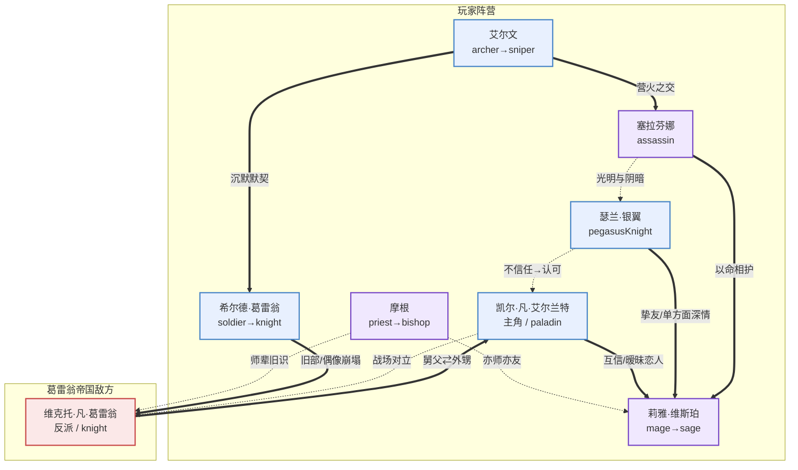

# 角色设定（Characters）

> 本文档支撑设计支柱 **「抉择（Choose）」**——角色的立场冲突、永久死亡条件、人物弧光，是让"战争没有赢家"主题在玩家心里落地的核心载体。
>
> 依赖：[设计支柱](00_design_pillars.md) · [职业系统](03_professions.md) · 联动：`05_story_branches.md`（待 C 组）

---

## 〇、设计哲学

本角色群服务的命题是：**「没有人是反派，每个人都在为某种正确而战。」**

为忠实于 [设计支柱](00_design_pillars.md) 的灰色道德基调与「战争没有赢家」主题，本设定遵循三条铁律：

1. **没有脸谱化反派**——即使是敌方统帅，也有自洽的、令人同情的立场。玩家打败他时不该感到爽快，而该感到沉重。
2. **同伴之间有立场冲突**——玩家队伍内部不是铁板一块。不同国家出身的同伴对"如何结束战争"有根本分歧，这会在剧情分支里爆发。
3. **永久死亡有叙事重量**——战旗的经典 permadeath 机制，在这里不是"单位损失"，而是"一段故事永远闭合"。每个角色都设计了死亡条件与死亡对剧情的连锁影响。

### 引用的设计原理

| 原理 | 出处 | 体现 |
|------|------|------|
| **Thematic Emphasis（主题优先于数值）** | `character-optimization-design` | 角色的属性成长倾向服务其叙事定位（如"悔恨的老兵"防御成长高、"偏执的天才"技巧成长高），而不是单纯追求强度。鼓励玩家因叙事而爱角色，而非因强度而堆角色。 |
| **Flow State（难度梯度）** | `flow-state-design-framework` | 队伍构成天然形成难度梯度：简单单位（剑士/重骑士系角色）让新手有立足点，复杂单位（魔法系/刺客系角色）留给熟练玩家。 |
| **Interconnected Attributes** | `character-optimization-design` | 每个角色的"优点"必伴"缺点"——见各角色的"性格"与"成长倾向"的对照，杜绝完美主角。 |

### 国家速查（详见 `02_nations.md`，待 A 组产出；此处为角色设定所需最小集）

| 简称 | 全名 | 一句话定位 |
|------|------|-----------|
| **艾尔兰特** | 艾尔兰特王国 | 旧秩序的守护者，骑士之国，正陷入王位继承危机。 |
| **维斯珀** | 维斯珀联邦 | 魔法师的城邦联盟，垄断源脉知识，被视为异端。 |
| **葛雷翁** | 葛雷翁帝国 | 军事强权，依靠钢铁与纪律扩张，仇视魔法。 |
| **古源** | 古源（源脉圣地） | 中立的隐世宗门，守护源脉本源，被各方觊觎。 |

---

## 一、角色总表

共 **8 个主要角色**：玩家队伍 7 人（含 1 名后期加入），反派 1 名（作为最终对立面）。

| # | 姓名（中/英） | 国家 | 职业 id | 战斗定位 | 上手难度 | 阵营 |
|---|--------------|------|---------|----------|----------|------|
| 1 | 凯尔·凡·艾尔兰特 / Kael | 艾尔兰特 | `recruitKnight`→`paladin` | 坦克/副输出 | 2 | 主角（玩家） |
| 2 | 莉雅·维斯珀 / Lyra | 维斯珀 | `mage`→`sage` | 魔法输出（稀缺王牌） | 4 | 同伴 |
| 3 | 希尔德·葛雷翁 / Hilde | 葛雷翁（叛逃） | `soldier`→`knight` | 主坦克 | 1 | 同伴 |
| 4 | 艾尔文 / Alwyn | 通用（佣兵） | `archer`→`sniper` | 远程输出 | 2 | 同伴 |
| 5 | 瑟兰·银翼 / Thera | 维斯珀 | `pegasusKnight` | 飞行侦察/刺杀 | 3 | 同伴 |
| 6 | 摩根 / Morgan | 古源 | `priest`→`bishop` | 治疗/辅助 | 2 | 同伴 |
| 7 | 维克托·凡·葛雷翁 / Viktor | 葛雷翁 | `knight`（敌方统帅，不可转职） | 重甲铁卫 | — | **反派（主角舅父）** |
| 8 | 塞拉芬娜 / Seraphina | 维斯珀（暗面） | `assassin` | 刺客（玻璃刀） | 5 | 同伴（后期加入，立场暧昧） |

> 职业 id 全部链回 [03_professions.md 职业总表](03_professions.md#二职业总表master-table)。

---

## 二、角色详细设定

### 角色 1：凯尔·凡·艾尔兰特（主角）

| 项 | 内容 |
|----|------|
| **姓名（中/英）** | 凯尔·凡·艾尔兰特 / Kael van Elrant |
| **国家** | 艾尔兰特王国 |
| **职业 id** | `recruitKnight` →（转职）→ `paladin` |
| **身份/职位** | 艾尔兰特王国先王私生子，被承认为第三骑士团见习骑士。现任国王（其异母兄）暴毙后，王位空悬。 |
| **外貌** | 22 岁，深栗色短发，灰蓝色眼睛。左眉骨有一道陈年刀疤（幼年宫廷动乱留下）。常穿艾尔兰特制式的银白轻甲，胸前佩一枚褪色的王室纹章——那是他唯一能证明血统的东西。体格偏瘦，不像传统重甲骑士那样魁梧。 |
| **性格** | 沉稳、负责、近乎固执地守诺。最大的缺点是**责任感过剩**——他把所有人的命都扛在自己肩上，导致决策迟缓、无法割舍任何一个同伴（在 permadeath 机制下这是致命的）。他害怕成为"另一个为了王位不顾一切的人"。 |
| **背景** | 私生子身份让他在宫廷长大却从未被真正接纳。先王临终前承认了他，将他编入骑士团"以观后效"。先王暴毙、异母兄长继位不足一年也离奇死亡后，王室正统断绝，凯尔作为最后的血亲被推上前台——但他**从未想要王位**，他只想弄清楚兄长为何而死。 |
| **核心动机** | **"我不要王座，我要真相——和我哥哥的死因。"** |
| **人物弧光** | **开局信念**："只要我足够负责、足够公正，就能让所有人活下来，结束这场乱局。" → **中段冲突**：发现兄长之死牵涉维斯珀与葛雷翁双方，且部分真相指向他自己被承认的"合法性"本身就是阴谋的一环。他必须在"追查真相（可能引发全面战争）"与"维持和平（掩盖真相）"之间抉择。 → **结局转变**：接受"有些战争不是你能阻止的，你能选的只是以什么姿态走进去"——从一个想救所有人的少年，变成一个知道会有人死、但仍选择扛起责任的王。 |
| **战斗定位** | 中前期是 `recruitKnight`，平衡型骑兵，mov 7 用于机动补位。转职 `paladin` 后成为队伍主心骨——hp/def 中上，可抗可打，mov 8 全队最快，是"救火队长"。 |
| **成长倾向** | def 与 hp 成长高（守护型），agility 中等，power 中等偏低——他不是输出机器，是"永远站在最前面的人"。 |
| **与他人关系** | ① **维克托（反派）是他的舅父**——母亲是葛雷翁公主，下嫁艾尔兰特先王。舅父曾抱过年幼的凯尔。② **莉雅**是他最信任的参谋与（隐含的）情感对象，但两国立场让这段关系始终悬而未决。③ **希尔德**曾在他麾下任职葛雷翁军，两人有旧怨。 |
| **死亡条件** | 若在 [剧情分支] 凯尔执意单挑维克托且未满足"说服条件"（莉雅在场 + 持有特定信物），凯尔会在单挑中被维克托误杀。**死亡影响**：主角死亡触发隐藏结局"群龙无首"——战争陷入更长久的拉锯，所有同伴的结局线恶化。这是 permadeath 机制下最重的叙事惩罚。 |

---

### 角色 2：莉雅·维斯珀

| 项 | 内容 |
|----|------|
| **姓名（中/英）** | 莉雅·维斯珀 / Lyra Vesper |
| **国家** | 维斯珀联邦 |
| **职业 id** | `mage` →（转职，需源脉晶石）→ `sage` |
| **身份/职位** | 维斯珀源脉学院最年轻的魔导师，被联邦议会派驻凯尔军中"协助"（实为监视与情报）。 |
| **外貌** | 20 岁，银白色长发（源脉启悟者的特征），淡紫色瞳孔。身形单薄，常年穿深紫色的学院长袍，左手腕有一圈源脉烙印的银色纹路（施法过度的烧伤痕迹）。随身携带一本厚重的法术书，书页边缘焦黑。 |
| **性格** | 聪明、冷静、言辞犀利，习惯用理性包装一切。缺点是**情感压抑与道德模糊**——她被训练成"魔法的工具"，习惯把人当变量计算。她对凯尔的好感让她害怕，因为她的任务里包含"必要时牺牲他"。 |
| **背景** | 出身维斯珀平民，幼年因源脉天赋被学院带走，与家人断绝。她是学院"完美武器"计划的产物——被教导魔法是国家资产，施法者为国家所用。她开始怀疑这一切，是在第一次被命令对平民施法之后。 |
| **核心动机** | **"我想知道，魔法究竟是人的工具，还是人成了魔法的祭品。"** |
| **人物弧光** | **开局信念**："理性与秩序高于一切，情感是误差。" → **中段冲突**：被议会密令在关键时刻对凯尔"采取行动"，但她做不到。她第一次意识到自己不是工具。 → **结局转变**：选择背叛维斯珀议会、公开源脉知识（这是维斯珀立国之本），以"让魔法不再被垄断"为代价换和平——这让她成为祖国的叛徒，却是她第一次作为"人"做选择。 |
| **战斗定位** | 全队唯一稳定魔法输出。参考 [魔法稀缺说明](03_professions.md#六魔法职业特别说明核心主题服务)，她的 MP 是全队最紧绷的资源——玩家每场战斗都要算"这一发给莉雅值不值"。转职 `sage` 后成为破甲钥匙与 boss 战核心。 |
| **成长倾向** | power 与 res 成长极高（魔法威力与魔防），hp 成长全队最低——她是被保护的对象，不是冲锋的人。 |
| **与他人关系** | ① **凯尔**：互相信任又互相试探，立场暧昧的盟友/恋人。② **摩根**：古源出身的治愈者，是唯一理解莉雅"被源脉灼烧之痛"的人，亦师亦友。③ **瑟兰**：同为维斯珀女性，但瑟兰是"行动派"、莉雅是"思考派"，两人常有路线之争。 |
| **死亡条件** | 若在维斯珀议会事件中莉雅选择"公开源脉"但凯尔未提供足够保护（队伍战力不足或未派她撤退路线），她会被议会刺客灭口。**死亡影响**：全队永久失去魔法输出与破甲能力，后续重甲战难度骤增；凯尔的结局线强制走向"复仇与孤独"。 |

---

### 角色 3：希尔德·葛雷翁

| 项 | 内容 |
|----|------|
| **姓名（中/英）** | 希尔德·葛雷翁 / Hilde Graion |
| **国家** | 葛雷翁帝国（叛逃者） |
| **职业 id** | `soldier` →（转职）→ `knight` |
| **身份/职位** | 前葛雷翁帝国铁卫军百夫长，因拒绝执行屠村命令而被通缉，现流亡至凯尔军中。 |
| **外貌** | 28 岁，金色短发剃成军旅式样，墨绿色眼睛。身材高大魁梧（全队最壮的女性），右脸颊有一道贯穿至颈部的烧伤疤（"不听话"的惩罚）。永远穿着一套保养到发亮的旧葛雷翁制式重甲，胸甲上的帝国徽记被她亲手凿去，留下一块粗糙的疤。 |
| **性格** | 直率、忠诚、死板地恪守军纪。缺点是**倔强与自我惩罚**——她离开葛雷翁不是因为"反战"，而是因为"我服从了太久，直到那条线"。她无法原谅自己曾经执行过的命令，把这股罪疚变成了对凯尔"绝对服从"的补偿。 |
| **背景** | 葛雷翁农家女，为养活弟弟参军，凭借体格与纪律一路升到百夫长。她曾相信"军人的职责就是服从"。直到上级下令屠杀一个窝藏魔法师的村庄，她看见那个村庄里有和自己弟弟一样大的孩子——她第一次违抗命令，砍倒长官，带着残余村民逃亡。她的弟弟至今仍在葛雷翁，不知姐姐是"叛徒"。 |
| **核心动机** | **"我不想再听见孩子的哭声，因为我的剑。"** |
| **人物弧光** | **开局信念**："只要我服从一个值得服从的人（凯尔），就能赎我的罪。" → **中段冲突**：在战场上重逢已成为葛雷翁军官的弟弟，弟弟奉命追杀"叛徒姐姐"。 → **结局转变**：不再把"服从"当作救赎，而是学会"自己判断什么是对的事"——即使这意味着再次与凯尔意见相左。 |
| **战斗定位** | 队伍主坦克。`knight` 职业的 hp34/def11 让她能堵住任何隘口。她是凯尔之外第二个"站在最前面"的人。mov 仅 4，需要预判布阵。 |
| **成长倾向** | hp 与 def 成长全队最高，agility 与 res 全队最低——她是物理之墙，却最怕魔法（呼应 [职业克制](03_professions.md#三职业克制关系武器三角--特攻)：重甲被魔法特攻）。 |
| **他人关系** | ① **凯尔**：曾听命于他（葛雷翁旧役），现以赎罪心态效忠。② **维克托（反派）**：曾是她崇拜的偶像，葛雷翁铁卫军的传奇——如今是她必须面对的旧神。③ **艾尔文**：佣兵艾尔文是唯一不问"你为什么叛逃"的人，两人在沉默中有默契。 |
| **死亡条件** | 在与弟弟的战斗中，若玩家选择"让希尔德亲手了结弟弟"，她会战后因崩溃而离队（不算死亡但永久不可用）；若选择"保护弟弟"，希尔德会在掩护中重伤，若当关未获治疗则死亡。**死亡影响**：全队失去主坦克，后续重甲战极度依赖凯尔一人，容错大降。 |

---

### 角色 4：艾尔文

| 项 | 内容 |
|----|------|
| **姓名（中/英）** | 艾尔文 / Alwyn |
| **国家** | 无国籍（佣兵） |
| **职业 id** | `archer` →（转职）→ `sniper` |
| **身份/职位** | 自由佣兵，以"按人头收费"闻名，被凯尔以长期契约雇佣。 |
| **外貌** | 26 岁，深褐色乱发，褐色眼睛总是半眯着（常年瞄准养成的习惯）。下巴有胡茬，穿一件洗得发白的皮甲，背后斜挎一把长弓。腰间挂着一个钱袋和一个酒壶——两者都很少是空的。左手的食指因常年拉弦而变形弯曲。 |
| **性格** | 玩世不恭、实际、把一切换算成金币。缺点是**犬儒主义掩盖下的懦弱**——他用"我只为钱"来逃避"我为什么而战"这个问题。他其实比谁都重感情，只是不敢承认。 |
| **背景** | 出身不明，自称"记不清老家在哪"。曾在三国之间游走接活，杀过人也救过人，价钱合适就行。他加入凯尔不是因为契约，而是因为凯尔是第一个"在战场上把手伸向他"的雇主——那一次他中箭倒地，所有人都以为他死了，只有凯尔回头。 |
| **核心动机** | **"我想找一个值得我不收钱去死的理由——但我大概找不到。"** |
| **人物弧光** | **开局信念**："活下去，拿到钱，别的都不重要。" → **中段冲突**：在一场本可撤退的战斗中，他选择留下来掩护平民撤退（没有报酬）。他开始害怕自己"变了"。 → **结局转变**：拒绝一笔足以让他一生衣食无忧的"背叛凯尔"的收买，并第一次对凯尔说"这一单，我免费"。他没找到"理由"，但他找到了"人"。 |
| **战斗定位** | 稳定的远程输出，反制飞行单位的核心（弓克飞行，见 [职业克制](03_professions.md#32-特攻关系非循环针对硬目标)）。`archer` 射程 [2,3]，转职 `sniper` 后 [2,4]，是"对方摸不到我"的安全输出位。 |
| **成长倾向** | skl 与 agility 成长高（命中与追击），hp 与 def 低——典型的玻璃炮，必须站在后排。 |
| **他人关系** | ① **希尔德**：沉默的默契，两人都是"用冷酷掩饰真心"。② **塞拉芬娜**：后期加入的刺客，两人都习惯独处，却在营火旁交换过最真实的过往。③ **凯尔**：雇主与雇佣，但艾尔文心知这早已不是金钱关系。 |
| **死亡条件** | 艾尔文是最容易"被收买而背叛"的角色——若玩家长期忽视他的契约（不支付军饷剧情触发），他可能在某关离队投敌。若玩家选择在战场上击杀叛逃的他，他会死；若选择放过，他会在结局线回归。**这是对玩家"把角色当工具"的惩罚设计**——呼应 permadeath 的主题。 |

---

### 角色 5：瑟兰·银翼

| 项 | 内容 |
|----|------|
| **姓名（中/英）** | 瑟兰·银翼 / Thera Silverwing |
| **国家** | 维斯珀联邦 |
| **职业 id** | `pegasusKnight` |
| **身份/职位** | 维斯珀天马骑士团小队长，莉雅的护卫与挚友，被议会一同派往凯尔军中。 |
| **外貌** | 21 岁，浅金色长发编成战斗用的长辫，翠绿色眼睛。身形轻盈，穿维斯珀制式的银白轻型骑甲，背后是天马骑士特有的羽翼披风（非真羽翼，是仪式性装饰）。右耳戴一枚银色耳钉——天马骑士成年的标志。座下天马"晨星"是她的伙伴，比她更早加入骑士团。 |
| **性格** | 热情、冲动、护短到极点。缺点是**鲁莽与二元思维**——她把世界分成"自己人"和"敌人"，对朋友两肋插刀，对敌人不留情面。她很难理解灰色地带，这让复杂的政治博弈让她头痛。 |
| **背景** | 维斯珀边境骑士世家出身，三代天马骑士。她与莉雅是学院同期，莉雅被霸凌时是她第一个拔剑。她对莉雅的情感超过友谊，但她自己从未说清——她以为"保护"就够了。 |
| **核心动机** | **"我要守住我想守住的人——管他什么大局。"** |
| **人物弧光** | **开局信念**："敌人就该死，朋友就该护。" → **中段冲突**：当莉雅开始"思考大局"甚至可能与"敌方"合作时，瑟兰感到被背叛——她不理解莉雅为什么要和"坏人"说话。 → **结局转变**：学会"有些敌人也曾是别人的朋友"，第一次在战场上放过一个投降的敌人。 |
| **战斗定位** | 飞行侦察与刺杀。mov 8 + 无视地形，用于绕后杀法师/弓手。**致命弱点**：被弓箭特攻（[1.5 倍伤害](03_professions.md#32-特攻关系非循环针对硬目标)），hp 仅 20——看到敌方 archer 必须绕开。全队操作难度最高的"赌徒单位"之一。 |
| **成长倾向** | agility 与 res 成长高（闪避与魔防），hp 与 def 低——她靠"不被打到"活着，一旦被弓手摸到就危险。 |
| **他人关系** | ① **莉雅**：挚友（瑟兰单方面更深的情感），保护欲是其核心驱动力。② **凯尔**：起初不信任（"又一个想利用莉雅的王子"），后逐渐认可。③ **塞拉芬娜**：同为"行动派"女性，但瑟兰光明、塞拉芬娜阴暗，互看不对眼。 |
| **死亡条件** | 瑟兰的鲁莽是被设计进机制的——她是最容易因"贪刀飞进敌方弓手射程"而死的角色。**死亡影响**：若瑟兰死于玩家操作失误，莉雅的结局线会强制走向"封闭与复仇"，剧情张力急剧上升。这是 permadeatn 与角色关系交织的最直接体现。 |

---

### 角色 6：摩根

| 项 | 内容 |
|----|------|
| **姓名（中/英）** | 摩根 / Morgan |
| **国家** | 古源（源脉圣地） |
| **职业 id** | `priest` →（转职）→ `bishop` |
| **身份/职位** | 古源隐世宗门的游方司祭，奉宗主之命"观察"这场战争，实则在寻找一个能终结源脉流血的人。 |
| **外貌** | 外表约 40 岁（实际年龄成谜，古源修士寿元悠长），灰白色短发整齐地梳向脑后，琥珀色眼睛异常平静。穿一袭素白的长袍，腰间挂一串源脉念珠与一柄从不拔出的旧杖。双手布满细密的银色纹路——源脉修习者的标志，比莉雅的更柔和、更古老。永远带着温和的笑，但那笑意从不到达眼底。 |
| **性格** | 温和、睿智、有一种让人安心的笃定。缺点是**超然到近乎冷漠**——他见过太多战争，对"这一场"的伤亡有一种"都会过去"的疏离感。他真正在乎的事，藏在那一笑之下。 |
| **背景** | 古源宗门的资深修士，曾游历诸国数十年。他亲眼见证过上一次因源脉而起的战争（五十年前），那场战争毁灭了一个国家。他此行的任务不是"帮谁赢"，而是"别让源脉再一次被战争吞噬"。他对莉雅有特殊的关注——她让他想起五十年前那个"被源脉灼烧而死的故人"。 |
| **核心动机** | **"我不想再活过一场我不该活过的战争。"** |
| **人物弧光** | **开局信念**："超然是最高的智慧，不站队才能止损。" → **中段冲突**：当他意识到"不站队"本身就是一种站队（默认让强权继续碾压弱者）时，他的超然开始崩塌。 → **结局转变**：第一次为某一方"下场"——明知会打破古源中立、明知会死，但他选择"这一场，我站这边"。 |
| **战斗定位** | 队伍治疗核心，转职 `bishop` 后拥有全队最高 res（10）与净化/反不死能力。他不是输出，但**没有他的队伍在持久战里会崩**。 |
| **成长倾向** | res 与 skl 成长高（魔防与治疗命中），hp 与 def 极低——他和莉雅一样是被保护对象。 |
| **他人关系** | ① **莉雅**：亦师亦友，唯一理解源脉灼痛的人，暗中引导她。② **维克托（反派）**：五十年前那场战争的旧识——他们都还年轻过。③ **凯尔**：他在凯尔身上看到了"那个能终结循环的人"的可能，但不敢确认。 |
| **死亡条件** | 摩根的死亡是剧情性的——若玩家走向"完全依赖源脉力量"的路线（滥用魔法/牺牲同伴换源脉），摩根会在某关以自身封印源脉暴走而亡。**死亡影响**：全队永久失去最高治疗与净化，后续 boss 战难度大增；同时这是对玩家"为力量不择手段"的主题惩罚。 |

---

### 角色 7：维克托·凡·葛雷翁（反派，重点立体化）

| 项 | 内容 |
|----|------|
| **姓名（中/英）** | 维克托·凡·葛雷翁 / Viktor van Graion |
| **国家** | 葛雷翁帝国 |
| **职业 id** | `knight`（敌方统帅，数值可略高于我方 knight 作为 boss） |
| **身份/职位** | 葛雷翁帝国铁卫军大元帅，"钢铁之手"。凯尔的舅父（凯尔之母是葛雷翁公主）。 |
| **外貌** | 50 岁，钢铁灰色短发向后梳，冰蓝色眼睛（与凯尔同源的母系遗传）。身材魁梧如一堵墙，穿全套漆黑的葛雷翁重甲，肩甲上的帝国双头鹰被血锈染暗。左臂是一只用源脉驱动的机械义肢——三十年前对抗维斯珀魔法师时失去原臂，被古源匠人（即摩根的师辈）以禁忌之术接续。这道伤疤是他"反魔法"立场的肉体根源。 |
| **性格** | 严厉、笃定、对士兵有近乎父爱的责任感。缺点是**信仰已经硬化成偏执**——他真心相信"魔法是世界的祸根，消灭魔法是拯救人类"，这让他对任何反驳都听不进去。他不残暴，不嗜杀，甚至会在战后厚葬敌人——但他绝不动摇。 |
| **背景** | 年轻时是葛雷翁最英武的骑士，娶了艾尔兰特公主（凯尔之母）为妻，两国曾因这段婚姻短暂和平。维斯珀的魔法师团为破坏和议，在宴会上施法屠杀了凯尔之母与数十名贵族——维克托失去妻子、失去左臂、失去对魔法的一切信任。他回国后推动葛雷翁彻底转向"钢铁与反魔法"，用三十年把一个中等国家练成大陆最强军事机器。**他不是为权力而战，他是为"不让任何一个妻子再死于魔法"而战。** |
| **核心动机** | **"我要让这个世界再无魔法——哪怕用钢铁碾碎所有源脉，哪怕碾碎我自己。"** |
| **人物弧光** | **开局信念**："魔法是恶，消灭魔法即是正义。" → **中段冲突**：当他发现凯尔（他抱过的外甥）正与维斯珀魔导师（莉雅）并肩，且凯尔的合法性恰恰源于那场"魔法阴谋"——他的世界开始裂开。他面对的不是"敌人"，而是"我妹妹的儿子和一个像我爱过的妻子一样会魔法的女孩"。 → **结局转变**：拒绝简单的悔悟。他至死都相信自己的事业，但他最后选择"不杀凯尔"——因为他终于意识到，"用钢铁碾碎一切"和"用魔法统治一切"是同一枚硬币的两面。他以自己的死，而不是胜利，完成了立场。**这是一个反派最大的尊严。** |
| **战斗定位** | 终局 boss 之一。作为高阶 `knight`，hp/def 极高，正面硬打几乎不可能——必须用魔法（绕 def）或侧背夹击。这是 [魔法稀缺](03_professions.md#六魔法职业特别说明核心主题服务) 设计的高光时刻：玩家一局攒下的那几发魔法，在这里决定了胜负。 |
| **成长倾向** | 作为 boss 不适用成长曲线；其固定数值为 boss 版本（hp 远超普通 knight）。 |
| **他人关系** | ① **凯尔**：外甥，曾抱过他，如今是必须击败的敌人——也是他唯一可能的救赎。② **摩根**：五十年前古源匠人为他接续义肢，摩根的师辈与他有旧；摩根是他唯一愿意"听一句话"的敌方。③ **希尔德**：曾是他最看重的铁卫军后辈，她的叛逃是他个人的失败，也是最痛的伤口。④ **莉雅**：她像极了他失去的妻子（也会魔法、也来自敌国）——这让他无法下手。 |
| **死亡条件** | 维克托之死是剧情核心节点。三种可能：① 凯尔单挑杀他（悲剧结局）；② 莉雅+摩根说服他放下武器（最难达成的和平结局，需多个分支条件）；③ 他在保护凯尔免受第三方（真正幕后黑手）袭击时战死（救赎结局）。**维克托的死不是玩家的胜利，是战争本身的损失——这正是主题所在。** |

---

### 角色 8：塞拉芬娜（后期加入，立场暧昧）

| 项 | 内容 |
|----|------|
| **姓名（中/英）** | 塞拉芬娜 / Seraphina |
| **国家** | 维斯珀联邦（暗面） |
| **职业 id** | `assassin` |
| **身份/职位** | 维斯珀议会"暗影司"的顶级刺客，代号"夜莺"。被派来"清理"莉雅（因莉雅开始不听话），却在执行任务时倒戈。 |
| **外貌** | 年龄不详（约 24-27），黑色短发齐耳，一只眼睛是淡紫（源脉改造痕迹），另一只是黑色。身形纤细，穿贴身的黑色软甲，腰间两柄反握短剑。脖颈有一圈极细的银色纹路——不是天生的源脉烙印，是被议会强制植入的"控制咒"。她很少说话，因为她被训练成"沉默比说话更安全"。 |
| **性格** | 警惕、寡言、黑色幽默（罕见的放松时）。缺点是**信任机能几乎为零**——她从未被人善待过，所以也不会相信善意。她对任何温暖的第一反应是"这是不是陷阱"。 |
| **背景** | 她不记得父母。自幼被维斯珀暗影司"收养"，训练为只认命令的刀。她杀过的人里，有几个是她后来才知道是"无辜的"。她倒戈的那一刻，是在接到"清理莉雅"命令时——莉雅是第一个在学院里对她说过"你看起来很累"的人。那句话让她犹豫了三秒，而那三秒救了莉雅，也杀死了"夜莺"。 |
| **核心动机** | **"我不知道我是谁——但我知道我不再是谁的刀。"** |
| **人物弧光** | **开局信念**："活着就是执行下一个命令。" → **中段冲突**：加入凯尔军后，她第一次被人信任，却不知如何回应。议会的控制咒会定期发作，强迫她"回归"。 → **结局转变**：在控制咒最后一次发作时，她选择自毁咒印（濒死）而不是伤害同伴——这是她第一次作为"自己"做选择。若获救，她活下来；若不救，她以自由之身死去。 |
| **战斗定位** | 全队最高单体爆发（assassin 的 agility 12 全表第一），专杀敌方脆皮。但 hp 16、def 3——是"换子"单位，每场战斗只能赌一两次。难度 5，留给熟练玩家。 |
| **成长倾向** | agility 与 skl 成长极高（暴击与追击），hp 与 def 极低。 |
| **他人关系** | ① **莉雅**：唯一对她说过人话的人，她以命相护。② **艾尔文**：两个"用冷酷掩饰真心"的人在营火旁交换过真实。③ **瑟兰**：互看不对眼（光明 vs 阴暗），但战场上有最锋利的配合。 |
| **死亡条件** | 见人物弧光——控制咒自毁是她的"自由之死"。若玩家在她倒戈后仍不信任她（多次拒绝她的战术建议），她会在某关被议会控制、被迫攻击同伴，玩家须在"杀她救同伴"与"冒险救她"间抉择。 |

---

## 三、角色关系图



> 若 mermaid 不渲染，ASCII 速查版：

```
                    [维克托 反派]
                     /  |    \
              舅父⇄外甥  |    师辈旧识(摩根师门)
                   /    |        \
                [凯尔]──互信/恋人──[莉雅]──亦师亦友──[摩根]
                  │                ↑↑↑                    
              不信任→认可      挚友│││以命相护              
                  │          (瑟兰│││塞拉芬娜)              
                  │                │                       
        [希尔德]──旧怨──→(维克托)  │                       
          │                         │                       
        沉默默契──[艾尔文]──营火──[塞拉芬娜]               
```

---

## 四、队伍构成与难度梯度（Flow State 应用）

依据 `flow-state-design-framework` 的三阶段理论，队伍构成天然服务于玩家技能成长曲线：

| 玩家阶段 | 推荐核心队伍 | 对应 Flow 阶段 | 设计意图 |
|----------|-------------|----------------|----------|
| **入门期**（前 5 关） | 凯尔(recruitKnight) + 希尔德(soldier) + 艾尔文(archer) + 摩根(priest) | Stage 1: Introduction | 全是难度 1-2 的物理/治疗单位，机制单一，反馈直接。让新手建立"布阵→交锋→治疗"的基础心流。 |
| **成长期**（中段） | 上述 + 莉雅(mage) + 瑟兰(pegasusKnight) | Stage 2: Practice | 引入魔法稀缺与飞行操作，挑战略高于当前技能。玩家开始学 MP 管理与走位。 |
| **精通期**（后段） | 全员 + 塞拉芬娜(assassin) + 转职后的高阶职业 | Stage 3: Flow | 全机制齐备，permadeatn 与分支决策密集。挑战与玩家技能精确匹配，进入沉浸心流。 |

> 莉雅的魔法职业难度 4、塞拉芬娜的刺客难度 5，被刻意安排在中后期加入/解锁——这是 Flow 框架"挑战随技能爬坡"的直接落地。

---

## 五、永久死亡（Permadeath）与主题呼应

本作继承战旗经典的 permadeath 机制，并把它**主题化**：

| 死亡类型 | 触发 | 主题意义 |
|----------|------|----------|
| **战术失误死亡** | 任何角色在战场 HP 归零且无"救援"道具 | 战争的随机残酷——再重要的人也会因一次走位失误永远消失。 |
| **剧情抉择死亡** | 见各角色"死亡条件"（如凯尔单挑维克托、摩根封印源脉） | 抉择的重量——某些死亡是玩家"选择"的结果，不是失误。 |
| **背叛/离场死亡** | 艾尔文被收买、塞拉芬娜控制咒发作 | 把角色"当工具"的惩罚——呼应对应 `character-optimization-design` 的 min/max 警告：你不能只看数值不看人。 |

**核心叙事装置**：每当一个同伴永久死亡，凯尔会在战后营地有一段独白，主题始终是"我以为我能救所有人"。这是「战争没有赢家」主题在系统层面的反复敲击——玩家每一次失误，都让这句话更沉重一分。

---

## 六、与职业系统、代码库的对齐

| 角色 | 职业 id | 数据对齐说明 |
|------|---------|-------------|
| 凯尔 | recruitKnight→paladin | 两职业均在 [03 职业总表](03_professions.md#二职业总表master-table)；转职见 [转职树 4.3](03_professions.md#43-圣骑之路王牌流三段)。 |
| 莉雅 | mage→sage | 转职消耗源脉晶石（稀缺道具，见 [转职条件总表](03_professions.md#46-转职条件总表)）。 |
| 希尔德 | soldier→knight | soldier 为本表新增基础职业，knight 为现有 `professions.json` 已有职业（数值不变）。 |
| 艾尔文 | archer→sniper | archer 为现有职业，sniper 为新增高阶。 |
| 瑟兰 | pegasusKnight | 新增飞行职业，需在数据层补 `moveType: "fly"`（见 [03 第七节](03_professions.md#七与现有代码库的对齐说明)）。 |
| 摩根 | priest→bishop | priest 为现有职业，bishop 为新增高阶。 |
| 维克托 | knight（boss 版） | 复用 knight 数值，boss 版 hp/def 放大。 |
| 塞拉芬娜 | assassin | 现有 `professions.json` 已含 assassin，数值沿用。 |

---

## 七、待办与下游依赖

- [ ] 国家详细设定需对齐 `02_nations.md`（A 组产出后核对国家倾向）。
- [ ] 剧情分支需对齐 `05_story_branches.md`（C 组）：维克托之死的三种结局、莉雅的源脉公开、希尔德的弟弟遭遇战，均需写入分支。
- [ ] 源脉晶石、各类转职纹章需在 `06_items.md`（D 组）中定义。
- [ ] 角色专属技能（如莉雅的源脉觉醒、塞拉芬娜的控制咒发作）需在 `07_skills.md`（D 组）中对齐 `skills.json` 的 mpCost 量纲。
