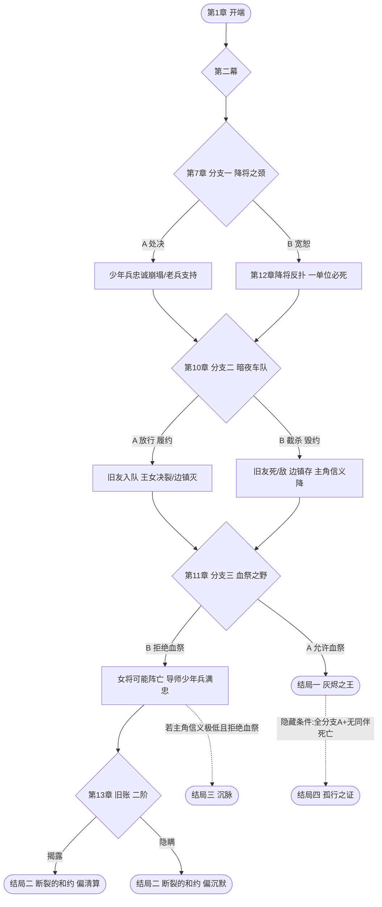

# 剧情分支设计（05_story_branches.md）

> **对应设计支柱**：本文档服务三大支柱中的 **「抉择」（Choose）**——在剧情分支、角色生死、资源消耗之间做不可逆取舍（见 [00 设计支柱](00_design_pillars.md)）。核心主题严格服从设计纲领：**「战争没有赢家，只有活下来的人」**。禁止非黑即白、禁止爽文式结局。

---

## 0. 协作对齐说明（必读）

本剧情骨架**不依赖具体国名/角色名**即可成立。文中以**功能位占位符**称呼，待以下文档完成后回填：

| 占位符 | 功能位 | 待回填文档 |
|--------|--------|-----------|
| `[帝国]` | 试图统一源脉、终结乱世的扩张型霸权 | [02 国家](02_nations.md) |
| `[联邦]` | 松散的自由诸邦同盟，内部分裂 | [02 国家](02_nations.md) |
| `[教国]` | 崇拜源脉为神迹的神权国，掌握封印知识 | [02 国家](02_nations.md) |
| `[旧王国]` | 已亡国、遗迹遍布地图的第三势力 | [01 世界观](01_worldview.md) |
| `主角` | 被征召的源脉学者/战场术士，故事的「见证者-抉择者」 | [04 角色](04_characters.md) |
| `导师` | 曾试图以统一终结战争、如今幻灭的老将 | [04 角色](04_characters.md) |
| `旧友` | 投身 `[帝国]` 阵营的昔日同窗，理念对立者 | [04 角色](04_characters.md) |
| `女将` | 为族人复仇的 `[联邦]` 将领，会为胜利不择手段 | [04 角色](04_characters.md) |
| `王女` | 亡国 `[旧王国]` 的流亡公主，理想主义者 | [04 角色](04_characters.md) |
| `老兵` | 愤世嫉俗的雇佣兵，实用主义者 | [04 角色](04_characters.md) |
| `少年兵` | 被卷入战火的平民少年，故事的人性温度计 | [04 角色](04_characters.md) |

> 职业与技能沿用 [03 职业](03_professions.md) 与现有 `godot/data/professions.json` 字段（sword/lance/axe/bow/magic/staff、foot/ride/fly）。

---

## 1. 一句话 Logline

> **一名被迫披甲的源脉学者，在 `[帝国]` 想用统一魔法终结乱世、`[联邦]` 为自由而战却内部倾轧的绞肉机中，必须在「以任何手段结束屠杀」与「守住那份可能让己方输掉战争的仁慈」之间反复下注——无论他怎么选，他爱的人里必有一个活不到停战那一天。**

- **主角**：源脉学者/战场术士（见证者-抉择者）
- **困境**：终结战争的效率 vs. 不变成自己所讨伐之物
- **赌注**：大陆的命运、同伴的性命、主角残存的人性
- **主题**：战争没有赢家，只有活下来的人（synergy-thematic-design 的「主题一致性」——本作走 **War is Horrible** 调性，禁止 Glory 调性的音乐/美术/机制错配）

---

## 2. 三幕结构总览

参考 `experience-pacing-structure` 的 **Rollercoaster（过山车）节奏模型**：紧张度做峰谷起伏，而非一路紧绷；每章单局控制在玩家 **7-10 分钟注意力窗口** 内可体验一次完整的小循环。

### 第一幕 · 开端（第 1-4 章）——「被卷入」
- **核心问题（玩家反复思考的命题）**：*当战争找上你，你能保持「不杀人」多久？*
- 功能：建立队伍雏形、揭示世界矛盾（源脉稀缺 + 三国争霸 + `[旧王国]` 亡国阴影）、确立灰色基调。
- 节奏：紧张度由 1 缓升至 3，第 4 章首次让玩家「不舒服」。

### 第二幕 · 发展（第 5-11 章）——「立场动摇」
- **核心问题**：*为了救更多的人，你是否愿意做一件你知道是错的事？*
- 功能：战局扩大、阵营内部分裂、三个重大分支点全部落在此幕、第一次同伴可能离队/死亡。
- 节奏：紧张度 4↔5 与 1↔2 交替（第 6/11 章为峰，第 8 章为谷），符合过山车模型。

### 第三幕 · 高潮与结局（第 12-15 章）——「清算」
- **核心问题**：*你愿意为「结束」付出怎样的代价——以及，结束之后剩下的是什么？*
- 功能：封印真相全揭露、终极对决、由累计分支决定走向哪个结局。
- 节奏：紧张度持续 4-5，但结尾给一个**安静的长镜头**（反高潮），呼应「没有赢家」。

---

## 3. 章节列表（共 15 章）

紧张度 1=最松弛 / 5=最紧绷。「新机制/职业」沿用 `professions.json` 的 weaponType 与 moveType 命名。「剧情功能」标注叙事节拍。

| 章 | 章名 | 关卡类型 | 剧情功能 | 新机制/职业 | 紧张度 |
|----|------|----------|----------|-------------|--------|
| 1 | 学院的陷落 | 撤退/护卫 | 引入主角+导师；战火降临 | 步兵 sword 基础移动/攻击教学 | 2 |
| 2 | 流亡之路 | 护卫（护送平民） | 引入女将+老兵；建立战争代价 | 杖 staff 治疗与 MP 稀缺管理 | 2 |
| 3 | 首次反攻 | 野战/攻城前置 | 加入 `[联邦]`；引入少年兵 | 弓 bow 远程 + 森林地形减伤 | 3 |
| 4 | 焦土 | 伏击/遭遇 | **首次道德冲击**：目睹双方屠杀平民 | 魔法 magic + 元素克制引入 | 4 |
| 5 | 旧友与故国 | 对话+小规模冲突 | 引入王女（理想）与旧友（敌营） | 骑 ride 移动力差异 | 3 |
| 6 | 河谷围城 | 攻城 | 战局升级；女将显露狠辣 | 破坏城门/援军回合机制 | 5 |
| 7 | **【分支一】降将之颈** | 抉择关 | 见下方分支一 | 「劝降/俘获」机制 | 4 |
| 8 | 营地之夜 | 基地整备（非战斗） | 间奏；同伴支援对话；喘息 | 商店/转职/支援系统开放 | 1 |
| 9 | 沉睡之名 | 探索/护卫 | **真相揭露**：封印因战争抽干源脉而松动 | 飞兵 fly 越障 + 古迹调查 | 3 |
| 10 | **【分支二】暗夜车队** | 夜战/潜行伏击 | 见下方分支二 | 战争迷雾/夜战视野 | 5 |
| 11 | **【分支三】血祭之野** | 决战 | 见下方分支三 | （分支依赖）血魔法可选机制 | 5 |
| 12 | 地脉之鸣 | 多线防御 | 封印之力显形；三方被迫应对 | 不可控友军 NPC 军团 | 4 |
| 13 | 旧账 | 对决/单挑 | 导师的过去被揭开；可选分支 | 理念亲和加成（相邻同理念单位增益） | 3 |
| 14 | 兵临王都 | 多阶段推进 | 最终汇聚；同伴生死清算 | 多阶段 Boss/区域目标 | 5 |
| 15 | 余烬 | 决战+结局 | 终极对决；由累计分支决定结局 | 综合系统收束 | 5 → 1 |

> 节奏校验（experience-pacing-structure）：第 6→7→8 形成「峰→中→谷」；第 10→11 双峰后第 13 为相对谷；第 15 在高潮后强制降至 1（反高潮收尾），避免「光荣胜利」错觉。

---

## 4. 分支设计（三个核心分支 + 一个二阶分支）

每个分支严格遵循 `player-psychology-decisions` 的 **Triangularity（三角性）** 原理：**两条路都有代价，没有「正确答案」**。代价分布在「短期战场 / 长期结局 / 同伴忠诚 / 主题呼应」四个维度。

### 分支一 · 第 7 章「降将之颈」

- **触发条件**：第 6 章围城胜利后，俘获一名 `[帝国]` 降将。该降将曾在第 4 章焦土事件中屠村，但其家眷尚在 `[帝国]` 境内，且掌握 `[帝国]` 下一步进军路线。
- **抉择 A · 处决**：以血还血。
  - 短期后果：第 10 章夜战缺少该降将提供的进军情报，地图增援+1 波，难度上升。
  - 长期后果：女将阵营气势大振，第 11 章血祭提案更易通过；但少年兵亲历处决，忠诚崩塌，第 13 章有**永久离队**风险。
  - 同伴反应：女将、老兵支持；王女、少年兵反对。
- **抉择 B · 宽恕**：将其收押，换取情报。
  - 短期后果：第 10 章获得情报，伏击顺利；但该降将在第 12 章地脉之鸣时趁乱脱逃，带兵反扑，**一名非剧情保护单位必然阵亡**（由系统从玩家存活单位中选最弱者，制造无力感）。
  - 长期后果：少年兵忠诚上升，王女好感上升；但老兵鄙夷，第 14 章拒绝出力（战力下降）。降将的家眷后来在第 15 章王都战时，会暗中放走一批平民——这个回报藏在环境叙事里，不易察觉。
  - 同伴反应：王女、少年兵支持；女将、老兵反对。
- **主题呼应**：*仁慈不是免费的，复仇也不是。*无论 A/B，玩家都在第 8 章营地收到被屠村庄遗属的来信——A 路线遗属感谢，B 路线遗属诅咒。同一封信，两种读法。

### 分支二 · 第 10 章「暗夜车队」

- **触发条件**：旧友秘密联络，愿以 `[帝国]` 调兵密信为投名状叛逃至 `[联邦]`，条件是：放行一支当夜经过的「辎重车队」。但情报显示车队中混有将被调往前线的 `[帝国]` 增援，放行意味着他们日后会屠戮一座 `[联邦]` 边镇。
- **抉择 A · 履约放行**：接回旧友，兑现承诺。
  - 短期后果：第 12 章获得密信，提前布防，地脉之鸣关卡难度大幅下降；旧友加入为可用单位（强力 magic 单位）。
  - 长期后果：那支增援在过场外屠了边镇（第 13 章通过环境叙事——主角行军经过该镇废墟——才得知）。王女信仰崩塌，**永久离队**并成为第 14 章的敌方 NPC（理念决裂）。
  - 同伴反应：旧友、导师理解；王女决裂；少年兵沉默。
- **抉择 B · 毁约截杀**：背刺旧友，全歼车队。
  - 短期后果：救下边镇（第 13 章该镇存活 NPC 会加入），但失去密信，第 12 章难度激增（增援从三面合围）。旧友在混战中**死亡或黑化为复仇敌人**（第 14 章作为精英敌出场）。
  - 长期后果：老兵大加赞赏，少年兵学到「为大局牺牲私情」；但主角的「信义」评分下降，影响「沉脉」结局的可达性。
  - 同伴反应：老兵、女将支持；导师痛心但不离队；旧友死/敌。
- **主题呼应**：*忠诚的代价，总是由别人来付。*A 救了战友却让平民去死；B 救了平民却亲手杀了朋友。两条路在结尾都会出现旧友的一句话回响——内容随选择不同。

### 分支三 · 第 11 章「血祭之野」

- **触发条件**：`[联邦]` 在决战中陷入绝境。女将提议动用一种以活体（战俘/平民）为燃料的源脉血祭，可在战场上召唤短暂的天灾级魔法翻转局势。这是设计支柱中明确反对的「魔法万能化」的禁区——本作魔法的稀缺性正在于此。
- **抉择 A · 允许血祭**：用战俘的命换一场胜利。
  - 短期后果：第 11 章几乎必胜，且血祭会暂时「封住」地脉的躁动（第 12 章难度下降）。
  - 长期后果：导师**当场离队**并带走在队中的少年兵（若存活）；主角「人性」评分归零，**锁定「灰烬之王」结局**。第 14-15 章主角可使用血魔法技能树，但每次施法消耗一名友军的 HP。
  - 同伴反应：女将拥护；导师、王女（若在场）离队；老兵沉默默许。
- **抉择 B · 拒绝血祭**：宁可战败，不越底线。
  - 短期后果：第 11 章极难，**女将大概率阵亡**（若无 S/L），且 `[联邦]` 一翼防线崩溃，第 12 章起战略态势转为守势。
  - 长期后果：保住队伍的人性内核，导师与少年兵（若存活）忠诚满级；解锁「断裂的和约」与「沉脉」结局路径。
  - 同伴反应：导师、王女、少年兵拥护；女将关系破裂，战场上不再接受主角指挥（变为友军 NPC，不可控）。
- **主题呼应**：*一场用恶魔手段赢得的胜利，与恶魔的胜利有何区别？*这是全作最锐利的三角——A 是功利主义的最优解，B 是义务论的自杀选项。设计支柱禁止爽文，故 B 路线不给「道德奖励性必胜」。

### 二阶分支 · 第 13 章「旧账」（可选，影响结局细节）

- **触发条件**：第 13 章导师的过去被揭开——他年轻时曾为促成「统一和平」而下令屠灭一座拒绝归顺的城。主角可选择**当众揭露**或**替他隐瞒**。
- 揭露：导师被迫退队，但 `[联邦]` 民意支持度上升，第 14 章援军+1；少年兵（若在场）得知真相后陷入长考。
- 隐瞒：导师留队并传授终极源脉技艺（解锁主角终极职业），但第 15 章真相会被敌方公开，主角「信义」评分再降。
- 主题呼应：*清算与包庇，都是一种共谋。*

---

## 5. 分支树（Mermaid）

---

## 6. 多结局（4 个，无完美结局）

触发条件基于**累计的「人性 / 信义 / 同伴存活」三项隐性评分**，而非单次选择。最「好」的结局也要付出代价（synergy-thematic-design 主题一致性：禁止 Glory 式圆满）。

### 结局一 · 「灰烬之王」（最苦涩 / 悲剧）
- **触发**：第 11 章选 A（允许血祭）。人性评分归零。
- **最终场景**：主角率军踏着 `[帝国]` 与 `[联邦]` 两军的尸骨进入 `[帝国]` 王都，以血魔法强行压制地脉躁动，赢得「统一」。庆功宴上无人举杯，导师的空席被撤走。最后一个镜头是主角独自站在被抽干的源脉干涸河床上，低头看见水中自己的脸——与他曾经讨伐的暴君一模一样。
- **主题评分**：**最悲观**。你赢了战争，输掉了「不再有这种人」的意义。

### 结局二 · 「断裂的和约」（最希望 / 仍有代价）
- **触发**：第 11 章选 B，且至少一名核心同伴（导师/王女/少年兵）存活。
- **最终场景**：主角以放弃追剿部分 `[帝国]` 战犯为代价，换得三方停战协议。`[联邦]` 没有赢，`[帝国]` 没有亡，地脉的封印只是勉强补上。最后一幕是主角与存活的同伴站在营地，望着士兵们各自回家——少年兵（若存活）问「这就结束了吗」，主角答「没有，只是暂时没人打了」。
- **主题评分**：**最希望，但苦涩**。战争没有结束，只是停止了响声；某些恶人还活着，因为这是停战的代价。
- **分支变体**：第 13 章选「揭露」→ 和约更公开但更脆弱；选「隐瞒」→ 表面稳固但埋下雷。

### 结局三 · 「沉脉」（最壮烈 / 自我献祭）
- **触发**：第 11 章选 B，且主角「信义」评分极低（曾在分支二毁约、分支三隐瞒等），且导师或王女其一已死亡/离队。
- **最终场景**：主角认定只要源脉存在，战争就永远不会结束。在最终决战中，他选择亲手击碎源脉的主脉，**永久终结大陆的魔法**——包括牺牲自己与所有源脉绑定的同伴（导师/旧友/王女中存活者一并殉葬）。最后一幕是无魔法的清晨，老兵带着少年兵（若存活）在一片平静却贫瘠的土地上生火，说「至少，没人会为这玩意儿再打仗了」。
- **主题评分**：**苦涩的救赎**。你饿死了战火，也饿死了文明的一部分。

### 结局四 · 「孤行之证」（隐藏 / 空洞）
- **触发**：极苛刻——全部分支选 A（最功利路线），且奇迹般无任何同伴死亡（需高难度操作）。
- **最终场景**：主角以最少代价赢得了战争，所有同伴活着。但结尾是一段长镜头：营地里每个人都在，却没人愿意与主角对视。最后一帧是主角一个人擦拭武器，画外音是导师早年的话：「活下来的人，不等于赢家。」
- **主题评分**：**最冷的讽刺**。这是给功利最优解玩家的「奖赏」——你什么都没失去，除了所有人都还愿意把你当人。

---

## 7. 同伴生死与永久死亡处理

参考《火焰纹章》经典永久死亡，但增加叙事弹性。原则：**死亡不可撤销，但叙事不崩溃**。

| 角色 | 剧情保护状态 | 死亡后果与替代处理 |
|------|--------------|---------------------|
| `主角` | **全程剧情保护**，阵亡即 Game Over | —— |
| `导师` | 第 1-12 章剧情保护；第 13 章后可因「揭露」退队 | 若第 13 章前阵亡：由 `老兵` 在关键过场顶替台词（语气更冷），结局二台词变化；结局三的牺牲者改由 `王女` 承担 |
| `少年兵` | 第 1-7 章剧情保护；分支一选 A 后第 13 章可能离队 | 阵亡则第 14 章主角获得其遗物（一次性道具「少年的木哨」），使用后全军一回合无敌——把悲剧转化为机制 |
| `女将` | 无剧情保护 | 第 11 章分支三选 B 时大概率阵亡（剧情杀倾向）；若玩家硬核救活，她第 14 章转为不可控友军 |
| `王女` | 无剧情保护 | 分支二选 A 则强制离队并转为敌方 NPC；阵亡则结局二的「希望」被削弱，台词改为更苍凉版本 |
| `老兵` | 无剧情保护 | 阵亡则第 14 章少一名强力雇佣兵，且失去所有「实用主义」选项的剧情支持者 |
| `旧友` | 仅在分支二选 A 时短暂可用 | 选 B 则死或转为第 14 章精英敌；其台词回响随选择不同出现在结尾 |

**死亡影响结局**：
- 「灰烬之王」：不依赖同伴存活，永远是苦涩的。
- 「断裂的和约」：**要求至少 1 名核心同伴存活**；若全员死亡则降级为结局三「沉脉」。
- 「沉脉」：反而**要求**主角已失去足够多（信义低 + 至少一人死亡/离队），是「绝望中的决断」。
- 「孤行之证」：要求无任何同伴死亡——故难度最高且最具讽刺性。

**替代单位机制**：任一同伴永久死亡后，下一章基地会提供一个**同名同职业的匿名雇佣兵**（属性略低，无支援对话），保证关卡可玩性，但叙事上明确标注「这不是他/她」。这尊重了死亡重量，又不让玩家卡关（player-psychology-decisions：避免挫败感）。

---

## 8. 环境叙事落点（environmental-storytelling-technique）

参考原理：**「把游戏世界当作一个角色」**——剧情不全靠过场，而是落到战旗地图本身。以下 6 个落点，玩家通过单位移动即可触发或目击。

1. **第 4 章 · 焦土村庄（村庄废墟）**
   - 地图中央有一座烧毁的农舍，单位进入 2 格范围触发主角独白：「这里也有人替我们决定了谁该活。」地上散落儿童木马（地形装饰），不可互动但**强制可见**。不播放过场。

2. **第 6 章 · 河谷围城（黑化草地图案）**
   - 战场上一片草地呈焦黑色源脉纹路——这是开战前 `[帝国]` 术士抽干地脉的痕迹。法师单位站在其上 MP 回复为 0（机制 + 叙事协同）。老兵会喃喃：「地也会流血。」

3. **第 9 章 · 沉睡之名（封印古迹壁画）**
   - 古迹墙壁上有 4 幅壁画，描绘上一个纪元源脉觉醒时的灭世场景。调查单位（任意）每看一幅，获得一段无主语的文本碎片。**集齐 4 幅才拼出完整预言**——对应结局三的伏笔。

4. **第 10 章 · 边镇（分支二后果的可视化）**
   - 若第 10 章选 A（放行），第 13 章主角行军经过该镇时，地图上满是倒塌房屋与无声 NPC（站立不语，头顶无叹号）。若选 B（截杀），同一张地图是灯火通明、NPC 主动递补给。**同一张地图，两种状态，零过场**。

5. **第 12 章 · 地脉之鸣（三方军旗混插）**
   - 战场上 `[帝国]`、`[联邦]`、`[教国]` 三色军旗交错插在尸体间——暗示三方都为同一股力量流血。无文字说明，靠美术与单位阵营色对比传达。

6. **第 15 章 · 王都（结局分化环境）**
   - 不播放胜利过场。结局一的街上是跪伏的沉默民众与被抽干的源脉裂痕；结局二的街上是撤离中的双方残兵；结局三的街上空无一人，只有风声。**结局由你看到的街道决定**，而非由字幕决定。

---

## 9. 主题一致性自检（synergy-thematic-design）

| 设计元素 | 如何服务「战争没有赢家，只有活下来的人」 |
|----------|-------------------------------------------|
| 分支三角性 | 每个抉择都有代价，禁止「道德最优解」（player-psychology-decisions） |
| 魔法稀缺 | 血祭是禁忌而非爽点；结局一用它「赢」却输掉人性 |
| 永久死亡 | 同伴死不可挽回，模拟战争的真实代价 |
| 环境叙事 | 村庄废墟/黑化草地让玩家「看见」而非「被告知」战争代价 |
| 反高潮收尾 | 第 15 章紧张度强制降至 1，不给光荣胜利的错觉 |
| 无完美结局 | 即便「孤行之证」也是讽刺性奖赏，而非庆典 |

**禁止清单（来自 00 设计支柱）**：
- 禁止日式轻小说吐槽风对话
- 禁止「主角开挂逆转一切」的爽文桥段
- 禁止魔法万能化（结局一的血魔法是诅咒，不是奖励）
- 禁止 Glory 调性音乐盖在 Horrible 画面上（音画一致性）

---

## 10. 待回填与交叉引用

- [ ] 待 [02 国家](02_nations.md) 完成后，将 `[帝国]`/`[联邦]`/`[教国]`/`[旧王国]` 替换为正式国名
- [ ] 待 [04 角色](04_characters.md) 完成后，将 `主角`/`导师`/`旧友`/`女将`/`王女`/`老兵`/`少年兵` 替换为正式角色名
- [ ] 待 [03 职业](03_professions.md) 完成后，将「新机制/职业」列与正式职业 ID 对齐
- [ ] 待 [01 世界观](01_worldview.md) 完成后，将「源脉/封印/纪元」术语与世界设定统一
- [x] 已对齐 [00 设计支柱](00_design_pillars.md)：三大支柱、魔法稀缺、灰色基调、字段命名

---

*本文档为剧情骨架，所有关卡数值、分支的战场难度参数需与关卡设计师在实现阶段联调。*
