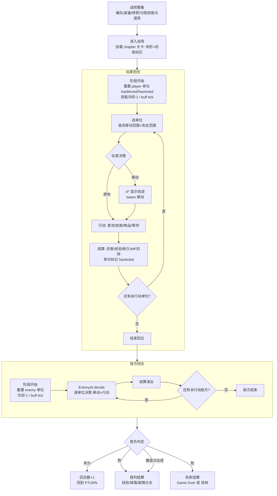

# 核心玩法机制（Gameplay Mechanics Bible）

> **支柱映射**：本文件主要服务**布阵（Position）**与**交锋（Clash）**两大支柱——它定义了「单位如何在格子世界里移动、抢地形、互相克制、结算伤害」。每一次数值落地都应可被「心流框架（Flow-State Design）」的难度曲线感知、被「三角性决策（Triangular Decisions）」的取舍验证。
>
> **对齐说明**：本文档严格对齐现有 Godot 工程。凡标注「现有实现」的机制，其行为/数值已落地在 `godot/scripts/` 下对应文件；标注「建议新增（需改代码）」的条目是设计提案，落地时需同步修改对应脚本与数据文件。

---

## 0. 代码实参速查（写文档前必读的对齐锚点）

| 机制 | 代码锚点 | 关键事实 |
|------|----------|----------|
| 阵营枚举 | `core/enums.gd` FACTIONS | `player` / `enemy` / `ally` / `other` |
| 武器类型 | `core/enums.gd` WEAPON_TYPES | `sword` / `lance` / `axe` / `bow` / `anima` / `dark` / `staff` |
| 移动类型 | `core/enums.gd` MOVE_TYPES | `foot` / `armor` / `cavalry` / `flying` |
| 地形类型 | `core/enums.gd` TERRAIN_TYPES | `plain` / `forest` / `mountain` / `water` / `fort` / `village` / `wall` |
| 技能类型 | `core/enums.gd` SKILL_TYPES | `damage` / `heal` / `aoe` / `buff` / `debuff` |
| 地形数据 | `core/terrain.gd` | `def_bonus` / `avoid_bonus` / `move_cost{foot,armor,cavalry,flying}` / `walkable`，**99 = 不可通行** |
| 移动/寻路 | `systems/grid_system.gd` | Dijkstra 移动范围 + A* 寻路 + BFS 攻击范围（**移动范围与攻击范围解耦**） |
| 回合调度 | `systems/turn_manager.gd` | `player`/`enemy` 两阶段；阶段开始重置 `hasMoved`/`hasActed`、技能冷却 -1、`tick_buffs` |
| 战斗结算 | `systems/combat_system.gd` | FE 经典版：命中/伤害/双击/暴击/反击 |
| 武器三角 | `core/weapons.gd` `WEAPON_TRIANGLE` | sword→axe→lance→sword；弓/魔法不进三角 |
| 三角修正 | `core/weapons.gd` `TRIANGLE_MODIFIER` | 优势 +1 伤害 +15 命中；劣势 -1 -15 |
| 敌方 AI | `systems/enemy_ai.gd` | 枚举可停留格 × 候选行动（普攻/技能/物品）取最高分 |
| 玩家托管 | `systems/player_ai.gd` + `battle/turn_director.gd` | 偏好 `{priorityTargetId, strategy}`，5 种 strategy |
| 单位属性映射 | `core/professions.gd` + `core/unit.gd` | `professions.json.power → stats.str（物理）/ stats.mag（魔法）`；`agility → spd`；`attackRange` 职业固有优先于武器射程 |

> **属性命名注意（易踩坑）**：职业 JSON 字段是 `power / agility`，但运行时 `unit.stats` 用 `str / mag / spd`。`apply_profession` 按武器类型分流：物理职业（sword/lance/axe/bow）把 `power` 写入 `str`、`mag=0`；魔法职业（anima/dark/staff）把 `power` 写入 `mag`、`str=0`。战斗/技能公式统一从 `stats.str`/`stats.mag` 取值。

---

## 1. 战斗流程总览

### 1.1 一场战斗的生命周期（mermaid）



### 1.2 系统反馈层（对齐「心流框架」的即时反馈原则）

| 玩家动作 | 系统即时反馈 | 反馈载体 |
|----------|--------------|----------|
| 悬停单位 | 高亮蓝色移动范围 + 红色攻击范围 | `grid.compute_attack_range` 返回的 `moveRange`/`attackTiles` |
| 选定移动格 | A* 画出轨迹线 | `grid.find_path` |
| 选定攻击目标 | 弹出战斗预览（命中/伤害/双击/暴击） | `CombatSystem.preview` |
| 施法/用道具 | 预览 hp_delta / buff 描述 | `SkillSystem.preview` / `ItemSystem.preview` |
| 结算 | 数字跳字 + tween 移动 + 死亡淡出 | `turn_director._tween_move` |

---

## 2. 回合制结构（对齐 `turn_manager.gd`）

### 2.1 回合 = 玩家阶段 + 敌方阶段

> **现有实现**：`turn_manager.gd` 用 `phase` 字段在 `player` / `enemy` 间切换，`end_turn()` 在 player→enemy 直接切，enemy→player 时 `turn_number += 1`。

| 阶段 | 触发 | 系统动作（`start_player_phase` / `start_enemy_phase`） |
|------|------|--------------------------------------------------------|
| 玩家阶段开始 | `phase_player` 信号 | 对每个 `faction==player` 的存活单位：`hasMoved=false`、`hasActed=false`、`_tick_cooldowns(u)`；全单位 `SkillSystem.tick_buffs(units)` |
| 敌方阶段开始 | `phase_enemy` 信号 | 同上，阵营过滤改为 `enemy` |
| 回合结束 | `end_turn()` | player→切 enemy；enemy→`turn_number+1` 后切 player |

### 2.2 单位行动规则（一回合 = 移动 1 次 + 行动 1 次）

> **现有实现**：单位有独立的 `hasMoved` 和 `hasActed` 两个标志位，二者互不锁死——这是火焰纹章式的「**行动后不可再移动**」规则的数据基础。

| 规则 | 说明 | 设计意图（原理） |
|------|------|------------------|
| **每单位每回合可移动 1 次** | 移动后置 `hasMoved=true` | 移动力是布阵支柱的核心资源 |
| **每单位每回合可行动 1 次** | 普攻/技能/道具/等待任选其一后置 `hasActed=true` | 行动是交锋支柱的核心资源 |
| **行动顺序自由** | 玩家可在任意未 `hasActed` 的己方单位间切换，**不按速度排序** | 给玩家「三角性决策」空间：先动谁改变全局 |
| **行动后不可再移动** | 一旦 `hasActed=true`，该单位本回合结束（灰显） | 参考 FE 经典：防止「打了就跑」破坏布阵的意义 |
| **可只移动不行动** | 移动后选「等待」，仅 `hasMoved=true`，仍可后续... | （见下方设计选择） |
| **可原地行动** | 不移动直接普攻/施法，仍消耗本回合行动 | 远程/法师的站位压制 |

> **设计选择（建议固化为规则）**：当前 `turn_manager` 只跟踪两个标志位，并未在「移动后未行动」时锁死单位。**推荐规则**：移动后若未行动，单位仍可被选中执行行动（普攻/技能/道具），但**不能再二次移动**——即 `hasMoved=true` 后移动范围高亮消失，只剩攻击/技能范围。这与 FE 经典一致，落地只需 UI 层在 `hasMoved==true` 时禁用移动指令。如要做成《皇家骑士团》式「移动-行动-再移动」的 AP 制，则需重构为 `actionPoints`（**建议新增，需改代码**，不在本期范围）。

### 2.3 敌方阶段编排

> **现有实现**：`battle/turn_director.gd::start_enemy_phase` 串行 `await _enemy_act(enemy)` 每个敌方单位，每个单位决策-移动-演出-结算，全部跑完后 `on_check_battle_end` + `turn.end_turn()`。

敌方单位顺序由 `grid.units` 的遍历顺序决定（非 AI 排序）。每个敌方单位：
1. `EnemyAI.decide(enemy, grid, players)` → `{moveTarget, attackTarget, action}`
2. `find_path` + `_tween_move` 移动
3. 按 `action.type`（normal/skill/item）分发到 `on_resolve_combat_sync` / `on_resolve_skill` / `on_resolve_item`
4. 短暂停顿后进入下一个敌方单位

---

## 3. 移动系统（对齐 `grid_system.gd` + `terrain.gd`）

### 3.1 移动范围计算（Dijkstra）

> **现有实现**：`grid_system.gd::compute_move_range(sx, sy, move_type, mov, ally_faction)`。

```text
算法：Dijkstra（优先队列按 cost 升序）
起点 cost = 0
对每个相邻格：
  若 !walkable 或 move_cost[move_type] >= 99 → 跳过
  若 该格有非己方阵营单位 → 跳过（阻挡）
  new_cost = cur.cost + move_cost[move_type]
  若 new_cost > mov → 跳过
  记录/更新 result["x,y"] = min(已存, new_cost)
返回 { "x,y" -> cost }
```

**关键设计点**：
- **累加地形消耗**：路径上每一格的 `move_cost` 都计入，不是「直线距离」。
- **非己方单位阻挡**：`blocker.faction != ally_faction` 的格子不可穿越（但可攻击）。
- **己方单位可穿越但不可停留**：当前实现里，己方单位占据的格子在 Dijkstra 里**不被跳过**（因为 `faction == ally_faction`），但 `compute_attack_range` 收集 `stops` 时会过滤掉被占格——即「能穿过但不能停」（FE 经典「友军穿插」）。> 注：当前 `compute_move_range` 实际上会让穿越己方单位的路径继续扩展，但 `stops` 过滤保证了不能停在友军身上。

### 3.2 地形移动消耗表（玩家可读版，直接来自 `terrain.gd`）

| 地形 \ move_type | foot（步） | armor（重甲） | cavalry（骑兵） | flying（飞行） |
|------------------|:---------:|:------------:|:--------------:|:-------------:|
| plain 平原       | 1 | 1 | 1 | 1 |
| forest 森林      | 2 | 2 | 3 | 1 |
| mountain 山地    | 3 | **99** | **99** | 1 |
| water 水域       | **99** | **99** | **99** | 1 |
| fort 要塞        | 1 | 1 | 1 | 1 |
| village 村庄     | 1 | 1 | 1 | 1 |
| wall 墙          | **99** | **99** | **99** | **99** |

> **99 = 不可通行**。注意 `wall` 的 `walkable=false`，连飞行也无法停留（天然全阻挡）。

**战术含义（布阵支柱的核心张力）**：
- **山地是步兵的城墙**：`mountain` 对 armor/cavalry 是 99，foot 花费 3 格移动力——重骑兵无法翻山，步兵可在山口设防形成「以步制骑」。
- **水域是天然屏障**：除 flying 外全员 99，河流分割战场、迫使走桥。
- **森林拖慢骑兵**：cavalry 在 forest 花 3（等于走 3 格平原的距离），伏击骑兵的优选地形。
- **飞行无视地形**：flying 在所有可停留地形（非 wall）上都是 1，可翻山越水——但飞行单位通常 HP/防偏低，是「高机动脆皮」。

### 3.3 寻路（A*）

> **现有实现**：`grid_system.gd::find_path(start, goal, move_type, max_cost)`，曼哈顿启发，返回 `[Vector2i, ...]` 或空数组。

A* 仅用于**显示移动轨迹**（UI 层 tween 沿路径走），不参与范围计算。`max_cost` 传 `unit.stats.mov`，保证寻出的路径在移动力范围内。

### 3.4 移动力 `mov` 的设计意义

> `mov` 存在 `unit.stats.mov`，由职业 `professions.mov` 写入（如 swordsman=5, knight=4）。

| mov 值 | 平原可达半径 | 山地可达（foot） | 典型职业 |
|--------|--------------|------------------|----------|
| 4 | 4 格 | 1 格（剩 1 点不够再走） | knight（重甲坦克，慢但硬） |
| 5 | 5 格 | 1-2 格 | swordsman（标准步兵） |
| 6-7 | 6-7 格 | 2 格 | cavalry（高机动，但怕山/林） |
| 6-8 + flying | 6-8 格 + 无视地形 | 6-8 格 | flying（天马/飞龙） |

**布阵张力**：mov 5 的步兵在平原能走 5 格，但进入山地可能只走 1-2 格——玩家必须在「走捷径翻山（慢）」与「绕平原走大路（远但快）」之间取舍，这正是「**布阵**」支柱的可玩性来源（对齐「三角性决策」原理）。

---

## 4. 地形系统（对齐 `terrain.gd`）

### 4.1 完整地形表

| 地形 | def_bonus | avoid_bonus | walkable | 战术意义 | 视觉表现建议 |
|------|:---------:|:-----------:|:--------:|----------|--------------|
| `plain` 平原 | 0 | 0 | ✓ | 开阔战场，无加成，机动单位主场 | 草地/泥土，少量灌木 |
| `forest` 森林 | 1 | **+20** | ✓ | 步兵掩蔽所：高回避拖垮骑兵 | 郁闭林冠，单位半透明叠影 |
| `mountain` 山地 | 1 | **+30** | ✓ | 高地优势+骑兵禁入，狙击手/法师据点 | 陡峭岩壁，单位站高位 |
| `water` 水域 | 0 | +10 | ✓ | 天然屏障，仅飞行可过，分割战线 | 河流/浅滩，波纹动画 |
| `fort` 要塞 | **+3** | +20 | ✓ | 据点防御核心：高防+高回避，据守首选 | 石砌塔楼/箭塔，旗帜 |
| `village` 村庄 | 0 | 0 | ✓ | 可访问触发事件/补给，无战斗加成 | 茅屋聚落，访问图标 |
| `wall` 墙 | 0 | 0 | ✗ | 全阻挡（含飞行），形成不可逾越障壁 | 城墙/岩石，无单位站立 |

### 4.2 地形修正如何进入公式

- **`def_bonus`** 进入伤害公式：`CombatSystem._damage` 的 `defender_tile_def` 参数，直接减伤。要塞 +3 意味着每次受击少掉 3 HP。
- **`avoid_bonus`** 进入命中公式：`CombatSystem._hit_chance` 的 `defender_tile_avoid` 参数，加在回避项。森林 +20 让敌方命中率直降 20%。

> **现有实现**：`turn_director._enemy_act` 和 `player_ai.decide` 调用 `CombatSystem.preview` 时，会从 `grid.tile_at(px, py)` 取 `avoid_bonus`/`def_bonus` 传入——即「**守方所在格的地形修正**」生效，攻方地形不影响本次结算。

### 4.3 新增地形建议（需扩 `TERRAIN_TYPES`，标注「需改代码」）

| 建议地形 | def | avoid | move_cost（建议） | 用途 |
|----------|:---:|:-----:|-------------------|------|
| `snow` 雪原 | 0 | 5 | foot 2 / armor 2 / cavalry 2 / flying 1 | 每回合微损 HP（建议新增 `terrain_effect` hook），寒区关卡 |
| `bridge` 桥 | 0 | 0 | 全员 1 | 横跨 water 的通道，争夺焦点 |
| `throne` 王座 | +5 | +30 | 全员 1 | 关卡目标点（占领/击杀守座 boss） |
| `sand` 沙地 | 0 | 0 | foot 2 / armor 3 / cavalry 2 / flying 1 | 沙漠关卡，拖慢重甲 |
| `reef` 礁石 | 1 | 15 | 仅 flying 1，余 99 | 海岸关卡复杂地形 |

> 落地步骤：①`enums.gd` 的 `TERRAIN_TYPES` 追加；②`terrain.gd::_static_init` 追加 `_mk(...)`；③如需回合效果（snow 损血）在 `turn_manager.start_player_phase` 加 `terrain_effect` tick。

---

## 5. 武器三角与克制（对齐 `WEAPON_TYPES` + `weapons.gd`）

### 5.1 核心三角（现有实现）

> **现有实现**：`weapons.gd::WEAPON_TRIANGLE`。环向：**sword → axe → lance → sword**（攻方 strong_vs 守方 = 优势）。

```
     sword ──优势──> axe
       ↑              │
       │              ↓
     lance <──优势── (axe→lance? 否)
```

正确闭环（按 `WEAPON_TRIANGLE`）：
- **sword** strong_vs `axe`，weak_vs `lance`
- **lance** strong_vs `sword`，weak_vs `axe`
- **axe** strong_vs `lance`，weak_vs `sword`

即：**剑克斧 / 枪克剑 / 斧克枪**（FE 经典三项）。

### 5.2 三角修正值（现有实现）

| 关系 | damage 修正 | hit 修正 | 来源 |
|------|:-----------:|:--------:|------|
| 优势（strong_vs） | **+1** | **+15** | `TRIANGLE_MODIFIER.advantage` |
| 劣势（weak_vs） | **-1** | **-15** | `TRIANGLE_MODIFIER.disadvantage` |
| 无关（弓/魔法/同系） | 0 | 0 | — |

> 注：现有实现是 `±1 伤害 / ±15 命中`，而非设计支柱里提到的 `±15%`。本文档以**代码实参**为准（`+1 伤 / +15 命中`）。如要改成百分比，需改 `TRIANGLE_MODIFIER` + `_damage`/`_hit_chance` 的应用方式（**建议新增，需改代码**）。

### 5.3 弓与魔法（不进三角，但有独立规则）

| 武器类型 | 三角 | 特殊规则 | 来源 |
|----------|------|----------|------|
| `bow` 弓 | 不参与 | 远程（attackRange 通常 [2,2] 或 [2,3]）；**建议新增**：对 `flying` 移动类型伤害 ×1.5（需在 `_damage` 加 move_type 判定） | `weapons.gd` WEAPONS |
| `anima` 理魔 | 不参与 | 远程魔法（fire: range [1,2]）；**建议新增**：anima↔dark 二项三角（anima→dark→anima？或对调），丰富法师对决 | 现无三角 |
| `dark` 暗魔 | 不参与 | 高威力低命中（建议特性）；对 light 系（若有）劣势 | 现无三角 |
| `staff` 杖 | 不参与 | **治疗系，不造成伤害**，`CombatSystem.preview` 里 `def_hit=0`、`def_dmg=0`（守方持杖不反击） | `combat_system.gd` |

### 5.4 完整克制矩阵（行=攻方武器，列=守方武器/移动类型）

**武器 vs 武器（伤害/命中修正）**：

| 攻＼守 | sword | lance | axe | bow | anima | dark | staff |
|--------|:-----:|:-----:|:---:|:---:|:-----:|:----:|:-----:|
| **sword** | 0/0 | **-1/-15** | **+1/+15** | 0/0 | 0/0 | 0/0 | 0/0 |
| **lance** | **+1/+15** | 0/0 | **-1/-15** | 0/0 | 0/0 | 0/0 | 0/0 |
| **axe** | **-1/-15** | **+1/+15** | 0/0 | 0/0 | 0/0 | 0/0 | 0/0 |
| **bow** | 0/0 | 0/0 | 0/0 | 0/0 | 0/0 | 0/0 | 0/0 |
| **anima** | 0/0 | 0/0 | 0/0 | 0/0 | 0/0 | 0/0* | 0/0 |
| **dark** | 0/0 | 0/0 | 0/0 | 0/0 | 0/0* | 0/0 | 0/0 |
| **staff** | — | — | — | — | — | — | — |

> `*` 标注「建议新增」：anima↔dark 二项克制（建议 anima→dark 优势、dark→anima... 或反向，取决于世界观设定——参考 `07_skills.md` 的元素克制循环 fire→wind→earth→water）。落地需扩 `WEAPON_TRIANGLE`。

**武器 vs 移动类型（伤害倍率，建议新增）**：

| 攻方武器 \ 守方 move_type | foot | armor | cavalry | flying |
|---------------------------|:----:|:-----:|:-------:|:------:|
| sword/lance/axe           | ×1.0 | ×1.0  | ×1.0    | ×1.0   |
| **bow**                   | ×1.0 | ×1.0  | ×1.0    | **×1.5**（建议） |
| anima                     | ×1.0 | ×1.0  | ×1.0    | ×1.0   |
| dark                      | ×1.0 | ×1.0  | ×1.0    | ×1.0   |

> 弓克飞行是 FE 经典（天马/飞龙被弓手一发入魂）。现有 `_damage` 未实现，需加 `defender.moveType == "flying"` 判定（**建议新增，需改代码**）。

### 5.5 武器耐久（设计选择）

> **现有实现**：`weapons.gd` 的 Weapon 结构含 `uses` 字段（如 ironSword=46, ironBow=45, heal=30），但**当前战斗结算路径（`combat_system.execute`）未扣减 uses**。

| 选项 | 说明 | 推荐 |
|------|------|------|
| **A. 有耐久（FE 经典）** | 每次攻击 -1，归 0 武器碎掉 | ✓ 与「魔法稀缺/资源管理」主题一致，强化「抉择」支柱 |
| **B. 无耐久** | 武器永久，简化资源管理 | 与道具 `uses` 不一致，破坏经济张力 |

**推荐 A**：落地需在 `combat_system.execute` 攻击命中后 `attacker.weapon.uses -= 1`，归 0 时触发武器销毁事件（**建议新增，需改代码**）。这与 `items.json` 的 `uses` 字段、魔法稀缺硬约束形成统一资源逻辑。

---

## 6. 战斗结算（伤害公式）

### 6.1 公式总览（对齐 `combat_system.gd`，FE 经典简化版）

```text
# ===== 命中率 =====
avoid      = def_spd * 1.5 + def_luk / 2 + defender_tile_avoid
atk_hit    = weapon.hit + atk_skl * 1.5 + atk_luk / 2 - avoid + triangle_hit
def_hit    = (weapon.hit + ... - avoid - triangle_hit)   # 守方持杖则 = 0
最终命中   = clamp(atk_hit, 0, 100)

# ===== 伤害 =====
is_magic   = weapon.type ∈ {anima, dark, staff}
atk_stat   = mag if is_magic else str
def_stat   = res if is_magic else def
base_dmg   = max(0, atk_stat + weapon.might - def_stat - defender_tile_def)
atk_dmg    = max(0, base_dmg + triangle_damage)

# ===== 双击（追击） =====
attack_speed = spd - max(0, weapon.weight - str / 2)   # 重量负担
double_attack = (atk_attack_speed - def_attack_speed) >= 4
defender_double = (def_attack_speed - atk_attack_speed) >= 4

# ===== 暴击 =====
atk_crit   = max(0, atk_skl / 2 + weapon.crit - def_luk / 2)
暴击伤害   = 基础伤害 × 3

# ===== 反击条件 =====
can_counter = _in_range(attacker, defender)   # 守方武器射程能到攻方
            且 weapon.type != staff            # 杖不反击
```

### 6.2 公式变量来源表（对齐 `professions.json` → `unit.stats`）

| 公式变量 | 运行时来源 | 职业 JSON 字段 | 说明 |
|----------|------------|----------------|------|
| `weapon.hit` | `unit.weapon.hit` | — | 武器基础命中（ironSword=90） |
| `weapon.might` | `unit.weapon.might` | — | 武器威力（ironSword=5） |
| `weapon.crit` | `unit.weapon.crit` | — | 武器暴击（ironSword=0） |
| `weapon.weight` | `unit.weapon.weight` | — | 武器重量（ironSword=5），影响 attack_speed |
| `atk_skl` / `def_*` | `BuffSystem.effective_stat(u, "skl")` | `professions.skl` | 技（影响命中+暴击） |
| `atk_luk` / `def_luk` | `effective_stat(u, "luk")` | `professions.luk` | 运（影响命中+减暴击） |
| `str` | `effective_stat(u, "str")` | `professions.power`（物理武器分流） | 力（物理攻击力） |
| `mag` | `effective_stat(u, "mag")` | `professions.power`（魔法武器分流） | 魔力（魔法攻击力） |
| `spd` | `effective_stat(u, "spd")` | `professions.agility` | 速（影响双击+回避） |
| `def` | `effective_stat(u, "def")` | `professions.def` | 防（物理减伤） |
| `res` | `effective_stat(u, "res")` | `professions.res` | 魔防（魔法减伤） |
| `defender_tile_avoid` | `grid.tile_at(px,py).avoid_bonus` | — | 守方地形回避 |
| `defender_tile_def` | `grid.tile_at(px,py).def_bonus` | — | 守方地形防御 |
| `triangle_hit/damage` | `WeaponData.triangle_modifier` | — | 武器三角修正 |

> **属性映射关键**：`effective_stat` 会叠加 `unit.buffs`（来自技能/道具的临时修正），所以 buff/debuff 真实参与命中与伤害计算——这是 `buff_system.gd` 从 `skill_system` 抽出独立模块的核心原因（打破 `combat ↔ skill` 循环依赖）。

### 6.3 战斗执行流程（`combat_system.execute`）

```text
1. 调 preview() 得到所有预估值
2. 攻击者第一次攻击：
   命中判定 rand(0,100) < atkHit
     暴击判定 rand(0,100) < atkCrit → 伤害 ×3
     扣 defender.hp；若 hp<=0 → defenderDied，返回
3. 反击判定（can_counter 且 weapon != staff）：
   命中 → 扣 attacker.hp；若 hp<=0 → attackerDied，返回
4. 追击判定（double_attack）：
   命中 → 扣 defender.hp；若 hp<=0 → defenderDied
返回 CombatResult
```

> **设计要点**：暴击仅在攻击者首次攻击触发（追击不二次判定暴击，当前实现）。杖持有者**完全不反击**（`def_hit=0, def_dmg=0`）——治疗职业是「纯辅助」，近战被贴脸只能挨打，这强化了「保护奶妈」的布阵需求（对齐「三角性决策」）。

### 6.4 技能伤害公式（对齐 `skill_system.gd`，独立结算）

> **关键差异**：技能走 `SkillSystem` 独立结算，**不被反击**，用 `skill.power` 取代 `weapon.might`。

```text
is_magic   = skill.element 是魔法元素（fire/water/earth/wind/light/dark）
atk        = mag if is_magic else str
def        = res if is_magic else def
skill_dmg  = max(0, atk + skill.power - def)   # 不吃地形 def_bonus、不吃武器三角
skill_hit  = skill.hitBonus（基础值，如 fireball=90）
```

| 对比项 | 普攻（CombatSystem） | 技能（SkillSystem） |
|--------|---------------------|---------------------|
| 威力来源 | `weapon.might` | `skill.power` |
| 地形 def 减伤 | ✓（`defender_tile_def`） | ✗（当前不减） |
| 武器三角 | ✓ | ✗ |
| 反击 | ✓（守方射程内） | ✗（**技能不被反击**） |
| 双击 | ✓（速度差≥4） | ✗ |
| 暴击 | ✓ | ✗（当前实现） |
| MP/冷却 | ✗ | ✓（`mpCost` / `cooldown`） |

> 技能「不被反击 + 必中可调」是其核心战术价值——用技能秒掉 otherwise 会触发反击的硬茬（如重甲），代价是 MP（魔法稀缺硬约束）。

---

## 7. 技能与道具的使用（链 [06_items.md](06_items.md) / [07_skills.md](07_skills.md)）

### 7.1 技能可用性（对齐 `skill_system.gd::can_use`）

```text
can_use(caster, skill_id) :=
    SkillData.get_skill(skill_id) 非空
  且 caster.skillCooldowns[skill_id] == 0（冷却已转好）
  且 caster.mp >= skill.mpCost（MP 足）
```

| 检查项 | 字段 | 失败结果 |
|--------|------|----------|
| 技能存在 | `SkillData.get_skill` | 返回 false，UI 灰显 |
| 冷却 | `caster.skillCooldowns[id]` | >0 则不可用，每回合 -1（`turn_manager._tick_cooldowns`） |
| MP | `caster.mp` vs `skill.mpCost` | MP 不足不可用 |

> **魔法稀缺硬约束**：MP 不自动回满（仅靠 `mpPotion` 等限量药剂，对齐 `06_items.md`）。单场战斗魔法系单位通常只有 2-3 次常规技能 + 1 次大招——这是「源脉魔法稀缺」世界观的系统落地。

### 7.2 技能射程与移动范围解耦（对齐 `grid_system.compute_attack_range`）

> **现有实现**：移动范围（Dijkstra）与攻击范围（BFS 按职业 `attackRange`）是**两个独立计算**。技能射程同理：`SkillSystem.targets_for` 用 `skill.range[min,max]` + `targetType` 在全场扫描合法目标，**不依赖移动**。

| 概念 | 计算方式 | 用途 |
|------|----------|------|
| 移动范围 | Dijkstra，累加 move_cost ≤ mov | 决定能走到哪 |
| 攻击范围（普攻） | BFS 按 `unit.attackRange` | 决定原地能打到哪 |
| 技能射程 | `skill.range` + `targetType` 全场过滤 | 决定能施法到哪 |
| 道具射程 | `item.range` + `target` 全场过滤 | 决定能用道具到哪 |

**典型流程**：玩家选单位 → 看移动范围（蓝）+ 原地攻击范围（红）→ 选移动格 → 到达后重新判定该格的攻击/技能范围 → 选目标结算。技能/道具的 `targetType`（`enemy`/`ally`/`self`/`aoe_ally`/`aoe_enemy`）决定合法目标阵营。

### 7.3 技能效果分支（对齐 `skill_system.execute`，5 种 SKILL_TYPES）

| `type` | 结算逻辑 | 目标 | 典型例子 |
|--------|----------|------|----------|
| `damage` | `_skill_damage` 扣血，命中判定用 `skill.hitBonus` | 单体 enemy | 火球术（power=10, range[1,3]） |
| `aoe` | 对 `targets`（范围内所有合法）各结算一次 `_skill_damage` | 范围 enemy | 暴风雪（power=X, range[1,3], targetType=aoe_enemy） |
| `heal` | `min(skill.power + heal_bonus, max_hp - cur_hp)` 必中 | 单体 ally | 治疗术（power=15, range[1,2]） |
| `buff` | `apply_buff(target, skill.stat, +buffValue, buffTurns)` | self/ally | 加攻/加速 |
| `debuff` | `apply_buff(target, skill.stat, -|buffValue|, buffTurns)` | enemy | 降防/降速 |

### 7.4 buff/debuff 的持续与 tick（对齐 `buff_system.gd` + `turn_manager`）

> **现有实现**：buff 结构 `{stat, value, turns, label}`，挂在 `unit.buffs` 数组。`effective_stat` 取属性时叠加所有同 stat 的 buff value。

| 时机 | 动作 | 代码位置 |
|------|------|----------|
| 施放 buff/debuff | `apply_buff(unit, stat, value, turns, label)`；同 stat+label 刷新时长并覆盖值 | `buff_system.gd` |
| 每阶段开始 | `tick_buffs(units)`：所有 buff `turns -= 1`，`turns<=0` 移除 | `turn_manager.start_*_phase` 调 `SkillSystem.tick_buffs` |
| 解毒药 | `cleanse_debuffs`：移除所有 `value < 0` 的 buff | `buff_system.gd` |

> **tick 语义**：buff 在**挂上的单位所属阵营的下一阶段开始时** -1（因为 `tick_buffs` 对全单位执行，每阶段都跑一次）。即玩家给己方上的 buff，敌方阶段开始也会 tick——这意味着一个 `turns=1` 的 buff 实际只活到下一次己方阶段开始就消失。设计技能 `buffTurns` 时需考虑这个语义（建议 `buffTurns=2` 起步）。

### 7.5 道具使用（对齐 `item_system.gd` + `items.json`）

| 道具字段 | 说明 | 来源 |
|----------|------|------|
| `uses` | 使用次数，每次 -1，归 0 消失 | `items.json` |
| `range[min,max]` | 道具射程，0,0=自身；0,1=自身或邻格友军 | `items.json` |
| `target` | `ally`/`self`/`enemy`，合法目标阵营 | `items.json` |
| `effect` | `heal_hp`/`heal_mp`/`damage`/`buff`/`cleanse` 等 | `items.json` |

| 效果 | 说明 | 典型道具 |
|------|------|----------|
| `heal_hp` | 恢复 `power` 点 HP | 生命药剂（power=20） |
| `heal_mp` | 恢复 `power` 点 MP（魔法稀缺的唯一回蓝途径） | 法力药剂（power=10） |
| `cleanse` | 清除自身所有 debuff | 解毒药 |
| `damage` | 投掷物造成固定伤害（不被反击） | 手里剑 |
| `buff` | 临时增益 | 战吼卷轴（建议） |

---

## 8. 胜利/失败条件

### 8.1 胜利条件类型

> **现有实现**：`turn_manager.check_victory` 只实现了「全歼敌军」与「己方全灭」两种（`win`/`lose`/空）。其余条件需关卡层（`chapter` 配置 + `battle.gd` 自定义判定）扩展（**建议新增，需改代码**）。

| 胜利条件 | 触发逻辑 | 典型关卡（链 [05_story_branches.md](05_story_branches.md)） | 实现状态 |
|----------|----------|------------------------------------------------------------|----------|
| **全歼敌军** | 所有 `faction==enemy` 的单位 `isDead` | 大多数遭遇战、野战 | ✓ 现有 |
| **击杀 boss** | 指定 `unitId` 的敌人死亡 | 终章「灰烬之王」击败维克托 | 建议新增 |
| **护卫 NPC 存活 N 回合** | `ally` 阵营某单位存活且 `turn_number >= N` | 护送难民车队章节 | 建议新增 |
| **占领据点** | 己方单位站在 `throne`/`fort` 格 N 回合 | 攻城战、夺旗 | 建议新增（需 throne 地形） |
| **坚守 N 回合** | `turn_number >= N` 且主角存活 | 峡谷阻击战、断后 | 建议新增 |
| **到达撤退点** | 主角到达指定格子 | 撤退章节、突围战 | 建议新增 |

### 8.2 失败条件

| 失败条件 | 触发 | 后果 |
|----------|------|------|
| **主角死亡** | 主角 `unitId` 的 `isDead=true` | **Game Over**（对齐永久死亡设定，链 [04_characters.md](04_characters.md)） |
| **护卫对象死亡** | 指定 NPC 死亡 | 任务失败，分支转劣 |
| **全灭** | 所有 `faction==player` 单位 `isDead` | `check_victory` 返回 `lose` |
| **超时** | `turn_number > 上限` | 失败（坚守关的反向） |

> **永久死亡（Permadeath）**：同伴阵亡即永久失去（对齐 `04_characters.md`），这是「抉择」支柱的核心张力——每场战斗的取舍都有长期代价。主角死亡直接 Game Over。

---

## 9. 经验与成长（对齐 `weapons.gd` 经验公式 + `unit.gd` 成长率）

### 9.1 经验来源（现有实现：`weapons.gd`）

```text
击杀经验  = 30 + enemy_level * 3              # exp_for_kill
命中经验  = max(1, 10 + (enemy_level - attacker_level))  # exp_for_hit（每次命中）
升级所需  = 50 + level * 30                    # exp_to_next（累进）
```

| 行为 | 经验 | 公式来源 |
|------|------|----------|
| 击杀敌军 | 30 + 敌方等级×3 | `exp_for_kill` |
| 命中（未杀） | max(1, 10 + 敌我等级差) | `exp_for_hit` |
| 治疗队友 | 少量（建议新增：按恢复量 ×0.3） | 建议新增 |
| buff/支援 | 少量（建议新增：固定 5/次） | 建议新增 |

> **设计意图**：治疗/支援也得少量经验，避免辅助职业升级断层（对齐「属性关联防 min/max」原理——所有职业都应能成长）。

### 9.2 升级与属性成长

> **现有实现**：`unit.gd::DEFAULT_GROWTHS` + `unit.stats`。每级按 growths 概率成长。

```text
升级条件：exp >= exp_to_next(level) → level += 1, exp -= 所需
属性成长：对每项 stat，rand(0,99) < growths[stat] → 该 stat +1
```

| 属性 | 默认成长率（%） | 说明 |
|------|:--------------:|------|
| hp | 70 | 高成长（坦克/近战） |
| str | 45 | 物理输出 |
| mag | 15 | 魔法稀缺→低成长（仅魔法系高） |
| skl | 45 | 命中+暴击 |
| spd | 45 | 双击+回避 |
| luk | 40 | 暴击+减暴击 |
| def | 30 | 物理减伤 |
| res | 25 | 魔法减伤 |
| mp | 20 | MP 上限（魔法稀缺→低成长） |

> **反 min/max**（对齐 `character-optimization-design`）：成长率设计让单一属性堆叠困难——hp/str 高成长但 def/res 中等，魔法系 mag/MP 双低成长。玩家无法造出「又肉又输出又高魔」的完美单位，必须靠职业互补（链 [03_professions.md](03_professions.md)）。

### 9.3 转职（链 [03_professions.md](03_professions.md)）

转职由 `ProfessionData.reclass` 支持：保留单位 id/位置/阵营/等级，重置为新职业的基础 stats 与武器。转职树（如 swordsman → myrmidon → swordmaster）在 `03_professions.md` 详述，本文件不重复。

---

## 10. 托管 AI（对齐 `enemy_ai.gd` + `player_ai.gd` + `turn_director.gd`）

### 10.1 敌方 AI 决策流程（现有实现：`enemy_ai.gd::decide`）

```text
1. compute_attack_range → 得 move_range
2. 收集 stops（move_range 内未被占的格）
3. 三类候选并行评估：
   a. 普攻：每个 stop × 每个 player 单位
      score = atkDmg*2 + (atkDmg if doubleAttack)
      若 atkDmg >= 目标hp → +5000（能击杀）
      减去 defDmg（规避反击）
   b. 技能：SkillData.usable_skills × targets_for
      damage: preview_dmg*2 + 击杀+4000
      aoe: preview_dmg*2.5（多目标加权）+ 击杀+4000
      heal: 缺血量*1.5（仅 missing>5 时）
      buff/debuff: buffValue*10*目标数
      技能扣 mpCost*0.5（防无脑用技能）
   c. 物品：同理评估
4. 取全局最高分 → {moveTarget, action}
5. 无候选 → 朝最近 player 移动（fallback）
```

**AI 行为特征**：
- **优先击杀**（+4000~5000 绝对权重），残血单位会被集火。
- **规避反击**（扣 `defDmg`），不会无脑冲硬茬。
- **技能/物品有 MP/uses 惩罚**，不会无脑放技能。
- **fallback 逼近**：打不到时朝最近敌人走，不会原地发呆。

### 10.2 Boss AI 特殊行为（建议新增）

| 行为 | 触发条件 | 实现（建议） |
|------|----------|--------------|
| 狂暴 | hp < 30% | 挂 `{stat:str, value:+5, turns:99}` buff |
| 召唤援军 | 每隔 3 回合 | 调 `grid.place_unit` 生成新敌方单位 |
| 守座不追击 | throne 半径 3 内有敌人 | 修改 `_pick_move_toward` 限制移动半径 |
| 阶段切换 | hp 跨越阈值 | 切换技能池/weapon（需 boss 多阶段配置） |

> Boss AI 需在 `enemy_ai.gd` 加 boss 专用分支判定（读 `chapter.bossConfig`，**建议新增，需改代码**）。

### 10.3 玩家方托管（autoplay，现有实现：`player_ai.gd` + `turn_director.gd`）

> **现有实现**：`turn_director.hosting_active` 开关，偏好存 `_auto_prefs[unitId] = {priorityTargetId, strategy}`。`PlayerAI.decide` 阵营中立、签名与 `EnemyAI.decide` 一致，仅多 `pref` 参数。

| strategy | 标签 | 评分逻辑 |
|----------|------|----------|
| `auto` | 自动(伤害最大) | 直接复用 `EnemyAI.decide`（零侵入） |
| `aggressive` | 激进(优先击杀) | 能击杀 +50000；否则基础分 |
| `defensive` | 保守(规避反击) | `base - defDmg*3`；不挨反击 +500 |
| `nearest` | 最近(贴脸) | `-dist*10 + base*0.1`（距离主导） |
| `weakest` | 残血(收割) | `base + missing*5`；能击杀 +5000 |

**托管偏好配置**：
- `priorityTargetId`：命中加 +100000 绝对权重（强制集火某敌人）。
- `strategy`：5 选 1，决定评分倾向。
- 未配置的单位退化为 `auto`（等价敌方 AI 行为）。

**托管流程**（`turn_director.start_player_auto_phase`）：
1. 遍历所有 `faction==player` 存活单位。
2. 对每个未 `hasActed` 单位：`PlayerAI.decide` → 移动 → 按 `action.type` 分发（普攻/技能/物品）。
3. 每次行动后 `check_victory`，分胜负则中止。
4. 全部行动完 → `turn.end_turn()`。

---

## 附录 A：机制与设计支柱映射表

| 机制 | 支柱 | Game Design Skill 原理 |
|------|------|------------------------|
| 移动范围 Dijkstra + 地形消耗 | 布阵 | 三角性决策（走捷径翻山 vs 绕远平原） |
| 武器三角 + 克制矩阵 | 交锋 | 三角性决策（选谁打谁） |
| 伤害/命中公式透明 | 交锋 | 心流框架（可预测的难度反馈） |
| MP 不回满 + 武器耐久 | 抉择 | 资源稀缺三角（每发魔法都是抉择） |
| 永久死亡 | 抉择 | 风险/回报（角色生死不可逆） |
| buff/debuff tick | 交锋 | 状态累积（鼓励combo） |
| 托管 AI 5 策略 | 布阵/交锋 | 玩家代理（自动化重复决策） |

## 附录 B：「现有实现」vs「建议新增」清单

| 机制 | 状态 | 落地锚点 |
|------|------|----------|
| 回合两阶段 + 重置标志位 | ✓ 现有 | `turn_manager.gd` |
| Dijkstra 移动 + A* 寻路 | ✓ 现有 | `grid_system.gd` |
| 7 种地形 + 修正 | ✓ 现有 | `terrain.gd` |
| 武器三角 sword→axe→lance | ✓ 现有 | `weapons.gd` |
| FE 经典伤害/命中/双击/暴击 | ✓ 现有 | `combat_system.gd` |
| 5 种技能类型 + buff 系统 | ✓ 现有 | `skill_system.gd` / `buff_system.gd` |
| 敌方 AI 三类候选评分 | ✓ 现有 | `enemy_ai.gd` |
| 玩家托管 5 策略 | ✓ 现有 | `player_ai.gd` / `turn_director.gd` |
| 全歼/全灭胜负 | ✓ 现有 | `turn_manager.check_victory` |
| 击杀 boss / 护卫 / 占领 / 坚守 / 撤退 | ☐ 建议新增 | `chapter` 配置 + `battle.gd` 判定 |
| 弓克飞行 ×1.5 | ☐ 建议新增 | `combat_system._damage` 加 move_type 判定 |
| anima↔dark 魔法三角 | ☐ 建议新增 | `weapons.gd::WEAPON_TRIANGLE` |
| 武器耐久扣减 | ☐ 建议新增 | `combat_system.execute` 命中后 -1 uses |
| snow/bridge/throne 等新地形 | ☐ 建议新增 | `enums.gd` + `terrain.gd` |
| Boss 狂暴/召唤/守座 | ☐ 建议新增 | `enemy_ai.gd` boss 分支 |
| 治疗经验 | ☐ 建议新增 | `skill_system.execute` heal 分支 |

---

*本文件与 [03_professions.md](03_professions.md)（职业/转职）、[06_items.md](06_items.md)（道具）、[07_skills.md](07_skills.md)（技能）、[05_story_branches.md](05_story_branches.md)（关卡目标）交叉互引，共同构成战斗系统的完整设计。*
