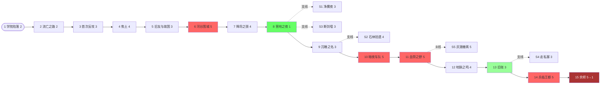

# 关卡与场景设计（09_levels_and_scenes.md）

> **对应设计支柱：布阵（Position）** ——「在格子地图上移动单位、抢占地形/高地/隘口」。本文档把 [01 世界观](01_worldview.md) 第九节的 8 个地点翻译成可走可打的格子地图，把 [05 剧情分支](05_story_branches.md) 的 15 章翻译成可布阵可交锋的关卡，把 [03 职业](03_professions.md) 的 13 个职业落到敌方编成里，并对接现有代码库 `godot/scripts/data/chapter_data.gd`（`MAP_LAYOUT` 字符数组）与 `godot/scripts/core/terrain.gd`（7 种地形）。
>
> 主题服从：所有关卡严格服从 [00 设计支柱](00_design_pillars.md) 的「战争没有赢家」「魔法稀缺」「灰色基调」。禁止爽文式「割草关」。

---

## 〇、地形字符与代码对齐（全文档约定）

本全文档的 ASCII 地图**严格沿用** `chapter_data.gd` 的 `TERRAIN_CHAR`（见 `godot/scripts/data/chapter_data.gd` L26-34）：

| 字符 | TerrainType | def+ | avoid+ | move_cost(foot/armor/cavalry/fly) | walkable |
|------|-------------|------|--------|-----------------------------------|----------|
| `.` | plain 平原 | 0 | 0 | 1/1/1/1 | ✓ |
| `F` | forest 森林 | 1 | 20 | 2/2/3/1 | ✓ |
| `M` | mountain 山 | 1 | 30 | 3/99/99/1 | ✓ |
| `W` | water 水 | 0 | 10 | 99/99/99/1 | ✓（仅 fly） |
| `T` | fort 要塞 | 3 | 20 | 1/1/1/1 | ✓ |
| `V` | village 村 | 0 | 0 | 1/1/1/1 | ✓ |
| `X` | wall 墙 | 0 | 0 | 99/99/99/99 | ✗ |

> 数值来源：`godot/scripts/core/terrain.gd` L14-22。**所有 ASCII 地图行宽必须一致**（对齐 `MAP_LAYOUT` 是定长 `String` 数组的硬约束），每行字符数 = 地图宽度。

> **特殊约定（本设计新增，需后续落地为代码）**：为承载 [01 世界观](01_worldview.md) 的灰潮/源脉叙事，本设计引入两个**语义标记**（不新增 TerrainType，而是在 `V` 村或 `.` 平原上叠加一个 `eventTag`，由关卡触发器读取）：
> - `V!` = 焦土/屠村废墟（触发环境叙事独白）
> - `.*` = 源脉抽干黑斑（法师站其上 MP 回复 = 0，见第 6 章）
> - `Ta` = 旗帜要塞（占领胜利条件的目标点）
> 它们只是 ASCII 标注，运行时仍是 `village/plain/fort`；实现时在 `chapter_data` 里加一张 `eventTiles: Dictionary` 旁路表即可，不改 terrain.gd。

---

## 一、关卡设计总纲

### 1.1 三大设计原则（每条引一个原理）

| # | 原则 | 一句话 | 引用原理 | 落地手法 |
|---|------|--------|----------|----------|
| 1 | **地形即叙事** | 关卡布局本身就是故事，玩家不用看字幕也知道这里发生过什么。 | `environmental-storytelling-technique`（"把世界当作角色"） | 焦土村落在地图中央、黑斑草地在法师必经之路、被冰封法师雕成战旗背景（见 §3 地形叙事库） |
| 2 | **一关一核心机制** | 每关只引入 1 个新元素（夜战 / 飞兵 / 血祭…），避免认知超载。 | `experience-pacing-structure`（"advance organizer + 7-10 分钟注意力窗口"） | 关卡总表的「新机制」列每章只填 1 项；分支关例外可叠加 |
| 3 | **难度递进曲线** | 入门→练习→心流，紧张度做峰谷而非一路紧绷。 | `flow-state-design-framework`（Stage1 Introduction → Stage2 Practice → Stage3 Flow） | 每关给「新手引导点 / 高手挑战点」双层目标（见 §2 设计卡） |

### 1.2 关卡类型分类表（8 类）

> 每类的「核心张力」回答：**玩家这关到底在怕什么、在抢什么。**

| 类型 | 核心张力 | 典型地形配置 | 代表章 |
|------|----------|--------------|--------|
| **遭遇战** Encounter | 双方都在开阔地相遇，比谁先抢到有利地形。 | 大片 `.` + 零星 `F`/`M`，无 `X` 墙，无固定防线 | 第 3、13 |
| **攻坚战** Siege | 敌方据守 `X` 墙 + `T` 要塞，玩家须破口而入。 | 敌方半场 `XXXX`/`TTT` 连绵，1-2 个缺口；玩家半场开阔 | 第 6、14 |
| **防守战** Defense | 玩家守一个点/一条线，撑过 N 回合或杀够 K 个。 | 玩家半场有 `T` 要塞群 + 隘口；敌方源源不断增援 | 第 12 |
| **护卫战** Escort | 保护一个脆皮 NPC（平民/要人）走到撤离点，NPC 死即败。 | 一条 `.` 通道两侧布 `F` 伏兵；NPC 移动力低、无反击 | 第 2、9 |
| **撤退战** Retreat | 玩家从地图一侧打到另一侧撤离点，时限内全员到达。 | 玩家起手被包围，撤离点在远端 `T`；敌方增援每回合刷新 | 第 1、（第 11 分支 B） |
| **伏击战** Ambush | 玩家在隘口/森林设伏，等敌方车队经过时收割。 | `F` 森林带 + `M` 高地俯瞰一条 `.` 瓶颈道；夜战视野受限 | 第 4、10 |
| **决战** Climax | 综合考验，多阶段 Boss + 大量精英 + 地形动态变化。 | 复合地形，中央 `T` 为 Boss 巢，周围 `W`/`M` 隔断 | 第 11、15 |
| **支线** Side | 练级/取宝/招募，难度可控，奖励稀有道具。 | 小而精，10×8 左右，单一主题地形 | §4 支线库 |

---

## 二、15 章关卡详细设计

### 2.1 关卡总表

> 章号 / 章名对齐 [05 剧情分支](05_story_branches.md) §3；地点对齐 [01 世界观](01_worldview.md) §九；职业 id 对齐 [03 职业](03_professions.md) §二；紧张度 1=最松弛 / 5=最紧绷。
> 地图尺寸格式 `宽×高`，单位为格；建议范围 12×10 ~ 16×12（编辑器上限 60×60，但战旗舒适量级不超过 16×12）。

| 章 | 章名 | 地点（→01） | 关卡类型 | 地图尺寸 | 玩家单位 | 敌方单位 | Boss | 胜利条件 | 失败条件 | 新机制 | 紧张度 |
|----|------|-------------|----------|----------|----------|----------|------|----------|----------|--------|--------|
| 1 | 学院的陷落 | 维兰瑟·学院郊外（→圣城艾尔萨外围） | 撤退战 | 14×10 | 2（主角+导师） | 4→8（逐回增援） | 帝国 `knight` 副官 | 全员抵达东侧撤离点（x≥12） | 主角阵亡 / 第 8 回合未撤离 | **步兵移动+攻击**（教学） | 2 |
| 2 | 流亡之路 | 银泪渡口（→地点3） | 护卫战 | 14×10 | 4 | 6 | 帝国 `lancer` 小队长 | 平民 NPC（3 个）存活抵达东岸 | 任一平民死亡 / 主角阵亡 | **杖 staff 治疗 + MP 稀缺** | 2 |
| 3 | 首次反攻 | 银泪渡口西岸林地 | 遭遇战 | 14×10 | 5 | 7 | 帝国 `archer` 队长 | 歼灭所有敌军 / 或敌方减员至 2 以下自动撤退 | 主角阵亡 | **弓 bow 远程 + 森林减伤** | 3 |
| 4 | 焦土 | 烬海北缘焦土村（→烬海石林外围） | 伏击战 | 16×11 | 6 | 9（含 2 名"屠村"帝国兵） | 帝国 `berserker` 屠夫 | 歼灭敌军；村庄废墟 `V!` 触发独白后胜利 | 主角阵亡 / 少年兵（剧情保护）阵亡 | **魔法 magic + 元素克制** | 4 |
| 5 | 旧友与故国 | 苍脊隘口（→黑铁要塞外围） | 遭遇战（轻） | 14×10 | 7 | 5（帝国巡逻队） | 旧友（`mage`，敌方 NPC，不可杀） | 旧友 HP ≤ 30% 触发对话，对话结束自动胜利 | 旧友被杀（强制 Game Over 提示） | **骑 ride 移动力差异** | 3 |
| 6 | 河谷围城 | 黑铁要塞（→地点2） | 攻坚战 | 16×12 | 8 | 12 + 增援 4/3 回合 | 帝国 `knight` 要塞司令 | 摧毁要塞正门 `X`（HP 30）并击杀司令 | 主角阵亡 / 12 回合超时 | **破城门 + 援军回合** | 5 |
| 7 | 【分支一】降将之颈 | 黑铁要塞地牢 | 抉择关（非战斗） | — | — | — | — | （纯对话 + 数值结算） | — | **劝降/俘获结算** | 4 |
| 8 | 营地之夜 | 联邦前线营地 | 基地整备（非战斗） | — | — | — | — | — | — | 商店/转职/支援开放 | 1 |
| 9 | 沉睡之名 | 回声深渊·矮人故都（→地点5） | 护卫战（探索） | 15×11 | 8 | 10（含岩族叛兵） | 岩族 `soldier` 叛首 | 调查 4 处壁画 `V` + 护送岩族长老到祭坛 `T` | 长老死亡 / 壁画未集齐 | **飞兵 fly 越障 + 古迹调查** | 3 |
| 10 | 【分支二】暗夜车队 | 银泪渡口夜（→地点3） | 伏击战（夜战） | 16×11 | 8 | 10（车队护卫） | 车队队长 `paladin` | A 履约：放行车队抵达东端；B 截杀：歼灭车队 | 主角阵亡 / 误杀旧友（A 线）/ 旧友逃脱（B 线） | **战争迷雾 + 夜战视野** | 5 |
| 11 | 【分支三】血祭之野 | 灰潮前线（→地点8） | 决战（分支依赖） | 16×12 | 9（A 线） / 8（B 线，女将 NPC 化） | 15（A 线易）/ 18（B 线难） | 帝国 `paladin` 主帅 | 歼灭敌方主帅 | 主角阵亡 / 防线崩溃（B 线女将阵亡） | A：**血祭可选**；B：综合考验 | 5 |
| 12 | 地脉之鸣 | 圣城艾尔萨地下源井（→地点1地下） | 防守战 | 16×12 | 9 | 三方合围（帝/联/教各 4） | 三方各有精英 `knight`/`sniper`/`bishop` | 守护源井 `T` 8 回合不死 | 源井被占 / 主角阵亡 | **不可控友军 NPC 军团** | 4 |
| 13 | 旧账 | 碎月自由港（→地点6） | 遭遇战（单挑倾向） | 14×10 | 8 | 7（旧仇家） | 导师昔日部下 `swordmaster` | 击败 Boss（可选揭露/隐瞒分支） | 主角阵亡 / 导师阵亡 | **理念亲和加成**（相邻同理念单位 +10% 命中） | 3 |
| 14 | 兵临王都 | 黑铁帝国王都（→黑铁要塞延伸） | 多阶段推进 | 16×12 ×2 阶段 | 9 | 阶段一 10 / 阶段二 12 | 阶段一 `knight` 守将 / 阶段二皇帝 `paladin` | 阶段一：破外城门；阶段二：击杀皇帝 | 主角阵亡 / 关键 NPC（分支依赖）阵亡 | **多阶段 Boss** | 5 |
| 15 | 余烬 | 圣城艾尔萨（→地点1） | 决战 + 结局 | 16×12 | 存活全员 | 残余三方联军（结局依赖） | 结局一/二/三各有终 Boss | 见设计卡 | 主角阵亡 | **综合系统收束** | 5 → 1 |

> **节奏校验**（对齐 [05 剧情分支](05_story_branches.md) §2 的过山车模型）：6→7→8 = 峰→中→谷（喘息关）；10→11 = 双峰；13 = 相对谷；15 = 高潮后强制降至 1（反高潮）。紧张度曲线见 §5。

### 2.2 代表性关卡设计卡（5 张，覆盖教学 / 中段分支 / 决战）

> 选样原则：覆盖不同关卡类型 + 覆盖三幕的节点。第 1 章（教学·撤退）、第 4 章（伏击·道德冲击）、第 6 章（攻坚·峰）、第 10 章（分支二·夜战伏击）、第 15 章（决战·结局）。

---

#### 【设计卡 1】第 1 章 · 学院的陷落（教学 / 撤退战）

- **地点**：维兰瑟神权国 · 源脉学院郊外（[01 世界观](01_worldview.md) 地点 1 圣城艾尔萨的外围）。
- **剧情定位**：[05 剧情分支](05_story_branches.md) 第 1 章——主角与导师被帝国突袭，首次披甲，向联邦方向撤退。建立"被迫卷入"基调。
- **引用原理**：`flow-state-design-framework` Stage 1（Introduction）——新手零技能，只给"移动 + 攻击"两个动作，地形只放 `.` 与 `F`，不出现 `W`/`X`。
- **地图 ASCII（14×10）**：

```
..............     ← 第 0 行：撤离点附近（x≥12 撤离）
....F.........
...FF.....F...
....F.........     ← 学院围墙废墟（叙事：倒塌的浮雕）
..VV..........     ← 燃烧的学院（V! 触发独白：主角"这里…是我读过书的地方"）
..............
..............
.....TT.......     ← 导师起手据守的小要塞（教学：地形加成）
..............
..............     ← 玩家从左下角 (x=1,y=8) 出发
```

- **部署**：
  - 玩家：主角（`mage`，[03](03_professions.md) §二）于 (1,8)；导师（`paladin`）于 (5,7) `T` 上。
  - 敌方：4 个 `swordsman` 从东侧 (x=12-13) 第 1 回合出现；第 3/5/7 回合各 +1 个 `archer`/`lancer` 增援从东端入场。
- **关键地形**：
  - (5,7) `T` 要塞——导师起手位置，def+3。**教学点**：让玩家看到导师站要塞 vs 平原的命中差异。
  - (4,4) `V!` 燃烧学院——主角经过触发独白，无机制效果，纯叙事（`environmental-storytelling`）。
  - (x≥12) 东端撤离带——撤退胜利区。
- **敌方编成与 AI**：帝国 `swordsman` ×4 + 增援 `archer` ×2 + `lancer` ×2。AI 倾向：优先追主角（撤退战标准 AI），不主动攻击导师除非挡路。
- **胜负条件**：
  - 胜利：主角 + 导师**均**抵达 x≥12 区域。
  - 失败：主角阵亡（导师可倒下，触发"导师重伤掩护"剧情但不 Game Over——呼应 [05](05_story_branches.md) §7 剧情保护）。
- **新手引导点 / 高手挑战点**（`flow-state` 双层）：
  - 新手：导师挡在 `T` 隘口牵制，主角直线跑向东。8 回合内必达。
  - 高手：不丢任何一回合，让导师反击杀 3 个敌人（额外经验），主角第 5 回合即抵达。
- **环境叙事触发**：主角踏入 (4,4) 周围 2 格 → 独白「这里也有人替我们决定了谁该活」（与 [05](05_story_branches.md) §8 落点 1 共用台词库）。

---

#### 【设计卡 2】第 4 章 · 焦土（伏击战 / 道德冲击）

- **地点**：烬海北缘焦土村（[01 世界观](01_worldview.md) 地点 4 烬海石林外围）。
- **剧情定位**：[05](05_story_branches.md) 第 4 章——首次道德冲击，目睹双方屠杀平民，引入魔法。
- **引用原理**：`environmental-storytelling-technique`（世界作为角色）+ `game-competency-puzzle-design`（Memory 型：敌人固定布局，玩家靠记忆走位）。
- **地图 ASCII（16×11）**：

```
................     ← 第 0 行：北方荒原（敌方增援入场）
..FFF.......FFF..
..F..F.....F..F..
.F....F...F....F.     ← 两侧森林带：伏击位（avoid+20）
.......V!.......     ← 中央焦土村（屠村现场，V!）
.......::*::....     ← `.*` 源脉黑斑（叙事+机制：法师站其上 MP 不回复）
.......V!.......
..FFF.......FFF..     ← 南方森林：玩家伏击位
................     ← 玩家从南方 (y=10) 出发
................
```

- **部署**：
  - 玩家：6 单位，部署于 y=8-10 南侧森林带（含主角 `mage`、导师、女将 `lancer`、老兵 `archer`、少年兵 `swordsman`、牧师）。
  - 敌方：9 单位，含 2 名「屠村」帝国 `berserker`（剧情标记，杀他们触发独白）、4 `swordsman`、2 `archer`、1 `knight` Boss「屠夫」。
- **关键地形**：
  - (7-8, 4-6) `V!` 焦土村——**地图灵魂**。单位进入触发主角独白；杀光 2 名屠村 `berserker` 后村庄「安息」，地面变为 `.`（视觉：火焰熄灭）。
  - (7-8, 5) `.*` 源脉黑斑——**机制+叙事协同**：法师站其上 MP 回复为 0（[05](05_story_branches.md) §8 落点 2 的前置演示）。
  - 两侧 `F` 森林带——伏击位，avoid+20，弓兵藏身。
- **敌方编成与 AI**：帝国屠村小队。AI 倾向：前 3 回合在村庄附近徘徊（"清理"平民 NPC，纯动画），第 4 回合发现玩家后转为攻击。这给玩家 3 回合"布阵抢森林"的窗口（Memory 型挑战）。
- **胜负条件**：
  - 胜利：歼灭所有敌方（含 2 名屠村兵）+ 主角踏入 `V!` 触发独白。
  - 失败：主角阵亡 / 少年兵阵亡（[05](05_story_branches.md) §7 少年兵第 1-7 章剧情保护，此关后被解除）。
- **新手引导点 / 高手挑战点**：
  - 新手：用导师+女将正面扛，老兵弓兵+主角法师在森林里输出。少年兵躲后排。
  - 高手：第 1 回合用主角 `fireball`（[07 技能](07_skills.md)）直接秒 1 名屠村兵触发独白，制造"复仇"叙事节奏；同时让少年兵"目睹"（相邻 3 格）获得隐藏buff「见证者」+5 luk。
- **环境叙事触发**：进入 `V!` → 独白「这里也有人替我们决定了谁该活」；杀屠村兵 → 少年兵颤声「他们…还是人吗」。

---

#### 【设计卡 3】第 6 章 · 河谷围城（攻坚战 / 第一幕峰）

- **地点**：黑铁要塞（[01 世界观](01_worldview.md) 地点 2）。
- **剧情定位**：[05](05_story_branches.md) 第 6 章——战局升级，女将显露狠辣。第一幕紧张度峰值（5）。
- **引用原理**：`experience-pacing-structure`（峰）+ `flow-state-design-framework` Stage 3（综合应用前 5 章学到的全部机制）。
- **地图 ASCII（16×12）**：

```
................      ← 第 0 行：要塞后方（司令部）
..XXXXXXXXXXXX..
..X..........X..      ← 内城墙（X，不可走）
..X.TTTTTTTT.X..      ← 要塞司令部（T，Boss 区）
..X..........X..
..XX..XX..XX..X..      ← 外城墙缺口（3 处破口，每处 X 有 1 格缺口）
..W..W..W..W..X..      ← 护城河（W，骑兵不可趟，fly 可越）
................
................      ← 中央冲击区
................
................      ← 玩家从南方 (y=11) 出发
```

- **部署**：
  - 玩家：8 单位于 y=10-11（含主角、导师、女将 `lancer`、老兵 `archer`/`sniper`、少年兵、牧师、2 名 `knight`）。
  - 敌方：12 单位于城墙内 + 3 处缺口各 1 `knight` 堵口；第 3/6/9 回合各 +1 波增援（`swordsman`×2）从要塞后方入场。Boss「要塞司令」`knight` Lv.8 于内城 `T`。
- **关键地形**：
  - 外城墙 `X` 的 3 处缺口——**瓶颈**。每处 1 格，敌方 `knight` 堵口，玩家必须用 `mage` 破甲（[03](03_professions.md) §3.2 魔法特攻重甲）或 `archer` 远程消耗。
  - 护城河 `W`——骑兵/步兵不可趟，**只有 `pegasusKnight` 飞兵能越河直接上城墙**（本关尚未解锁飞兵，故河是真屏障，迫使玩家走缺口）。
  - 内城 `TTTTTTTT`——Boss 巢，def+3，最难啃。
  - 城门 `X`（正中央那块，HP 30）——**可破坏目标**。用 `knight` 或道具 `bomb`（[06 道具](06_items.md)）破坏后开第 4 条路。
- **敌方编成与 AI**：帝国黑铁卫。AI 倾向：堵口不主动出击（攻坚 AI 标准），玩家破口后涌入。Boss 司令在玩家进入内城后激活。
- **胜负条件**：
  - 胜利：击杀要塞司令（破城门是手段不是条件）。
  - 失败：主角阵亡 / 12 回合超时（增援压垮）。
- **新手引导点 / 高手挑战点**：
  - 新手：集中火力破 1 处缺口，用 `knight` 顶住、`archer`/`mage` 身后输出，10 回合稳过。
  - 高手：3 路同时破口（用 `bomb` 炸城门 + 2 处缺口），第 6 回合前攻入内城，触发「闪电破城」隐藏成就 + 掉落 `silverBow`（[06](06_items.md)）。
- **环境叙事触发**：女将进入城墙缺口 → 独白「女人打仗比男人狠，是因为我们输不起」；导师路过城墙 `X` 上镶嵌的断剑 → 「这里埋过比我更强的兵」。

---

#### 【设计卡 4】第 10 章 · 暗夜车队（分支二 / 夜战伏击）

- **地点**：银泪渡口夜（[01 世界观](01_worldview.md) 地点 3，夜版）。
- **剧情定位**：[05](05_story_branches.md) 第 10 章分支二——旧友投名状，履约放行 vs 毁约截杀。第二幕第二峰（5）。
- **引用原理**：`game-competency-puzzle-design`（Skill 型：视野受限下临场判断）+ `player-psychology-decisions` Triangularity（[05](05_story_branches.md) §4 分支二）。
- **地图 ASCII（16×11）**：

```
................      ← 第 0 行：北岸芦苇丛（W 周边）
..FFFF...FFFF...      ← 伏击林（F，夜战视野=1 格）
..F..F...F..F...
.WWWWWW.F.WWWWWW      ← 银泪河（W，唯一渡口在中央）
..F..F...F..F...      ← 南岸伏击林
..FFFF...FFFF...
................      ← 车队从西端 (x=0) 出发，东端 (x=15) 撤离
................
................
................
................
```

- **部署**：
  - 玩家：8 单位于南北两岸伏击林（y=1-2 与 y=4-5）。
  - 敌方（车队）：10 单位，车队队长 `paladin` Lv.10 居中，护卫 `lancer`×4 + `archer`×3 + `mage`×2，沿 `.` 通道从 x=0 向 x=15 移动。旧友 `mage` 在车队中段（剧情保护，不可被玩家直接攻击——选中他时弹"这是旧友"提示）。
- **关键地形**：
  - 中央 `.` 渡口——车队唯一通道（两侧 `W` 不可趟）。**瓶颈**。
  - 南北 `F` 伏击林——夜战视野=1，玩家单位在林中敌方看不见（伏击位）。
  - 东西两端——A 线胜利区（车队抵达 x=15）/ B 线歼灭区。
- **夜战视野机制（新）**：所有单位视野半径=1（默认 2）。森林额外隐蔽。这迫使玩家靠 Memory（记住车队路线）+ Skill（判断何时出击）。
- **敌方编成与 AI**：车队护卫 AI：沿通道匀速东行，被攻击后反击但不追击过远。旧友 AI：不主动攻击玩家，被玩家单位（非主角）相邻时触发"旧友认出你"对话。
- **胜负条件（分支依赖）**：
  - A 履约：保护车队抵达 x=15（玩家须主动避战或掩护车队通过联邦伏击点——讽刺：玩家成了自己第 4 章伏击对象的护卫）。
  - B 截杀：歼灭车队（含旧友——但旧友被击破时触发"重伤逃脱"剧情，第 14 章以精英敌回归）。
- **失败条件**：主角阵亡 / A 线车队损失过半（旧友死） / B 线旧友第 1 回合即死（触发隐藏 Game Over「你亲手杀了朋友，故事在此终结」）。
- **新手引导点 / 高手挑战点**：
  - 新手：A 线——清掉沿途联邦自己的伏击兵（剧情解释：女将安排的伏击队不知情），护送车队 12 回合抵达。
  - 高手：B 线——在第 1 回合用 `sniper`（射程 [2,4]）从森林盲狙车队队长 `paladin`，触发"误杀旧友"风险分支；或精确控制只杀护卫留旧友活口，解锁第 13 章"旧友书信"支线。
- **环境叙事触发**：主角站到河岸 `W` 边 → 「这条河去年还运粮食，现在运尸体」；夜战视野中偶尔闪过对岸火把（车队灯笼），无需过场即传达"猎物接近"。

---

#### 【设计卡 5】第 15 章 · 余烬（决战 + 结局）

- **地点**：圣城艾尔萨（[01 世界观](01_worldview.md) 地点 1，决战版）。
- **剧情定位**：[05](05_story_branches.md) 第 15 章——终极对决，结局分化。紧张度 5→1（反高潮收尾）。
- **引用原理**：`synergy-thematic-design`（主题一致：无完美结局）+ `experience-pacing-structure`（反高潮）。
- **地图 ASCII（16×12）**：

```
......TTTT......      ← 第 0 行：圣城金顶神殿（源井所在，T）
.....TTTTTT.....
....T......T....      ← 神殿回廊
...T..:*::*..T...      ← `.*` 源脉裂痕（结局三：主角击碎处）
...T........T....
....XXXXXXXX.....      ← 内殿墙（X，Boss 阶段二屏障）
....X......X....
....X..VV..X....      ← V：结局一街道（沉默民众）/ 结局二（撤离残兵）
....X......X....
....XXXXXXXX.....      ← 外殿墙
................      ← 玩家从南方 (y=11) 出发
................
................
```

- **部署（结局依赖）**：
  - 玩家：存活全员（结局一约 9 / 结局二需导师或王女其一存活 / 结局三主角独剩少数）。
  - 敌方：结局一——帝国+联邦残余联军，Boss 灰烬之王形态（主角自己的镜像，`sage` Lv.20 黑化）；结局二——三方残兵，Boss 帝国皇帝 `paladin` Lv.20；结局三——源脉守卫者（不可选阵营的中立精英），无传统 Boss，目标是击碎 (7-8,3) `.*` 主脉。
- **关键地形**：
  - (7-8,3) `.*` 源脉裂痕——**结局三的目标**。主角站其上发动"沉脉"（剧情技），全地图魔法永久消失。
  - 神殿 `TTTT`——源井所在，def+3。结局一/二的最终争夺点。
  - 双层 `X` 墙——多阶段推进感（虽是单关，但有内外殿节奏）。
  - (4-5,7) `V` 街道——**结局分化的环境叙事载体**（[05](05_story_branches.md) §8 落点 6）：结局一此处是跪伏沉默 NPC（无对话，头顶无叹号）；结局二是撤离中的双方残兵 NPC；结局三空无一人。
- **敌方编成与 AI**：
  - 结局一：灰烬之王（主角镜像）使用血魔法，每回合消耗一名友军 HP 回血——玩家须在友军被吸干前击杀。AI 优先攻击血量最低单位。
  - 结局二：帝国皇帝 + 残余。AI 标准决战。
  - 结局三：源脉守卫者无限增援（杀不完），迫使玩家速通至裂痕——**限时生存**变体。
- **胜负条件**：
  - 结局一：击杀灰烬之王（主角自己）——胜利后强制播放"独自站在干涸河床"长镜头，紧张度降至 1。
  - 结局二：击杀帝国皇帝 → 触发三方停战过场。
  - 结局三：主角抵达 (7-8,3) 发动沉脉 → 全地图魔法消失 → 通关。
- **失败条件**：主角阵亡（所有结局通用）。
- **新手引导点 / 高手挑战点**：
  - 新手：结局二（最"希望"），保留导师/王女，常规决战打法。
  - 高手：结局四「孤行之证」——前 14 章全 A 线 + 全员存活，此关解锁隐藏 Boss「主角的影子」，击败后获得空洞结局。
- **环境叙事触发**（结局由你看到的街道决定，[05](05_story_branches.md) §8 落点 6）：
  - 进入 (4-5,7) → 结局一：看到沉默跪伏 NPC，主角独白「他们活着，但没人在家」。
  - 结局二：看到撤离残兵互相搀扶，少年兵（若存活）「这就结束了吗」。
  - 结局三：空街 + 风声，老兵「至少，没人会为这玩意儿再打仗了」。

---

## 三、地形叙事库（8 个地点 → 地形配置模板）

> 把 [01 世界观](01_worldview.md) §九的 8 个地点展开成可直接搭图的模板。每个地点给：推荐尺寸 / 主导地形 / 视觉关键词 / 适合关卡类型。

### 3.1 圣城艾尔萨（Elsath, the Holy City）

| 维度 | 值 |
|------|-----|
| 推荐尺寸 | 16×12（决战级） |
| 主导地形 | `T` 要塞（神殿群）+ `X` 墙（城防）+ 少量 `.` 广场 + `.*` 源脉裂痕（地下源井） |
| 视觉关键词 | 金顶、白大理石、源脉幽蓝光纹、浮雕城墙、肃穆、圣歌余音；色调：金 + 冷蓝 + 白 |
| 适合关卡 | 攻城战（第 6 章可复用）、决战（第 15）、防守战（第 12 地下源井版） |
| 叙事签名 | 城墙浮雕 = 第一纪元编织者；地下源井 = 全大陆最后富源井；结局街道分化（[05](05_story_branches.md) §8 落点 6） |

### 3.2 黑铁要塞（Blackiron Hold）

| 维度 | 值 |
|------|-----|
| 推荐尺寸 | 16×12（攻坚级） |
| 主导地形 | `X` 城墙（双层）+ `T` 要塞（司令部）+ `W` 护城河 + `.` 冲击区 |
| 视觉关键词 | 黑铁、铁灰、断剑嵌墙、血锈暗红、哥特尖顶、烽烟；色调：黑 + 暗红 + 铁灰 |
| 适合关卡 | 攻坚战（第 6、14 阶段一）、防守战（玩家守要塞时） |
| 叙事签名 | 城墙嵌满阵亡者断剑——"每一寸墙都死过人"（`environmental-storytelling`） |

### 3.3 银泪渡口（Silver Tear Ford）

| 维度 | 值 |
|------|-----|
| 推荐尺寸 | 14×10 ~ 16×11 |
| 主导地形 | `W` 银泪河（横断）+ 中央 `.` 渡口 + 两岸 `F` 芦苇/丛林 + 雾（夜战视野机制） |
| 视觉关键词 | 银灰雾气、芦苇荡、木栈桥、湿漉石阶、晨昏冷暖光；色调：银灰 + 苍青 + 暖橙（晨光） |
| 适合关卡 | 护卫战（第 2，护送平民过河）、伏击战（第 10 夜版）、遭遇战（第 3 西岸） |
| 叙事签名 | "去年还运粮食，现在运尸体"（河 = 战争对民生动脉的吞噬） |

### 3.4 烬海石林（Ashen Pillars）

| 维度 | 值 |
|------|-----|
| 推荐尺寸 | 15×11 |
| 主导地形 | `M` 石化柱群（岩族/灰潮感染者石化形成，按 `M` 处理但视觉独特）+ `.` 荒漠 + 散布 `V` 源城废墟 + `.*` 黑斑密布 |
| 视觉关键词 | 风蚀石柱、空洞嗡鸣、灰黄沙暴、半人半石化雕塑、源城残柱；色调：焦黄 + 灰白 + 暗红（残阳） |
| 适合关卡 | 伏击战（第 4 焦土）、探索/撤退战（支线 §4）、稀有道具获取 |
| 叙事签名 | 石柱 = 石化的人；玩家走过即"踩着尸体行军"（`environmental-storytelling` 主题落点） |

### 3.5 回声深渊·矮人故都（Echoing Deep）

| 维度 | 值 |
|------|-----|
| 推荐尺寸 | 15×11 |
| 主导地形 | `M` 钟乳石柱 + `W` 熔岩河（按 `W` 处理但伤害版，需 eventTag）+ `T` 岩族祭坛 + `V` 壁画（4 处调查点） |
| 视觉关键词 | 穹顶、钟乳石、熔岩橙红反光、源脉最近地表（蓝紫光渗）、矮人符文；色调：黑岩 + 熔岩橙 + 源脉蓝紫 |
| 适合关卡 | 护卫战/探索（第 9 沉睡之名）、地下战、限时生存 |
| 叙事签名 | 4 处壁画拼出灭世预言（[05](05_story_branches.md) §8 落点 3，结局三伏笔） |

### 3.6 碎月湾·自由港（Freeport of Broken Moon）

| 维度 | 值 |
|------|-----|
| 推荐尺寸 | 14×10 ~ 15×11 |
| 主导地形 | `X` 仓库墙 + `V` 码头货栈 + `.` 街巷 + `W` 港湾（边界）+ `T` 市政厅 |
| 视觉关键词 | 千帆桅杆、木栈道、油布雨篷、走私黑市灯笼、潮湿石板路；色调：海蓝 + 木褐 + 灯笼暖黄 |
| 适合关卡 | 巷战、遭遇战（第 13 旧账）、限时占领仓库（支线） |
| 叙事签名 | 仓库堆满搜刮来的源晶——"自由的代价是别人的源脉" |

### 3.7 霜落祭坛（Frostfall Altar）

| 维度 | 值 |
|------|-----|
| 推荐尺寸 | 14×10 |
| 主导地形 | `M` 冰岩（按 `M` 处理）+ `T` 镇渊律圣坛 + `.` 冰原（每回合 HP 微损，需 eventTag）+ 大量「冰封法师雕」装饰（`V` 变体，触发独白） |
| 视觉关键词 | 冰蓝、冰封人形（法师受刑者）、极光、呼气白雾、血色祭坛反差；色调：冰蓝 + 死白 + 血红点缀 |
| 适合关卡 | 夜战、暗杀、护送逃亡法师（支线 §4「净魔夜」） |
| 叙事签名 | 冰封法师雕 = 《镇渊律》暴行的无声控诉（[01](01_worldview.md) §九 落点 7 直接点明） |

### 3.8 灰潮前线（The Gray Tide Front）

| 维度 | 值 |
|------|-----|
| 推荐尺寸 | 16×12 |
| 主导地形 | `.` 半石化地（每数回合随机格变 `X` 不可走——**动态地形**）+ `M` 已完成石化区 + `.*` 蔓延源斑 |
| 视觉关键词 | 灰白石化地、裂纹蔓延、半石化植被、灰雾低垂、死寂；色调：灰白 + 死灰 + 偶尔源脉紫 |
| 适合关卡 | 动态地形战 / 限时撤离（第 11 决战 B 线）、撤退战（支线） |
| 叙事签名 | 地面实时石化 = "你脚下的世界正在死"（`environmental-storytelling` 最高强度形式） |

---

## 四、支线与自由战斗（5 个）

> 触发条件 / 地点 / 奖励 / 难度。均非主线必打，给玩家练级、取稀有道具、招募隐藏角色。对齐 [05](05_story_branches.md) §三幕结构，支线多放第二幕间隙。

| # | 支线名 | 触发条件 | 地点（→01） | 关卡类型 | 奖励 | 难度 |
|---|--------|----------|-------------|----------|------|------|
| S1 | **净魔夜** | 第 8 章营地，与王女对话（若存活） | 霜落祭坛（3.7） | 护卫战（护送逃亡法师） | 招募隐藏角色「冰封法师」`sage`（弱化版，HP 偏低）+ `holyWater`×2（[06](06_items.md)） | 3（紧张度） |
| S2 | **石林拾遗** | 第 9 章后，地图自由探索 | 烬海石林（3.4） | 探索/遭遇战 | 传说道具 `voidChalice`（[06](06_items.md) §3.1，代价：永久 -1 power） | 4 |
| S3 | **断剑墙下的亡魂** | 第 6 章后，老兵在队 | 黑铁要塞外围（3.2） | 遭遇战（精英佣兵） | 精良道具 `silverBow`（[06](06_items.md)）+ 老兵专属转职纹章「佣兵勋章」 | 3 |
| S4 | **自由港走私客** | 第 13 章前后，碎月联邦声望≥中立 | 碎月自由港（3.6） | 巷战/限时占领 | 大量金币 + 稀有消耗品 `elixir`×2 + 情报（解锁第 14 章一条捷径） | 3 |
| S5 | **灰潮撤离** | 第 11 章分支 B（拒绝血祭）后 | 灰潮前线（3.8） | 撤退战（动态地形） | 源脉晶石 ×1（[03](03_professions.md) §4 转职稀缺道具）+ 隐藏成就 | 5（紧张度，B 线限定高难） |

> **支线设计原则**（`game-competency-puzzle-design` Memory 型缓解）：主线是 Skill 型（临场判断），支线倾向 Memory 型（固定布局可重复刷），用「固定布局 + 随机掉落」缓解主线挫败感。
> **喘息节奏**：S1/S3/S4 紧张度 3，放第二幕谷（第 8、13 章前后）给玩家"喘息关"；S5 紧张度 5，仅 B 线玩家可触，作为高难挑战。

---

## 五、关卡难度曲线（15 章 + 支线）

### 5.1 紧张度曲线（ASCII）

```
紧张度
5 |        ●           ●●                 ●●        ●●●
4 |      ●   ●       ●    ●             ●  ●      ●    ●
3 |    ●       ●   ●      ●     ●     ●      ●   ●      ●
2 |  ●           ●●        ●   ● ●   ●        ● ●        ●
1 |                            ●   ●                          ●(反高潮)
  +--+--+--+--+--+--+--+--+--+--+--+--+--+--+--+--+--+--+--
章   1  2  3  4  5  6  7  8  9 10 11 12 13 14 15  
                                S1    S3 S4  S5(高难B线)
                        S2
```

> 波峰：第 6（攻坚）、10-11（双峰决战段）、14-15（终局）。波谷：第 8（喘息关·非战斗）、第 13（相对谷·旧账）。
> **反高潮收尾**：第 15 章战斗紧张度 5，但通关后强制降至 1（街道长镜头，[05](05_story_branches.md) §2），呼应「没有赢家」。

### 5.2 Mermaid 版（含支线）



### 5.3 喘息关设计（低紧张度 + 资源补给）

| 喘息关 | 紧张度 | 补给内容 | 设计意图 |
|--------|--------|----------|----------|
| 第 8 章 营地之夜 | 1 | 商店半价、免费转职一次、全员回满 HP/MP | 第二幕前的总整备（`experience-pacing` advance organizer） |
| 第 13 章 旧账（相对谷） | 3 | 支线 S4 金币、导师/老兵专属纹章 | 终局前的最后一次"人事清算" |

> 喘息关必须**有实质内容**（不是纯空关），让玩家在低紧张度下做长线决策（转职/装备/支援对话），符合 `flow-state-design-framework` Stage 2→3 过渡。

---

## 六、地图编辑器对接（对齐 map_editor.gd）

### 6.1 现有管线

| 组件 | 路径 | 职责 |
|------|------|------|
| 编辑器 | `godot/scripts/scenes/map_editor.gd` | 画笔/橡皮/填充/平移/角色放置 5 工具；侧栏选 block（`grassland_0`/`ocean_1`…）；顶栏调尺寸（`MIN_MAP_SIZE=4` ~ `MAX_MAP_SIZE=60`，默认 20×20）；导出/导入 JSON |
| 类型 | `godot/scripts/editor/editor_types.gd` | `EditorMap = { width, height, cells:[[String\|null]], units:[PlacedUnit] }` |
| 持久化 | `godot/scripts/core/level_storage.gd` | 每关存 `user://levels/<id>.json`；首启 `seed_builtin_if_empty` 注入 `BuiltinLevels`（meadow/border） |
| 转换 | `godot/scripts/core/level_to_chapter.gd` | `cells`（block title 矩阵）→ `terrain`（TerrainType 矩阵）via `CATEGORY_TO_TERRAIN`；`PlacedUnit` → `UnitData`；输出 `ChapterData` |
| 内置 | `godot/scripts/data/builtin_levels.gd` | 两个 demo EditorMap（草原遭遇战 10×8 / 边境冲突 12×10） |

### 6.2 block title → TerrainType 映射（来自 level_to_chapter.gd）

| block 类别前缀 | → TerrainType | 对应 ASCII 字符 |
|----------------|---------------|-----------------|
| `ocean` / `swamp` | water | `W` |
| `forest` / `rainforest` / `elfland` | forest | `F` |
| `mountain` / `snow` / `volcano` | mountain | `M` |
| `grassland` / `desert` / `basic` / `vanilla` / `creative` | plain | `.` |
| null（未画） | wall | `X` |
| `village_*` / `fort_*`（需在 CATEGORY_TO_TERRAIN 补） | village / fort | `V` / `T` |

> **缺口提示**：现有 `CATEGORY_TO_TERRAIN` 没有 `village`/`fort` 前缀映射（见 `level_to_chapter.gd` L10-24）。落地本设计的 `V`/`T` 地形时，需在编辑器侧栏新增 `village_0..2`、`fort_0..2` block 组，并在 `CATEGORY_TO_TERRAIN` 补两行：`village = &"village"`、`fort = &"fort"`。

### 6.3 编辑器 → JSON → chapter 流转

```
[1] 美术/策划在 map_editor.gd 中：
    - 调尺寸（如 14×10）
    - 用画笔涂 block（grassland_0 → plain, forest_2 → forest…）
    - 用"角色"工具放置 PlacedUnit（选 classId/faction/level/weaponId）
    - 点"导出"→ 存为 user://levels/<id>.json（StoredLevel）

[2] LevelStorage.save_level(level) 持久化：
    StoredLevel = { id, name, createdAt, map: EditorMap }

[3] 关卡启动时 LevelToChapter.stored_to_chapter(stored)：
    - cells_to_terrain(cells)  → terrain 矩阵（TerrainType）
    - _placed_unit_to_unit_data → playerUnits / enemyUnits
    - 透传 blockTitles 给渲染层（block 图优先于 tile）
    → ChapterData = { id, name, map, width, height, playerUnits, enemyUnits, blockTitles }

[4] BattleScene 读取 ChapterData 开战
```

### 6.4 把本设计的 ASCII 关卡落地为代码的两种方式

**方式 A（推荐，教学/演示用）**：直接写进 `chapter_data.gd` 的 `MAP_LAYOUT`。例如第 1 章：

```gdscript
# chapter_data.gd 新增
const CH1_LAYOUT: Array[String] = [
    "..............",
    "....F.........",
    "...FF.....F...",
    "....F.........",
    "..VV..........",
    "..............",
    "..............",
    ".....TT.......",
    "..............",
    "..............",
]
# 宽 14 × 高 10，与现有 chapter_1() 同构
```

**方式 B（主线 15 章 + 支线，推荐）**：用 `map_editor.gd` 画好每关 → 导出 JSON → 程序打包进 `builtin_levels.gd` 的 `all_levels()`，或作为外部 `res://levels/chN.json` 资源加载。这样关卡数据与代码解耦，策划可独立迭代。

### 6.5 eventTag（本设计新增）落地建议

本设计的 `V!`（焦土村）、`.*`（源脉黑斑）、`Ta`（旗帜要塞）等语义标记，建议在 `ChapterData` 增加一个旁路字段（不改 terrain.gd）：

```gdscript
# ChapterData 扩展（建议）
{
    ...
    eventTiles = {
        "village_ruin":  [Vector2i(4,4), Vector2i(7,5)],   # V! 焦土
        "source_scar":   [Vector2i(7,5), Vector2i(8,5)],   # .* 黑斑
        "capture_flag":  [Vector2i(7,0), Vector2i(8,0)],   # Ta 旗帜
    }
}
```

BattleScene 在单位移动结束时查 `eventTiles`，命中则触发对应事件（独白/MP 锁/占领计数）。`map_editor.gd` 可在"角色"工具旁加一个"事件标记"工具，把这些点画到地图上，存进 `EditorMap.eventTiles`，随 `stored_to_chapter` 透传。

---

## 七、与上游文档的交叉引用速查

| 本文档章节 | 引用上游 | 引用点 |
|------------|----------|--------|
| §一原则 | [00 设计支柱](00_design_pillars.md) | 三大支柱、魔法硬约束 |
| §二关卡总表 | [05 剧情分支](05_story_branches.md) §3 | 15 章名、剧情功能、紧张度 |
| §二关卡总表 | [01 世界观](01_worldview.md) §九 | 8 个地点 |
| §二设计卡敌编成 | [03 职业](03_professions.md) §二 | 职业 id（knight/mage/lancer…） |
| §二设计卡奖励 | [06 道具](06_items.md) §三 | 道具 id（silverBow/voidChalice…） |
| §二设计卡技能 | [07 技能](07_skills.md) | fireball 等 |
| §二国家敌编成 | [02 国家](02_nations.md) | 黑铁帝国=重甲、维兰瑟=法师、碎月=弓弩 |
| §三地形库 | [01 世界观](01_worldview.md) §九 | 8 地点逐一展开 |
| §四支线 | [05 剧情分支](05_story_branches.md) §四 | 分支依赖（S5 锁 B 线） |
| §五曲线 | [05 剧情分支](05_story_branches.md) §2 | 过山车模型、反高潮 |
| §六编辑器 | `godot/scripts/scenes/map_editor.gd` 等 | 现有管线 |

---

## 八、设计自检（对齐 00 设计支柱禁止清单）

| 自检项 | 结果 |
|--------|------|
| 是否有「割草关」（无脑赢）？ | 否。最松的第 8 章是非战斗喘息关，非战斗爽关 |
| 是否有「魔法万能」桥段？ | 否。`.*` 黑斑机制反而惩罚法师站桩；血祭是诅咒不是奖励 |
| 是否有 Glory 调性胜利？ | 否。第 15 章强制反高潮，结局由沉默街道决定 |
| 是否每关只引入 1 个新机制？ | 主线是（见关卡总表「新机制」列）；分支关允许叠加（第 7/10/11） |
| 紧张度是否峰谷起伏？ | 是。6→7→8 峰中谷，10→11 双峰，13 谷，15 反高潮（§5） |
| 地形是否服务叙事？ | 是。焦土村/黑斑/冰封法师雕/断剑墙均为 `environmental-storytelling` 落点 |
| ASCII 地图是否用代码库字符？ | 是。全部 `./F/M/W/T/V/X`，行宽一致，对齐 `chapter_data.gd` |
| 永久死亡是否在关卡层有体现？ | 是。少年兵第 4 章剧情保护解除、女将第 11 章 B 线大概率阵亡、S2 道具带 -1 属性代价 |

---

*本文档为关卡与场景设计总纲。具体每关的数值（敌方属性、回合数、增援波次）需在实现阶段与数值策划联调；eventTag 机制需与程序确认落地方式。*
