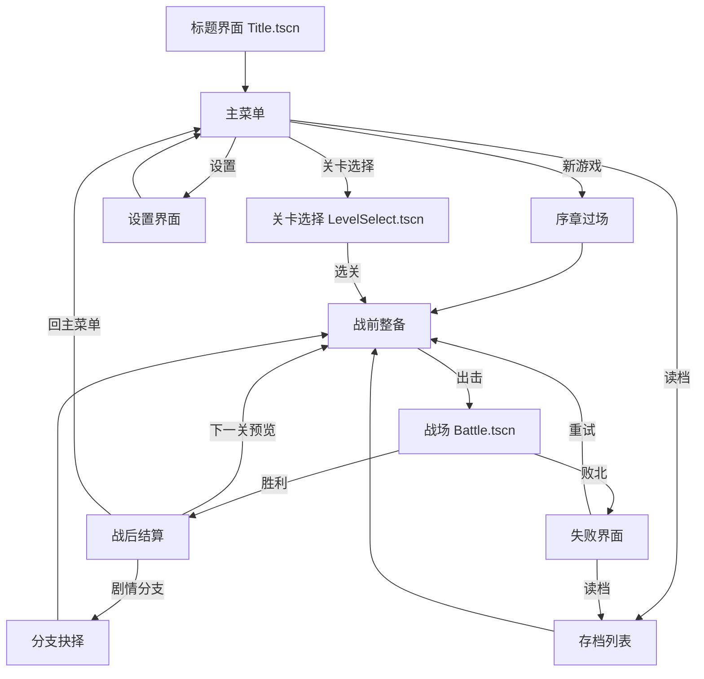

# 界面与交互设计（UI/UX）

> 本文档服务三大支柱中的**「布阵 / 交锋」**——让玩家在战场上的每一次移动与攻击都**高效、可读、可撤销**。所有界面设计服从 `00_design_pillars.md` 的「古代魔法 + 庄重史诗」基调与「魔法稀缺」硬约束，并对齐现有 Godot 工程的 `battle_ui.gd` / `range_overlay.gd` / `turn_director.gd` / `title.gd` / `level_select.gd` 实现风格。

---

## 0. 与代码库的对齐基线（subagent 必读）

现有 UI 实现特征，本文档的所有「改造」都基于这些事实：

| 现状（代码事实） | 文件 | 本文档的态度 |
|---|---|---|
| 原生 `Button`/`Label`/`Panel`，位置硬编码（`Vector2(16,12)` 等） | `title.gd` / `level_select.gd` / `battle_ui.gd` | 保留原生控件（MVP 够用），但引入 **Theme 资源 + 锚点布局**取代硬坐标 |
| 单位菜单动态构建：攻击/技能/物品/等待（按可用性过滤） | `battle_ui.gd::open_unit_menu` | 已天然符合 Hick 定律，**补一项「取消移动」+ 推荐项高亮** |
| 预览面板：命中率/必杀/伤害/反击，贴右上 `vp.x-230,60` | `battle_ui.gd::_show_preview_panel` | **扩展为双栏对位 HP 条 + 武器克制图标**（SRPG 灵魂面板） |
| 范围色：蓝`(0.25,0.55,1.0)` 可移动 / 红`(1.0,0.25,0.25)` 被占 / 紫`(0.75,0.35,1.0)` 攻击 / 金`(1.0,0.82,0.2)` 光标浮动 | `range_overlay.gd` 常量 | **沿用四色**，新增**绿（治疗）**与**橙（危险移动）** |
| 移动可撤销：`_pending_move_undo = {unit, from}`，菜单期间 ESC 回原位 | `battle.gd::_cancel_move` | **强化为显式「撤销」按钮 + 危险格红色预警** |
| 托管开关 + 偏好面板（`hosting_active` / `_auto_prefs`） | `turn_director.gd` | 偏好面板升级为**可视化的「军令」面板** |
| Mode 枚举：`IDLE/UNIT_SELECTED/MOVING/MENU/ENEMY_TURN/ANIMATING` | `battle.gd` line 30 | 所有 HUD 显隐都以这 6 态为条件 |

---

## 1. UI 设计总纲

### 1.1 三原则（每条引用 Game Design Skill 原理）

| 原则 | 引用原理 | 落地表现 |
|---|---|---|
| **信息层级清晰** | **Hick 定律**（hicks-law：选项 3-6 最优、分组优于层级） | 单位菜单 ≤5 项；技能/道具按可用性过滤；目标选择器推荐项置顶高亮 |
| **操作高效** | **Fitts 定律**（fitts-law：常用元素放大放近、分组、屏幕边缘是无穷大目标） | 高频按钮（结束回合/确认/取消）放大、贴边；菜单弹出在单位屏幕投影旁 |
| **状态可读** | **视觉引导**（visual-player-guidance：可供性、注意力捕获、一致性） | 范围四色 + 金色呼吸光标；HP 条颜色随血量渐变；危险移动橙色预警 |

### 1.2 视觉风格定位（古代魔法 + 庄重史诗 + 日漫二次元）

**美术关键词（给美术/外包的 brief）**

| 维度 | 关键词 | 具体规范 |
|---|---|---|
| **风格基调** | **日漫二次元赛璐璐** | **清晰线稿 + 平涂 + 硬边二级阴影**（cel shading）；**暗色系二次元**（不萌 / 不幼 / 不 Q）。完整规范（线条 / 上色 / 色彩三阶 / 禁项）见 [13_art_style.md](13_art_style.md) §1.3 与 §2.5 |
| **字体** | 衬线 + 微哥特感 | 中文：思源宋体 Heavy（标题）/ 思源宋体 Regular（正文）；西文/数字：Cinzel（标题，罗马碑铭感）/ EB Garamond（正文）。**禁用**无衬线现代字体 |
| **配色** | 暗金 / 铁灰 / 血红 / 源脉蓝 | 见下表 |
| **材质** | 羊皮纸 / 铁框 / 源晶 | 面板底纹用羊皮纸纹理（`#E8D9B0` 叠 12% 噪声）；边框用铁灰**硬边亮暗两阶**（替代连续浮雕渐变）；魔法相关元素嵌源晶（色块化自发光蓝） |
| **图形语言** | 纹章 / 蔓藤 / 鲁恩符文 | 国家徽记用纹章风（02_nations 四国各有徽记）；分隔线用蔓藤；魔法值/MP 用鲁恩符文做单位 |

**核心配色表（十六进制，全局复用）**

| 用途 | 色名 | 十六进制 | RGB | 使用场景 |
|---|---|---|---|---|
| 背景-铁灰 | `--iron-gray` | `#2B2B3A` | 43,43,58 | 面板底色（替代现 `Color(0,0,0,0.88)` 黑底） |
| 背景-夜墨 | `--night-ink` | `#1A1A24` | 26,26,36 | 全屏遮罩底色 |
| 主强调-暗金 | `--dark-gold` | `#C9A227` | 201,162,39 | 标题、金色光标、关键按钮描边（对齐 range_overlay `_CURSOR_COLOR`） |
| 次强调-源脉蓝 | `--ley-blue` | `#408CFF` | 64,140,255 | 可移动范围、MP 条、魔法元素（对齐 `_RANGE_COLOR_MOVABLE`） |
| 危险-血红 | `--blood-red` | `#B22222` | 178,34,34 | HP 低血、被占格、攻击范围辅助、Game Over |
| 攻击-源晶紫 | `--crystal-violet` | `#BF59FF` | 191,89,255 | 攻击范围（对齐 `_RANGE_COLOR_ATTACK`） |
| 治疗-翡翠绿 | `--emerald` | `#3CB371` | 60,179,113 | 治疗范围、buff 图标（**新增**） |
| 危险移动-烬橙 | `--ember-orange` | `#E07B2A` | 224,123,42 | 处于敌方攻击范围的移动格（**新增预警**） |
| 文字-羊皮 | `--parchment` | `#E8D9B0` | 232,217,176 | 正文文字、HP 条底 |
| 文字-骨白 | `--bone-white` | `#F2EDE0` | 242,237,224 | 标题文字 |

> 配色一致性自检：以上 10 色覆盖全部 UI，**禁止引入第 11 色**（visual-player-guidance：一致性）。

### 1.3 黄金比例布局（golden-ratio-design，Φ = 1.618）

主战场 16:9（以 1920×1080 为基准）。把屏幕宽 1920 按 Φ 分割：

```
1920 = 1185 (主区 a) + 735 (侧栏 b)   →  1185/735 ≈ 1.612 ≈ Φ
1080 =  667 (主区 a) + 413 (顶/底 b)   →  667/413  ≈ 1.615 ≈ Φ
```

**主战场 UI 分区（Φ 标注）**

```
┌──────────────────────────────────────────────────────────────────────────────┐
│  顶部 HUD（高 ≈ 1080/Φ² ≈ 413px 的 1/4 ≈ 103px）                              │
│  ┌──────────────────────────────┐ ┌──────────────────────────────────────┐ │
│  │ 回合 #N · 玩家阶段            │ │ 敌我计数  目标提示                    │ │
│  └──────────────────────────────┘ └──────────────────────────────────────┘ │
├──────────────────────────────────┬──────────────────────────────────────────┤
│                                  │                                          │
│                                  │  右侧栏（宽 735px，含预览/详情面板）      │
│   3D 等距战场（主视野）           │  ┌────────────────────────────────────┐ │
│   宽 ≈ 1185px                    │  │ 战斗预测面板（攻击时弹出）          │ │
│                                  │  │ HP 条 / 命中 / 伤害 / 双击 / 克制   │ │
│   光标金框 + 蓝格移动范围         │  └────────────────────────────────────┘ │
│                                  │  ┌────────────────────────────────────┐ │
│                                  │  │ 单位详情（长按 / Tab 切换时）       │ │
│                                  │  └────────────────────────────────────┘ │
│                                  │                                          │
├──────────────────────────────────┴──────────────────────────────────────────┤
│  左下：单位行动菜单（弹出，贴单位投影）           右下：结束回合(E) · 托管 · 偏好│
│  底栏高 ≈ 103px                                                              │
└──────────────────────────────────────────────────────────────────────────────┘
   ↑ 左下菜单在「单位屏幕投影 + (40,-40) 偏移」处弹出（对齐 battle_ui.gd 现有定位逻辑）
```

- **主视野 1185×870**（去掉顶/底栏）：战场 3D 渲染区，UI 仅叠金色光标与范围色块。
- **右侧栏 735×870**：信息密集区（预览/详情），按 Φ 再分：预览面板高 ≈ 870/Φ ≈ 538，详情 ≈ 332。
- **左下角**：单位菜单（弹出式，不常驻），遵循 Fitts——靠近单位投影，减少鼠标行程。
- **右下角**：回合级操作簇（结束回合/托管/偏好），贴屏幕角（Fitts：角落是「无穷大目标」）。

> 现有 `battle_ui.gd` 把 `info_label` 放左上 360×240、`end_turn_btn` 放左上 (16,50)，是 MVP 占位。本文档**重构为：信息面板移右侧栏（不遮挡左半战场），操作簇移右下角**，主视野更干净。

---

## 2. 全局界面流程图



**各界面职责**

| 界面 | 职责 | 跳转条件 | 对齐代码 |
|---|---|---|---|
| Title | 品牌 + 主入口 | 点「开始」→ 主菜单 | `title.gd`（现直接跳 LevelSelect，补一层主菜单） |
| 主菜单 | 新游戏/继续/设置/关卡选择/退出 | 选择分支 | 新增（现 title 内联两按钮，不够） |
| 战前整备 | 编队/装备/技能/转职/物品库 | 点「出击」且编队≥1 | 新增（链 03/06/07） |
| 战场 | 布阵+交锋核心循环 | 胜负判定 | `battle.gd` + `battle_ui.gd` |
| 战后结算 | 经验/掉落/生死/下一关 | 玩家确认 | 新增（现仅 `show_result_banner` 横幅） |
| 失败 | Game Over + 恢复 | 重试/读档 | 新增（player-error-handling 容错） |

---

## 3. 战场 HUD（核心）

战场是 3D 等距（`IsoBoard`），UI 用 `CanvasLayer`（`battle_ui.gd` 已是 CanvasLayer）叠加。以下设计对齐 `battle_ui.gd` 的 `build()` / `open_unit_menu()` / `_show_preview_panel()` / `show_info_at()`。

### 3.1 顶部 HUD

```
┌─────────────────────────────────────────────────────────────────────────────┐
│ ▌回合 #3 · 玩家阶段          友军 6/8        敌军 4/7     ▶ 解救村民(0/2)    │
│ │                            ████░░ HP池     ███░░░░       （当前目标提示）  │
└─────────────────────────────────────────────────────────────────────────────┘
```

| 元素 | id | 内容 | 显隐条件（Mode） | 引用 |
|---|---|---|---|---|
| 回合标签 | `phase_label` | `回合 #N · 玩家/敌方阶段` | 常驻，敌方回合文字变血红 | 对齐 `battle_ui.gd::phase_label` |
| 友军计数 | `ally_count` | `友军 存活/总数` + 迷你 HP 池 | 常驻 | visual-guidance：状态可读 |
| 敌军计数 | `enemy_count` | `敌军 存活/总数` | 常驻 | |
| 目标提示 | `objective_hint` | 当前关卡目标（如「解救村民 0/2」「击破敌将」） | 常驻，完成时变绿打勾 | 链 05 story_branches 关卡目标 |

敌方回合时整条 HUD 描边变血红 + 轻微脉冲（attention-capture：motion），让玩家明确「现在不是我的回合」。

### 3.2 单位行动菜单（选中单位移动后弹出）

**严格 Hick 定律：5 项以内，按可用性过滤，分组清晰。** 现有 `open_unit_menu` 已动态过滤（无目标则不显示「攻击」），本设计补一项「撤销移动」并加推荐高亮。

```
        ┌─────────────────────┐
        │  ▸ 攻击  (3 目标)   │  ← 可用时置顶，金色描边（推荐）
        ├─────────────────────┤
        │    技能  (2 可用)    │
        │    物品  (1 可用)    │
        ├─────────────────────┤
        │    等待              │
        │  ✕ 撤销移动 (Esc)    │  ← 新增：显式撤销，回到移动前
        └─────────────────────┘
            ↑ 弹出位置：单位屏幕投影 + (40,-40)
              （对齐 battle_ui.gd 现有定位）
```

**菜单选项表（Hick：5 项上限）**

| 选项 | 快捷键 | 显示条件 | 行为 | 引用 |
|---|---|---|---|---|
| 攻击 | A | `targets` 非空 | 进攻击目标选择器 → 预测面板 → 结算 | 现有 |
| 技能 | S | `usable_skills` 非空 | 进技能选择器 | 现有 |
| 物品 | I | `usable_items` 非空 | 进物品选择器 | 现有 |
| 等待 | W | 常显 | `hasActed=true`，结束本单位行动 | 现有 |
| 撤销移动 | Esc | `_pending_move_undo` 非空 | 调 `_cancel_move` 回原位，回到 `UNIT_SELECTED` | **新增**（对齐 `battle.gd::_cancel_move`） |

**分组理由（Hick：分组 > 层级）**：上方「攻击」单列一组（进攻性、需选目标），中段「技能/物品」一组（资源消耗、需选目标），下段「等待/撤销」一组（无目标的收尾动作）。用分隔线视觉分组，把 5 项的认知负荷降到 ~3 组。

**推荐项高亮（降低 Hick 决策时间）**：当某项为「最优解」（如攻击能击杀、技能能 AOE 多目标）时，该项描暗金边 + 行尾加 `★`，引导玩家但不强制。

### 3.3 技能 / 道具选择器

现有 `_open_skill_picker` 列出「名称 (MPx 冷却x)」。本设计**降低认知负荷**（Hick：过滤 + 排序 + 推荐高亮）：

```
┌──────────────────────────────────────────────┐
│  技能 · 莉雅                        MP 12/20 │
├──────────────────────────────────────────────┤
│ ★ 火球术       MP6  射程1-3  预伤 18-24  fire│ ← 推荐（伤害最高 + 元素克制）
│   寒霜之触     MP4  射程1-2  预伤 10-14  water│
│   魔法护盾     MP3  自身     +6防 3回合      │ ← 灰显（当前无威胁目标）
├──────────────────────────────────────────────┤
│  (灰显) 暴风雪  MP15  MP不足                  │ ← 自动过滤/置灰
└──────────────────────────────────────────────┘
```

**降负荷三策略（Hick）**

1. **可用性过滤**：MP 不足 / 冷却中 / 无合法目标的技能**置灰**而非隐藏（保留学习感），行尾标原因。
2. **推荐高亮**：对当前选中目标伤害最高 / 命中最高 / 元素克制的技能标 `★` + 金边。
3. **关键信息前置**：MP / 射程 / 预伤 / 元素**四个维度同屏**，避免来回切换（omission-error 防遗漏）。

道具选择器同构（`_open_item_picker`），把 `×uses` 换成 `MP`、加 `效果` 列。

> **MP 经济呼应**（00_design_pillars 魔法稀缺）：技能面板顶部显式「MP 12/20」总量，让玩家**每次施法都感到稀缺**——这是主题在 UI 层的落地。

### 3.4 战斗预测面板（SRPG 灵魂面板）

现有 `_show_preview_panel` 是纯文本 6 行。本设计升级为**双栏对位 + HP 条 + 克制图标**，这是玩家决定「打不打」的唯一依据，必须详尽（player-error-handling：攻击前必看预测 = 防错误行动）。

```
┌─────────────────────────────────────────────────────┐
│  战斗预测                              [武器三角]    │
├──────────────────────┬──────────────────────────────┤
│  攻方                │  守方                         │
│  ⚔ 凯尔 [剑士]       │  🛡 敌兵 [枪兵]               │
│  HP ████████░░ 22/24 │  HP ████░░░░░░ 9/18          │
│                      │                              │
│  命中  92%           │  反击命中 41%                 │
│  伤害  12  ×2(双击!) │  反击伤害 4                   │
│  必杀  7%            │                              │
├──────────────────────┴──────────────────────────────┤
│  ▲ 剑 克 枪 (+15%命中 +3伤害)                        │ ← 武器三角提示
│  ⚠ 敌人 HP 降至 0 → 可击杀                           │ ← 结果预判
│  ⚠ 敌人射程 1，你移入后将受反击                      │ ← 危险预警
└─────────────────────────────────────────────────────┘
   位置：右侧栏，对齐 battle_ui.gd 的 vp.x-230 区域（加宽到 360）
```

**信息项（每项都服务决策）**

| 信息 | 数据来源 | 决策价值 |
|---|---|---|
| 双方 HP 条（数字+色条） | `u.hp / s.hp` | 判断能否击杀 / 会不会死 |
| 命中率 | `prev.atkHit` | 判断风险 |
| 伤害（含 ×2 双击） | `prev.atkDmg` + `prev.doubleAttack` | 火纹式双击提示 |
| 必杀率 | `prev.atkCrit` | 小概率大收益的赌博 |
| 反击信息 | `prev.defHit / defDmg / defenderDouble` | 「打过去会不会被反打」 |
| 武器三角 | 武器类型克制（链 03） | 解释命中/伤害加成来源 |
| 结果预判 | 推导（HP 降至 0？） | 一句话结论 |
| 危险预警 | 移动后是否进敌方射程 | 烬橙色 `--ember-orange` 警告 |

**HP 条颜色规则（visual-guidance：状态可读）**：HP > 50% 绿（`--emerald`），25-50% 黄（`--dark-gold`），< 25% 红（`--blood-red`）渐变。

**操作**：预测面板显示 1.2s（对齐现有 `timer 1.2s`）后自动结算；**新增「确认/取消」按钮**让玩家有最后反悔机会（player-error-handling：unpunished error）。

### 3.5 单位详情面板

点击/长按单位查看完整属性。对齐现有 `show_info_at` 的多行文本，升级为结构化面板。

```
┌────────────────────────────────────────────┐
│  凯尔  [剑士·Lv5]                主角       │
├────────────────────────────────────────────┤
│  HP 22/24   MP 0/0   EXP ▓▓▓░░  74/100     │
├────────────────────────────────────────────┤
│  力 9   速 8   技 7   运 6                  │
│  防 5   魔防 2   移动 5   射程 1            │
├────────────────────────────────────────────┤
│  装备                                       │
│   · 铁剑 (攻击+5)                           │
│   · 皮甲 (防御+2)                           │
│  技能  火球术(冷却0) 连击                    │
│  背包  生命药剂×2                            │
│  状态  ┃力+3(2回合)┃                        │
├────────────────────────────────────────────┤
│  地形：森林  防御+2 回避+15                  │
└────────────────────────────────────────────┘
```

显隐：长按单位（≥400ms）弹出，松手不消失，点外部或 Esc 关闭。短按仍走选中流程（区分「查看」与「操作」）。

### 3.6 光标与范围可视化（对齐 range_overlay.gd）

**沿用现有四色，新增绿（治疗）与橙（危险），共六色**。颜色可供性理由（visual-player-guidance）：

| 色 | 含义 | 十六进制 | 可供性理由 |
|---|---|---|---|
| 蓝 | 可移动 | `#408CFF`（对齐 `_RANGE_COLOR_MOVABLE`） | 蓝色 = 安全/通行，跨文化通用 |
| 红 | 被占/不可移动 | `#B22222`（对齐 `_RANGE_COLOR_BLOCKED`） | 红 = 阻断/危险 |
| 紫 | 攻击范围 | `#BF59FF`（对齐 `_RANGE_COLOR_ATTACK`） | 紫 = 神秘/魔法攻击感，与蓝（友）红（血）区分 |
| 金 | 光标/选中 | `#C9A227`（对齐 `_CURSOR_COLOR`） + 浮动呼吸 | 金 = 高价值/焦点，呼吸动画捕获注意力（attention-capture: motion） |
| 绿（新） | 治疗范围 | `#3CB371` | 绿 = 治愈/友方，与攻击紫对立 |
| 橙（新） | 危险移动 | `#E07B2A` | 移入将受反击的格用橙叠在蓝上预警 |

**实现要点（对齐 range_overlay.gd 现有机制）**
- 金色光标沿用 `_make_flat_diamond_frame` + `_start_cursor_float`（上下浮动 0.4 单位，周期 1s），**不改**。
- 范围沿用 `_make_flat_quad` 贴地描边，**新增治疗/危险色**到常量区。
- 攻击格保留旋转动画（紫），治疗格静态（绿），危险格蓝底叠橙斜纹（visual-guidance：图案区分，色盲友好）。

---

## 4. 战前整备界面

链 03 职业 / 06 道具 / 07 技能。主布局（Fitts：常用区放大放近）：

```
┌────────────────────────────────────────────────────────────────────────────┐
│  战前整备 · 第3章「碎月关」                                  [出击 ▶]        │
├────────────┬──────────────────────────────────────┬───────────────────────┤
│ 左栏        │  中栏（主操作区，最大）              │ 右栏（详情/预览）      │
│ 编队        │                                      │                       │
│ ┌────────┐ │  ┌──Tab: 编队─装备─技能─转职─物品──┐ │  ┌─────────────────┐ │
│ │✓凯尔   │ │  │                                  │ │  │ 选中：凯尔       │ │
│ │✓莉雅   │ │  │  当前 Tab 内容（列表/网格）       │ │  │ 剑士 Lv5         │ │
│ │✓希尔德 │ │  │                                  │ │  │ HP22 MP0         │ │
│ │□艾尔文 │ │  │                                  │ │  │ 力9 速8 ...      │ │
│ │□瑟兰   │ │  │                                  │ │  │ 装备/技能/状态   │ │
│ └────────┘ │  └──────────────────────────────────┘ │  └─────────────────┘ │
│ 上场 3/6   │                                      │                       │
├────────────┴──────────────────────────────────────┴───────────────────────┤
│  MP 池预览：本队法师合计 MP 32（莉雅20+摩根12） · 药剂:源脉药剂×2           │
└────────────────────────────────────────────────────────────────────────────┘
```

**五个 Tab（Hick：主选项 5 个，子内容展开）**

| Tab | 内容 | 链接 |
|---|---|---|
| 编队 | 左栏勾选上场单位（≤6，推荐按职业搭配提示） | 03 professions |
| 装备 | 武器/防具/饰品三槽，拖拽或点选；显示攻防变化 ± | 06 items |
| 技能 | 每单位技能槽（有限），**显示 MP 池预览**（下方合计） | 07 skills |
| 转职 | 满足条件的单位可转职（转职树可视化） | 03 professions 转职树 |
| 物品库 | 全队共享背包，按稀有度分组（Hick：分组） | 06 items |

**Fitts「常用区」标注**
- **「出击」按钮**：右上角，放大（260×60，对齐 title.gd 主按钮），贴角（无穷大目标）。
- **Tab 切换**：中栏顶部，横向排开，每个 ≥120×44，鼠标行程短。
- **左栏编队列表**：高频勾选，每个单位行 ≥44px 高（触摸安全）。

**MP 池预览（呼应魔法稀缺）**：底栏显式显示全队 MP 总量与可回 MP 药剂数，让玩家在整备期就**感到 MP 是稀缺预算**，呼应 00_design_pillars 与 07_skills 的 MP 经济硬底线。

---

## 5. 战后结算界面

### 5.1 胜利结算

```
┌────────────────────────────────────────────────────────────┐
│                       胜  利                                │
│                  （暗金大字 + 羊皮纸卷轴展开）               │
├────────────────────────────────────────────────────────────┤
│  经验获得                                                    │
│   凯尔  +48 ▓▓▓▓▓░░  Lv5→6!  (力+1 速+1)                   │
│   莉雅  +32 ▓▓▓░░░░  Lv4                                    │
│   希尔德 +30 ▓▓▓░░░░  (存活)                                │
│  掉落                                                       │
│   · 铁枪×1  · 源脉药剂×1  · 100 金币                        │
│  队员状态                                                    │
│   ✓全员存活   (本关无永久死亡)                               │
│  下一关预览                                                  │
│   第4章「灰潮之下」· 推荐等级6 · 新增兵种：重甲枪兵            │
├────────────────────────────────────────────────────────────┤
│           [继续剧情]   [回整备]   [存档]                     │
└────────────────────────────────────────────────────────────┘
```

**要素**：经验条动画 / 升级属性增长高亮 / 掉落列表 / **队员生死**（链 04 永久死亡：本关有人死亡则显示「阵亡·不可复」血红标记）/ 下一关预览（链 05）。

### 5.2 失败界面（player-error-handling：错误行动→恢复）

```
┌────────────────────────────────────────────────────────────┐
│                                                            │
│                    全  军  覆  没                            │
│                  （血红 + 裂纹羊皮纸）                       │
│                                                            │
│          主角凯尔已倒下，战局无可挽回。                       │
│                                                            │
├────────────────────────────────────────────────────────────┤
│   [重试本关]    [读档]    [回主菜单]                         │
│                                                            │
│   💡 上次自动存档：回合 #4（2 分钟前）                       │
└────────────────────────────────────────────────────────────┘
```

**容错设计（player-error-handling：Critical 级 → 自动存档/检查点/撤销）**
- **默认高亮「重试本关」**（最常用恢复路径，Fitts：放大置中）。
- **显示最近自动存档**，引导读档而非弃游。
- **不嘲讽玩家**（player-error-handling：entertaining failure，不是羞辱）——文案庄重而非「You Lose 哈哈」。
- 永久死亡模式下，「读档」是唯一能救回角色的路径，特别强调。

---

## 6. 视觉引导与容错设计

### 6.1 新手引导（第一关教学，visual-player-guidance）

| 时机 | 引导手段 | 原理 |
|---|---|---|
| 开局 | 高亮玩家单位（金框加粗）+ 气泡「按方向键移动凯尔」 | attention-capture: motion + 显式提示 |
| 首次移动 | 蓝格范围内，目标格画**金色箭头**指向任务点 | wayfinding: structured paths |
| 首次攻击 | 敌人头顶红色倒计时箭头 + 「按 A 攻击」 | affordance + 提示 |
| 首次技能 | 莉雅头顶气泡「试试火球术（按 S）」+ 技能图标脉动 | attention-capture |
| 首次克制 | 武器三角浮窗动画「剑→斧→枪」 | 一致性教学 |
| 可跳过 | 右下「跳过教学」按钮（老玩家友好） | Hick：专家模式 |

引导一律**可关闭**，且**只在首次触发**（不重复啰嗦）。

### 6.2 防误操作（player-error-handling）

| 误操作 | 容错设计 | 对齐代码 |
|---|---|---|
| 移动错位置 | 移动后菜单含「撤销移动」，ESC 回原位 | `battle.gd::_cancel_move` + `_pending_move_undo` |
| 攻击错目标 | 攻击前**必看预测面板** + 「确认/取消」按钮 | `_show_preview_panel` 升级 |
| 移入危险格 | 危险移动格**烬橙预警** + 预测面板「⚠将受反击」 | range_overlay 新增橙色 |
| 误结束回合 | 结束回合前若仍有未行动单位，弹确认「3 个单位未行动，确认结束？」 | 新增（omission-error 防遗漏） |
| 误用稀有道具 | 传说道具使用前二次确认（链 06：传说道具必有代价） | 新增 |
| 误杀剧情关键 NPC | 关键目标攻击前红框警告「此举将影响剧情」 | 链 05 story_branches |

### 6.3 信息可达性

- **长按单位看详情**（3.5 面板），区别于短按选中。
- **快捷键**（全战场）

| 键 | 功能 | 引用 |
|---|---|---|
| Tab | 切换下个未行动友军 | Fitts：减少鼠标寻路 |
| Shift+Tab | 切换上个 | |
| Space / Enter | 确认 / 打开菜单 | |
| Esc | 取消 / 撤销移动 / 关面板 | 对齐现有 ESC 逻辑 |
| A / S / I / W | 攻击/技能/物品/等待（菜单内） | Hick：快捷直达 |
| E | 结束回合 | 对齐 `end_turn_btn` 文案「结束回合 (E)」 |
| H | 开关托管 | 对齐 `turn_director.toggle_hosting` |
| 鼠标右键 | 取消当前选择 / 关菜单 | |
| 滚轮 | 缩放战场 | |

### 6.4 错误分类应对表（player-error-handling 四类）

| 错误类型 | 战旗场景 | 容错设计 | 严重度响应 |
|---|---|---|---|
| **运动控制** Motor | 手滑点错格，单位移动到错误位置 | 移动可撤销（ESC 回原位）；范围格足够大（贴地描边清晰） | Minor→Moderate，即时撤销 |
| **流程** Procedure | 玩家以为要回主菜单才能换装备，实际整备界面就能换 | 整备界面 Tab 明确标注「装备/技能」；主菜单不放装备入口，避免多余路径 | Moderate，UI 清晰化 |
| **遗漏** Omission | 忘了用某个单位就结束回合 | 结束回合前确认「N 个单位未行动」；未行动单位头顶持续金色叹号 | Moderate，显式提醒 |
| **错误行动** Wrong Action | 把传说药剂浪费在小怪上 | 使用前二次确认；预测面板显示「此举将消耗唯一传说道具」 | Critical，确认+可读档 |

---

## 7. 设置与无障碍

```
┌────────────────────────────────────────────┐
│  设置                                       │
├────────────────────────────────────────────┤
│  显示                                       │
│   文字大小      [小] [中(✓)] [大] [特大]    │
│   色盲模式      [关] [三色(✓)] [图案]       │ ← 蓝/绿格加斜纹/点阵
│   战斗动画      [全开] [简易(✓)] [关]       │
│  游戏                                       │
│   自动存档频率  [每回合(✓)] [每3回合] [关]  │
│   托管默认      [关(✓)] [开]                │ ← 对齐 turn_director.hosting
│   永久死亡      [经典(✓)] [休闲]            │ ← 链 04 永久死亡
│  音频                                       │
│   主音量 / 音乐 / 音效 / 语音   ──●──       │
└────────────────────────────────────────────┘
```

**无障碍要点**

| 项 | 设计 | 引用 |
|---|---|---|
| 文字大小 | 4 档，所有 UI 文字随之缩放 | Fitts：大字号=大点击区 |
| 色盲模式 | 蓝/绿/红范围格**叠加图案**（斜纹/点阵/十字），不仅靠颜色 | visual-guidance：一致性 + 不只靠颜色 |
| 战斗动画 | 可关，加速重复战斗（刷关友好） | 玩家效率 |
| 自动存档 | 默认每回合，失败时可恢复（6.2 容错） | player-error-handling: Critical |
| 永久死亡 | 经典（死就死）/休闲（撤退而非死），影响 04 角色生死与 05 结局 | 链 04/05 |

---

## 8. 触摸 / 手柄适配（前瞻）

| 输入 | 适配要点 | 引用 |
|---|---|---|
| **触摸** | 所有可点元素 ≥44×44px（iOS HIG / Material 标准）；单位菜单改** radial 径向菜单**（围绕单位投影，手指行程最短）；长按 = 详情，短按 = 选中，双指 = 缩放 | Fitts：大目标 + 短距离 |
| **手柄** | 焦点导航：方向键在格/菜单项间移动，A=确认 B=取消 Y=切换单位 X=详情；焦点元素加粗金边（visual-guidance：焦点可供性）；端到端可用手柄通关 | Fitts：分组 + 焦点反馈 |
| **键鼠** | 默认形态（见 6.3 快捷键表） | 基线 |

**径向菜单示意（触摸/手柄友好）**

```
          [攻击]
       [技能] · [物品]
          [等待]
           [撤销]
        (单位投影居中)
```

---

## 9. 交叉引用

| 本文档章节 | 依赖文档 | 关键点 |
|---|---|---|
| 1.2 配色 | 02 nations | 四国徽记配色（黑铁/维兰瑟/碎月/烬民） |
| 3.2 菜单 | 07 skills / 06 items | 技能 MP / 物品 uses 来自数据 |
| 3.4 预测面板 | 03 professions | 武器三角克制（剑→斧→枪→剑） |
| 4 整备 | 03 professions / 06 items / 07 skills | 编队/装备/技能/转职/物品 |
| 4 MP 池 | 07 skills / 00 design_pillars | MP 经济硬底线（不设回 MP 技能） |
| 5.1 结算 | 04 characters / 05 story_branches | 永久死亡 / 下一关 / 分支 |
| 5.2 失败 | 05 story_branches | 永久死亡读档恢复 |
| 6.4 错误应对 | 06 items | 传说道具代价（二次确认） |
| 7 设置 | 04 characters / turn_director | 永久死亡 / 托管 |

---

## 附录 A：与现有代码的改造对照表

| 现状（文件:行） | 问题 | 本文档改造 |
|---|---|---|
| `battle_ui.gd:91` `phase_label.position=(16,12)` | 硬坐标，无锚点 | 改 `PRESET_TOP_WIDE` + 居中布局 |
| `battle_ui.gd:100` `info_label` 左上 360×240 | 遮挡左半战场 | 移右侧栏，结构化为详情面板 |
| `battle_ui.gd:105` 托管/偏好按钮左下 | 与菜单冲突 | 移右下角操作簇 |
| `battle_ui.gd:267` 单位菜单 4 项 | 缺撤销 | 补「撤销移动」=5 项（Hick 上限） |
| `battle_ui.gd:546` 预测面板纯文本 | 信息不够直观 | 双栏 HP 条 + 克制图标 |
| `battle_ui.gd:593` 面板样式黑底白边 | 与主题不符 | Theme 资源：铁灰底 `#2B2B3A` + 暗金边 `#C9A227` + 羊皮纸文字 |
| `range_overlay.gd:54-58` 四色常量 | 无治疗/危险色 | 补 `_RANGE_COLOR_HEAL` 绿 + `_RANGE_COLOR_DANGER` 橙 |
| `title.gd:33` 两按钮内联 | 缺主菜单层 | 拆出 MainMenu 场景（新游戏/继续/设置/关卡/退出） |
| `level_select.gd:30-47` 按钮硬坐标 | 不可缩放 | 改容器布局 + Theme |

---

## 附录 B：设计自检清单（服从 00_design_pillars）

- [x] 服务「布阵/交锋」的高效决策（三原则）
- [x] 遵守「魔法稀缺」（MP 池预览、技能面板 MP 总量显式）
- [x] 落在古代冷兵器 + 稀有魔法的视觉边界（衬线字体、纹章、羊皮纸、铁框，无现代/科幻元素）
- [x] 对齐 `godot/data/*.json` 字段（HP/MP/属性/技能/物品全部沿用现有字段名）
- [x] 引用具体原理（Hick / Fitts / visual-guidance / player-error-handling / golden-ratio）
